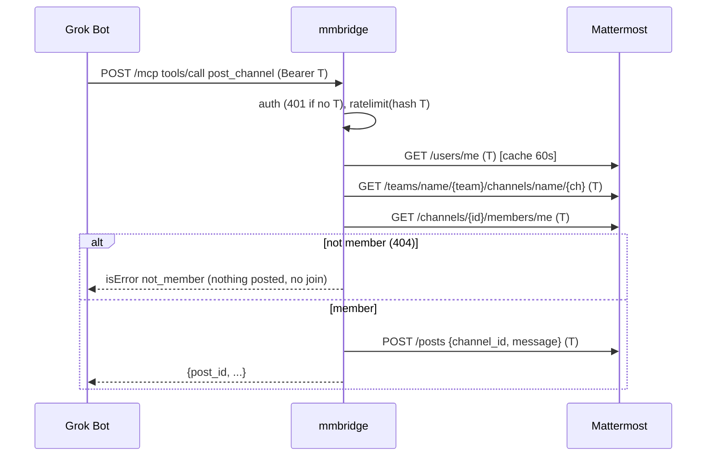

# Architecture: mmbridge MCP
Implements REQ-1..8 of [the design](../design/2026-10-25-mmbridge-mcp.md). Triage: medium. Grounded in [research](../../thoughts/shared/research/2026-10-25-mmbridge-current-code.md).

## Components and boundaries
| Component | Module | Responsibility |
|---|---|---|
| HTTP app | `app/main.py` | FastAPI; `/health` (public); mounts `/mcp`; everything else 404 (echo route removed) |
| Auth middleware | `app/auth.py` | Extract `Authorization: Bearer`; 401 if missing; put token in request context; never log/echo it |
| Rate limiter | `app/ratelimit.py` | In-memory token buckets keyed by SHA-256(token) / client IP (ADR-0004) |
| MCP server | `app/mcp.py` | Official `mcp` SDK, Streamable HTTP, stateless; 5 tools (ADR-0003) |
| Service layer | `app/service.py` | REQ logic: resolve team/channel/user, membership check, map errors to codes |
| Mattermost client | `app/mattermost.py` | `httpx.AsyncClient` to `MATTERMOST_URL/api/v4`, per-request bearer (ADR-0002) |
| Logging | `app/logging.py` | JSON logs + redaction filter (ADR-0005) |

Boundary: Internet → Coolify proxy (TLS, chats.rmlab.cloud) → container :8080 → private stack network → `mattermost:8065`. The bridge owns no data and no secrets.

```
Grok Bot (per-bot MCP connector, header Authorization: Bearer <bot token>)
   │ HTTPS
Coolify proxy ── mmbridge :8080 [auth → ratelimit → MCP tool → service → MM client] ──HTTP──▶ mattermost:8065 /api/v4
```

## Contracts / interfaces
Transport: MCP Streamable HTTP, `POST https://chats.rmlab.cloud/mcp`, stateless, JSON responses. Every request needs `Authorization: Bearer <token>`; else HTTP 401 `{"error":"unauthorized"}` (no `WWW-Authenticate` realm details, no echo).

| Tool | Args | Result | REQ |
|---|---|---|---|
| `list_channels` | – | `{channels:[{team, name, display_name, type}]}` (O/P channels the bot is a member of, all its teams) | 2 |
| `post_channel` | `team:str, channel:str, message:str (1..16383)` | `{post_id, channel, team, create_at}` | 3, 7 |
| `read_channel` | `team, channel, limit:int=20 (1..100)` | `{posts:[{id, author, create_at (ISO-8601 UTC), message}]}` newest first | 4, 7 |
| `dm_send` | `username, message` | `{post_id, channel_id, create_at}` | 5, 7 |
| `dm_read` | `username, limit=20 (1..100)` | same shape as `read_channel` | 6, 7 |

Error result (tool result with `isError: true`): `{"code": <code>, "message": <human text>}`. Codes: `unauthorized` (MM 401), `not_member`, `unknown_channel`, `unknown_user`, `invalid_argument`, `rate_limited` (+`retry_after_s`), `mattermost_unavailable` (connect error/timeout/5xx), `mattermost_error` (other 4xx, with MM status only). Messages never contain the token or raw MM response bodies.

## Data ownership and schemas
Mattermost owns all data. Bridge state is in-memory only: rate-limit buckets and a 60 s `users/me` cache, both keyed by SHA-256(token). No database, no persisted secrets. Config via env: `MATTERMOST_URL` (default `http://mattermost:8065`), `RL_CALLS_PER_MIN`=60, `RL_WRITES_PER_MIN`=20, `RL_ANON_PER_MIN`=30, `LOG_LEVEL`.

## Sequence (post_channel)

DM: `GET /users/username/{u}` → `POST /channels/direct [me, u.id]` (idempotent; opens or returns existing) → `POST /posts` or `GET /channels/{id}/posts?per_page=limit`. Read: `GET /channels/{id}/posts?page=0&per_page=limit`, order by `order[]`, author names via `POST /users/ids`.

## Failure modes and error handling
| Error | Trigger | Handler | User-visible result | Test |
|---|---|---|---|---|
| No credential | missing/malformed Authorization | auth middleware | HTTP 401, no MM call | REQ-1 ex2 (stub asserts 0 MM calls) |
| Invalid credential | MM 401 on `users/me` | service | `unauthorized` | stub 401 |
| Unknown channel/team | MM 404 on by-name lookup (or not visible to bot) | service | `unknown_channel` | REQ-7 |
| Not a member | `members/me` 404/403 | service, before any write | `not_member`; no join, no post | REQ-7 ex1 (assert no POST /posts) |
| Unknown user | `users/username` 404 | service | `unknown_user` | REQ-7 ex2 |
| Bad args | limit out of range, empty/oversize message | tool schema/validator | `invalid_argument` | unit |
| Rate limited | bucket empty | ratelimit | `rate_limited` + `retry_after_s` | unit |
| MM down | connect error / timeout / 5xx | client | `mattermost_unavailable`, token absent | REQ-8 ex1 (assert token not in result/logs) |
| MM other 4xx | e.g. 403 permission | client | `mattermost_error` with status | stub 403 |
| Unexpected exception | bug | top-level handler | generic `internal_error`, redacted log with request id | unit |

## Rollback, partial deploy, feature flags
Single container on Coolify built from `main`. Rollback = redeploy previous commit/image in Coolify. No data migrations, so rollback is always safe. No feature flags; unfinished tools are simply not registered. Slice 1 ships auth + echo removal + `list_channels`, so the token-echo hole closes in the first deploy.

## Observability
JSON log line per tool call (request id, tool, bot username, token-hash prefix, outcome code, MM status, latency) — ADR-0005. No headers/tokens/bodies logged; redaction filter as backstop. `/health` public liveness only, unchanged (`{"ok": true}`), used by Docker/Coolify healthcheck.

## Security (STRIDE quick pass)
- **Spoofing:** identity = Mattermost token validated by MM itself; bridge cannot act without caller's token (ADR-0001).
- **Tampering:** TLS at Coolify; container not host-published (`expose` only).
- **Repudiation:** posts authored by bot identity in MM; bridge logs bot username + request id.
- **Information disclosure:** remove echo route (currently leaks Authorization, `app/main.py:25`); never echo/log tokens; errors don't forward raw MM bodies.
- **Denial of service:** per-token and per-IP rate limits (ADR-0004); 10 s MM timeout; MCP body size capped (message ≤16383 chars).
- **Elevation of privilege:** no shared admin token; bot can do only what its MM bot account can; explicit no-join on non-member (REQ-7).

## Owner legibility (standing question)
n/a — no UI. The bridge has no frontend; Rob judges it through Mattermost (posts appear under bot names) and the acceptance examples.

## ADRs (accepted at CP-B 2026-10-25)
- [ADR-0001](../decisions/0001-credential-handoff-bearer-per-call.md) credential handoff
- [ADR-0002](../decisions/0002-mattermost-http-client.md) Mattermost client
- [ADR-0003](../decisions/0003-mcp-surface-streamable-http.md) MCP surface
- [ADR-0004](../decisions/0004-per-token-in-memory-rate-limit.md) rate limiting
- [ADR-0005](../decisions/0005-structured-logs-public-health.md) observability
Acceptance-test ADR (large-only) and Codex cross-model gate: skipped (triage medium).
