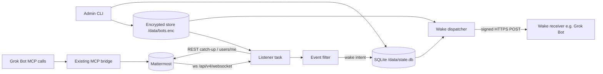
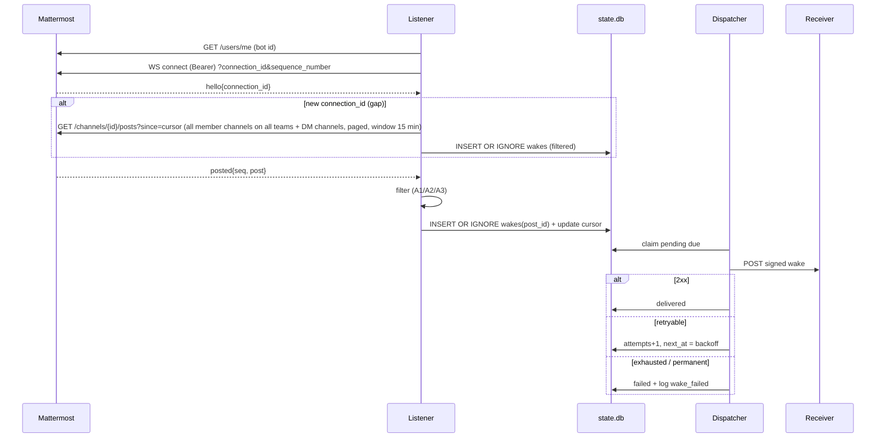

# Architecture: Live bots one-bot v1
Implements REQ-A1, A2, A3 (own-post only), A4, A7, A8 of [the design](../design/2026-10-26-live-bots.md) (scope REDUCE, one bot, hand-set channel list). Grounded in [research](../../thoughts/shared/research/2026-10-26-live-bots-current-code.md) (CP-R accepted). Triage: large. Out of scope here: A5/A5b/A5c, A6, bot-to-bot caps, threads-as-feature, reactions, files, Grok Bot-specific receive.

## Components and boundaries
| Component | Module (new unless noted) | Responsibility |
|---|---|---|
| MCP bridge (existing, unchanged) | app/main.py, app/mcp.py, app/service.py | per-call Bearer MCP tools (ADR-0001 still governs this path) |
| Token/bot store | app/store.py | encrypted file holding the ONE bot config: token, wake URL, wake secret (ADR-0006; channel ids dropped 2026-10-27, membership is the filter) |
| Admin CLI | app/admin.py (`python -m app.admin`) | operator sets/rotates bot config, lists failed wakes; run via Coolify terminal (no HTTP admin endpoint in v1) |
| Listener | app/listener.py | one asyncio task started in FastAPI lifespan; Mattermost websocket, auth, seq tracking, reconnect, REST catch-up (ADR-0007) |
| Event filter | app/live_filter.py | pure function: posted event -> wake or drop (A1/A2/A3) |
| State DB | app/state.py | SQLite on persistent volume: dedupe ledger, wake queue, per-channel cursor (ADR-0009) |
| Wake dispatcher | app/wake.py | signed HTTPS POST, retry/backoff, failure record (ADR-0008) |
| Mattermost REST client (existing) | app/mattermost.py | reused by listener for users/me, channel lookups, catch-up |

Boundaries: Mattermost (websocket + REST, same stack network), wake receiver (any HTTPS endpoint; Grok Bot-specific receive deferred), persistent volume `/data`, env secret `MMB_STORE_KEY`.



## Contracts / interfaces
### Bot config (decrypted in memory only)
```json
{"version":1,"bot":{"token":"<mm bot token>","wake_url":"https://...","wake_secret":"<32+ random bytes b64>"}}
```
No channel list (amended 2026-10-27, delta no-allowlist): the bot's Mattermost memberships decide which channels can wake it; Rob adds/removes the bot in Mattermost. A legacy `channels` key in an existing store is accepted and ignored. Nothing ever joins a channel (REQ-7 unamended).

### Admin CLI
- `python -m app.admin set-bot --token-stdin --wake-url URL` (no `--channels`; passing it -> `invalid_argument: channels no longer used`) (wake secret generated and printed once, or `--wake-secret-stdin`)
- `python -m app.admin show` (token masked to last 4 chars, secret never shown)
- `python -m app.admin failed [--retry POST_ID]` list/requeue failed wakes; `python -m app.admin stats` latency p95 and counts
- Listener re-reads the store when its mtime changes (checked every 30 s); no redeploy needed to change token/URL/secret.

### Mattermost websocket (OQ1; sources: docs.mattermost.com/api/reference/mattermost-api "WebSocket" section, mattermost/mattermost webapp/platform/client/src/websocket.ts, mattermost-webapp PR #7921 "Reliable Websockets", issue mattermost/mattermost#30388; read 2026-10-26)
- Connect `ws://mattermost:8065/api/v4/websocket` with `Authorization: Bearer <token>` header (documented standard auth; the `authentication_challenge` action `{"seq":1,"action":"authentication_challenge","data":{"token":..}}` -> `{"status":"OK","seq_reply":1}` is the fallback).
- First event `hello` with `data.connection_id`; events carry an increasing `seq` starting at 0; replies to client actions carry `seq_reply` instead and are not part of the event sequence.
- Reconnect with query `?connection_id=<id>&sequence_number=<next seq>`: same `connection_id` in the new hello => server resumes from that seq; different id (long timeout, server restart, seq not found) => events lost, run REST catch-up and reset expected seq to 0 (the #30388 reconnect-loop bug comes from not resetting).
- Event of interest: `posted`; `data.post` is a JSON string (id, user_id, channel_id, root_id, type, message, create_at); `data.channel_type` (`D` DM, `O`/`P` channel, `G` group). Other events ignored in v1.
- To verify against Rob's Mattermost version in the first slice (spike), owner: implementer.

### Filter rules (REQ-A1/A2/A3)
Drop when: `post.user_id == bot.user_id` (A3); `post.type` non-empty (system messages); `channel_type == G` (group DMs out of v1). Wake when: `channel_type == D` (A2; the bot only receives its own DMs) or `channel_type in O,P` (A1: the websocket only delivers posts from channels the bot is a member of, so membership is the filter; amended 2026-10-27). `@channel`/`@here`/`@all` posts and thread replies (root_id set, incl. threads the bot posted in) wake like any post, with `root_id` in the payload.

### Wake HTTP contract (ADR-0008, generic; OQ3)
`POST <wake_url>`, `Content-Type: application/json`, timeout 5 s, headers:
- `X-MMB-Delivery: <post_id>` (idempotency key; receiver should drop repeats)
- `X-MMB-Timestamp: <unix seconds>`
- `X-MMB-Signature: v1=<hex HMAC-SHA256(wake_secret, timestamp + "." + raw_body)>`
```json
{"version":1,"kind":"post","delivery_id":"<post_id>","attempt":1,
 "bot":{"user_id":"..","username":"eddie"},
 "channel":{"id":"..","name":"town-square","display_name":"Town Square","type":"O|P|D","team":"main"},
 "sender":{"user_id":"..","username":"rob"},
 "post":{"id":"..","message":"..","create_at":"2026-10-26T12:00:00Z","root_id":null}}
```
Receiver verification: recompute HMAC with constant-time compare, reject if `|now - ts| > 300 s`, reject unknown version. Response: 2xx delivered; 408/429/5xx/timeout/connect error retry; other 4xx permanent failure (no retry). Payload never contains the token (REQ-A7).

## Data ownership and schemas
- `/data/bots.enc`: owned by store module, Fernet ciphertext of the bot config JSON, file mode 0600, uid 10001. Key: env `MMB_STORE_KEY` (Coolify secret). ADR-0006.
- `/data/state.db` (SQLite, WAL), owned by state module, ADR-0009:
  - `wakes(post_id TEXT PK, channel_id, payload_json, status TEXT CHECK(status IN ('pending','delivered','failed')), attempts INT, next_at INT, last_error TEXT, created_at INT, updated_at INT)`; no tokens/secrets stored; message text is stored (needed for retry) and pruned 7 days after terminal state.
  - `cursors(channel_id TEXT PK, last_create_at INT)` - highest create_at seen per member channel (all teams) and DM channel; used for catch-up.
  - `meta(key PK, value)` - ws connection_id, last seq, single-listener lease.
- Dedupe: `INSERT OR IGNORE` on `wakes.post_id` is the single at-most-once gate for both websocket and catch-up paths.

## Sequence

Catch-up window default 15 min (`LIVE_CATCHUP_MINUTES`, design Q6 note: default proposed here, final in plan); posts older than the window during an outage are logged as `catchup_skipped` count, not woken. Catch-up channel discovery (amended 2026-10-27, delta finding F4):
- Membership set = `GET /users/me/teams` (all teams, paged `page`/`per_page=200` until a short page), then per team `GET /users/me/teams/{team_id}/channels` (O/P and D/G the bot belongs to); G dropped by the filter, D/O/P kept. Union with any channel id seen on the socket since start. Deduped by channel id.
- Refresh: at listener start, before every catch-up, and every `LIVE_MEMBERSHIP_REFRESH_S` (default 300 s); websocket `user_added`/`added_to_team` for the bot triggers an immediate refresh, `user_removed` drops the channel and its cursor.
- Posts per channel: `GET /channels/{id}/posts?since=<cursor>`; if the server caps the result, page with `page`/`per_page=200` ordered by `(create_at, id)`; cursor written atomically after each fully enqueued page (PR-3).
- Cursor for a channel seen for the first time: the listener's last-alive time (meta `last_event_at`, written with every event), bounded by the catch-up window, so posts made during an outage in a channel joined or discovered during that outage are still caught. First start ever (no `last_event_at`): cursors initialised to now (no backfill of history).
- 403/404 on a channel: skip, log `channel_unavailable`, drop it from the set until the next refresh.

## Failure modes and error handling
| Error | Trigger | Handler | User-visible result | Test |
|---|---|---|---|---|
| Store key missing/wrong | `MMB_STORE_KEY` unset or decrypt fails | listener not started; MCP tools unaffected | `/health` `listener:"off"`, log `store_unreadable` (no key material) | unit: bad key |
| No volume / not writable | `/data` absent or read-only | listener not started | `/health` `listener:"off"`, log `state_unwritable` | unit: ro dir |
| Flag off | `LIVE_BOTS_ENABLED` not true | listener not started | `listener:"disabled"` | unit |
| Bot token invalid | users/me or WS 401 | stop, retry every 5 min (store may be fixed) | log `mm_unauthorized`, health `degraded` | acceptance: fake 401 |
| WS drop / MM restart | close, or no frame 60 s (ping 30 s) | reconnect, backoff 1->60 s jitter | none if gap healed; log `ws_reconnect` | acceptance REQ-A4 |
| Seq gap / new connection_id | hello id changed or seq jump | REST catch-up within window, dedupe via ledger | exactly one wake per post | acceptance REQ-A4 |
| Outage > window | gap longer than catch-up window | skip older posts | log `catchup_skipped n=` | unit |
| Malformed event | JSON/field errors | drop event, continue | log `event_invalid` | unit |
| Channel unavailable | catch-up 403 / bot removed | skip channel, keep listening | log `channel_unavailable` | unit |
| Wake retryable failure | 5xx/408/429/timeout | backoff 2,4,8,16,32 s (5 attempts, `WAKE_MAX_ATTEMPTS`) | after exhaustion `failed` row + log `wake_failed` + `admin failed` | acceptance REQ-A8 |
| Wake permanent failure | other 4xx (e.g. 401 bad signature) | mark failed immediately | same | unit |
| Crash after 2xx before mark | process killed mid-delivery | pending re-sent on restart with same `X-MMB-Delivery` | receiver dedupes; residual duplicate risk documented | unit |
| Listener task crash | unexpected exception | caught, logged `listener_error`, task restarted with backoff | health `degraded` | unit |
| Restart | deploy/restart | pending rows resumed, cursors used for catch-up | none | acceptance |

No silent failures: every drop/skip path logs a structured event with a reason code.

## Rollback, partial deploy, feature flags
- `LIVE_BOTS_ENABLED` (default false). Deploy with flag off first: MCP bridge behaviour unchanged (existing specs stay green). Turn on after store + volume set up.
- Rollback: flag off (env change + restart) or redeploy previous image; `/data` files are ignored by older images. Delete `/data/bots.enc` to destroy the stored token.
- Single process only: uvicorn runs without `--workers` (Dockerfile:19); Coolify replicas must stay 1. Defence in depth: SQLite lease row in `meta` (owner + heartbeat 30 s, `BEGIN IMMEDIATE`); a second listener that cannot take the lease stays idle and logs `listener_lease_held`.

## Observability
- Structured JSON logs (ADR-0005 style; Redact filter applies): `listener_start/stop`, `ws_connected` (connection_id), `ws_reconnect` (attempt, delay), `catchup` (channels, posts, skipped), `event_dropped` (reason), `wake_enqueued`, `wake_delivered` (post_id, attempt, latency_ms from create_at), `wake_retry`, `wake_failed` (status, error class), `store_updated` (fields, never values). Never token, secret, signature or message body.
- `/health` adds `listener: disabled|off|connecting|ok|degraded` and `wake_failed_24h: <int>` - no ids or names (public endpoint, ADR-0005).
- Metric support (design: wake within 10 s for >=95% over 7 days, 0 dupes, 0 loops): `wake_delivered.latency_ms` in logs; `admin stats` prints p95 and counts from state.db.

## Security (STRIDE quick pass)
This is the security review required by Q7 (stored tokens revise ADR-0001).
| Threat | Vector | Mitigation |
|---|---|---|
| Spoofing | forged wake to receiver | HMAC-SHA256 over ts+body, 300 s window, per-bot secret (ADR-0008) |
| Spoofing | fake Mattermost on network | MM reached over internal stack network only (as today); `MATTERMOST_URL` operator-set |
| Tampering | edit store/state on volume | Fernet authenticated encryption (tamper -> decrypt fails, listener off); state.db holds no secrets; volume mounted only to this container |
| Repudiation | who changed bot config | admin CLI logs `store_updated` (fields changed, never values) |
| Info disclosure | token in logs/output/payload | token only in decrypted memory + MM Authorization header; Redact filter; `show` masks; payload has no token (tested, REQ-A7) |
| Info disclosure | volume/backup leak | ciphertext only; key in Coolify env, not on volume; message text in state.db is residual risk (pruned 7 d) - for Rob at CP-B |
| Info disclosure | key + volume both leaked (Coolify host compromise) | out of scope: host compromise also exposes Mattermost; rotate bot token + key via CLI |
| DoS | wake receiver slow | 5 s timeout, bounded attempts, queue in SQLite, dispatcher concurrency 4 |
| DoS | reconnect storm | capped exponential backoff with jitter |
| Elevation | admin surface | no HTTP admin endpoint; CLI needs container shell (Coolify access) |
| Elevation | listener joins channels | never: no join calls (REQ-7 unamended) |
| Loops | bot wakes itself | own-post filter A3; bot-to-bot needs A6 (deferred) |

## Owner legibility (standing question)
n.a. - no UI in this increment (backend listener, CLI, webhook). Owner-judgeable evidence instead: acceptance specs in domain language (ADR-0010), a CP-S demo script (post in Town Square -> receiver log shows one signed wake), and `admin stats`.

## Research open questions
| OQ | Resolution |
|---|---|
| OQ1 MM websocket events/auth/seq | Resolved in Contracts above from external docs (provenance listed there); verify against Rob's MM version in slice 1. Owner: implementer. |
| OQ2 Coolify volume | Required deploy prerequisite (see below): persistent volume at `/data`, writable by uid 10001, replicas=1. Coolify setup owned by Rob; open deploy prerequisite for CP-B, not a design blocker. |
| OQ3 Grok Bot webhook verify | Generic signed contract (ADR-0008). Grok Bot-specific receive still deferred; if Grok Bot cannot verify HMAC, a relay/Grok-specific follow-up goes to TODOS. Owner: Rob/Eddie after v1. |
| OQ4 WS client lib | `websockets` only transitive via `uvicorn[standard]` (uvicorn 0.34.0 METADATA: `websockets>=10.4; extra == 'standard'`); ADR-0007 pins it explicitly. Encryption adds pinned `cryptography` (ADR-0006). |

## Deploy prerequisites (Rob, Coolify)
1. Persistent volume -> `/data` (writable by uid 10001).
2. Env secret `MMB_STORE_KEY` (Fernet key; generate with `python -c "from cryptography.fernet import Fernet;print(Fernet.generate_key().decode())"`).
3. Container terminal: `python -m app.admin set-bot ...` with bot token and wake URL (no channels; add the bot to channels in Mattermost).
4. Then env `LIVE_BOTS_ENABLED=true`.
5. Replicas stay 1.

## ADRs
- [ADR-0006 Encrypted token store](../decisions/0006-encrypted-token-store.md) (partially supersedes ADR-0001 for the listener)
- [ADR-0007 Mattermost websocket listener](../decisions/0007-mattermost-websocket-listener.md)
- [ADR-0008 Signed wake webhook](../decisions/0008-signed-wake-webhook.md)
- [ADR-0009 Listener state persistence](../decisions/0009-listener-state-persistence.md)
- [ADR-0010 Acceptance tests for Live bots](../decisions/0010-acceptance-tests-live-bots.md)
- Advisory cross-model review: [findings](../../thoughts/shared/verification/2026-10-26-live-bots-arch-review.md) (awaiting Codex run by Rob)
