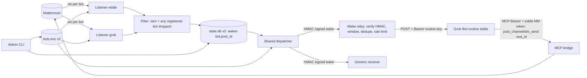
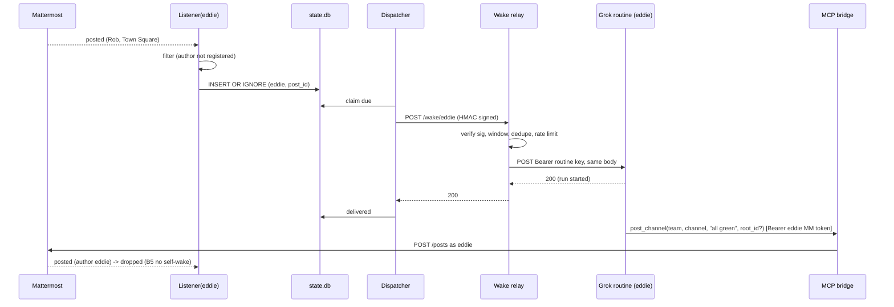

# Architecture: Grok Bot webhook wake, round-trip reply and multi-bot (increment B)
Implements REQ-B1..B8 of [design B](../design/2026-10-28-grok-webhook-multibot.md) (scope HOLD). Grounded in [research B](../../thoughts/shared/research/2026-10-28-grok-webhook-multibot-current-code.md) (CP-R accepted 2026-10-28). Triage: large. Builds on [architecture A](2026-10-26-live-bots.md) and ADR-0006..0010, which stay in force except where an ADR below amends them. Out of scope: web admin UI, bot-to-bot wakes and loop caps, channel ignore-list, auto-accept invites, moving the relay onto the Grok Bot computer (future only).

**Revision 2026-10-28 (Rob decision on authenticity).** mmbridge keeps sending only HMAC-signed wakes (ADR-0008). A thin **wake relay** deployed beside mmbridge (Coolify on the same VPS) verifies the HMAC wake and forwards it to the Grok Bot routine with the routine's Bearer key (ADR-0011, rewritten). mmbridge never holds a Bearer routine key. `claim_wake` is dropped for this increment (ADR-0012 rejected). The residual risk of the Bearer key living on the relay is accepted (low probability; relay rate limit + tripwire).

Slice order (Rob, option C): **B-s1** relay + Grok Bot wake for one bot (B1-B4) -> **B-s2** round-trip reply + wake authenticity at the relay (B2, B5) -> **B-s3** multi-bot registry and routing (B6-B8). One version.

## Components and boundaries
| Component | Module | Change |
|---|---|---|
| Bot store | app/store.py | v2 document: named bots map; per-bot signed wake target `{url, secret}` (ADR-0013); v1 read and migrated |
| Admin CLI | app/admin.py | `set-bot --name`, `--wake-secret-stdin`; new `list`, `remove-bot`, `status`; `failed`/`stats` gain `--bot` (ADR-0013) |
| Wake dispatcher | app/wake.py | one shared dispatcher; per-row bot config lookup; **signed only** (ADR-0008 headers); payload v2 fields added inside the signed body |
| Listener | app/listener.py | one Listener per registered bot (own websocket, own token, own membership); filter also drops posts by ANY registered bot (ADR-0014) |
| Event filter | app/live_filter.py | `decide(event, bot_user_id, registered_ids)` (B7) |
| Runtime | app/live.py | BotSupervisor: starts/stops a Listener per bot on store reload; per-bot status map (B8) |
| State DB | app/state.py | schema v2: wakes keyed `(bot, post_id)`, cursors `(bot, channel_id)`, per-bot meta keys (ADR-0014) |
| MCP bridge | app/mcp.py, app/service.py | `post_channel`/`dm_send` gain optional `root_id` (ADR-0015). No new tool |
| **Wake relay (new, separate deploy)** | `relay/` (own small container, Coolify, same VPS) | verifies ADR-0008 HMAC + timestamp window + delivery-id dedupe; maps bot name -> Grok routine URL + Bearer key; forwards; rate limit + tripwire (ADR-0011) |
| Grok Bot routine (external) | per-bot routine on Grok Bot | receives the wake from the relay, replies with `post_channel`/`dm_send` via the bridge using its own Mattermost token |

External boundaries: Mattermost (ws + REST), the relay's public HTTPS endpoint, Grok Bot routine webhook URLs (HTTPS, per bot, called only by the relay), existing generic signed receivers, `/data` volume, `MMB_STORE_KEY`, relay env secrets.



## Contracts / interfaces
### Bot store v2 (decrypted in memory only; ADR-0013)
```json
{"version":2,"bots":{
  "eddie":{"token":"<mm token>","user_id":"..","wake":{"url":"https://relay.<host>/wake/eddie","secret":"<>=32 chars>"}},
  "test": {"token":"<mm token>","user_id":"..","wake":{"url":"https://recv/wake","secret":"<>=32 chars>"}}}}
```
- Name: `^[a-z0-9][a-z0-9-]{0,31}$`, operator-chosen, stable key for state rows and logs. Token must be unique across bots (same MM user twice is rejected).
- Wake is always signed: `url` https, `secret` >= 32 chars (ADR-0008). Per-bot secret, so the relay can tell bots apart and one leaked secret does not cover the others.
- v1 document `{"version":1,"bot":{...}}` loads as `{"bots":{"<mm username or 'bot'>": {token, wake:{url, secret}}}}`; the first `save` writes v2 and keeps `bots.enc.v1.bak` (0600) for rollback.
- All tokens and secrets are registered with the redact filter on load/save (as today).

### Admin CLI
- `set-bot --name NAME --token-stdin --wake-url URL --wake-secret-stdin`. Creates or replaces that one bot; other bots untouched. Token validated with `/users/me` as today.
- `list` -> one line per bot: name, MM username, token last 4, wake URL host, "secret set (hidden)". `show NAME` same detail for one.
- `remove-bot NAME` -> deletes the bot; its pending wakes are marked `failed` with `bot_removed`.
- `status` -> per bot: listener state (`off|connecting|ok|degraded`), last event age, last wake result, failed_24h.
- `failed [--bot NAME] [--retry BOT:POST_ID]`, `stats [--bot NAME]`.
- Live reload unchanged: ConfigHolder polls `bots.enc` every 30 s; changes apply without redeploy (B4).

### Signed wake from mmbridge (ADR-0008 unchanged on the wire)
Headers exactly as ADR-0008 (`X-MMB-Timestamp`, `X-MMB-Signature` HMAC-SHA256 over `timestamp.body`, `X-MMB-Delivery`). Body adds `version: 2` fields:
```json
{"version":2,"kind":"post","delivery_id":"eddie:<post_id>","attempt":1,"issued_at":"2026-10-28T19:00:00Z",
 "bot":{"name":"eddie","user_id":"..","username":"eddie"},
 "channel":{"id":"..","name":"town-square","display_name":"Town Square","type":"O|P|D","team":"main"},
 "sender":{"user_id":"..","username":"rob"},
 "post":{"id":"..","message":"..","create_at":"..","root_id":null},
 "reply":{"tool":"post_channel","team":"main","channel":"town-square","root_id":"<post.root_id or null>"}}
```
- `reply.tool` is `dm_send` with `username` = sender for `type D`. `reply.root_id` = post `root_id` when set (B5 thread); top-level channel post -> `null` (answer at top level); DMs `null`.
- Generic signed receivers ignore unknown fields (B4 "keeps working"); a receiver that needs strict v1 is out of scope.
- Response mapping in mmbridge unchanged from ADR-0008: 2xx delivered; 408/429/5xx/timeout = retry (2,4,8,16,32 s); other 4xx permanent `failed http_<code>`.

### Wake relay (ADR-0011)
- `POST /wake/<bot>`: verify HMAC with that bot's secret (constant-time), `|now - X-MMB-Timestamp| <= 300 s`, and `X-MMB-Delivery` not seen in the last 24 h (small sqlite or file-backed set on the relay volume). Failure -> `401` (bad sig/stale) or `200 {"status":"duplicate"}` (already forwarded; idempotent so mmbridge retries after a lost response do not re-wake).
- Forward: `POST <routine url>` with `Content-Type: application/json`, `Authorization: Bearer <routine key>`, `X-MMB-Delivery`, body = verified body unchanged; timeout 5 s. Map upstream: 2xx -> `200`; 408/429/5xx/timeout -> `503` (mmbridge retries, relay does not record delivery as seen until upstream 2xx); 401/403/404/other 4xx -> `424 {"upstream":<code>}` (permanent 4xx to mmbridge, logged `upstream_http_<code>`, tripwire on 401/403).
- Config (env / Coolify secrets, never in repo): per bot `RELAY_BOT_<NAME>_HMAC_SECRET`, `..._ROUTINE_URL`, `..._ROUTINE_KEY`. Bearer key and secrets redacted in logs.
- Rate limit: per bot forward cap (default 30/min, burst 10); excess -> `429` (mmbridge retries with backoff).
- Tripwire: log + alert (Mattermost post to an ops channel via a dedicated token, or Coolify notification) when: HMAC failures > 5 in 10 min, rate limit hit, upstream 401/403 (key rotated/revoked), or daily forwarded count deviates from mmbridge `stats` delivered count. Operator response: rotate the routine key.
- `GET /health`: public, counts only.
- Stateless apart from the dedupe set; no Mattermost token, no store key.

### MCP reply tools (ADR-0015)
`post_channel(team, channel, message, root_id=None)`, `dm_send(username, message, root_id=None)`; `root_id` validated as a 26-char Mattermost id, passed as `root_id` on `POST /posts`. Mattermost errors map as today (`not_member`, `unknown_user`, plus `invalid_root` for 400/404 on root).

### Filter (B6, B7; ADR-0014)
`decide(event, bot_user_id, registered_ids)`: drop if `post.user_id in registered_ids` (covers own posts and bot-to-bot), drop system posts and `G` as today; otherwise wake for this listener's bot. `registered_ids` = set of `/users/me` ids of all bots in the store (cached non-secret `user_id` in v2), refreshed on reload.

## Data ownership and schemas (state.db v2; ADR-0014)
- `wakes(bot TEXT, post_id TEXT, channel_id, payload_json, status CHECK IN ('pending','in_flight','delivered','failed'), attempts, next_at, last_error, created_at, updated_at, PRIMARY KEY(bot, post_id))`. `INSERT OR IGNORE` on `(bot, post_id)` is the at-most-once gate per bot (B3, B6).
- `cursors(bot, channel_id, last_create_at, PK(bot, channel_id))`.
- `meta(key PK, value)`: per-bot keys `bot:<name>:identity|user_id|last_event_at|ws_connection_id`; single `dispatcher_owner` lease; listener lease per bot `listener_owner:<name>`.
- Migration (`PRAGMA user_version` 1 -> 2) in one transaction at startup; backup `state.db.v1.bak` first. Idempotent.
- Relay owns only its dedupe set (`delivery_id`, `seen_at`), pruned after 24 h.

## Sequence (round trip via relay)


## Failure modes
| Trigger | Handler | User/operator-visible result | Test |
|---|---|---|---|
| Grok routine 5xx/429/timeout | relay 503 -> mmbridge retry backoff, 5 attempts | wake arrives once on recovery; else one `failed` row, `wake_failed` log with bot name | spec B3, relay unit upstream_retry |
| Grok routine 401/403/404 | relay 424 -> mmbridge permanent fail; relay tripwire | `admin status` shows `wake: failing (http_424)`; relay alert `upstream_http_401` | relay unit upstream_permanent |
| Relay down | mmbridge retry/fail as any signed receiver | `failed` rows, `/health bots_failing` | spec B3 relay_down |
| Forged POST to relay | HMAC fails -> 401, counted; tripwire after threshold | bot not woken | spec B2 forged |
| Replay of captured signed wake | stale timestamp -> 401, or seen delivery -> 200 duplicate, not forwarded | bot not woken twice | spec B2 replay |
| Tampered body | HMAC fails -> 401 | bot not woken | spec B2 tampered |
| Routine Bearer key leaked from relay host | outside mmbridge defence: attacker can call routine directly. Accepted risk (ADR-0011): key only in relay secrets, rotate on tripwire | possible spurious bot run until rotation | n.a. (runbook) |
| Relay flood / runaway | relay per-bot rate limit -> 429 | mmbridge backs off; tripwire alert | relay unit rate_limit |
| One bot token revoked | that Listener `degraded`, retries `auth_retry_s`; others unaffected | `admin status`, log `mm_unauthorized bot=grok`, `/health` counts | spec B8 |
| One bot's wake target down | its rows retry/fail; per-bot cap 2 in flight so one dead target cannot starve others | other bots woken on time | spec B8, unit dispatcher fairness |
| Store reload fails (bad key/corrupt) | keep old config (`store_reload_failed`) | log + status | existing test |
| Bot removed with pending wakes | mark `failed bot_removed` | `admin failed` | unit |
| Bot-authored post (any registered) | filter drop | no wake | spec B7 |
| Reply with bad root_id | MM 400/404 -> `invalid_root` tool error | bot sees error, can retry top-level | unit service |
| state.db v1->v2 migration error | abort live runtime only (MCP path stays up), `live_migration_failed`, health `listener: degraded` | operator restores backup | unit state migrate |

No silent failures: every drop is either a filter rule (counted in `stats`) or logged (mmbridge or relay).

## Rollback, partial deploy, flags
- Flag `LIVE_BOTS_ENABLED` stays the kill switch (MCP path unaffected).
- Per-bot rollback: point a bot's `--wake-url` at another signed receiver or remove it (no redeploy, B4). Relay can be stopped independently; mmbridge just retries/fails those rows.
- Version rollback to v0.3.0: stop container, restore `bots.enc.v1.bak` and `state.db.v1.bak`, deploy v0.3.0. Relay unaffected (v1 signed wakes verify the same; extra fields absent).
- Slices deploy independently: B-s1 relay + one bot; B-s2 adds `root_id` (additive) and relay replay/rate-limit hardening; B-s3 enables >1 bot.

## Observability
- mmbridge logs (JSON, ADR-0005): all live events gain `bot=<name>`; new `bot_started`, `bot_stopped`, `live_migration_*`.
- Relay logs (JSON, same redaction rules): `relay_forwarded`, `relay_rejected{reason=bad_sig|stale|duplicate|rate_limited}`, `relay_upstream{code}`, `relay_tripwire{reason}`.
- `/health` mmbridge: keep `listener` (worst of all bots) and `wake_failed_24h`; add `bots_total`, `bots_failing` counts only. Relay `/health`: counts only.
- `admin status`/`stats --bot` for per-bot detail (B8).

## Security (STRIDE quick pass)
- **Spoofing:** to the relay - per-bot HMAC (ADR-0008); to the routine - Bearer key held only by the relay; to mmbridge MCP - existing per-call MM token (ADR-0001).
- **Tampering:** HMAC over timestamp+body; relay forwards the verified body byte-for-byte.
- **Repudiation:** delivery timestamps in state.db and relay logs per bot.
- **Information disclosure:** HMAC secrets/tokens encrypted at rest in mmbridge (ADR-0006); routine keys only in relay Coolify secrets; all redacted in logs, never in payload; message text pruned after 7 days (as today).
- **DoS:** mmbridge per-bot in-flight cap; relay per-bot rate limit.
- **Elevation:** a bot's token cannot reply as another bot (MM posts as token owner). Accepted residual: a leaked routine key lets someone wake that routine directly, bypassing HMAC (low probability; rate limit + tripwire + rotation runbook; ADR-0011).

## Standing UI question
No UI in this increment (CLI + MCP + relay env). Owner judges behaviour by: `admin list/status` output, relay health/logs, the CP-S demo script (post -> Eddie answers in Town Square/DM/thread; two bots routing; revoke one token; forged/replayed wake ignored), and acceptance specs written in domain language.

## Acceptance tests
ADR-0016: extends ADR-0010 with the real relay container plus a fake Grok routine driver (checks Bearer, records bodies, replies through the real MCP bridge) and multi-bot fake Mattermost users. No Playwright (no UI).

## ADRs
- [ADR-0011](../decisions/0011-hmac-to-bearer-wake-relay.md) HMAC->Bearer wake relay beside mmbridge (rewritten; replaces the earlier Bearer-in-mmbridge proposal; ADR-0008 kept unchanged)
- [ADR-0012](../decisions/0012-claim-wake-authenticity.md) `claim_wake` - **rejected** for increment B (authenticity handled by HMAC + relay)
- [ADR-0013](../decisions/0013-multi-bot-store-v2.md) Multi-bot encrypted store v2 and admin CLI (amends ADR-0006)
- [ADR-0014](../decisions/0014-multi-bot-runtime-state-v2.md) Per-bot listeners, shared dispatcher, state.db v2 (amends ADR-0007, ADR-0009)
- [ADR-0015](../decisions/0015-thread-replies-root-id.md) Thread replies via optional `root_id`
- [ADR-0016](../decisions/0016-acceptance-tests-increment-b.md) Acceptance tests for increment B

## Open questions
- OQ-B1: Grok routine non-200 codes undocumented; relay mapping above is a guess to verify in the B-s1 spike against a real routine (owner: implementer, at CP-S).
- OQ-B2: Does the Grok routine expose the JSON body to the bot verbatim? Verify in B-s1 spike (no claim fallback any more; if not verbatim, reply hints must survive in whatever the routine exposes).
- OQ-B3: Relay code location: `relay/` in this repo (shared HMAC verify code, one CI) vs separate repo. Default: `relay/` here, separate image and Coolify app.
- OQ-B4 (future, not this increment): move the relay onto the Grok Bot computer so the Bearer key never leaves Grok Bot's side.

## Cross-model review
Advisory: [thoughts/shared/verification/2026-10-28-grok-webhook-multibot-arch-review.md](../../thoughts/shared/verification/2026-10-28-grok-webhook-multibot-arch-review.md) (awaiting Codex; re-review needed after this revision).
