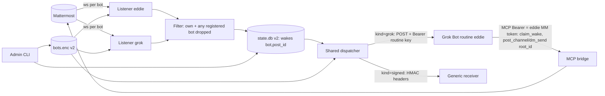
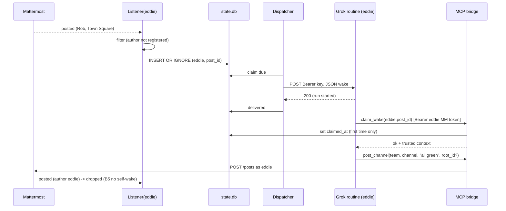

# Architecture: Grok Bot webhook wake, round-trip reply and multi-bot (increment B)
Implements REQ-B1..B8 of [design B](../design/2026-10-28-grok-webhook-multibot.md) (scope HOLD). Grounded in [research B](../../thoughts/shared/research/2026-10-28-grok-webhook-multibot-current-code.md) (CP-R accepted 2026-10-28). Triage: large. Builds on [architecture A](2026-10-26-live-bots.md) and ADR-0006..0010, which stay in force except where an ADR below amends them. Out of scope: web admin UI, bot-to-bot wakes and loop caps, channel ignore-list, auto-accept invites.

Slice order (Rob, option C): **B-s1** Grok Bot wake target for one bot (B1-B4) -> **B-s2** round-trip reply + wake authenticity (B2 claim, B5) -> **B-s3** multi-bot registry and routing (B6-B8). One version.

## Components and boundaries
| Component | Module | Change |
|---|---|---|
| Bot store | app/store.py | v2 document: named bots map; per-bot wake target with `kind` (ADR-0013); v1 read and migrated |
| Admin CLI | app/admin.py | `set-bot --name`, `--wake-kind grok|signed`, `--wake-key-stdin`; new `list`, `remove-bot`, `status`; `failed`/`stats` gain `--bot` (ADR-0013) |
| Wake dispatcher | app/wake.py | one shared dispatcher; per-row bot config lookup; sender strategy by kind: `signed` (ADR-0008, unchanged) or `grok` (Bearer routine key, ADR-0011) |
| Listener | app/listener.py | one Listener per registered bot (own websocket, own token, own membership); filter also drops posts by ANY registered bot (ADR-0014) |
| Event filter | app/live_filter.py | `decide(event, bot_user_id, registered_ids)` (B7) |
| Runtime | app/live.py | BotSupervisor: starts/stops a Listener per bot on store reload; per-bot status map (B8) |
| State DB | app/state.py | schema v2: wakes keyed `(bot, post_id)`, cursors `(bot, channel_id)`, per-bot meta keys, `claimed_at` column (ADR-0014, ADR-0012) |
| MCP bridge | app/mcp.py, app/service.py | `post_channel`/`dm_send` gain optional `root_id`; new tool `claim_wake(delivery_id)` (ADR-0012, ADR-0015) |
| Grok Bot routine (external) | per-bot routine on Grok Bot | receives the wake, calls `claim_wake`, replies with `post_channel`/`dm_send` via the bridge using its own Mattermost token |

External boundaries: Mattermost (ws + REST), Grok Bot routine webhook URLs (HTTPS, per bot), the existing generic signed receivers, `/data` volume, `MMB_STORE_KEY`.



## Contracts / interfaces
### Bot store v2 (decrypted in memory only; ADR-0013)
```json
{"version":2,"bots":{
  "eddie":{"token":"<mm token>","wake":{"kind":"grok","url":"https://<grok routine webhook>","key":"<routine bearer key>"}},
  "test": {"token":"<mm token>","wake":{"kind":"signed","url":"https://recv/wake","secret":"<>=32 chars>"}}}}
```
- Name: `^[a-z0-9][a-z0-9-]{0,31}$`, operator-chosen, stable key for state rows and logs. Token must be unique across bots (same MM user twice is rejected).
- `kind=grok`: `url` https, `key` non-empty (>= 16 chars). `kind=signed`: `url` https, `secret` >= 32 chars (ADR-0008).
- v1 document `{"version":1,"bot":{...}}` loads as `{"bots":{"<mm username or 'bot'>": {token, wake:{kind:"signed", url, secret}}}}`; the first `save` writes v2 and keeps `bots.enc.v1.bak` (0600) for rollback.
- All tokens, keys and secrets are registered with the redact filter on load/save (as today).

### Admin CLI
- `set-bot --name NAME --token-stdin --wake-url URL [--wake-kind grok|signed] [--wake-key-stdin | --wake-secret-stdin]`. Default kind `signed` (backward compatible). Grok: key read from stdin line 2 (required, never echoed). Creates or replaces that one bot; other bots untouched. Token validated with `/users/me` as today.
- `list` -> one line per bot: name, MM username, token last 4, wake kind, wake URL host, "key/secret set (hidden)". `show NAME` same detail for one.
- `remove-bot NAME` -> deletes the bot; its pending wakes are marked `failed` with `bot_removed`.
- `status` -> per bot: listener state (`off|connecting|ok|degraded`), last event age, last wake result, failed_24h.
- `failed [--bot NAME] [--retry BOT:POST_ID]`, `stats [--bot NAME]`.
- Live reload unchanged: ConfigHolder polls `bots.enc` every 30 s; changes apply without redeploy (B4).

### Grok Bot wake (kind=grok; ADR-0011; contract locked at CP-A)
`POST <routine url>`, headers `Content-Type: application/json`, `Authorization: Bearer <routine key>`, `X-MMB-Delivery: <delivery_id>`; timeout 5 s. Body = the existing v1 payload plus `version: 2` fields:
```json
{"version":2,"kind":"post","delivery_id":"eddie:<post_id>","attempt":1,"issued_at":"2026-10-28T19:00:00Z",
 "bot":{"name":"eddie","user_id":"..","username":"eddie"},
 "channel":{"id":"..","name":"town-square","display_name":"Town Square","type":"O|P|D","team":"main"},
 "sender":{"user_id":"..","username":"rob"},
 "post":{"id":"..","message":"..","create_at":"..","root_id":null},
 "reply":{"tool":"post_channel","team":"main","channel":"town-square","root_id":"<post.root_id or null>"},
 "instructions":"Call claim_wake(delivery_id) first; act only if it returns ok. Reply with reply.tool and reply.root_id."}
```
- `reply.tool` is `dm_send` with `username` = sender for `type D`. `reply.root_id` = post `root_id` when set (B5 thread); for a top-level channel post it is `null` (answer at top level, matching design example "appears in Town Square"); for DMs `null`.
- Response mapping (research open question: only 200 is documented): 2xx = delivered (= run started); 408/429/5xx/timeout/connect = retry (existing 2,4,8,16,32 s); 400/401/403/404/other 4xx = permanent `failed` with `last_error=http_<code>` (401/403 means wrong routine key: operator action, no retry storm). The Bearer key is never logged; `Authorization` is already redacted by pattern.
- Signed kind: unchanged ADR-0008 headers/body (payload `version` stays 1 for `signed` unless the receiver opts in; B4 "keeps working").

### claim_wake MCP tool (ADR-0012)
`claim_wake(delivery_id) -> {"status":"ok","bot":"eddie","channel":{...},"sender":{...},"post":{...},"reply":{...}}` or `{"status":"already_claimed"}` / `{"status":"unknown"}` / `{"status":"not_yours"}`. Caller is authenticated by its MM token (existing Bearer, ADR-0001); the row's bot token fingerprint must match the caller's. First successful call sets `claimed_at`; subsequent calls return `already_claimed`. Rows are claimable only while `delivered` and younger than `WAKE_CLAIM_TTL_S` (default 900 s). Returns the trusted post context from state.db, so a forged body cannot inject a fake message.

### MCP reply tools (ADR-0015)
`post_channel(team, channel, message, root_id=None)`, `dm_send(username, message, root_id=None)`; `root_id` validated as a 26-char Mattermost id, passed as `root_id` on `POST /posts`. Mattermost errors map as today (`not_member`, `unknown_user`, plus `invalid_root` for 400/404 on root).

### Filter (B6, B7; ADR-0014)
`decide(event, bot_user_id, registered_ids)`: drop if `post.user_id in registered_ids` (covers own posts and bot-to-bot), drop system posts and `G` as today; otherwise wake for this listener's bot. `registered_ids` = set of `/users/me` ids of all bots in the store, refreshed on reload; until a bot's id is known its token's id is resolved at load (CLI already calls `/users/me`; the store keeps `user_id` cached in v2 as non-secret field `user_id`).

## Data ownership and schemas (state.db v2; ADR-0014)
- `wakes(bot TEXT, post_id TEXT, channel_id, payload_json, status CHECK IN ('pending','in_flight','delivered','failed'), attempts, next_at, last_error, created_at, updated_at, claimed_at INT NULL, PRIMARY KEY(bot, post_id))`. `INSERT OR IGNORE` on `(bot, post_id)` is the at-most-once gate per bot (B3, B6: two bots in one channel each get exactly one wake).
- `cursors(bot, channel_id, last_create_at, PK(bot, channel_id))`.
- `meta(key PK, value)`: per-bot keys `bot:<name>:identity|user_id|last_event_at|ws_connection_id`; single `dispatcher_owner` lease; listener lease per bot `listener_owner:<name>`.
- Migration (`PRAGMA user_version` 1 -> 2) in one transaction at startup: copy rows with `bot = <migrated name>`, rename meta keys. Backup `state.db.v1.bak` first. Idempotent.

## Sequence (round trip, kind=grok)


## Failure modes
| Trigger | Handler | User/operator-visible result | Test |
|---|---|---|---|
| Grok webhook 5xx/429/timeout | retry backoff, 5 attempts | wake arrives once on recovery; else one `failed` row, `wake_failed` log with bot name | spec B3, unit wake grok_retry |
| Grok webhook 401/403/404 | permanent fail `http_401` | `admin status` shows bot `wake: failing (http_401)`; `/health` `bots_failing>=1` | unit wake grok_permanent |
| Forged POST to routine URL (attacker knows URL) | rejected by Grok (no key); if key leaked, `claim_wake` returns `unknown` | bot does nothing | spec B2 forged |
| Replay of captured wake | `claim_wake` returns `already_claimed` / expired | bot does nothing | spec B2 replay |
| Grok bot ignores claim instruction | out of mmbridge control; documented in OWNER-GUIDE routine prompt | risk accepted in ADR-0012 | n.a. (manual CP-S) |
| One bot token revoked | that Listener `degraded`, retries `auth_retry_s`; others unaffected (separate tasks under `supervise`) | `admin status` marks it, log `mm_unauthorized bot=grok`, `/health` counts | spec B8 |
| One bot's wake target down | its rows retry/fail; dispatcher claims per row, concurrency shared, per-bot cap 2 in flight so one dead target cannot starve others | other bots woken on time | spec B8, unit dispatcher fairness |
| Store reload fails (bad key/corrupt) | keep old config (`store_reload_failed`) | log + status | existing test |
| Bot removed with pending wakes | mark `failed bot_removed` | `admin failed` | unit |
| Bot-authored post (any registered) | filter drop | no wake | spec B7 |
| Reply with bad root_id | MM 400/404 -> `invalid_root` tool error | bot sees error, can retry top-level | unit service |
| state.db v1->v2 migration error | abort startup of live runtime only (MCP path stays up), `live_migration_failed` log, health `listener: degraded` | operator restores backup | unit state migrate |

No silent failures: every drop is either a filter rule (counted in `stats`) or logged.

## Rollback, partial deploy, flags
- Flag `LIVE_BOTS_ENABLED` stays the kill switch (MCP path unaffected).
- Per-bot rollback: switch a bot back to `--wake-kind signed` (no redeploy, B4).
- Version rollback to v0.3.0: stop container, restore `bots.enc.v1.bak` and `state.db.v1.bak`, deploy v0.3.0. Documented in README; backups written only on first migration.
- Slices deploy independently: B-s1 works with one bot on v2 store; B-s2 adds tools (additive); B-s3 enables >1 bot (CLI refuses a second bot until B-s3 code is present - naturally, since only B-s3 adds it).

## Observability
- Logs (JSON, ADR-0005): all live events gain `bot=<name>`; new `wake_claimed`, `wake_claim_rejected{reason}`, `bot_started`, `bot_stopped`, `live_migration_*`.
- `/health` (public, ADR-0005): keep `listener` (worst of all bots) and `wake_failed_24h`; add `bots_total`, `bots_failing` counts only (no names publicly).
- `admin status`/`stats --bot` for per-bot detail (B8 "operator sees which bot").
- Round-trip latency: `stats` adds p95 delivered->claimed.

## Security (STRIDE quick pass)
- **Spoofing:** to the routine - Bearer key per routine (Grok side); to the bot - `claim_wake` confirms the wake is genuine and fresh (ADR-0012). To mmbridge MCP - existing per-call MM token (ADR-0001).
- **Tampering:** body could be altered in transit only by breaking TLS; `claim_wake` returns trusted context from state.db, and the routine prompt says to act on that, not the body.
- **Repudiation:** delivery/claim timestamps in state.db per bot.
- **Information disclosure:** routine keys/secrets/tokens encrypted at rest (ADR-0006), redacted in logs, never in payload; message text in wakes table pruned after 7 days (as today); `claim_wake` returns a row only to the owning bot token.
- **DoS:** per-bot in-flight cap; existing rate limit on MCP (ADR-0004) covers `claim_wake`.
- **Elevation:** a bot's token cannot claim or reply as another bot (token fingerprint check; MM posts as token owner).

## Standing UI question
No UI in this increment (CLI + MCP only). Owner judges behaviour by: `admin list/status` output, the CP-S demo script (post -> Eddie answers in Town Square/DM/thread; two bots routing; revoke one token), and acceptance specs written in domain language.

## Acceptance tests
ADR-0016: extends ADR-0010 with a fake Grok routine driver (checks Bearer, records bodies, can call `claim_wake` and reply through the real MCP bridge) and multi-bot fake Mattermost users. No Playwright (no UI).

## ADRs
- [ADR-0011](../decisions/0011-grok-routine-wake-target.md) Grok Bot routine wake target kind (amends ADR-0008)
- [ADR-0012](../decisions/0012-claim-wake-authenticity.md) Wake authenticity and replay defence via `claim_wake`
- [ADR-0013](../decisions/0013-multi-bot-store-v2.md) Multi-bot encrypted store v2 and admin CLI (amends ADR-0006)
- [ADR-0014](../decisions/0014-multi-bot-runtime-state-v2.md) Per-bot listeners, shared dispatcher, state.db v2 (amends ADR-0007, ADR-0009)
- [ADR-0015](../decisions/0015-thread-replies-root-id.md) Thread replies via optional `root_id`
- [ADR-0016](../decisions/0016-acceptance-tests-increment-b.md) Acceptance tests for increment B

## Open questions
- OQ-B1: Grok routine non-200 codes undocumented; mapping above is a guess to verify in B-s1 spike against a real routine (owner: implementer, at CP-S).
- OQ-B2: Does the Grok routine expose the JSON body to the bot verbatim? Verify in B-s1 spike; if not, `claim_wake` context is the fallback source of truth anyway.

## Cross-model review
Advisory: [thoughts/shared/verification/2026-10-28-grok-webhook-multibot-arch-review.md](../../thoughts/shared/verification/2026-10-28-grok-webhook-multibot-arch-review.md) (awaiting Codex).
