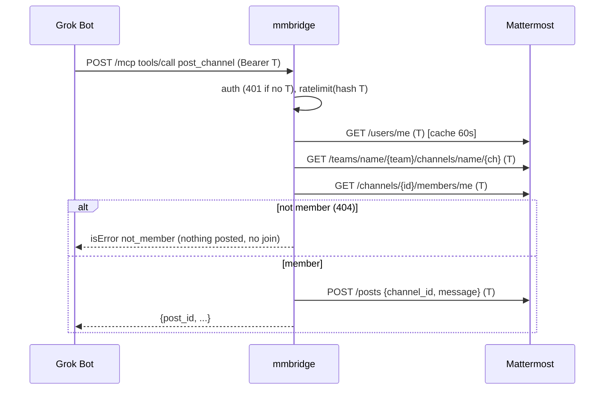

# eng-run plan-review mmbridge-mcp

## Summary
- role: plan-review; runner: codex (codex); exit code: 0; started 2026-10-25 23:53:24
- review file: thoughts/shared/verification/2026-10-25-mmbridge-mcp-plan-review.md - 12 finding(s): 3 high, 8 medium, 1 low
- set plan_review: thoughts/shared/verification/2026-10-25-mmbridge-mcp-plan-review.md in thoughts/shared/plans/2026-10-25-mmbridge-mcp.md
- next: disposition every finding (fixed / accepted-risk with Rob / rejected + reason); run .eng/bin/eng-check .

## Command
````
codex exec --sandbox read-only -o thoughts/shared/runs/2026-10-25-plan-review-mmbridge-mcp.last-message.txt '<prompt: see run log>'
````

## Prompt
````
You are the independent plan reviewer for this repository (eng-process kit v2.5.1). Do not edit any file except as stated below.

Follow the eng-plan skill (.claude/skills/eng-plan/SKILL.md, steps 8-9 "Mandatory plan review") and .eng/PROCESS.md section 10.

Review thoughts/shared/plans/2026-10-25-mmbridge-mcp.md and its slice cards (thoughts/shared/slices/2026-10-25-s1-auth-list-channels.md thoughts/shared/slices/2026-10-25-s2-post-read-channel.md thoughts/shared/slices/2026-10-25-s3-dm.md) against the approved design (docs/design/2026-10-25-mmbridge-mcp.md, REQ ids), the architecture (docs/architecture/2026-10-25-mmbridge-mcp.md) and the ADRs in docs/decisions/. Look for gaps, wrong ordering, missing tests, missing verification commands, and security holes (auth, tenancy, secrets, input validation).

Executable specs (v2.5, medium/large): check every REQ has at least one spec in tests/acceptance/specs/ tagged @pytest.mark.req("REQ-n") that follows the design's Acceptance examples; specs use domain language only (no URLs, selectors, status codes, sleeps); each spec creates its own data through the DSL; every slice lists `specs:`; the planned channels match triage (medium: api; large: api + one Playwright web journey). Report specs that test implementation instead of behavior.

Output: a numbered list of findings. Each finding on its own line as
  N. [severity] location - finding - suggested fix
with severity one of critical | high | medium | low. If you find nothing, write exactly "No findings."
Your final message is saved by eng-run to thoughts/shared/verification/2026-10-25-mmbridge-mcp-plan-review.md (a review-findings artifact); the planner then fills the Findings table dispositions. Never approve anything: only Rob approves (CP-C).
````

## Output
````
Reading additional input from stdin...
OpenAI Codex v0.164.0
--------
workdir: /mnt/d/rob/projects/mmbridge
model: gpt-6.1-sol
provider: openai
approval: never
sandbox: read-only
reasoning effort: none
reasoning summaries: none
session id: 01a1768e-5e40-7412-bd57-b1d912e0f94a
--------
user
You are the independent plan reviewer for this repository (eng-process kit v2.5.1). Do not edit any file except as stated below.

Follow the eng-plan skill (.claude/skills/eng-plan/SKILL.md, steps 8-9 "Mandatory plan review") and .eng/PROCESS.md section 10.

Review thoughts/shared/plans/2026-10-25-mmbridge-mcp.md and its slice cards (thoughts/shared/slices/2026-10-25-s1-auth-list-channels.md thoughts/shared/slices/2026-10-25-s2-post-read-channel.md thoughts/shared/slices/2026-10-25-s3-dm.md) against the approved design (docs/design/2026-10-25-mmbridge-mcp.md, REQ ids), the architecture (docs/architecture/2026-10-25-mmbridge-mcp.md) and the ADRs in docs/decisions/. Look for gaps, wrong ordering, missing tests, missing verification commands, and security holes (auth, tenancy, secrets, input validation).

Executable specs (v2.5, medium/large): check every REQ has at least one spec in tests/acceptance/specs/ tagged @pytest.mark.req("REQ-n") that follows the design's Acceptance examples; specs use domain language only (no URLs, selectors, status codes, sleeps); each spec creates its own data through the DSL; every slice lists `specs:`; the planned channels match triage (medium: api; large: api + one Playwright web journey). Report specs that test implementation instead of behavior.

Output: a numbered list of findings. Each finding on its own line as
  N. [severity] location - finding - suggested fix
with severity one of critical | high | medium | low. If you find nothing, write exactly "No findings."
Your final message is saved by eng-run to thoughts/shared/verification/2026-10-25-mmbridge-mcp-plan-review.md (a review-findings artifact); the planner then fills the Findings table dispositions. Never approve anything: only Rob approves (CP-C).

codex
I’ll read the project state, review guidance, and plan artifacts, then check requirement coverage, slice ordering, verification, and security. I won’t edit any files.
exec
/bin/bash -lc 'cat PROJECT_STATE.md' in /mnt/d/rob/projects/mmbridge
 succeeded in 0ms:
---
id: STATE
type: project-state
phase: plan
status: active
owner_agent: Eddie
date: 2026-10-25
links: []
triage: medium            # unset | small | medium | large
active_slice: none
# Single source of truth for approvals. One item per line: "CP-X: <path> - <decision needed>".
# Later checkpoints (e.g. CP-B while in discover) may be listed early. Quote items containing commas.
pending_approvals: []
# Working agreements (see PROCESS.md section 10). Never hard-code these in design docs.
implementer: claude-code      # who writes code (default: Claude Code on the owner's PC)
planner: grok-bot             # who plans, writes docs, keeps state and process
cross_review: codex-advisory  # codex-advisory | none  (advisory, never a gate)
push_permission: ask          # ask (before each push) | standing
board: none                   # none | vikunja (optional, board only; repo stays the source of truth)
acceptance: executable-specs   # v2.5: tests/acceptance/, see PROCESS.md 13
---
# PROJECT_STATE

> Single entry point. Any agent reads THIS file first, then the latest handoff linked below.
> Update it at the end of every session. Keep it under one screen.

## Current phase
plan - entry/exit criteria in `.eng/PROCESS.md` section 3.

## Goal (one sentence)
A public HTTPS MCP bridge (Python, deployed on Coolify at chats.rmlab.cloud) that lets Grok Bots read and post in Rob's self-hosted Mattermost, each bot using its own Mattermost bot token.

## Active slice
none

## Next action
Plan + 3 slice cards drafted (status draft), specs locked (sha256:8c883651b4daba66). Next: Rob/implementer runs the mandatory Codex plan review (command from .eng/bin/eng-status); planner triages findings; then CP-C. Token for real-bot test goes ONLY in the Grok Bot MCP connection (Authorization: Bearer), never Coolify/repo.

## Blockers
none

## Pending approvals
See `pending_approvals` in the front matter (the only copy; `.eng/bin/eng-status` renders it). Do not list items here.

## Back-ups to an earlier phase
<!-- date - from phase -> to phase - why (blameless) - artifacts revised -->
none

## Latest artifacts
<!-- Relative links only; .eng/bin/eng-check verifies they resolve. -->
- Conventions: [AGENTS.md](AGENTS.md)
- Owner guide: [OWNER-GUIDE.md](OWNER-GUIDE.md)
- Definition of Done: [docs/definition-of-done.md](docs/definition-of-done.md)
- Process feedback: [thoughts/shared/process-feedback.md](thoughts/shared/process-feedback.md)
- Design (approved; scope hold approved): [docs/design/2026-10-25-mmbridge-mcp.md](docs/design/2026-10-25-mmbridge-mcp.md)
- Architecture: [docs/architecture/2026-10-25-mmbridge-mcp.md](docs/architecture/2026-10-25-mmbridge-mcp.md)
- ADRs 0001-0005: [docs/decisions/](docs/decisions/)
- Latest handoff: [thoughts/shared/handoffs/2026-10-25_23-43-13_cp-b-approved-plan-drafted.md](thoughts/shared/handoffs/2026-10-25_23-43-13_cp-b-approved-plan-drafted.md)
- Plan (draft): [thoughts/shared/plans/2026-10-25-mmbridge-mcp.md](thoughts/shared/plans/2026-10-25-mmbridge-mcp.md)
- Slices: [thoughts/shared/slices/](thoughts/shared/slices/)
- Specs: [tests/acceptance/specs/test_mmbridge.py](tests/acceptance/specs/test_mmbridge.py)
- Research: [thoughts/shared/research/2026-10-25-mmbridge-current-code.md](thoughts/shared/research/2026-10-25-mmbridge-current-code.md)
- Deferred work: [TODOS.md](TODOS.md)

## Approval log
<!-- One row per decision. Artifact cell names the file path(s). Decision: approved | accepted | partially accepted | deferred | rejected.
     Pre-kit decisions: back-fill with Checkpoint "pre-kit" and Decision "approved (back-filled, pre-kit)". .eng/bin/eng-check matches rows to statuses. -->
| Date | Checkpoint | Artifact | Decision (Rob) |
|---|---|---|---|
| 2026-10-25 | CP-A | docs/design/2026-10-25-mmbridge-mcp.md | approved (problem, REQ-1..8, acceptance examples) |
| 2026-10-25 | CP-A (scope) | docs/design/2026-10-25-mmbridge-mcp.md | approved (scope mode hold: REQ-1..8 in; @mention wakes, auto-join, multi-bot, threads/reactions/files out) |
| 2026-10-25 | CP-B | docs/architecture/2026-10-25-mmbridge-mcp.md | approved |
| 2026-10-25 | CP-B | docs/decisions/0001-credential-handoff-bearer-per-call.md, docs/decisions/0002-mattermost-http-client.md, docs/decisions/0003-mcp-surface-streamable-http.md, docs/decisions/0004-per-token-in-memory-rate-limit.md, docs/decisions/0005-structured-logs-public-health.md | accepted (ADR-0001..0005) |

exec
/bin/bash -lc 'cat .claude/skills/eng-plan/SKILL.md .eng/PROCESS.md' in /mnt/d/rob/projects/mmbridge
 succeeded in 0ms:
---
name: eng-plan
description: Write an implementation plan as vertical slices with automated and manual success criteria. Use after research (and architecture for large work) is approved, before any code changes.
---
# eng-plan

Session: standard Start/Finish per `.eng/PROCESS.md` section 8 (kit: `PROCESS.md`). Scripts: `.eng/bin/eng-check`, `.eng/bin/eng-status`, `.eng/bin/eng-new`.

## Inputs (files only)
- Approved design doc, research doc, accepted ADRs, approved architecture (large); .eng/bin/eng-check enforces these
- `AGENTS.md` (test/lint commands); PROJECT_STATE working agreements

## Outputs
- `thoughts/shared/plans/<date>-<slug>.md`
- One slice card per phase: `thoughts/shared/slices/*` (`status: todo`, `plan:`/`plan_phase:` set)
- Medium/large: the **mandatory** Codex plan review `thoughts/shared/verification/<date>-<slug>-plan-review.md`, linked from the plan's `plan_review:`

## Steps
1. Be skeptical: verify research claims you rely on against the code.
2. Propose the phase outline (slice names, order) to Rob before details; get buy-in.
3. Each phase is a **vertical slice**: thin, end-to-end, demoable; contract/mock first. No horizontal DB -> API -> UI phases.
4. Program design in Implementation Approach: key types/signatures, call path, file-tree diff.
5. Each phase: Changes Required, Success Criteria split into **Automated Verification** (exact commands) and **Manual Verification**.
6. Write each slice card so the implementer (PROJECT_STATE `implementer`, normally Claude Code on Rob's PC) can run it cold from `eng-resume` + `eng-implement-slice`. Mark auth/tenancy/security slices: they always get the cross-model review.
7. Fill **What We're NOT Doing** and a short **Demo script** (3-6 steps Rob can follow to see it work). Resolve all open questions.
7a. **Executable specs (medium/large, v2.5; PROCESS.md 13):** if `tests/acceptance/` is missing, run `python3 .eng/bin/eng-spec init .`. Turn the design's Acceptance examples into specs in `tests/acceptance/specs/` (domain language, DSL calls only, `@pytest.mark.req("REQ-n")`; medium: api channel; large: plus one `@pytest.mark.channels("api", "ui")` journey). Extend the DSL interface as needed (assertion steps named `assert_*`/`then_*`/...). Fill every slice card's `reqs:` and `specs:` (or `specs: none - <reason>`). Fill Testing Strategy. Then `python3 .eng/bin/eng-spec lock .` and include the printed `approved speclock sha256:<hex>` decision in the CP-C Approval log row Rob approves. Drivers can stay stubs until the slices that need them.
8. **Mandatory plan review (medium/large; small exempt)**, after the plan and slice cards are drafted and before asking for CP-C. Rob (or the implementer) runs Codex non-interactively from the repo root on his machine; `.eng/bin/eng-status` prints the command with real paths:
   `codex exec "review <plan path> and the slice cards <slice glob> against <design doc> (REQ ids), <architecture doc> and <ADR range> for gaps, wrong ordering, missing tests, and security holes; output a numbered list of findings with severity" -o thoughts/shared/verification/<date>-<slug>-plan-review.md`
   Or: `python3 .eng/bin/eng-run plan-review <plan>` (runner from `.eng/runners.toml`; writes the findings file, a run log, and sets an empty `plan_review:`). Chet/Dave may run it on Rob's PC with his approval; `--dry-run` shows the command.
9. Codex has written the review file (`-o`; eng-run pre-fills the Findings table as `open`). Add the review-findings front matter and Findings table above the raw output (template `review-findings.md`); one row per finding with severity (critical/high/medium/low) and disposition: `fixed` (say where; update plan/cards), `accepted-risk` (only after Rob approves; record "Rob <date>"), or `rejected` (with a reason **and evidence**: a file:line or a test reference; eng-check warns otherwise). Set `plan_review:` in the plan to that path. No critical/high may stay `open`. Plan approved before reviews were mandatory: run it retroactively before the next slice, or log Rob's waiver row (PROCESS.md 10).
10. `.eng/bin/eng-check .` must pass (it enforces the plan review once a slice starts).

## Exit criteria
All required sections; every phase has both criteria types; slice cards exist; no open questions; (M/L) plan review linked with no open critical/high finding.

## Approval stop (Rob)
**CP-C Plan**: `CP-C: <plan path> - approve plan`. Medium/large: ask only once the plan review is clean. On approval set plan `approved`, log it, set `phase: implement`, `active_slice:` the first slice card. Then the slice is ready: start it with `python3 .eng/bin/eng-run implement <plan> <slice-id>` (CP-C approval covers this unless Rob said otherwise) and show Rob the "ready to implement" message as FYI (`.eng/bin/eng-status` prints it; paste prompt only as fallback; PROCESS.md section 10).

## Finish
Standard: end with eng-handoff.
<!-- Copy of eng-process kit v2.5.1 PROCESS.md, vendored by eng-init. Do not edit here. -->
# Engineering Process (canonical, kit v2.1)

One human approver (Rob, "the owner"), several interchangeable AI agents. **All state lives in files; the repo is the single source of truth.** Any agent must be able to pick up the project from `PROJECT_STATE.md` + the latest handoff alone. This file is the only place the phase-to-skill routing lives (section 3); `AGENTS.md` and skills reference it, and `.eng/PROCESS.md` is a pinned read-only copy written by `eng-init`.

## 1. Repo layout (created by `<kit>/bin/eng-init`)
```
PROJECT_STATE.md          single entry point: phase, triage, working agreements, active slice, next action, approvals
AGENTS.md  (CLAUDE.md -> @AGENTS.md)   commands, architecture map, conventions
OWNER-GUIDE.md            plain-language guide + glossary for the owner
CHANGELOG.md  TODOS.md    release notes; deferred work and scope cuts
docs/definition-of-done.md
docs/vision/              long-lived product vision / feature list (type vision)
docs/design/              design docs per increment (problem -> requirements -> scope [-> architecture])
docs/architecture/        optional separate architecture docs for large work (type architecture)
docs/decisions/           ADRs NNNN-slug.md, id ADR-NNNN, append-only
thoughts/shared/research/         codebase research: what the code IS (type research)
thoughts/shared/market-research/  external/market/methods research (type market-research)
thoughts/shared/briefs/           project briefs for a new implementer/reviewer (type project-brief)
thoughts/shared/{plans,slices,handoffs,retros}/
thoughts/shared/verification/     verification reports + independent review findings (*-review.md)
thoughts/shared/review-notes/     owner's scratch notes; agents don't edit; not checked
thoughts/shared/process-feedback.md  friction log for the kit (type process-feedback)
.eng/bin/                 vendored kit scripts (eng-check, eng-status, eng-new, eng-init, englib.py); plain python3
.eng/templates/  .eng/PROCESS.md  .eng/VERSION   vendored templates, this file, kit version
.claude/skills/eng-*/SKILL.md     vendored skills (Claude Code project-skill location)
.eng/templates/  .eng/PROCESS.md  .eng/VERSION    kit copy (templates used by .eng/bin/eng-new)
```
Every checked artifact starts with front matter: `id, type, phase, status, owner_agent, date, links`. `.eng/bin/eng-check` enforces it. Inline lists may quote items containing commas (`["a, b", c]`); dash lists also work.

## 2. Triage (`eng-triage`, first step for any request)
| Size | Signal | Phases |
|---|---|---|
| **Small** | about 1 file or an obvious fix, no new interface, no data change, reversible | Implement -> Verify -> Ship (one slice card, no plan) |
| **Medium** | a few files, one component, known patterns | Discover (short design doc) -> Research -> Plan -> Implement -> Verify -> Ship -> Reflect |
| **Large** | new component/interface/data model, cross-cutting, brownfield risk, security/money/data | all nine phases, all checkpoints |
When in doubt, size up. Re-triage if research reveals more than expected. Record it in `PROJECT_STATE.md` (`triage:`).

**Readiness check.** When a project claims to be at a later phase (e.g. "we're already on slice 1"), `eng-triage` verifies that every earlier phase's artifacts and approvals exist for its size (table below; `.eng/bin/eng-status` prints `readiness:` and `.eng/bin/eng-check` fails on gaps). If anything is missing, set `phase` back to the earliest incomplete phase, list exactly what is missing under Blockers, and record the back-up (section 4a).

| To be in phase | Small | Medium | Large |
|---|---|---|---|
| research | n/a | approved design (CP-A) | approved design (CP-A) |
| architecture | n/a | n/a | + approved codebase research (CP-R) |
| plan | n/a | approved design; research doc exists | + approved architecture (CP-B logged, or approved `docs/architecture/` doc) |
| implement | slice card | + approved plan (CP-C) with clean plan review | + approved plan (CP-C) with clean plan review |
| verify | slice card | same as implement | same as implement |
| ship | + verification `pass` (CP-D) | + verification `pass` | + verification `pass` |

## 3. Phases (and the skill for each: this is the routing table)
| # | Phase | Skill | Entry | Output | Exit criteria | Checkpoint |
|---|---|---|---|---|---|---|
| 0 | (any session) | eng-resume to start, eng-handoff to end; eng-triage for new requests; eng-project-init to adopt | | | | |
| 1 | Discover | eng-discover | triaged M/L | `docs/design/*` (+ optional `docs/vision/`, `thoughts/shared/market-research/`) | problem, metric, testable requirements; no `[NEEDS CLARIFICATION]` | **CP-A Product** |
| 2 | Scope | eng-scope-review | CP-A approved | design doc Scope section (baseline = approved requirements list); cuts -> TODOS.md; ADR if durable | mode chosen relative to baseline, in/out lists | (part of CP-A for L) |
| 3 | Research | eng-research | approved design | `thoughts/shared/research/*` | code *as is* with file:line; no recommendations | **CP-R Research** (L; optional M) |
| 4 | Architecture | eng-architecture-review | research approved | design doc Architecture section **or** `docs/architecture/*` linked from it; ADRs | contracts, data, sequence, failure modes, rollback, observability, security | **CP-B Architecture** (L) |
| 5 | Plan | eng-plan | prerequisites (section 2) | `thoughts/shared/plans/*` + slice cards + **mandatory Codex plan review** (M, L) | vertical slices, each with automated + manual criteria; What We're NOT Doing; no open critical/high review finding | **CP-C Plan** (M, L) |
| 6 | Implement | eng-implement-slice (run by the implementer) | plan approved, slice next, no pending approvals | code + tests, plan checkboxes, slice card; then independent review findings | slice's automated criteria pass; review findings answered | **CP-S Slice** per slice |
| 7 | Verify | eng-verify | all slices `review`/`done` | `thoughts/shared/verification/*` | every criterion re-executed; DoD pass; verdict PASS | **CP-D Done** |
| 8 | Ship | eng-ship | verification PASS | CHANGELOG entry, VERSION (if used), PR | CI green, PR opened | **CP-P PR merge/deploy** (Rob merges) |
| 9 | Reflect | eng-retro | shipped (or weekly, or each advisor consultation) | `thoughts/shared/retros/*` + edits | process-feedback pass done; each change applied to a file | none |

**One phase per session, one artifact, then stop for approval.** Discovery tends to pre-draft later artifacts (architecture, plan). That's allowed only as input. **Wording, used everywhere:** `input` = a pre-draft written in an earlier phase than its own, not yet worked on in its own phase; `draft` = being written in its own phase; `in-review` = waiting for Rob. None of these is an approval, and neither is any invented status like `approved-for-review` (`.eng/bin/eng-check` rejects those). Pre-drafts carry `status: input` and the heading note "input, not approved"; their own phase's skill turns them into `draft`. The owner may choose to group phases in one session once familiar with the process; record that in the handoff.

## 4. Approval checkpoints
- **Front matter `pending_approvals` is the single source of truth.** Item format: `CP-X: <path>[ + <path>] - <decision needed>`; paths must exist (CP-P may name a PR URL). The body section only points at it; `.eng/bin/eng-status` renders it. `.eng/bin/eng-check` fails if the body lists CP items that differ.
- Checkpoints for **later** phases may be pending early (e.g. CP-B auth/hosting questions during Discover). A pending checkpoint for an **earlier** phase than the current one blocks (`.eng/bin/eng-check` error); so does any missing prerequisite (section 2), for every phase, not just implement/verify/ship.
- **Owner review workflow.** Rob may jot notes in `thoughts/shared/review-notes/<owner>-review-notes.md`. Agents never edit or act on it until he says the notes are ready. Approvals arrive in chat. The agent then records each one in (1) the PROJECT_STATE Approval log row, (2) the artifact `status`, and (3) an ADR if the decision is durable, removes the pending item, and commits. The repo, not the chat, is the official record. `.eng/bin/eng-check` cross-checks the log and statuses both ways.
- **Notes rotation.** When a cycle finalizes (a slice reaches `done`, or a ship), if the scratch file has notes: `git mv` it to `<cycle-id>-<owner>-review-notes.md` and recreate the empty scratch file from `.eng/templates/review-notes.md`. Done in eng-handoff and eng-ship.
- Rejection: status back to `draft`, reasons in the artifact; for research, discard and redo rather than patch.
- ADR statuses: `proposed | accepted | partially-accepted | deferred | rejected | deprecated | superseded`. `partially-accepted` requires a `## Parts` section marking each part; `deferred` sets `revisit:`.

### 4a. Backing up to an earlier phase (blameless)
Discovering that an earlier artifact is wrong is normal. Any agent or the owner can call "back up to <phase>" (usually Discover): set `phase` back, set the design doc back to `draft` and any later-phase pre-drafts to `input`, revise them, move affected approvals back to `pending_approvals`, and add a line to PROJECT_STATE "Back-ups to an earlier phase": date, from -> to, why, artifacts revised. No blame, just the reason.

**Approvals live only in the Approval log table** (`| date | CP-X | path | decision |`). `eng-check` flags an approval written anywhere else in PROJECT_STATE.md (a prose line like "CP-C approved by Rob", a row-like line outside the table, a stray line inside the section), and any `approved` status without a table row.

**Design changes after CP-A.** Once the design doc is approved, editing it needs re-approval: set it back to `in-review` and request CP-A again, then log a **new** Approval log row (newer date). To make the check exact, put the content hash in the decision cell: `approved sha256:<first 12+ hex of sha256 of the file, LF line endings>`. Without a hash, `eng-check` warns when git shows a commit touching the approved design dated after the latest CP-A row. Edits during phase `discover` are never flagged. It also warns when plan or slice drafts exist while no design doc is approved (except triage small, or unset: size unknown before triage). Both checks are errors since v2.5.0.

## 5. WIP rules
- One project phase at a time; **max 1 slice `in-progress`** (enforced). Max open PRs = what Rob can review (default 1).
- Pull the next slice only when the previous is `done` or explicitly `blocked` with a reason.
- A slice is ~100-200 changed lines, end-to-end, demoable. Bigger -> split before starting.
- Deferrals and unrelated discoveries go to `TODOS.md`, not into the current slice.

## 6. Definition of Done
`docs/definition-of-done.md` (project may extend, never weaken). Core: criteria re-executed in the verifying session; tests incl. regression; no weakened gates; docs, CHANGELOG, ADRs, TODOS updated; verification PASS; state + handoff written.

## 7. Context hygiene
- **One phase per session.** Start fresh; load only PROJECT_STATE, the latest handoff, and the inputs the skill names.
- **~40% rule of thumb:** no context meter exists, so use proxies: when you've read >~15 files, done >~30 tool calls, or been corrected twice, compact: write progress into the artifact + handoff and end the session.
- **Compaction is into files**, never into memory: plan checkboxes, slice progress log, handoff.
- **Sub-tasks for search:** delegate wide searches to sub-agents returning paths + file:line; read critical artifacts directly and fully.
- Codebase research documents what *is*; opinions belong in market research, architecture or plan.
- Keep AGENTS.md short: only what an agent cannot infer from code.

## 8. Session convention (every skill's Start and Finish)
Skills say "Session: standard" instead of repeating this.
- **Start:** new session. Read only `PROJECT_STATE.md`, the latest handoff it links, and the skill's Inputs. Run `.eng/bin/eng-check .`; if it fails for a reason this skill must not fix, stop and report. If `pending_approvals` holds a checkpoint this skill needs, stop.
- **Finish:** update PROJECT_STATE (`phase`, `active_slice`, `pending_approvals`, `owner_agent`, `date`, Next action, Blockers, Latest artifacts) as part of **eng-handoff**, which is the session end. It writes `thoughts/shared/handoffs/YYYY-MM-DD_HH-MM-SS_<slug>.md` (Tasks+status, Critical References, Recent changes file:line, Learnings, Artifacts, Approvals, Next Steps naming the next skill), runs `.eng/bin/eng-check .` (must pass) and commits the docs. eng-handoff and eng-resume don't call themselves.
- **Resume:** eng-resume reads PROJECT_STATE, the linked handoff fully, then only its Critical References; verifies Recent changes exist (git); reports discrepancies; proceeds only if no needed approval is pending.
- If the next agent must ask "what was I doing?", the handoff is defective. Log it in `process-feedback.md`.
- Session handoff and **project brief** are different: the handoff passes one session to the next; a brief (`.eng/bin/eng-new brief`) orients a new implementer or reviewer and points at the plan and state.

## 9. Rules for every agent
Recommend; Rob decides. Never weaken a gate or use `--no-verify`. A report is a claim until re-executed. Stop and report on plan/code mismatch ("Issue in Phase N") instead of improvising. No fix without root cause; after 3 failed fixes, stop and hand off. Log process friction in `thoughts/shared/process-feedback.md` as you hit it.

## 10. Working agreements (standard; values in PROJECT_STATE front matter)
| Field | Default | Meaning |
|---|---|---|
| `implementer` | `claude-code` | Who writes code: Claude Code on the owner's own PC. Never name it in design docs; reference this field. |
| `planner` | `grok-bot` | Grok Bot assistants plan, write docs, keep state and process. They don't write production code. |
| `cross_review` | `codex-advisory` | Independent cross-model review; advisory, never a gate. `none` disables. |
| `push_permission` | `ask` | `ask` = ask the owner before each push; `standing` = may push the slice branch without asking (never merge). |
| `board` | `none` | Optional Kanban (e.g. self-hosted Vikunja, deferred). If used: board only, one card per slice linking to the repo plan/slice card. The repo stays the single source of truth; never record decisions on the board. |

**Implementer hand-off loop.**
1. When a slice is ready (plan approved with its mandatory plan review clean (M/L), slice is next in PROJECT_STATE `active_slice` with `status: todo`, `pending_approvals` empty, `.eng/bin/eng-check` OK), the planner **starts** implementation on the owner's PC: `python3 .eng/bin/eng-run implement <plan> <slice-id>` (or `eng run implement ...` with the global CLI), then tells Rob once, as FYI, with the standard message from `.eng/templates/ready-to-implement.md` (`.eng/bin/eng-status` prints it filled). Bots run eng-run on Rob's PC only with Rob's approval; his CP-C / slice-ready approval covers starting implement unless he said otherwise (if PROJECT_STATE has no standing note, a one-line "start implement?" is enough). **Fallback:** if eng-run or the Claude CLI is unavailable, or Rob wants to drive Claude interactively, send the paste prompt from the same message: `Run eng-resume, then eng-implement-slice for <slice> per <plan>`. Work keeps running until Rob interjects or a real decision is due: CP-S, a push when `push_permission: ask`, eng-check failures, locked-spec issues, open critical/high plan-review findings, blockers.
2. The implementer runs the slice on the owner's PC, ends with eng-handoff.
3. **Independent review (advisory):** before eng-verify, the cross-model review runs on the slice diff. Findings go to `thoughts/shared/verification/<date>-<slice>-review.md` (`.eng/bin/eng-new review <slug>`). The implementer fixes or answers each finding, then eng-verify runs.
4. The planner picks up the implementer's handoff and runs `eng-verify` and `.eng/bin/eng-check`, then requests CP-S.

**Mandatory plan review (medium and large; small exempt).** After the plan and slice cards are drafted and before CP-C, Codex reviews them non-interactively from the repo root on the owner's machine:
`codex exec "review <plan path> and the slice cards <slice glob> against <design doc> (REQ ids), <architecture doc> and <ADR range> for gaps, wrong ordering, missing tests, and security holes; output a numbered list of findings with severity" -o thoughts/shared/verification/<date>-<slug>-plan-review.md`
`.eng/bin/eng-status` prints this command with the real paths while CP-C is pending. **Codex output always goes straight to a file in the repo, never only the terminal:** `-o`/`--output-last-message <path>` writes the final review to the review file. Then turn that file into the findings artifact in place: add the review-findings front matter and Findings table (from `templates/review-findings.md`) above the raw output, which stays under "Reviewer raw output". Link it it from the plan's `plan_review:` field. Each finding gets a severity (critical/high/medium/low) and a disposition: `fixed` (where), `accepted-risk` (only with Rob's approval, recorded in the row), or `rejected` (with a reason). `.eng/bin/eng-check` fails, for medium/large triage, if a slice is in-progress or the phase is implement/verify/ship without a linked plan review, or with any critical/high finding still `open`. **Grandfathered plans** (approved before the review was mandatory): before the next slice starts, either run the review retroactively (same command, link it in `plan_review:`, fix/disposition findings), or record Rob's waiver in the Approval log: `| <date> | CP-C | <plan path> | waiver: plan review - approved by Rob |`. eng-check's error names both routes. This is the one review that is a gate; slice-diff and architecture reviews stay advisory.

**Cross-model review (Codex), advisory.** Run it on every slice diff before Rob approves the slice (always for auth, tenancy or security work), and on architecture docs for large work (plans: see the mandatory review above). Skip it for small or docs-only changes (write "skipped: <reason>" in the verification report). In Claude Code, gstack's `/codex` calls the real Codex CLI (diffs: `codex review --base <base> > thoughts/shared/verification/<date>-<slice-slug>-review.md`; documents: `codex exec "<prompt>" -o thoughts/shared/verification/<date>-<slug>-review.md`; always written into the repo). That needs `npm install -g @openai/codex` and `codex login` once on the owner's PC. Findings are recorded in the findings file and summarized in the verification report's "Cross-model review" section. They are advice: Rob decides, and no finding blocks by itself.

**Windows owner machines.**
- Line endings: set per command, not globally: `git -c core.autocrlf=false <cmd>` (or `input`). Kit files are LF.
- Encoding: write files as UTF-8 **without BOM** (PowerShell 5: `Out-File -Encoding utf8` adds a BOM; use `[IO.File]::WriteAllText` or PowerShell 7 `utf8NoBOM`). The scripts tolerate a BOM and print ASCII only.
- Archiving a repo to move it: include dotfiles and `.git` (`tar -czf repo.tgz -C <parent> <repo>`; Explorer's "Send to zip" can skip them).

**Headless agent runs (`eng-run`, v2.3).** From the repo root: `python3 .eng/bin/eng-run plan-review <plan>`, `... implement <plan> <slice-id>`, `... code-review <slice-id | --base REF>`. Prompts are `.eng/prompts/<role>.md` (kit-owned); the runner per role is `.eng/runners.toml` (project-owned, created once; defaults implement=claude, plan-review/code-review=codex), overridable by `ENG_RUNNER_<ROLE>` or `--runner` (`claude`, `codex`, or a `[runners.<name>]` `command` runner). Rules: every run writes a run log `thoughts/shared/runs/<date>-<role>-<target>.md` (command, prompt, output, exit code); every review also writes a review-findings file in `thoughts/shared/verification/` with rows `open` until dispositioned; review output never lives only in the terminal. Plan reviews set an empty `plan_review:` so eng-check's gate applies. eng-run refuses a review by the same runner that implemented the slice (run log, else PROJECT_STATE `implementer`) unless `--allow-self-review`, which must be named in the verification report. `--dry-run` prints the exact command without running. Bots (Chet, Dave) may run eng-run on Rob's PC only with Rob's approval for that run.

## 10a. The kit travels with the repo
The kit is vendored into every repo, so any agent on any machine (box, WSL, Git Bash, macOS) has it without the kit source: skills in `.claude/skills/<name>/SKILL.md`, scripts in `.eng/bin/`, prompts in `.eng/prompts/`, version in `.eng/VERSION`. Always call scripts by repo-relative path from the repo root, through the interpreter (no shebang reliance): `python3 .eng/bin/eng-check .` on Linux/macOS/WSL/Git Bash, `python .eng/bin/eng-check .` or `py .eng/bin/eng-check .` on native Windows. Every path the scripts compare or print is normalized to POSIX form (`/`), so backslash paths in front matter, links or the Approval log work too; always write `/` in docs. Commit `.eng/` and `.claude/skills/`. Never edit vendored files in a repo; change the kit and re-vendor.
- **Upgrade an existing repo** (planner, from the kit source): `<kit>/bin/eng-init <repo> --upgrade`. It overwrites only kit-owned files (`.eng/bin`, `.eng/templates`, `.eng/prompts`, `.eng/PROCESS.md`, `.eng/VERSION`, `.claude/skills/eng-*`), never project files; commit the result as "chore: vendor eng-process vX.Y.Z".
- `--upgrade` also: refreshes template comments/help text in project files (AGENTS.md, CLAUDE.md, OWNER-GUIDE.md, PROJECT_STATE.md body, DoD, ...) only where a section is still unchanged kit boilerplate, and prints every owner-edited stale section to update by hand (never overwrites owner content; front matter untouched); adds an empty `plan_review:` to plans lacking it; maintains the `# >>> eng-process defaults` block in `.gitignore` (`__pycache__/`, `*.pyc`, `.venv/`, ...) adding only lines not already present anywhere in the file (no duplicate block), and prints (never runs) `git rm -r --cached -- <files>` for tracked files the ignore rules now match. `__pycache__`/`.pyc` are never vendored. Stale sections are reported by name with a short diff. New checks start warn-only for one version (stray approvals: warn until v2.4.0; `eng-check --strict` makes them errors).
- `eng-check` fails if `.eng/bin` or `.claude/skills/eng-*` is missing, and warns when `.eng/VERSION` is older than the kit running it (or `$ENG_KIT/VERSION` if set).
- **Optional global install on a dev machine:** copy the skills to Claude Code's personal skill dir so they work in every repo: `mkdir -p ~/.claude/skills && cp -r <repo>/.claude/skills/eng-* ~/.claude/skills/` (WSL: inside the WSL home; Git Bash: `%USERPROFILE%\.claude\skills`). Project skills in the repo are still the source of truth; scripts are always taken from the repo's `.eng/bin/`.

## 11. Brownfield adoption and migration
Use `<kit>/bin/eng-init <repo> --brownfield` (eng-project-init "brownfield mode"). It lists every pre-existing markdown file with a suggested destination and type (a heuristic from its name and path; confirm each).
1. **Never delete history.** Move pre-kit docs with `git mv <old> <new>` in a dedicated commit (`chore: adopt eng-process layout`) so `git log --follow` works. Don't mix moves with content edits in one commit.
2. **Map each doc** to a kit location and type: vision/feature list -> `docs/vision/`; design/spec -> `docs/design/`; architecture -> `docs/architecture/`; codebase notes -> `thoughts/shared/research/`; external/market research -> `thoughts/shared/market-research/`; plans -> `thoughts/shared/plans/`; orientation docs for an implementer -> `thoughts/shared/briefs/`. Add front matter; unknown status -> `draft`.
3. **ADRs:** kit format is `docs/decisions/NNNN-slug.md` with id `ADR-NNNN` (4 digits). Migrate `ADR-001` style: `git mv docs/adr/001-x.md docs/decisions/0001-x.md`, set `id: ADR-0001`, then rewrite cross-references (`grep -rl 'ADR-0\?\([0-9]\{2,3\}\)'` then `sed -E 's/ADR-([0-9]{3})\b/ADR-0\1/g'`, reviewed). Keep numbers stable; never renumber to close gaps. Map old statuses: Deferred -> `deferred`; "accepted with parts open" -> `partially-accepted` + `## Parts`.
4. **Back-fill the Approval log** for decisions already accepted before the kit: one row per artifact, Checkpoint `pre-kit`, Decision `approved (back-filled, pre-kit)` / `accepted (...)`, date = original decision date if known. Set statuses to match. `.eng/bin/eng-check` then passes the log/status cross-check.
5. Delete only generated or duplicate files, and only with Rob's OK. Superseded docs get `status: superseded`.
6. Run the eng-triage **readiness check** to set the true phase.

## 12. Learning loop: predictions, evidence, lessons, adoption
- **Predictions.** Every ADR, advisor-consultation note and retro recommendation records *Expected outcome*, *Check date* and *What would prove it wrong* (templates `adr.md`, `retro.md`). eng-retro scores each past entry whose check date has passed as **right / wrong / unclear** with one line of evidence, in the retro and on the entry's `Score:` line.
- **Rejecting a finding.** A rejected Codex (or any reviewer) finding needs evidence in its Reason cell: a `file:line` (e.g. `src/auth.py:42`) or a test reference (e.g. `tests/test_auth.py::test_expired_token`). `eng-check` fails rejected rows without either (an error since v2.5.0). Retros record the **review hit-rate**: findings accepted vs rejected, and real bugs caught.
- **Research provenance.** Each research file starts with a provenance header: per source, the source (URL or repo), the commit (repos: pinned SHA) or date read (web), and `verified` (checked against the source by the author) or `unverified`. Pin cloned source repos to a commit and record it. When a consultation or decision relies on research, run a **staleness diff** first (`git -C <src> fetch && git -C <src> log --oneline <pinned>..origin/HEAD -- <paths relied on>`; web sources: re-read the page) and note the result. **Snapshot** a web page (save a copy next to the research with its fetch date) only when a decision-driving claim rests on it, and do it at re-derivation time, not by default. See `SOURCES.md`.
- **Kit lessons.** Format **"when X, do Y, because Z"** with origin, confirmation count and status (`templates/kit-lesson.md`). A lesson is a *hypothesis* until a second project confirms it. eng-retro proposes them; **Rob approves** each before it enters the kit's `LESSONS.md`.
- **Design adoption.** `process-feedback.md` has a *Design adoption* section: each kit step adopted or skipped, with reason. A skip the owner made knowingly (informed-owner skip) is recorded but not counted. **Two counted non-safety skips of the same step raise a redesign flag** for that step. **Any skip of a safety gate** (personal data handling, mandatory plan review, CP approvals) **is escalated to Rob immediately.**
- **Waste and time.** Each retro answers "which step felt like waste?" and records rough time per phase, so the kit can be trimmed with evidence.
- **Frontend legibility.** Architecture reviews always ask: *Can the owner judge this frontend's behaviour and code? If not, what reduces that gap?* Plans include a short **Demo script**. Frontend CI checks are opt-in and size-dependent: `.eng/templates/ci-checklist.md` (not enforced by eng-check).

## 13. Executable specifications (v2.5; Dave Farley's ATDD four-layer model)
**Two kinds of "spec", one direction.** *Design-side specs* (the design doc, the architecture doc, ADRs) say **what**
to build and **how** to build it; they are the authority. *Executable specs* are the **test-side** expression of the
design doc's requirements (REQ-n) and its plain-language acceptance examples: pytest tests in domain language under
`tests/acceptance/specs/`, each pointing back at its requirement with `@pytest.mark.req("REQ-n")` (the design doc's
id). They never introduce requirements; a spec without a REQ, or a REQ without a spec, is a gap to fix in the design
doc or the specs.

**Four layers** (`.eng/templates/acceptance/`, copied by `eng-spec init`):
1. **Specs** (`specs/`): what, never how; no URLs, selectors, status codes or sleeps; each creates its own data.
2. **DSL** (`dsl.py`): the shared domain vocabulary; aliases names per run (functional and temporal isolation).
3. **Protocol drivers** (`drivers/`): `api` (httpx), `ui` (Playwright), `mcp`. All system knowledge lives here.
4. **System under test**: deployed like production, started outside the tests; external systems stubbed at its boundary.

**By size.** Small: unchanged (unit/regression tests; no executable specs). Medium: specs on the API channel.
Large: API channel plus one Playwright web journey (`@pytest.mark.channels("api", "ui")`), with an ADR from
`.eng/templates/adr-acceptance-tests.md`.

**Approvals.**
- **CP-A:** Rob approves the plain-language Given/When/Then examples in the design doc's "Acceptance examples".
- **CP-C:** the planner writes the specs and the DSL interface, runs `.eng/bin/eng-spec lock .`, and the CP-C Approval
  log row records `approved speclock sha256:<hex>` (hash of `tests/acceptance/spec-lock.json`, printed by the command).
- **Locked:** spec files, and the DSL public interface (public step names, parameters, docstrings).
- **Flagged:** DSL assertion-step bodies (`assert_`/`then_`/`expect_`/`check_`/`verify_`); the Codex code review must
  name each changed step.
- **Free:** drivers, private DSL helpers (`_x`), `conftest.py`.
- An edit to a locked spec or the DSL interface during implementation is **not** a hard failure: `eng-run implement`
  prints a WARNING and writes an OWNER REVIEW entry in the run log, and `eng-check` warns until Rob re-approves
  (re-lock, new CP-C row) or the edit is reverted.

**Slices.** Each slice card lists `reqs:` and `specs:` (pytest node ids) or `specs: none - <reason>`. The implementer
runs them first and confirms they are red, then makes them green without touching locked files.

**Verify.** Re-run the acceptance suite on every planned channel; paste `eng-spec trace .` (REQ -> specs) with results
into the verification report; `eng-spec status .` must be clean or re-approved.

**eng-check (warn-only until v2.6.0; `--strict` makes them errors)**, active only when the project opted in
(`acceptance: executable-specs` in PROJECT_STATE, or a spec lock exists) and triage is not small:
`speclock-not-approved`, `spec-changed-without-approval`, `dsl-interface-changed`, `dsl-assertion-changed` (cleared
when a review-findings file names the step), `slice-without-spec`, `spec-unknown-node`, `req-without-spec` (at
verify/ship).

**Migration / grandfathering.** Existing projects are unaffected until they opt in with `eng-spec init .` (after
`eng-init --upgrade`). A project mid-increment may opt in at its next plan (CP-C); approved designs without
"Acceptance examples" are grandfathered, and their examples are written straight into specs at CP-C.


exec
/bin/bash -lc 'python3 .eng/bin/eng-check .' in /mnt/d/rob/projects/mmbridge
 succeeded in 413ms:
eng-check: OK - 0 error(s), 0 warning(s), 21 artifact(s) checked

exec
/bin/bash -lc 'cat thoughts/shared/handoffs/2026-10-25_23-43-13_cp-b-approved-plan-drafted.md docs/design/2026-10-25-mmbridge-mcp.md docs/architecture/2026-10-25-mmbridge-mcp.md docs/decisions/*.md' in /mnt/d/rob/projects/mmbridge
 succeeded in 0ms:
---
id: HANDO-20261025-cp-b-approved-plan-drafted
type: handoff
phase: plan
status: complete
owner_agent: Eddie
date: 2026-10-25T23:43:13-05:00
links: [thoughts/shared/plans/2026-10-25-mmbridge-mcp.md]
git_commit: 93b0908
branch: main
next_skill: eng-plan (step 8-9: Codex plan review triage), then CP-C
---
# Handoff: CP-B approved; plan drafted

## Task(s)
- Record CP-B — completed (architecture approved, ADR-0001..0005 accepted, Approval log rows, pending cleared, phase: plan).
- eng-plan — in progress: plan + 3 slice cards + 12 executable specs drafted, speclock written. Waiting on mandatory Codex plan review, then CP-C.

## Critical References
- thoughts/shared/plans/2026-10-25-mmbridge-mcp.md
- tests/acceptance/specs/test_mmbridge.py, tests/acceptance/dsl.py
- docs/architecture/2026-10-25-mmbridge-mcp.md

## Recent changes
- docs/decisions/0001..0005: status accepted; docs/architecture: status approved.
- PROJECT_STATE.md: CP-B rows, phase plan, pending_approvals [], acceptance: executable-specs.
- tests/acceptance/: eng-spec init; example spec removed; mmbridge DSL + specs; conftest default channel mcp; McpDriver stub (raises → specs red until slice 1).

## Learnings
- eng-check rejects "(approved, CP-B)" wording in Latest artifacts lines; approvals only in the log table.
- Rob's bot token goes only in the Grok Bot MCP connection header `Authorization: Bearer <token>`; never Coolify env or repo (ADR-0001).

## Artifacts
- thoughts/shared/plans/2026-10-25-mmbridge-mcp.md
- thoughts/shared/slices/2026-10-25-s1-auth-list-channels.md, -s2-post-read-channel.md, -s3-dm.md
- tests/acceptance/spec-lock.json (speclock sha256:8c883651b4daba66)

## Approvals
- CP-B granted 2026-10-25.
- CP-C pending — ask only after Codex plan review is clean. Row to log on approval: `| 2026-10-25 | CP-C | thoughts/shared/plans/2026-10-25-mmbridge-mcp.md | approved speclock sha256:8c883651b4daba66 |`

## Action Items & Next Steps
1. Rob/implementer runs on PC from repo root: `python3 .eng/bin/eng-run plan-review thoughts/shared/plans/2026-10-25-mmbridge-mcp.md` (or the `codex exec` command from `.eng/bin/eng-status`).
2. Planner triages findings (eng-plan step 9), sets plan_review, re-locks specs if changed, asks CP-C.
3. On CP-C: phase implement, active_slice s1; `eng-run implement`; after slice 1 deploy Rob connects real bot (plan Phase 1 manual checks).

## Other Notes
push_permission=ask; this push was requested by Rob via the parent.
---
id: DESIG-20261025-mmbridge-mcp
type: design
phase: discover
status: approved        # input (pre-draft from an earlier phase) | draft | in-review | approved | superseded
owner_agent: Eddie
date: 2026-10-25
links: [PROJECT_STATE.md]
# implementer is a PROJECT_STATE working agreement; never name it here
---
# Design: mmbridge MCP (Grok Bot <-> Mattermost)

## Problem
Rob's Grok Bots cannot read or post in Mattermost at all. Rob will not pay for Slack groups, so he installed a self-hosted Mattermost, then found Grok Bot has no way to use it. Today there is no workaround: any bot-to-team conversation in Mattermost simply does not happen. Grok Bot already has working Slack communication, so the gap is specific to Mattermost.

## Users and success metric
- Primary user: Rob, through his Grok Bots (each bot acting under its own Mattermost bot identity).
- Success metric: a Grok Bot, connected to the bridge with one Mattermost bot identity, can post a message into a channel it belongs to and into a DM with Rob, and can read back recent messages from both, with the posts visible to Rob in Mattermost under the bot's name. Target: working end to end within the first slice, no manual relay by Rob.
- Long-term goal (not v1): Slack parity where Mattermost allows - per-bot identities, DM, read/write posts, joining/invite handling, listening but responding only to @mention, waking on channel/DM activity.

## Narrowest wedge
One Grok Bot, one Mattermost bot identity: list the channels it belongs to, read recent posts from a channel or DM, post into a channel, and send/read a DM with a named Mattermost user. Nothing proactive: the bot acts only when it calls the bridge.

## Requirements (acceptance criteria)
- [ ] REQ-1: WHEN a Grok Bot connects to the bridge presenting its Mattermost bot credential THE SYSTEM SHALL act in Mattermost only as that bot identity, and SHALL refuse connections with a missing or invalid credential.
- [ ] REQ-2: WHEN the bot asks for its channels THE SYSTEM SHALL return the channels (name and team) that the bot identity is already a member of.
- [ ] REQ-3: WHEN the bot posts a message to a channel it belongs to THE SYSTEM SHALL create the post in that channel under the bot's identity and return a reference to the new post.
- [ ] REQ-4: WHEN the bot asks to read a channel it belongs to THE SYSTEM SHALL return the most recent posts (author, time, text), newest-limited to a requested count with a sensible default and maximum.
- [ ] REQ-5: WHEN the bot sends a DM to a Mattermost user by username THE SYSTEM SHALL deliver it in the direct conversation between the bot and that user, opening the conversation if it does not yet exist.
- [ ] REQ-6: WHEN the bot asks to read its DM with a Mattermost user THE SYSTEM SHALL return the most recent posts of that direct conversation in the same shape as REQ-4.
- [ ] REQ-7: WHEN the bot targets a channel it is not a member of, an unknown channel, or an unknown user THE SYSTEM SHALL return a clear error explaining why and SHALL NOT join the channel or post anywhere.
- [ ] REQ-8: WHEN Mattermost is unreachable or rejects a request THE SYSTEM SHALL return a clear error to the bot without exposing the bot's credential.

## Acceptance examples
- REQ-1 / example 1: GIVEN bot "eddie" has a valid credential WHEN it connects and posts THEN the post appears in Mattermost authored by "eddie".
- REQ-1 / example 2: GIVEN a caller with no credential WHEN it tries to list channels THEN it is refused and nothing is read from Mattermost.
- REQ-2 / example 1: GIVEN "eddie" is a member of "town-square" and "dev" in team "rmlab" WHEN it asks for its channels THEN it gets "town-square" and "dev" with team "rmlab", and not channels it has not joined.
- REQ-3 / example 1: GIVEN "eddie" is in "dev" WHEN it posts "build is green" to "dev" THEN Rob sees "build is green" from "eddie" in "dev".
- REQ-4 / example 1: GIVEN "dev" has 30 posts WHEN "eddie" reads "dev" asking for 5 THEN it gets the 5 newest posts with author, time and text.
- REQ-4 / example 2: GIVEN "dev" has 30 posts WHEN "eddie" reads "dev" without a count THEN it gets the default number of newest posts.
- REQ-5 / example 1: GIVEN "eddie" has never messaged "rob" WHEN it sends "hello" to "rob" THEN a direct conversation opens and Rob sees "hello" from "eddie".
- REQ-5 / example 2: GIVEN an existing DM between "eddie" and "rob" WHEN it sends "again" THEN it lands in that same conversation.
- REQ-6 / example 1: GIVEN Rob wrote "ping" to "eddie" in their DM WHEN "eddie" reads its DM with "rob" THEN "ping" from "rob" is among the returned posts.
- REQ-7 / example 1: GIVEN "eddie" is not in "finance" WHEN it posts to "finance" THEN it is told it is not a member, it does not join, and nothing is posted.
- REQ-7 / example 2: GIVEN no user "nobody" exists WHEN "eddie" sends a DM to "nobody" THEN it is told the user is unknown.
- REQ-8 / example 1: GIVEN Mattermost is down WHEN "eddie" posts THEN it is told Mattermost is unavailable and the message does not contain its credential.

## Constraints and assumptions
- Bridge is already reachable over public HTTPS on Coolify; Mattermost runs in the same stack and is reachable privately by the bridge.
- Bot accounts and bot access tokens are enabled in Mattermost; Rob creates each bot identity and adds it to channels himself in v1.
- Each Grok Bot supplies its own bot credential; the bridge holds no shared all-powerful credential.
- Side venture: speed over polish; slicing toward Slack parity is our call.

## Alternatives considered
| Option | Pros | Cons |
|---|---|---|
| A. Remote MCP bridge, per-bot credential passed by each Grok Bot (chosen) | Native tools for Grok Bot; per-bot identities from day one; fits existing Coolify deploy | Must build and host a small service |
| B. Mattermost incoming/outgoing webhooks only | No new service logic; built in | Write-only incoming; no reading or DMs; no per-bot identity |
| C. Pay for Slack groups / use Slack | Already works with Grok Bot | Rob explicitly rejected the cost; abandons installed Mattermost |

## Scope decision (filled by eng-scope-review)
Baseline: the Requirements list above as approved at CP-A on 2026-10-25 (REQ-1..REQ-8).
Mode (relative to that baseline): hold
Rationale: REQ-1..8 are exactly the narrowest wedge (one bot identity: list channels, read/post channel, send/read DM) plus the minimum safety (credential isolation, no implicit join, clean errors). Each was challenged: REQ-1/7/8 are safety floors and cheap; REQ-2 is needed to discover channels; REQ-3..6 are the success metric itself. No cheaper version drops a REQ without breaking the success metric, and no additional REQ is cheap enough to pull in without widening the blast radius (proactive wakes need a websocket/event path and a callback into Grok Bot; auto-join needs extra permissions). Thread replies, reactions and file uploads are outside the blast radius and are deferred, not added.
- In: REQ-1, REQ-2, REQ-3, REQ-4, REQ-5, REQ-6, REQ-7, REQ-8.
- Out (also recorded in TODOS.md): @mention-only responding and channel/DM activity wake-ups; auto-joining channels or answering invites; multi-bot routing/registry; thread replies, reactions, file attachments. (Proposed for later increments.)

## Architecture (filled by eng-architecture-review)
See [docs/architecture/2026-10-25-mmbridge-mcp.md](../architecture/2026-10-25-mmbridge-mcp.md) (status in-review, pending CP-B) and ADR-0001..0005. Summary: per-call `Authorization: Bearer <bot token>` (never stored), httpx client to `MATTERMOST_URL`, MCP Streamable HTTP at `/mcp` with 5 tools, in-memory per-token rate limit, JSON logs without secrets, `/health` public.

## Open questions
- Resolved in architecture (proposed, CP-B): credential handoff = ADR-0001; rate limiting = ADR-0004.
---
id: ARCH-20261025-mmbridge-mcp
type: architecture
phase: architecture
status: approved            # input (pre-draft from an earlier phase) | draft | in-review | approved | superseded
owner_agent: Eddie
date: 2026-10-25
links: [docs/design/2026-10-25-mmbridge-mcp.md]
design: docs/design/2026-10-25-mmbridge-mcp.md
---
# Architecture: mmbridge MCP
Implements REQ-1..8 of [the design](../design/2026-10-25-mmbridge-mcp.md). Triage: medium. Grounded in [research](../../thoughts/shared/research/2026-10-25-mmbridge-current-code.md).

## Components and boundaries
| Component | Module | Responsibility |
|---|---|---|
| HTTP app | `app/main.py` | FastAPI; `/health` (public); mounts `/mcp`; everything else 404 (echo route removed) |
| Auth middleware | `app/auth.py` | Extract `Authorization: Bearer`; 401 if missing; put token in request context; never log/echo it |
| Rate limiter | `app/ratelimit.py` | In-memory token buckets keyed by SHA-256(token) / client IP (ADR-0004) |
| MCP server | `app/mcp.py` | Official `mcp` SDK, Streamable HTTP, stateless; 5 tools (ADR-0003) |
| Service layer | `app/service.py` | REQ logic: resolve team/channel/user, membership check, map errors to codes |
| Mattermost client | `app/mattermost.py` | `httpx.AsyncClient` to `MATTERMOST_URL/api/v4`, per-request bearer (ADR-0002) |
| Logging | `app/logging.py` | JSON logs + redaction filter (ADR-0005) |

Boundary: Internet → Coolify proxy (TLS, chats.rmlab.cloud) → container :8080 → private stack network → `mattermost:8065`. The bridge owns no data and no secrets.

```
Grok Bot (per-bot MCP connector, header Authorization: Bearer <bot token>)
   │ HTTPS
Coolify proxy ── mmbridge :8080 [auth → ratelimit → MCP tool → service → MM client] ──HTTP──▶ mattermost:8065 /api/v4
```

## Contracts / interfaces
Transport: MCP Streamable HTTP, `POST https://chats.rmlab.cloud/mcp`, stateless, JSON responses. Every request needs `Authorization: Bearer <token>`; else HTTP 401 `{"error":"unauthorized"}` (no `WWW-Authenticate` realm details, no echo).

| Tool | Args | Result | REQ |
|---|---|---|---|
| `list_channels` | – | `{channels:[{team, name, display_name, type}]}` (O/P channels the bot is a member of, all its teams) | 2 |
| `post_channel` | `team:str, channel:str, message:str (1..16383)` | `{post_id, channel, team, create_at}` | 3, 7 |
| `read_channel` | `team, channel, limit:int=20 (1..100)` | `{posts:[{id, author, create_at (ISO-8601 UTC), message}]}` newest first | 4, 7 |
| `dm_send` | `username, message` | `{post_id, channel_id, create_at}` | 5, 7 |
| `dm_read` | `username, limit=20 (1..100)` | same shape as `read_channel` | 6, 7 |

Error result (tool result with `isError: true`): `{"code": <code>, "message": <human text>}`. Codes: `unauthorized` (MM 401), `not_member`, `unknown_channel`, `unknown_user`, `invalid_argument`, `rate_limited` (+`retry_after_s`), `mattermost_unavailable` (connect error/timeout/5xx), `mattermost_error` (other 4xx, with MM status only). Messages never contain the token or raw MM response bodies.

## Data ownership and schemas
Mattermost owns all data. Bridge state is in-memory only: rate-limit buckets and a 60 s `users/me` cache, both keyed by SHA-256(token). No database, no persisted secrets. Config via env: `MATTERMOST_URL` (default `http://mattermost:8065`), `RL_CALLS_PER_MIN`=60, `RL_WRITES_PER_MIN`=20, `RL_ANON_PER_MIN`=30, `LOG_LEVEL`.

## Sequence (post_channel)

DM: `GET /users/username/{u}` → `POST /channels/direct [me, u.id]` (idempotent; opens or returns existing) → `POST /posts` or `GET /channels/{id}/posts?per_page=limit`. Read: `GET /channels/{id}/posts?page=0&per_page=limit`, order by `order[]`, author names via `POST /users/ids`.

## Failure modes and error handling
| Error | Trigger | Handler | User-visible result | Test |
|---|---|---|---|---|
| No credential | missing/malformed Authorization | auth middleware | HTTP 401, no MM call | REQ-1 ex2 (stub asserts 0 MM calls) |
| Invalid credential | MM 401 on `users/me` | service | `unauthorized` | stub 401 |
| Unknown channel/team | MM 404 on by-name lookup (or not visible to bot) | service | `unknown_channel` | REQ-7 |
| Not a member | `members/me` 404/403 | service, before any write | `not_member`; no join, no post | REQ-7 ex1 (assert no POST /posts) |
| Unknown user | `users/username` 404 | service | `unknown_user` | REQ-7 ex2 |
| Bad args | limit out of range, empty/oversize message | tool schema/validator | `invalid_argument` | unit |
| Rate limited | bucket empty | ratelimit | `rate_limited` + `retry_after_s` | unit |
| MM down | connect error / timeout / 5xx | client | `mattermost_unavailable`, token absent | REQ-8 ex1 (assert token not in result/logs) |
| MM other 4xx | e.g. 403 permission | client | `mattermost_error` with status | stub 403 |
| Unexpected exception | bug | top-level handler | generic `internal_error`, redacted log with request id | unit |

## Rollback, partial deploy, feature flags
Single container on Coolify built from `main`. Rollback = redeploy previous commit/image in Coolify. No data migrations, so rollback is always safe. No feature flags; unfinished tools are simply not registered. Slice 1 ships auth + echo removal + `list_channels`, so the token-echo hole closes in the first deploy.

## Observability
JSON log line per tool call (request id, tool, bot username, token-hash prefix, outcome code, MM status, latency) — ADR-0005. No headers/tokens/bodies logged; redaction filter as backstop. `/health` public liveness only, unchanged (`{"ok": true}`), used by Docker/Coolify healthcheck.

## Security (STRIDE quick pass)
- **Spoofing:** identity = Mattermost token validated by MM itself; bridge cannot act without caller's token (ADR-0001).
- **Tampering:** TLS at Coolify; container not host-published (`expose` only).
- **Repudiation:** posts authored by bot identity in MM; bridge logs bot username + request id.
- **Information disclosure:** remove echo route (currently leaks Authorization, `app/main.py:25`); never echo/log tokens; errors don't forward raw MM bodies.
- **Denial of service:** per-token and per-IP rate limits (ADR-0004); 10 s MM timeout; MCP body size capped (message ≤16383 chars).
- **Elevation of privilege:** no shared admin token; bot can do only what its MM bot account can; explicit no-join on non-member (REQ-7).

## Owner legibility (standing question)
n/a — no UI. The bridge has no frontend; Rob judges it through Mattermost (posts appear under bot names) and the acceptance examples.

## ADRs (accepted at CP-B 2026-10-25)
- [ADR-0001](../decisions/0001-credential-handoff-bearer-per-call.md) credential handoff
- [ADR-0002](../decisions/0002-mattermost-http-client.md) Mattermost client
- [ADR-0003](../decisions/0003-mcp-surface-streamable-http.md) MCP surface
- [ADR-0004](../decisions/0004-per-token-in-memory-rate-limit.md) rate limiting
- [ADR-0005](../decisions/0005-structured-logs-public-health.md) observability
Acceptance-test ADR (large-only) and Codex cross-model gate: skipped (triage medium).
---
id: ADR-0001
type: adr
phase: architecture
status: accepted         # proposed | accepted | partially-accepted | deferred | rejected | deprecated | superseded
owner_agent: Eddie
date: 2026-10-25
links: [docs/design/2026-10-25-mmbridge-mcp.md, docs/architecture/2026-10-25-mmbridge-mcp.md]
superseded_by: none
revisit: none            # for deferred: the trigger or date to revisit
---
# ADR-0001: Credential handoff: per-call bearer Mattermost bot token, never stored

## Status
proposed

## Context
REQ-1 requires the bridge to act only as the calling bot's identity and refuse missing/invalid credentials; the design forbids a shared all-powerful credential. Grok Bot MCP connections can send a static custom header per connection. The current skeleton echoes all request headers including `Authorization` (`app/main.py:25`), which would leak tokens.

## Decision
We will require every MCP request to carry `Authorization: Bearer <mattermost-bot-token>`, configured per Grok Bot MCP connection. The bridge will hold the token only in request scope and never persist it; only a SHA-256 hash is kept in memory (rate-limit key, ADR-0004, and a 60 s `users/me` identity cache). Each call is validated via Mattermost `GET /api/v4/users/me` (cache miss). Missing/malformed header returns HTTP 401 before any Mattermost call; Mattermost 401 returns an `unauthorized` error. We will remove the catch-all echo route (unknown paths return 404) so no header is ever reflected.

## Consequences
Positive: no secret storage in the bridge; identity isolation is inherited from Mattermost; adding a bot needs no bridge deploy. Negative: token travels on every call (TLS terminates at Coolify proxy; private hop to container is plain HTTP inside the stack network); one extra `users/me` call per cache miss. Neutral: token rotation happens in Grok Bot connector config.

## Prediction (scored in a later eng-retro)
- Expected outcome: Two bots on the same bridge post under their own names; unauthenticated calls get 401 with zero Mattermost calls; no response or log contains a token (asserted by tests).
- Check date: after slice 1 ships
- What would prove it wrong: Grok Bot cannot send a per-connection Authorization header, or a token string appears in any response/log.
- Score: unscored
---
id: ADR-0002
type: adr
phase: architecture
status: accepted         # proposed | accepted | partially-accepted | deferred | rejected | deprecated | superseded
owner_agent: Eddie
date: 2026-10-25
links: [docs/design/2026-10-25-mmbridge-mcp.md, docs/architecture/2026-10-25-mmbridge-mcp.md]
superseded_by: none
revisit: none            # for deferred: the trigger or date to revisit
---
# ADR-0002: Mattermost access via async HTTP client to MATTERMOST_URL /api/v4

## Status
proposed

## Context
Mattermost runs in the same Coolify stack, reachable privately at `http://mattermost:8065` (`app/mattermost.py:12`, `coolify-service.snippet.yaml:13`). Options: official Go/JS drivers (wrong language), community `mattermostdriver` (sync, stale), or thin direct HTTP.

## Decision
We will use a thin `httpx.AsyncClient` wrapper over `MATTERMOST_URL` (default `http://mattermost:8065`) + `/api/v4`, passing the caller's bearer token (bot access token / PAT) per request with no client-level credential. Timeout 10 s; no automatic retries on writes; one retry on idempotent GETs for connect errors only. Endpoints: `users/me`, `users/me/teams`, `users/me/teams/{team_id}/channels`, `teams/name/{team}/channels/name/{channel}`, `channels/{id}/members/me`, `channels/{id}/posts`, `posts`, `users/username/{username}`, `channels/direct`, `users/ids`.

## Consequences
Positive: one small dependency, async, easy to stub with `respx`. Negative: we own a handful of endpoint shapes. Neutral: traffic stays on the private network.

## Prediction (scored in a later eng-retro)
- Expected outcome: Client module stays small (~200 lines) and all REQ-2..6 calls are covered by stubbed tests.
- Check date: after slice 2 ships
- What would prove it wrong: We end up reimplementing large parts of a driver (pagination, websockets) in v1.
- Score: unscored
---
id: ADR-0003
type: adr
phase: architecture
status: accepted         # proposed | accepted | partially-accepted | deferred | rejected | deprecated | superseded
owner_agent: Eddie
date: 2026-10-25
links: [docs/design/2026-10-25-mmbridge-mcp.md, docs/architecture/2026-10-25-mmbridge-mcp.md]
superseded_by: none
revisit: none            # for deferred: the trigger or date to revisit
---
# ADR-0003: MCP surface: Streamable HTTP at https://chats.rmlab.cloud/mcp with five tools

## Status
proposed

## Context
Grok Bot connects to remote MCP servers over HTTPS. The MCP spec deprecates HTTP+SSE in favour of Streamable HTTP. The official Python `mcp` SDK (FastMCP) provides a Streamable HTTP ASGI app that mounts into FastAPI.

## Decision
We will mount the official `mcp` SDK (pinned) Streamable HTTP transport at `/mcp`, stateless, JSON responses, inside the existing FastAPI app. Tools: `list_channels()`, `post_channel(team, channel, message)`, `read_channel(team, channel, limit=20, max 100)`, `dm_send(username, message)`, `dm_read(username, limit=20, max 100)`. Tool errors are results with `isError: true` and structured `{code, message}`; codes: `unauthorized`, `not_member`, `unknown_channel`, `unknown_user`, `invalid_argument`, `rate_limited`, `mattermost_unavailable`, `mattermost_error`. SSE is a fallback only if Grok Bot cannot use Streamable HTTP.

## Consequences
Positive: standard transport, no session state. Negative: SDK churn (pin it). Neutral: tool names become a public contract.

## Prediction (scored in a later eng-retro)
- Expected outcome: A Grok Bot connector lists the five tools and passes the REQ-1..8 acceptance examples end to end.
- Check date: after slice 1 ships (first live connector test)
- What would prove it wrong: Grok Bot's connector cannot handshake with Streamable HTTP and needs SSE.
- Score: unscored
---
id: ADR-0004
type: adr
phase: architecture
status: accepted         # proposed | accepted | partially-accepted | deferred | rejected | deprecated | superseded
owner_agent: Eddie
date: 2026-10-25
links: [docs/design/2026-10-25-mmbridge-mcp.md, docs/architecture/2026-10-25-mmbridge-mcp.md]
superseded_by: none
revisit: none            # for deferred: the trigger or date to revisit
---
# ADR-0004: Rate limiting: per-token in-memory token bucket (v1); Redis deferred

## Status
proposed

## Context
The bridge is public; a runaway bot loop could flood Mattermost. One container instance in v1; no shared store in the stack.

## Decision
We will apply an in-memory token bucket keyed by SHA-256(token): 60 tool calls/min (burst 10) and 20 writes/min (`post_channel` + `dm_send`) per token. Exceeded calls return `rate_limited` with `retry_after_s`. Requests without a valid-looking bearer are limited to 30/min per client IP. Limits are env-configurable (`RL_CALLS_PER_MIN`, `RL_WRITES_PER_MIN`, `RL_ANON_PER_MIN`). Redis-backed limiting is deferred (revisit: a second replica or multi-host deploy).

## Consequences
Positive: zero infra. Negative: limits reset on restart and are per replica. Neutral: Mattermost's own rate limit remains a backstop.

## Prediction (scored in a later eng-retro)
- Expected outcome: No legitimate bot use hits the limit; a loop is throttled within a minute.
- Check date: 2 weeks after first live use
- What would prove it wrong: Normal bot use regularly gets rate_limited, or we run more than one replica.
- Score: unscored
---
id: ADR-0005
type: adr
phase: architecture
status: accepted         # proposed | accepted | partially-accepted | deferred | rejected | deprecated | superseded
owner_agent: Eddie
date: 2026-10-25
links: [docs/design/2026-10-25-mmbridge-mcp.md, docs/architecture/2026-10-25-mmbridge-mcp.md]
superseded_by: none
revisit: none            # for deferred: the trigger or date to revisit
---
# ADR-0005: Observability: structured JSON logs without secrets; /health public

## Status
proposed

## Context
Coolify collects container stdout. Tokens must never appear in logs or responses (REQ-8). Coolify/Docker healthchecks call `/health` unauthenticated (`Dockerfile:15`).

## Decision
We will emit one JSON log line per tool call: timestamp, request id, tool, bot username/user id (from `users/me`), token hash prefix (8 hex), outcome code, Mattermost HTTP status, latency ms. We will never log headers, tokens or message bodies (lengths only). A redaction filter strips `Bearer ...` and token-like strings from log messages and exception text. `/health` stays public, unauthenticated, returns `{"ok": true}` only and does not call Mattermost (liveness only).

## Consequences
Positive: debuggable per bot without secrets. Negative: no message content in logs. Neutral: no metrics stack in v1.

## Prediction (scored in a later eng-retro)
- Expected outcome: Any failed call can be diagnosed from logs alone; grepping logs for test tokens finds nothing.
- Check date: after slice 1 ships
- What would prove it wrong: A token or message body is found in logs, or an incident cannot be diagnosed from logs.
- Score: unscored

exec
/bin/bash -lc 'cat thoughts/shared/plans/2026-10-25-mmbridge-mcp.md thoughts/shared/slices/2026-10-25-s*.md' in /mnt/d/rob/projects/mmbridge
 succeeded in 0ms:
---
id: PLAN-20261025-mmbridge-mcp
type: plan
phase: plan
status: draft            # input (pre-draft from an earlier phase) | draft | in-review | approved | in-progress | done | superseded
owner_agent: Eddie
date: 2026-10-25
links: [docs/design/2026-10-25-mmbridge-mcp.md, docs/architecture/2026-10-25-mmbridge-mcp.md]
plan_review: none        # medium/large: path to the mandatory Codex plan review (.eng/bin/eng-new plan-review <slug>)
---
# Plan: mmbridge MCP

## Overview
Turn the skeleton into the MCP bridge from the [design](../../../docs/design/2026-10-25-mmbridge-mcp.md) (REQ-1..8) per the approved [architecture](../../../docs/architecture/2026-10-25-mmbridge-mcp.md) and ADR-0001..0005. Three vertical slices; slice 1 is the shortest path to Rob connecting a real Mattermost bot from Grok Bot.

## Current State Analysis
From [research](../research/2026-10-25-mmbridge-current-code.md), verified against code:
- `app/main.py:12-14` `/health` returns `{"ok": true}`.
- `app/main.py:17-26` catch-all echo returns all request headers, including `Authorization` (token leak). Must go in the first deploy.
- `app/mattermost.py` and `app/mcp.py` are placeholders; `bot_token_for` stub conflicts with ADR-0001 and is removed.
- `requirements.txt`: fastapi, uvicorn only. No tests exist.

## Desired End State
`https://chats.rmlab.cloud/mcp` serves 5 MCP tools (Streamable HTTP, stateless). Each Grok Bot's MCP connection carries `Authorization: Bearer <its Mattermost bot token>`; the token lives only in the Grok Bot MCP connection, never in Coolify env or the repo. All 12 executable specs green; unknown paths 404; tokens never logged or echoed.

### Key Discoveries
- Echo leak at `app/main.py:25` (`"headers": dict(request.headers)`).
- Mattermost reachable only on the private stack network as `http://mattermost:8065` (`app/mattermost.py:11`).

## What We're NOT Doing
- @mention wakes / websocket events, auto-join, multi-bot routing, threads, reactions, files (TODOS.md, CP-A scope hold).
- Storing any token server-side (ADR-0001); no database; no admin token.
- Shared/distributed rate limiting (single container; ADR-0004).

## Implementation Approach
Call path: `POST /mcp` → `auth.require_bearer` (ASGI middleware on `/mcp`; 401 `{"error":"unauthorized"}` before any MM call; token into a `contextvars.ContextVar`) → `ratelimit.check(sha256(token), ip)` → MCP tool (`mcp` SDK `FastMCP`, `stateless_http=True`, `json_response=True`) → `service.*` → `mattermost.Client(token)`.

Key signatures:
```python
# app/mattermost.py
class MMError(Exception): code: str; status: int | None
class Client:
    def __init__(self, token: str, base_url: str = MATTERMOST_URL, transport: httpx.AsyncBaseTransport | None = None)
    async def get(self, path: str, **params) -> dict | list   # maps connect/timeout/5xx -> mattermost_unavailable, 401 -> unauthorized, 404 -> not_found, other 4xx -> mattermost_error
    async def post(self, path: str, json: dict) -> dict
# app/service.py
async def list_channels(c: Client) -> dict
async def post_channel(c, team, channel, message) -> dict
async def read_channel(c, team, channel, limit=20) -> dict
async def dm_send(c, username, message) -> dict
async def dm_read(c, username, limit=20) -> dict
# app/errors.py
def tool_error(code: str, message: str, **extra) -> CallToolResult  # isError=True, JSON {"code","message",...}
```
File tree diff:
```
app/main.py          M  remove echo; mount /mcp; 404 default
app/auth.py          A
app/ratelimit.py     A  (slice 2)
app/mcp.py           M  FastMCP server + tools
app/service.py       A
app/mattermost.py    M  httpx client; drop bot_token_for
app/errors.py        A
app/logging.py       A  JSON + redaction filter
requirements.txt     M  + mcp, httpx; requirements-dev.txt A (pytest, respx/none, pytest-asyncio)
tests/unit/          A
tests/acceptance/drivers/mcp.py, fake_mattermost.py  M/A
```
Fake Mattermost: an in-process ASGI app implementing only the `/api/v4` endpoints used, recording calls; injected via `httpx.ASGITransport` (env `MATTERMOST_URL` stays real in prod). The driver calls `/mcp` through `httpx.ASGITransport` on `app.main:app` with the `mcp` client SDK's Streamable HTTP client or raw JSON-RPC.

## Phase 1: Auth + echo removal + list_channels (real-bot connect)
Slice card: [thoughts/shared/slices/2026-10-25-s1-auth-list-channels.md](../slices/2026-10-25-s1-auth-list-channels.md) — **security slice: cross-model review required.**

### Changes Required
#### 1. Remove echo, mount MCP
**File**: `app/main.py` — delete catch-all; keep `/health`; mount MCP app at `/mcp`; unknown paths 404.
#### 2. Auth
**File**: `app/auth.py` — Bearer extraction, 401 without MM call, ContextVar token; never log the header.
#### 3. Mattermost client + error mapping
**Files**: `app/mattermost.py`, `app/errors.py` — httpx, 10 s timeout, error codes per architecture table.
#### 4. list_channels tool
**Files**: `app/mcp.py`, `app/service.py` — `users/me` (60 s cache by token hash), `users/me/teams`, `users/me/teams/{id}/channels`; return O/P channels only.
#### 5. Logging
**File**: `app/logging.py` — JSON line per call (ADR-0005), redaction filter.
#### 6. Test harness
`requirements-dev.txt`, `tests/unit/`, fake Mattermost + `McpDriver` (auth + list_channels), `pytest.ini`/conftest path setup. Update AGENTS.md Commands.

### Success Criteria
#### Automated Verification
- [ ] `pip install -r requirements.txt -r requirements-dev.txt` succeeds
- [ ] `pytest tests/unit -q` passes (auth 401 with zero MM calls; error mapping; redaction; echo gone: `GET /anything` → 404 and body lacks headers)
- [ ] `pytest tests/acceptance -q -k "refused or joined_channels"` passes (REQ-1 ex2, REQ-2 ex1)
- [ ] `docker build .` succeeds; container `/health` returns `{"ok": true}`
- [ ] `python3 .eng/bin/eng-check .` passes
#### Manual Verification (Rob — proves auth with a real bot)
- [ ] Coolify redeploy from `main`; `https://chats.rmlab.cloud/health` → `{"ok":true}`; `https://chats.rmlab.cloud/foo` → 404 (no headers echoed)
- [ ] `curl -X POST https://chats.rmlab.cloud/mcp` without Authorization → 401
- [ ] In Grok Bot, add MCP connection URL `https://chats.rmlab.cloud/mcp`, header `Authorization: Bearer <bot token>` (token only here; not in Coolify, not in repo)
- [ ] Ask the bot "list my Mattermost channels" → returns the channels the bot account was added to, team names correct
- [ ] Coolify logs show the call with bot username and token-hash prefix, no token

**Stop:** after automated checks pass, pause for Rob's manual verification before Phase 2.

---

## Phase 2: Post and read channel (+ rate limits)
Slice card: [thoughts/shared/slices/2026-10-25-s2-post-read-channel.md](../slices/2026-10-25-s2-post-read-channel.md)

### Changes Required
#### 1. `post_channel`, `read_channel`
**Files**: `app/mcp.py`, `app/service.py` — by-name lookup, `channels/{id}/members/me` check before any write (no join), `POST /posts`; read via `channels/{id}/posts` + `POST /users/ids`, ISO-8601 UTC, newest first, limit 1..100 default 20, message 1..16383.
#### 2. Rate limiting
**File**: `app/ratelimit.py` — ADR-0004 buckets (60 calls/min, 20 writes/min per token hash; 30/min anon per IP); `rate_limited` + `retry_after_s`.
#### 3. Fake MM + driver extensions for channel posts.

### Success Criteria
#### Automated Verification
- [ ] `pytest tests/unit -q` passes (limits/validation, rate limiter, not_member path issues no POST)
- [ ] `pytest tests/acceptance -q -k "not dm"` passes (REQ-1 ex1, REQ-3, REQ-4 x2, REQ-7 ex1, REQ-8)
- [ ] `python3 .eng/bin/eng-check .` passes
#### Manual Verification
- [ ] After redeploy, bot posts "build is green" to a channel it's in; Rob sees it in Mattermost authored by the bot
- [ ] Bot reads that channel with limit 5 → 5 newest posts with authors/times
- [ ] Bot posts to a channel it is not in → told not a member; Rob confirms it didn't join

**Stop:** pause for Rob's manual verification before Phase 3.

---

## Phase 3: DMs
Slice card: [thoughts/shared/slices/2026-10-25-s3-dm.md](../slices/2026-10-25-s3-dm.md)

### Changes Required
#### 1. `dm_send`, `dm_read`
**Files**: `app/mcp.py`, `app/service.py` — `users/username/{u}` (404 → `unknown_user`), `POST /channels/direct [me,u]` (idempotent), post/read as Phase 2.
#### 2. Fake MM + driver: direct channels.

### Success Criteria
#### Automated Verification
- [ ] `pytest tests -q` passes (all 12 acceptance specs + unit)
- [ ] `python3 .eng/bin/eng-spec status .` reports no drift; `python3 .eng/bin/eng-check .` passes
#### Manual Verification
- [ ] Bot DMs Rob "hello" → Rob sees it in a DM from the bot; a second DM lands in the same conversation
- [ ] Rob replies "ping"; bot reads DM with rob → "ping" returned
- [ ] DM to "nobody" → unknown user error

## Demo script
1. Open `https://chats.rmlab.cloud/health` → `{"ok":true}`.
2. In Grok Bot, MCP connection `https://chats.rmlab.cloud/mcp` with `Authorization: Bearer <bot token>`.
3. "List my Mattermost channels" → channels the bot is in.
4. "Post 'build is green' in dev" → appears in Mattermost from the bot.
5. "DM rob 'hello'" → Rob gets the DM; reply "ping", ask the bot to read it.

## Testing Strategy
- Unit: `tests/unit/` — auth, client error mapping, validation, rate limiter, log redaction (pytest, pytest-asyncio).
- Integration: bridge app in-process over httpx ASGITransport against fake Mattermost ASGI app.
- Acceptance (executable specs): `tests/acceptance/specs/test_mmbridge.py`, 12 specs tagged REQ-1..8, channel `mcp` (the bridge's only API surface is MCP). Speclock before CP-C.
- Manual steps: per phase above, with a real Mattermost bot via Grok Bot.

## Risks, Rollback, Migration
- Rollback: redeploy previous commit in Coolify; no data, always safe. Slice 1 ships the echo removal so the leak closes on first deploy.
- Risk: Grok Bot MCP connector must send custom `Authorization` header — verified in slice 1 manual step; if it can't, back up to architecture (ADR-0001).
- Risk: `mcp` SDK Streamable HTTP mount under FastAPI — pin version in slice 1.

## References
- Design: docs/design/2026-10-25-mmbridge-mcp.md
- Research: thoughts/shared/research/2026-10-25-mmbridge-current-code.md
- Architecture: docs/architecture/2026-10-25-mmbridge-mcp.md
- ADRs: docs/decisions/0001..0005
---
id: SLICE-20261025-s1-auth-list-channels
type: slice
phase: implement
status: todo
owner_agent: Eddie
date: 2026-10-25
links: [thoughts/shared/plans/2026-10-25-mmbridge-mcp.md]
plan: thoughts/shared/plans/2026-10-25-mmbridge-mcp.md
plan_phase: 1
review: required (security slice: auth/credential) - thoughts/shared/verification/<date>-s1-review.md
reqs: [REQ-1, REQ-2]
specs: [tests/acceptance/specs/test_mmbridge.py::test_caller_without_credential_is_refused, tests/acceptance/specs/test_mmbridge.py::test_lists_only_joined_channels]
---
# Slice: Auth + echo removal + list_channels

**SECURITY SLICE** (credential handling): cross-model review required.

## Outcome (user-visible, demoable)
Rob connects a real Mattermost bot to Grok Bot via `https://chats.rmlab.cloud/mcp` with `Authorization: Bearer <token>` and it lists its channels; no-token calls get 401; the echo leak is gone.

## Acceptance criteria
- [ ] Echo route removed; unknown paths 404; `/health` unchanged
- [ ] `/mcp` without/malformed Bearer → HTTP 401 `{"error":"unauthorized"}`, zero Mattermost calls
- [ ] MM 401 → tool error `unauthorized`; connect/timeout/5xx → `mattermost_unavailable`; token never in results or logs
- [ ] `list_channels` returns O/P channels the bot is a member of across its teams `{team,name,display_name,type}`
- [ ] JSON log line per tool call (ADR-0005) with redaction filter
- [ ] Token config only in the Grok Bot MCP connection; nothing token-related added to Coolify env, Dockerfile, or repo
- [ ] AGENTS.md Commands filled (install/test/run)

## Tasks
- [ ] Implement fake Mattermost + McpDriver for auth/list_channels; run the two specs (red)
- [ ] Failing unit tests: auth, echo 404, error mapping, redaction
- [ ] Implement app/auth.py, app/errors.py, app/logging.py, app/mattermost.py, app/service.py (list_channels), app/mcp.py, app/main.py; add mcp + httpx to requirements.txt (pinned)
- [ ] Run Phase 1 automated verification (specs green)

## Size check
~200 lines prod + tests/harness; harness is one-off. Split harness into its own commit.

## Progress log

## Blockers / deviations from plan
none
---
id: SLICE-20261025-s2-post-read-channel
type: slice
phase: implement
status: todo
owner_agent: Eddie
date: 2026-10-25
links: [thoughts/shared/plans/2026-10-25-mmbridge-mcp.md]
plan: thoughts/shared/plans/2026-10-25-mmbridge-mcp.md
plan_phase: 2
review: required (write path + rate limiting) - thoughts/shared/verification/<date>-s2-review.md
reqs: [REQ-1, REQ-3, REQ-4, REQ-7, REQ-8]
specs: [tests/acceptance/specs/test_mmbridge.py::test_posts_appear_as_the_connecting_bot, tests/acceptance/specs/test_mmbridge.py::test_post_to_member_channel, tests/acceptance/specs/test_mmbridge.py::test_read_requested_count, tests/acceptance/specs/test_mmbridge.py::test_read_default_count, tests/acceptance/specs/test_mmbridge.py::test_non_member_channel_is_refused_without_join, tests/acceptance/specs/test_mmbridge.py::test_mattermost_down_is_clear_and_leaks_nothing]
---
# Slice: Post and read channel (+ rate limits)

## Outcome (user-visible, demoable)
The bot posts to and reads channels it belongs to; non-member channels are refused without joining; calls are rate limited.

## Acceptance criteria
- [ ] `post_channel(team, channel, message)` → `{post_id, channel, team, create_at}`; membership checked before any write; no join ever
- [ ] `read_channel(team, channel, limit=20)` 1..100, newest first, `{id, author, create_at ISO-8601 UTC, message}`
- [ ] Errors: `not_member`, `unknown_channel`, `invalid_argument`, `mattermost_unavailable` (no token)
- [ ] Rate limits per ADR-0004 with `rate_limited` + `retry_after_s`

## Tasks
- [ ] Extend fake MM/driver; run this slice's specs (red)
- [ ] Failing unit tests: validation, rate limiter, not_member makes no POST
- [ ] Implement service/tools/ratelimit
- [ ] Run Phase 2 automated verification

## Size check
~150-200 lines.

## Progress log

## Blockers / deviations from plan
none
---
id: SLICE-20261025-s3-dm
type: slice
phase: implement
status: todo
owner_agent: Eddie
date: 2026-10-25
links: [thoughts/shared/plans/2026-10-25-mmbridge-mcp.md]
plan: thoughts/shared/plans/2026-10-25-mmbridge-mcp.md
plan_phase: 3
review: skipped: reuses slice 1-2 auth/write paths; Codex advisory optional
reqs: [REQ-5, REQ-6, REQ-7]
specs: [tests/acceptance/specs/test_mmbridge.py::test_first_dm_opens_conversation, tests/acceptance/specs/test_mmbridge.py::test_second_dm_lands_in_same_conversation, tests/acceptance/specs/test_mmbridge.py::test_read_dm, tests/acceptance/specs/test_mmbridge.py::test_dm_to_unknown_user]
---
# Slice: DMs

## Outcome (user-visible, demoable)
The bot DMs a Mattermost user by username and reads that DM.

## Acceptance criteria
- [ ] `dm_send(username, message)` opens or reuses the direct channel and posts
- [ ] `dm_read(username, limit=20)` same shape as read_channel
- [ ] Unknown username → `unknown_user`, nothing posted

## Tasks
- [ ] Extend fake MM/driver; run this slice's specs (red)
- [ ] Failing unit tests for unknown_user and direct-channel reuse
- [ ] Implement dm_send/dm_read
- [ ] Run Phase 3 automated verification (full suite green)

## Size check
~100 lines.

## Progress log

## Blockers / deviations from plan
none

exec
/bin/bash -lc 'rg --files tests .github; cat tests/acceptance/specs/test_mmbridge.py tests/acceptance/dsl.py tests/acceptance/conftest.py' in /mnt/d/rob/projects/mmbridge
 succeeded in 0ms:
rg: .github: No such file or directory (os error 2)
tests/acceptance/dsl.py
tests/acceptance/README.md
tests/acceptance/spec-lock.json
tests/acceptance/conftest.py
tests/acceptance/specs/test_mmbridge.py
tests/acceptance/drivers/mcp.py
tests/acceptance/drivers/api.py
tests/acceptance/drivers/ui.py
tests/acceptance/drivers/__init__.py
"""Executable specs (layer 1) for mmbridge, from the design's Acceptance examples. Locked at CP-C."""
import pytest

pytestmark = pytest.mark.channels("mcp")


@pytest.mark.req("REQ-1")
def test_posts_appear_as_the_connecting_bot(app):
    app.given_bot("eddie")
    app.given_channel("rmlab", "dev", members=["eddie"])
    app.post("dev", "build is green")
    app.assert_post_visible("dev", author="eddie", message="build is green")


@pytest.mark.req("REQ-1")
def test_caller_without_credential_is_refused(app):
    app.given_bot("eddie")
    app.list_channels(credential=False)
    app.assert_refused()


@pytest.mark.req("REQ-2")
def test_lists_only_joined_channels(app):
    app.given_bot("eddie")
    app.given_channel("rmlab", "town-square", members=["eddie"])
    app.given_channel("rmlab", "dev", members=["eddie"])
    app.given_channel("rmlab", "finance", members=[])
    app.list_channels()
    app.assert_channels(["town-square", "dev"], team="rmlab")


@pytest.mark.req("REQ-3")
def test_post_to_member_channel(app):
    app.given_bot("eddie")
    app.given_channel("rmlab", "dev", members=["eddie"])
    app.post("dev", "build is green")
    app.assert_post_visible("dev", author="eddie", message="build is green")


@pytest.mark.req("REQ-4")
def test_read_requested_count(app):
    app.given_bot("eddie")
    app.given_channel("rmlab", "dev", members=["eddie"])
    app.given_channel_posts("rmlab", "dev", 30)
    app.read_channel("dev", limit=5)
    app.assert_newest_posts(5)


@pytest.mark.req("REQ-4")
def test_read_default_count(app):
    app.given_bot("eddie")
    app.given_channel("rmlab", "dev", members=["eddie"])
    app.given_channel_posts("rmlab", "dev", 30)
    app.read_channel("dev")
    app.assert_default_post_count()


@pytest.mark.req("REQ-5")
def test_first_dm_opens_conversation(app):
    app.given_bot("eddie")
    app.given_user("rob")
    app.dm_send("rob", "hello")
    app.assert_dm_visible("rob", bot="eddie", message="hello")
    app.assert_single_dm_conversation("rob", bot="eddie")


@pytest.mark.req("REQ-5")
def test_second_dm_lands_in_same_conversation(app):
    app.given_bot("eddie")
    app.given_user("rob")
    app.dm_send("rob", "hello")
    app.dm_send("rob", "again")
    app.assert_dm_visible("rob", bot="eddie", message="again")
    app.assert_single_dm_conversation("rob", bot="eddie")


@pytest.mark.req("REQ-6")
def test_read_dm(app):
    app.given_bot("eddie")
    app.given_user("rob")
    app.given_dm_post(author="rob", bot="eddie", message="ping")
    app.dm_read("rob")
    app.assert_dm_contains(author="rob", message="ping")


@pytest.mark.req("REQ-7")
def test_non_member_channel_is_refused_without_join(app):
    app.given_bot("eddie")
    app.given_channel("rmlab", "finance", members=[])
    app.post("finance", "hi")
    app.assert_error("not_member")
    app.assert_nothing_posted_or_joined()


@pytest.mark.req("REQ-7")
def test_dm_to_unknown_user(app):
    app.given_bot("eddie")
    app.dm_send("nobody", "hi")
    app.assert_error("unknown_user")
    app.assert_nothing_posted_or_joined()


@pytest.mark.req("REQ-8")
def test_mattermost_down_is_clear_and_leaks_nothing(app):
    app.given_bot("eddie")
    app.given_channel("rmlab", "dev", members=["eddie"])
    app.given_mattermost_down()
    app.post("dev", "build is green")
    app.assert_error("mattermost_unavailable")
    app.assert_credential_not_exposed()
"""Domain-specific language for the mmbridge executable specs (layer 2).

The public interface below (method names, parameters, docstrings) is locked at CP-C with the specs.
Bodies may change freely, EXCEPT assertion steps (assert_*): eng-check flags those.
The driver runs the real bridge (FastAPI app, /mcp) against a fake Mattermost (/api/v4 stub)
that records every call. How-it-works detail lives in drivers/.
"""


class Dsl:
    """Domain: Grok Bots acting in Mattermost through the bridge."""

    def __init__(self, driver):
        self._d = driver
        self._last = None

    # --- Given: the Mattermost world -------------------------------------------------
    def given_bot(self, name="eddie"):
        """A Mattermost bot account exists with a valid token; later calls use it."""
        self._d.given_bot(name)

    def given_channel(self, team="rmlab", channel="dev", members=()):
        """A channel exists in a team; listed bots/users are members."""
        self._d.given_channel(team, channel, list(members))

    def given_channel_posts(self, team="rmlab", channel="dev", count=30):
        """The channel already contains `count` posts, oldest first."""
        self._d.given_channel_posts(team, channel, count)

    def given_user(self, username="rob"):
        """A human Mattermost user exists."""
        self._d.given_user(username)

    def given_dm_post(self, author="rob", bot="eddie", message="ping"):
        """A user wrote a message to the bot in their DM."""
        self._d.given_dm_post(author, bot, message)

    def given_mattermost_down(self):
        """Mattermost is unreachable from the bridge."""
        self._d.given_mattermost_down()

    # --- When: the bot uses the bridge ---------------------------------------------
    def list_channels(self, credential=True):
        """The bot asks for its channels (credential=False: no Authorization header)."""
        self._last = self._d.call("list_channels", {}, credential=credential)

    def post(self, channel="dev", message="build is green", team="rmlab"):
        """The bot posts a message to a channel."""
        self._last = self._d.call("post_channel", {"team": team, "channel": channel, "message": message})

    def read_channel(self, channel="dev", limit=None, team="rmlab"):
        """The bot reads recent posts of a channel (limit=None: default count)."""
        args = {"team": team, "channel": channel}
        if limit is not None:
            args["limit"] = limit
        self._last = self._d.call("read_channel", args)

    def dm_send(self, username="rob", message="hello"):
        """The bot sends a DM to a user."""
        self._last = self._d.call("dm_send", {"username": username, "message": message})

    def dm_read(self, username="rob"):
        """The bot reads its DM with a user."""
        self._last = self._d.call("dm_read", {"username": username})

    # --- Then ------------------------------------------------------------------------
    def assert_refused(self):
        """The call was refused for missing/invalid credential and Mattermost was never called."""
        assert self._last["http_status"] == 401, self._last
        assert self._d.mattermost_calls() == [], self._d.mattermost_calls()

    def assert_channels(self, expected, team="rmlab"):
        """The returned channels are exactly `expected` (names) in `team`."""
        got = sorted((c["team"], c["name"]) for c in self._last["result"]["channels"])
        assert got == sorted((team, n) for n in expected), got

    def assert_post_visible(self, channel="dev", author="eddie", message="build is green"):
        """Mattermost holds the message in the channel, authored by the bot; a post id came back."""
        assert self._last["result"].get("post_id"), self._last
        assert (author, message) in self._d.channel_posts(channel), self._d.channel_posts(channel)

    def assert_newest_posts(self, count):
        """Exactly `count` posts came back, newest first, each with author, time and text."""
        posts = self._last["result"]["posts"]
        assert len(posts) == count, len(posts)
        assert all(p.get("author") and p.get("create_at") and "message" in p for p in posts), posts
        times = [p["create_at"] for p in posts]
        assert times == sorted(times, reverse=True), times
        assert times[0] == self._d.newest_post_time(), times

    def assert_default_post_count(self):
        """The default number (20) of newest posts came back."""
        self.assert_newest_posts(20)

    def assert_dm_visible(self, username="rob", bot="eddie", message="hello"):
        """The DM between bot and user holds the message from the bot."""
        assert self._last["result"].get("post_id"), self._last
        assert (bot, message) in self._d.dm_posts(bot, username), self._d.dm_posts(bot, username)

    def assert_single_dm_conversation(self, username="rob", bot="eddie"):
        """Only one direct conversation exists between bot and user."""
        assert self._d.dm_channel_count(bot, username) == 1

    def assert_dm_contains(self, author="rob", message="ping"):
        """The returned DM posts include the message from that author."""
        posts = self._last["result"]["posts"]
        assert any(p["author"] == author and p["message"] == message for p in posts), posts

    def assert_error(self, code):
        """The tool returned an error with this code and a human message."""
        err = self._last["error"]
        assert err and err["code"] == code and err["message"], self._last

    def assert_nothing_posted_or_joined(self):
        """The bridge made no post and no join call to Mattermost."""
        writes = [c for c in self._d.mattermost_calls() if c[0] == "POST" and
                  (c[1].endswith("/posts") or "/members" in c[1])]
        assert writes == [], writes

    def assert_credential_not_exposed(self):
        """The bot's token appears nowhere in the response or the bridge logs."""
        tok = self._d.current_token()
        assert tok not in repr(self._last), "token in response"
        assert tok not in self._d.bridge_logs(), "token in logs"
"""Acceptance-test wiring: channel option, driver fixture, markers. Not locked; edit freely."""
import os
import pytest

from dsl import Dsl


def pytest_addoption(parser):
    parser.addoption("--channel", default=os.environ.get("ACCEPTANCE_CHANNEL", "mcp"),
                     choices=["api", "ui", "mcp"], help="protocol driver to run the specs through")


def pytest_configure(config):
    config.addinivalue_line("markers", "req(id): design-doc requirement this executable spec covers")
    config.addinivalue_line("markers", "channels(*names): channels this spec runs on (default: api)")


def pytest_collection_modifyitems(config, items):
    ch = config.getoption("--channel")
    for item in items:
        m = item.get_closest_marker("channels")
        if ch not in (m.args if m else ("api",)):
            item.add_marker(pytest.mark.skip(reason="not a %s-channel spec" % ch))


@pytest.fixture
def driver(request):
    ch = request.config.getoption("--channel")
    base = os.environ.get("ACCEPTANCE_BASE_URL", "http://127.0.0.1:8000")
    if ch == "api":
        from drivers.api import ApiDriver
        d = ApiDriver(base)
    elif ch == "ui":
        from drivers.ui import UiDriver
        d = UiDriver(base, page=request.getfixturevalue("page"))   # page fixture from pytest-playwright
    else:
        # In-process bridge (app.main:app) over Streamable HTTP + fake Mattermost; built in slice 1.
        from drivers.mcp import McpDriver
        d = McpDriver()
    yield d
    d.close()


@pytest.fixture
def app(driver):
    """The DSL every spec talks to."""
    return Dsl(driver)

exec
/bin/bash -lc 'nl -ba thoughts/shared/plans/2026-10-25-mmbridge-mcp.md; cat docs/decisions/0002* docs/decisions/0003* docs/decisions/0004* docs/decisions/0005*; cat tests/acceptance/drivers/mcp.py tests/acceptance/drivers/api.py; cat requirements.txt app/main.py Dockerfile docker-compose.yml' in /mnt/d/rob/projects/mmbridge
 exited 1 in 0ms:
     1	---
     2	id: PLAN-20261025-mmbridge-mcp
     3	type: plan
     4	phase: plan
     5	status: draft            # input (pre-draft from an earlier phase) | draft | in-review | approved | in-progress | done | superseded
     6	owner_agent: Eddie
     7	date: 2026-10-25
     8	links: [docs/design/2026-10-25-mmbridge-mcp.md, docs/architecture/2026-10-25-mmbridge-mcp.md]
     9	plan_review: none        # medium/large: path to the mandatory Codex plan review (.eng/bin/eng-new plan-review <slug>)
    10	---
    11	# Plan: mmbridge MCP
    12	
    13	## Overview
    14	Turn the skeleton into the MCP bridge from the [design](../../../docs/design/2026-10-25-mmbridge-mcp.md) (REQ-1..8) per the approved [architecture](../../../docs/architecture/2026-10-25-mmbridge-mcp.md) and ADR-0001..0005. Three vertical slices; slice 1 is the shortest path to Rob connecting a real Mattermost bot from Grok Bot.
    15	
    16	## Current State Analysis
    17	From [research](../research/2026-10-25-mmbridge-current-code.md), verified against code:
    18	- `app/main.py:12-14` `/health` returns `{"ok": true}`.
    19	- `app/main.py:17-26` catch-all echo returns all request headers, including `Authorization` (token leak). Must go in the first deploy.
    20	- `app/mattermost.py` and `app/mcp.py` are placeholders; `bot_token_for` stub conflicts with ADR-0001 and is removed.
    21	- `requirements.txt`: fastapi, uvicorn only. No tests exist.
    22	
    23	## Desired End State
    24	`https://chats.rmlab.cloud/mcp` serves 5 MCP tools (Streamable HTTP, stateless). Each Grok Bot's MCP connection carries `Authorization: Bearer <its Mattermost bot token>`; the token lives only in the Grok Bot MCP connection, never in Coolify env or the repo. All 12 executable specs green; unknown paths 404; tokens never logged or echoed.
    25	
    26	### Key Discoveries
    27	- Echo leak at `app/main.py:25` (`"headers": dict(request.headers)`).
    28	- Mattermost reachable only on the private stack network as `http://mattermost:8065` (`app/mattermost.py:11`).
    29	
    30	## What We're NOT Doing
    31	- @mention wakes / websocket events, auto-join, multi-bot routing, threads, reactions, files (TODOS.md, CP-A scope hold).
    32	- Storing any token server-side (ADR-0001); no database; no admin token.
    33	- Shared/distributed rate limiting (single container; ADR-0004).
    34	
    35	## Implementation Approach
    36	Call path: `POST /mcp` → `auth.require_bearer` (ASGI middleware on `/mcp`; 401 `{"error":"unauthorized"}` before any MM call; token into a `contextvars.ContextVar`) → `ratelimit.check(sha256(token), ip)` → MCP tool (`mcp` SDK `FastMCP`, `stateless_http=True`, `json_response=True`) → `service.*` → `mattermost.Client(token)`.
    37	
    38	Key signatures:
    39	```python
    40	# app/mattermost.py
    41	class MMError(Exception): code: str; status: int | None
    42	class Client:
    43	    def __init__(self, token: str, base_url: str = MATTERMOST_URL, transport: httpx.AsyncBaseTransport | None = None)
    44	    async def get(self, path: str, **params) -> dict | list   # maps connect/timeout/5xx -> mattermost_unavailable, 401 -> unauthorized, 404 -> not_found, other 4xx -> mattermost_error
    45	    async def post(self, path: str, json: dict) -> dict
    46	# app/service.py
    47	async def list_channels(c: Client) -> dict
    48	async def post_channel(c, team, channel, message) -> dict
    49	async def read_channel(c, team, channel, limit=20) -> dict
    50	async def dm_send(c, username, message) -> dict
    51	async def dm_read(c, username, limit=20) -> dict
    52	# app/errors.py
    53	def tool_error(code: str, message: str, **extra) -> CallToolResult  # isError=True, JSON {"code","message",...}
    54	```
    55	File tree diff:
    56	```
    57	app/main.py          M  remove echo; mount /mcp; 404 default
    58	app/auth.py          A
    59	app/ratelimit.py     A  (slice 2)
    60	app/mcp.py           M  FastMCP server + tools
    61	app/service.py       A
    62	app/mattermost.py    M  httpx client; drop bot_token_for
    63	app/errors.py        A
    64	app/logging.py       A  JSON + redaction filter
    65	requirements.txt     M  + mcp, httpx; requirements-dev.txt A (pytest, respx/none, pytest-asyncio)
    66	tests/unit/          A
    67	tests/acceptance/drivers/mcp.py, fake_mattermost.py  M/A
    68	```
    69	Fake Mattermost: an in-process ASGI app implementing only the `/api/v4` endpoints used, recording calls; injected via `httpx.ASGITransport` (env `MATTERMOST_URL` stays real in prod). The driver calls `/mcp` through `httpx.ASGITransport` on `app.main:app` with the `mcp` client SDK's Streamable HTTP client or raw JSON-RPC.
    70	
    71	## Phase 1: Auth + echo removal + list_channels (real-bot connect)
    72	Slice card: [thoughts/shared/slices/2026-10-25-s1-auth-list-channels.md](../slices/2026-10-25-s1-auth-list-channels.md) — **security slice: cross-model review required.**
    73	
    74	### Changes Required
    75	#### 1. Remove echo, mount MCP
    76	**File**: `app/main.py` — delete catch-all; keep `/health`; mount MCP app at `/mcp`; unknown paths 404.
    77	#### 2. Auth
    78	**File**: `app/auth.py` — Bearer extraction, 401 without MM call, ContextVar token; never log the header.
    79	#### 3. Mattermost client + error mapping
    80	**Files**: `app/mattermost.py`, `app/errors.py` — httpx, 10 s timeout, error codes per architecture table.
    81	#### 4. list_channels tool
    82	**Files**: `app/mcp.py`, `app/service.py` — `users/me` (60 s cache by token hash), `users/me/teams`, `users/me/teams/{id}/channels`; return O/P channels only.
    83	#### 5. Logging
    84	**File**: `app/logging.py` — JSON line per call (ADR-0005), redaction filter.
    85	#### 6. Test harness
    86	`requirements-dev.txt`, `tests/unit/`, fake Mattermost + `McpDriver` (auth + list_channels), `pytest.ini`/conftest path setup. Update AGENTS.md Commands.
    87	
    88	### Success Criteria
    89	#### Automated Verification
    90	- [ ] `pip install -r requirements.txt -r requirements-dev.txt` succeeds
    91	- [ ] `pytest tests/unit -q` passes (auth 401 with zero MM calls; error mapping; redaction; echo gone: `GET /anything` → 404 and body lacks headers)
    92	- [ ] `pytest tests/acceptance -q -k "refused or joined_channels"` passes (REQ-1 ex2, REQ-2 ex1)
    93	- [ ] `docker build .` succeeds; container `/health` returns `{"ok": true}`
    94	- [ ] `python3 .eng/bin/eng-check .` passes
    95	#### Manual Verification (Rob — proves auth with a real bot)
    96	- [ ] Coolify redeploy from `main`; `https://chats.rmlab.cloud/health` → `{"ok":true}`; `https://chats.rmlab.cloud/foo` → 404 (no headers echoed)
    97	- [ ] `curl -X POST https://chats.rmlab.cloud/mcp` without Authorization → 401
    98	- [ ] In Grok Bot, add MCP connection URL `https://chats.rmlab.cloud/mcp`, header `Authorization: Bearer <bot token>` (token only here; not in Coolify, not in repo)
    99	- [ ] Ask the bot "list my Mattermost channels" → returns the channels the bot account was added to, team names correct
   100	- [ ] Coolify logs show the call with bot username and token-hash prefix, no token
   101	
   102	**Stop:** after automated checks pass, pause for Rob's manual verification before Phase 2.
   103	
   104	---
   105	
   106	## Phase 2: Post and read channel (+ rate limits)
   107	Slice card: [thoughts/shared/slices/2026-10-25-s2-post-read-channel.md](../slices/2026-10-25-s2-post-read-channel.md)
   108	
   109	### Changes Required
   110	#### 1. `post_channel`, `read_channel`
   111	**Files**: `app/mcp.py`, `app/service.py` — by-name lookup, `channels/{id}/members/me` check before any write (no join), `POST /posts`; read via `channels/{id}/posts` + `POST /users/ids`, ISO-8601 UTC, newest first, limit 1..100 default 20, message 1..16383.
   112	#### 2. Rate limiting
   113	**File**: `app/ratelimit.py` — ADR-0004 buckets (60 calls/min, 20 writes/min per token hash; 30/min anon per IP); `rate_limited` + `retry_after_s`.
   114	#### 3. Fake MM + driver extensions for channel posts.
   115	
   116	### Success Criteria
   117	#### Automated Verification
   118	- [ ] `pytest tests/unit -q` passes (limits/validation, rate limiter, not_member path issues no POST)
   119	- [ ] `pytest tests/acceptance -q -k "not dm"` passes (REQ-1 ex1, REQ-3, REQ-4 x2, REQ-7 ex1, REQ-8)
   120	- [ ] `python3 .eng/bin/eng-check .` passes
   121	#### Manual Verification
   122	- [ ] After redeploy, bot posts "build is green" to a channel it's in; Rob sees it in Mattermost authored by the bot
   123	- [ ] Bot reads that channel with limit 5 → 5 newest posts with authors/times
   124	- [ ] Bot posts to a channel it is not in → told not a member; Rob confirms it didn't join
   125	
   126	**Stop:** pause for Rob's manual verification before Phase 3.
   127	
   128	---
   129	
   130	## Phase 3: DMs
   131	Slice card: [thoughts/shared/slices/2026-10-25-s3-dm.md](../slices/2026-10-25-s3-dm.md)
   132	
   133	### Changes Required
   134	#### 1. `dm_send`, `dm_read`
   135	**Files**: `app/mcp.py`, `app/service.py` — `users/username/{u}` (404 → `unknown_user`), `POST /channels/direct [me,u]` (idempotent), post/read as Phase 2.
   136	#### 2. Fake MM + driver: direct channels.
   137	
   138	### Success Criteria
   139	#### Automated Verification
   140	- [ ] `pytest tests -q` passes (all 12 acceptance specs + unit)
   141	- [ ] `python3 .eng/bin/eng-spec status .` reports no drift; `python3 .eng/bin/eng-check .` passes
   142	#### Manual Verification
   143	- [ ] Bot DMs Rob "hello" → Rob sees it in a DM from the bot; a second DM lands in the same conversation
   144	- [ ] Rob replies "ping"; bot reads DM with rob → "ping" returned
   145	- [ ] DM to "nobody" → unknown user error
   146	
   147	## Demo script
   148	1. Open `https://chats.rmlab.cloud/health` → `{"ok":true}`.
   149	2. In Grok Bot, MCP connection `https://chats.rmlab.cloud/mcp` with `Authorization: Bearer <bot token>`.
   150	3. "List my Mattermost channels" → channels the bot is in.
   151	4. "Post 'build is green' in dev" → appears in Mattermost from the bot.
   152	5. "DM rob 'hello'" → Rob gets the DM; reply "ping", ask the bot to read it.
   153	
   154	## Testing Strategy
   155	- Unit: `tests/unit/` — auth, client error mapping, validation, rate limiter, log redaction (pytest, pytest-asyncio).
   156	- Integration: bridge app in-process over httpx ASGITransport against fake Mattermost ASGI app.
   157	- Acceptance (executable specs): `tests/acceptance/specs/test_mmbridge.py`, 12 specs tagged REQ-1..8, channel `mcp` (the bridge's only API surface is MCP). Speclock before CP-C.
   158	- Manual steps: per phase above, with a real Mattermost bot via Grok Bot.
   159	
   160	## Risks, Rollback, Migration
   161	- Rollback: redeploy previous commit in Coolify; no data, always safe. Slice 1 ships the echo removal so the leak closes on first deploy.
   162	- Risk: Grok Bot MCP connector must send custom `Authorization` header — verified in slice 1 manual step; if it can't, back up to architecture (ADR-0001).
   163	- Risk: `mcp` SDK Streamable HTTP mount under FastAPI — pin version in slice 1.
   164	
   165	## References
   166	- Design: docs/design/2026-10-25-mmbridge-mcp.md
   167	- Research: thoughts/shared/research/2026-10-25-mmbridge-current-code.md
   168	- Architecture: docs/architecture/2026-10-25-mmbridge-mcp.md
   169	- ADRs: docs/decisions/0001..0005
---
id: ADR-0002
type: adr
phase: architecture
status: accepted         # proposed | accepted | partially-accepted | deferred | rejected | deprecated | superseded
owner_agent: Eddie
date: 2026-10-25
links: [docs/design/2026-10-25-mmbridge-mcp.md, docs/architecture/2026-10-25-mmbridge-mcp.md]
superseded_by: none
revisit: none            # for deferred: the trigger or date to revisit
---
# ADR-0002: Mattermost access via async HTTP client to MATTERMOST_URL /api/v4

## Status
proposed

## Context
Mattermost runs in the same Coolify stack, reachable privately at `http://mattermost:8065` (`app/mattermost.py:12`, `coolify-service.snippet.yaml:13`). Options: official Go/JS drivers (wrong language), community `mattermostdriver` (sync, stale), or thin direct HTTP.

## Decision
We will use a thin `httpx.AsyncClient` wrapper over `MATTERMOST_URL` (default `http://mattermost:8065`) + `/api/v4`, passing the caller's bearer token (bot access token / PAT) per request with no client-level credential. Timeout 10 s; no automatic retries on writes; one retry on idempotent GETs for connect errors only. Endpoints: `users/me`, `users/me/teams`, `users/me/teams/{team_id}/channels`, `teams/name/{team}/channels/name/{channel}`, `channels/{id}/members/me`, `channels/{id}/posts`, `posts`, `users/username/{username}`, `channels/direct`, `users/ids`.

## Consequences
Positive: one small dependency, async, easy to stub with `respx`. Negative: we own a handful of endpoint shapes. Neutral: traffic stays on the private network.

## Prediction (scored in a later eng-retro)
- Expected outcome: Client module stays small (~200 lines) and all REQ-2..6 calls are covered by stubbed tests.
- Check date: after slice 2 ships
- What would prove it wrong: We end up reimplementing large parts of a driver (pagination, websockets) in v1.
- Score: unscored
---
id: ADR-0003
type: adr
phase: architecture
status: accepted         # proposed | accepted | partially-accepted | deferred | rejected | deprecated | superseded
owner_agent: Eddie
date: 2026-10-25
links: [docs/design/2026-10-25-mmbridge-mcp.md, docs/architecture/2026-10-25-mmbridge-mcp.md]
superseded_by: none
revisit: none            # for deferred: the trigger or date to revisit
---
# ADR-0003: MCP surface: Streamable HTTP at https://chats.rmlab.cloud/mcp with five tools

## Status
proposed

## Context
Grok Bot connects to remote MCP servers over HTTPS. The MCP spec deprecates HTTP+SSE in favour of Streamable HTTP. The official Python `mcp` SDK (FastMCP) provides a Streamable HTTP ASGI app that mounts into FastAPI.

## Decision
We will mount the official `mcp` SDK (pinned) Streamable HTTP transport at `/mcp`, stateless, JSON responses, inside the existing FastAPI app. Tools: `list_channels()`, `post_channel(team, channel, message)`, `read_channel(team, channel, limit=20, max 100)`, `dm_send(username, message)`, `dm_read(username, limit=20, max 100)`. Tool errors are results with `isError: true` and structured `{code, message}`; codes: `unauthorized`, `not_member`, `unknown_channel`, `unknown_user`, `invalid_argument`, `rate_limited`, `mattermost_unavailable`, `mattermost_error`. SSE is a fallback only if Grok Bot cannot use Streamable HTTP.

## Consequences
Positive: standard transport, no session state. Negative: SDK churn (pin it). Neutral: tool names become a public contract.

## Prediction (scored in a later eng-retro)
- Expected outcome: A Grok Bot connector lists the five tools and passes the REQ-1..8 acceptance examples end to end.
- Check date: after slice 1 ships (first live connector test)
- What would prove it wrong: Grok Bot's connector cannot handshake with Streamable HTTP and needs SSE.
- Score: unscored
---
id: ADR-0004
type: adr
phase: architecture
status: accepted         # proposed | accepted | partially-accepted | deferred | rejected | deprecated | superseded
owner_agent: Eddie
date: 2026-10-25
links: [docs/design/2026-10-25-mmbridge-mcp.md, docs/architecture/2026-10-25-mmbridge-mcp.md]
superseded_by: none
revisit: none            # for deferred: the trigger or date to revisit
---
# ADR-0004: Rate limiting: per-token in-memory token bucket (v1); Redis deferred

## Status
proposed

## Context
The bridge is public; a runaway bot loop could flood Mattermost. One container instance in v1; no shared store in the stack.

## Decision
We will apply an in-memory token bucket keyed by SHA-256(token): 60 tool calls/min (burst 10) and 20 writes/min (`post_channel` + `dm_send`) per token. Exceeded calls return `rate_limited` with `retry_after_s`. Requests without a valid-looking bearer are limited to 30/min per client IP. Limits are env-configurable (`RL_CALLS_PER_MIN`, `RL_WRITES_PER_MIN`, `RL_ANON_PER_MIN`). Redis-backed limiting is deferred (revisit: a second replica or multi-host deploy).

## Consequences
Positive: zero infra. Negative: limits reset on restart and are per replica. Neutral: Mattermost's own rate limit remains a backstop.

## Prediction (scored in a later eng-retro)
- Expected outcome: No legitimate bot use hits the limit; a loop is throttled within a minute.
- Check date: 2 weeks after first live use
- What would prove it wrong: Normal bot use regularly gets rate_limited, or we run more than one replica.
- Score: unscored
---
id: ADR-0005
type: adr
phase: architecture
status: accepted         # proposed | accepted | partially-accepted | deferred | rejected | deprecated | superseded
owner_agent: Eddie
date: 2026-10-25
links: [docs/design/2026-10-25-mmbridge-mcp.md, docs/architecture/2026-10-25-mmbridge-mcp.md]
superseded_by: none
revisit: none            # for deferred: the trigger or date to revisit
---
# ADR-0005: Observability: structured JSON logs without secrets; /health public

## Status
proposed

## Context
Coolify collects container stdout. Tokens must never appear in logs or responses (REQ-8). Coolify/Docker healthchecks call `/health` unauthenticated (`Dockerfile:15`).

## Decision
We will emit one JSON log line per tool call: timestamp, request id, tool, bot username/user id (from `users/me`), token hash prefix (8 hex), outcome code, Mattermost HTTP status, latency ms. We will never log headers, tokens or message bodies (lengths only). A redaction filter strips `Bearer ...` and token-like strings from log messages and exception text. `/health` stays public, unauthenticated, returns `{"ok": true}` only and does not call Mattermost (liveness only).

## Consequences
Positive: debuggable per bot without secrets. Negative: no message content in logs. Neutral: no metrics stack in v1.

## Prediction (scored in a later eng-retro)
- Expected outcome: Any failed call can be diagnosed from logs alone; grepping logs for test tokens finds nothing.
- Check date: after slice 1 ships
- What would prove it wrong: A token or message body is found in logs, or an incident cannot be diagnosed from logs.
- Score: unscored
"""MCP protocol driver (layer 3): drives app.main:app over Streamable HTTP (/mcp) in-process,
with Mattermost replaced by a recording fake (/api/v4). Freely editable; implemented in slice 1
(list_channels, auth) and extended in slices 2-3. Stub until then: every call raises, so specs fail red."""


class McpDriver:
    def __getattr__(self, name):
        raise NotImplementedError("McpDriver.%s: implement in the slice that needs it" % name)

    def close(self):
        pass
"""HTTP API protocol driver (layer 3). Freely editable: all URL/payload knowledge lives here."""
import httpx


class ApiDriver:
    def __init__(self, base_url):
        self.c = httpx.Client(base_url=base_url, timeout=10)

    def register_user(self, name):
        self.c.post("/users", json={"name": name}).raise_for_status()

    def add_product(self, name, price):
        self.c.post("/products", json={"name": name, "price": price}).raise_for_status()

    def place_order(self, user, product, quantity):
        self.c.post("/orders", json={"user": user, "product": product, "quantity": quantity}).raise_for_status()

    def orders_for(self, user):
        r = self.c.get("/orders", params={"user": user})
        r.raise_for_status()
        return [{"product": o["product"], "quantity": o["quantity"]} for o in r.json()]

    def close(self):
        self.c.close()
fastapi==0.115.6
uvicorn[standard]==0.34.0
"""mmbridge: future MCP bridge between Grok Bots and self-hosted Mattermost.

Today this is a deployable skeleton: /health plus a catch-all echo.
"""
from fastapi import FastAPI, Request

from app import mattermost, mcp  # noqa: F401  (placeholders for upcoming work)

app = FastAPI(title="mmbridge", version="0.1.0")


@app.get("/health")
async def health() -> dict:
    return {"ok": True}


@app.api_route("/{path:path}", methods=["GET", "POST", "PUT", "PATCH", "DELETE", "OPTIONS", "HEAD"])
async def echo(request: Request, path: str = "") -> dict:
    return {
        "service": "mmbridge",
        "note": "Echo placeholder. This service will become the Grok Bot <-> Mattermost MCP bridge.",
        "method": request.method,
        "path": request.url.path,
        "query": str(request.url.query),
        "headers": dict(request.headers),
        "client": request.client.host if request.client else None,
    }
FROM python:3.12-slim

ENV PYTHONDONTWRITEBYTECODE=1 PYTHONUNBUFFERED=1
WORKDIR /app

COPY requirements.txt .
RUN pip install --no-cache-dir -r requirements.txt

COPY app ./app

RUN useradd --create-home --uid 10001 appuser
USER appuser

EXPOSE 8080
HEALTHCHECK --interval=30s --timeout=3s CMD python -c "import urllib.request;urllib.request.urlopen('http://127.0.0.1:8080/health')" || exit 1
CMD ["uvicorn", "app.main:app", "--host", "0.0.0.0", "--port", "8080", "--proxy-headers", "--forwarded-allow-ips", "*"]
cat: docker-compose.yml: No such file or directory

codex
Every REQ has a tagged spec, and every slice lists spec node IDs. I found gaps in the planned API channel, test deployment setup, credential isolation tests, and read authorization checks. I’m checking the remaining acceptance assertions and security ordering before returning the findings.
exec
/bin/bash -lc 'python3 .eng/bin/eng-spec trace .' in /mnt/d/rob/projects/mmbridge
 succeeded in 142ms:
| REQ | design doc | specs | result |
|---|---|---|---|
| REQ-1 | docs/design/2026-10-25-mmbridge-mcp.md | tests/acceptance/specs/test_mmbridge.py | <pass/fail from the full suite run> |
| REQ-2 | docs/design/2026-10-25-mmbridge-mcp.md | tests/acceptance/specs/test_mmbridge.py | <pass/fail from the full suite run> |
| REQ-3 | docs/design/2026-10-25-mmbridge-mcp.md | tests/acceptance/specs/test_mmbridge.py | <pass/fail from the full suite run> |
| REQ-4 | docs/design/2026-10-25-mmbridge-mcp.md | tests/acceptance/specs/test_mmbridge.py | <pass/fail from the full suite run> |
| REQ-5 | docs/design/2026-10-25-mmbridge-mcp.md | tests/acceptance/specs/test_mmbridge.py | <pass/fail from the full suite run> |
| REQ-6 | docs/design/2026-10-25-mmbridge-mcp.md | tests/acceptance/specs/test_mmbridge.py | <pass/fail from the full suite run> |
| REQ-7 | docs/design/2026-10-25-mmbridge-mcp.md | tests/acceptance/specs/test_mmbridge.py | <pass/fail from the full suite run> |
| REQ-8 | docs/design/2026-10-25-mmbridge-mcp.md | tests/acceptance/specs/test_mmbridge.py | <pass/fail from the full suite run> |

exec
/bin/bash -lc 'python3 .eng/bin/eng-check .' in /mnt/d/rob/projects/mmbridge
 succeeded in 195ms:
eng-check: OK - 0 error(s), 0 warning(s), 21 artifact(s) checked

codex
1. [high] thoughts/shared/plans/2026-10-25-mmbridge-mcp.md:111 - Membership checks are specified only before writes; Mattermost visibility alone does not establish membership for read_channel, leaving REQ-7 read authorization unspecified - Require membership before reading and test refused reads of non-member and unknown channels without side effects.
2. [high] tests/acceptance/specs/test_mmbridge.py:8 and slice 1 - Credential coverage tests one valid identity and a missing credential, but not invalid credentials or isolation across requests using the shared identity cache and ContextVar - Add invalid-token tests and alternating/concurrent callers with disjoint memberships; verify identity, outbound credentials, cache isolation, and context cleanup.
3. [high] thoughts/shared/plans/2026-10-25-mmbridge-mcp.md:59,95-102 - Slice 1 deploys the public authenticated bridge before slice 2 adds ADR-0004 rate limits, exposing upstream authentication and list operations without the accepted protection - Move call and anonymous rate limiting into slice 1, including tests; add write buckets when writes arrive.
4. [medium] tests/acceptance/specs/test_mmbridge.py:4 and plan:157 - All specs select channel mcp, although medium triage requires api; running --channel api skips every acceptance spec - Implement MCP over the api driver/channel, update markers and commands, and verify the API suite executes all applicable specs.
5. [medium] thoughts/shared/plans/2026-10-25-mmbridge-mcp.md:69,156 - Acceptance tests instantiate the application in-process rather than exercising an externally started system deployed like production, contrary to PROCESS.md section 13 - Keep in-process checks as integration tests and provide an external bridge plus boundary-stub startup procedure and exact acceptance commands.
6. [medium] tests/acceptance/dsl.py::assert_newest_posts - The assertion checks count, descending order, and only the newest timestamp; a result containing the newest post plus older posts can pass without returning the requested newest set - Compare all returned post identities and content against the expected newest slice of seeded data.
7. [medium] tests/acceptance/specs/test_mmbridge.py::test_dm_to_unknown_user and REQ-7 coverage - The unknown user is assumed absent rather than explicitly established through the DSL, and no spec covers an unknown channel - Add a domain step establishing an absent user and a spec for an absent channel, asserting a clear error and no posts or joins.
8. [medium] thoughts/shared/plans/2026-10-25-mmbridge-mcp.md:111,135 and slice 3 - Validation is described for channel operations but not explicitly required or tested for DM messages and limits; team/channel/username interpolation also lacks path-segment validation or encoding requirements - Define shared validators for both tool pairs, encode or reject unsafe identifier segments, and test boundary values and malformed inputs before upstream calls.
9. [medium] thoughts/shared/plans/2026-10-25-mmbridge-mcp.md:80 - The client work omits ADR-0002’s retry policy and verification, risking duplicate posts if generic retries are introduced - Specify no automatic write retries and exactly one GET retry for connection errors only; test upstream call counts for writes, GET connection failures, timeouts, and HTTP errors.
10. [medium] thoughts/shared/slices/2026-10-25-s3-dm.md:11 - Cross-model review is preemptively skipped although this slice adds production DM recipient resolution and access paths; section 10 calls for slice-diff review and always reviews security work - Schedule advisory review of the DM diff, including recipient and conversation isolation.
11. [medium] thoughts/shared/plans/2026-10-25-mmbridge-mcp.md:93,138-141 - Verification lacks exact container startup/health commands and the required final eng-spec trace output with results - Add reproducible build/run/health/cleanup commands and final acceptance, trace, and lock-status commands for the verification report.
12. [low] tests/acceptance/dsl.py::assert_nothing_posted_or_joined - The safety assertion inspects particular HTTP methods and path fragments, so it verifies an implementation route pattern rather than the complete behavioral outcome promised by its name - Assert unchanged post and membership state in the fake Mattermost world; retain endpoint-call checks as separate integration assertions.
tokens used
34,349
1. [high] thoughts/shared/plans/2026-10-25-mmbridge-mcp.md:111 - Membership checks are specified only before writes; Mattermost visibility alone does not establish membership for read_channel, leaving REQ-7 read authorization unspecified - Require membership before reading and test refused reads of non-member and unknown channels without side effects.
2. [high] tests/acceptance/specs/test_mmbridge.py:8 and slice 1 - Credential coverage tests one valid identity and a missing credential, but not invalid credentials or isolation across requests using the shared identity cache and ContextVar - Add invalid-token tests and alternating/concurrent callers with disjoint memberships; verify identity, outbound credentials, cache isolation, and context cleanup.
3. [high] thoughts/shared/plans/2026-10-25-mmbridge-mcp.md:59,95-102 - Slice 1 deploys the public authenticated bridge before slice 2 adds ADR-0004 rate limits, exposing upstream authentication and list operations without the accepted protection - Move call and anonymous rate limiting into slice 1, including tests; add write buckets when writes arrive.
4. [medium] tests/acceptance/specs/test_mmbridge.py:4 and plan:157 - All specs select channel mcp, although medium triage requires api; running --channel api skips every acceptance spec - Implement MCP over the api driver/channel, update markers and commands, and verify the API suite executes all applicable specs.
5. [medium] thoughts/shared/plans/2026-10-25-mmbridge-mcp.md:69,156 - Acceptance tests instantiate the application in-process rather than exercising an externally started system deployed like production, contrary to PROCESS.md section 13 - Keep in-process checks as integration tests and provide an external bridge plus boundary-stub startup procedure and exact acceptance commands.
6. [medium] tests/acceptance/dsl.py::assert_newest_posts - The assertion checks count, descending order, and only the newest timestamp; a result containing the newest post plus older posts can pass without returning the requested newest set - Compare all returned post identities and content against the expected newest slice of seeded data.
7. [medium] tests/acceptance/specs/test_mmbridge.py::test_dm_to_unknown_user and REQ-7 coverage - The unknown user is assumed absent rather than explicitly established through the DSL, and no spec covers an unknown channel - Add a domain step establishing an absent user and a spec for an absent channel, asserting a clear error and no posts or joins.
8. [medium] thoughts/shared/plans/2026-10-25-mmbridge-mcp.md:111,135 and slice 3 - Validation is described for channel operations but not explicitly required or tested for DM messages and limits; team/channel/username interpolation also lacks path-segment validation or encoding requirements - Define shared validators for both tool pairs, encode or reject unsafe identifier segments, and test boundary values and malformed inputs before upstream calls.
9. [medium] thoughts/shared/plans/2026-10-25-mmbridge-mcp.md:80 - The client work omits ADR-0002’s retry policy and verification, risking duplicate posts if generic retries are introduced - Specify no automatic write retries and exactly one GET retry for connection errors only; test upstream call counts for writes, GET connection failures, timeouts, and HTTP errors.
10. [medium] thoughts/shared/slices/2026-10-25-s3-dm.md:11 - Cross-model review is preemptively skipped although this slice adds production DM recipient resolution and access paths; section 10 calls for slice-diff review and always reviews security work - Schedule advisory review of the DM diff, including recipient and conversation isolation.
11. [medium] thoughts/shared/plans/2026-10-25-mmbridge-mcp.md:93,138-141 - Verification lacks exact container startup/health commands and the required final eng-spec trace output with results - Add reproducible build/run/health/cleanup commands and final acceptance, trace, and lock-status commands for the verification report.
12. [low] tests/acceptance/dsl.py::assert_nothing_posted_or_joined - The safety assertion inspects particular HTTP methods and path fragments, so it verifies an implementation route pattern rather than the complete behavioral outcome promised by its name - Assert unchanged post and membership state in the fake Mattermost world; retain endpoint-call checks as separate integration assertions.
````

## Result (final message, -o file)
````
1. [high] thoughts/shared/plans/2026-10-25-mmbridge-mcp.md:111 - Membership checks are specified only before writes; Mattermost visibility alone does not establish membership for read_channel, leaving REQ-7 read authorization unspecified - Require membership before reading and test refused reads of non-member and unknown channels without side effects.
2. [high] tests/acceptance/specs/test_mmbridge.py:8 and slice 1 - Credential coverage tests one valid identity and a missing credential, but not invalid credentials or isolation across requests using the shared identity cache and ContextVar - Add invalid-token tests and alternating/concurrent callers with disjoint memberships; verify identity, outbound credentials, cache isolation, and context cleanup.
3. [high] thoughts/shared/plans/2026-10-25-mmbridge-mcp.md:59,95-102 - Slice 1 deploys the public authenticated bridge before slice 2 adds ADR-0004 rate limits, exposing upstream authentication and list operations without the accepted protection - Move call and anonymous rate limiting into slice 1, including tests; add write buckets when writes arrive.
4. [medium] tests/acceptance/specs/test_mmbridge.py:4 and plan:157 - All specs select channel mcp, although medium triage requires api; running --channel api skips every acceptance spec - Implement MCP over the api driver/channel, update markers and commands, and verify the API suite executes all applicable specs.
5. [medium] thoughts/shared/plans/2026-10-25-mmbridge-mcp.md:69,156 - Acceptance tests instantiate the application in-process rather than exercising an externally started system deployed like production, contrary to PROCESS.md section 13 - Keep in-process checks as integration tests and provide an external bridge plus boundary-stub startup procedure and exact acceptance commands.
6. [medium] tests/acceptance/dsl.py::assert_newest_posts - The assertion checks count, descending order, and only the newest timestamp; a result containing the newest post plus older posts can pass without returning the requested newest set - Compare all returned post identities and content against the expected newest slice of seeded data.
7. [medium] tests/acceptance/specs/test_mmbridge.py::test_dm_to_unknown_user and REQ-7 coverage - The unknown user is assumed absent rather than explicitly established through the DSL, and no spec covers an unknown channel - Add a domain step establishing an absent user and a spec for an absent channel, asserting a clear error and no posts or joins.
8. [medium] thoughts/shared/plans/2026-10-25-mmbridge-mcp.md:111,135 and slice 3 - Validation is described for channel operations but not explicitly required or tested for DM messages and limits; team/channel/username interpolation also lacks path-segment validation or encoding requirements - Define shared validators for both tool pairs, encode or reject unsafe identifier segments, and test boundary values and malformed inputs before upstream calls.
9. [medium] thoughts/shared/plans/2026-10-25-mmbridge-mcp.md:80 - The client work omits ADR-0002’s retry policy and verification, risking duplicate posts if generic retries are introduced - Specify no automatic write retries and exactly one GET retry for connection errors only; test upstream call counts for writes, GET connection failures, timeouts, and HTTP errors.
10. [medium] thoughts/shared/slices/2026-10-25-s3-dm.md:11 - Cross-model review is preemptively skipped although this slice adds production DM recipient resolution and access paths; section 10 calls for slice-diff review and always reviews security work - Schedule advisory review of the DM diff, including recipient and conversation isolation.
11. [medium] thoughts/shared/plans/2026-10-25-mmbridge-mcp.md:93,138-141 - Verification lacks exact container startup/health commands and the required final eng-spec trace output with results - Add reproducible build/run/health/cleanup commands and final acceptance, trace, and lock-status commands for the verification report.
12. [low] tests/acceptance/dsl.py::assert_nothing_posted_or_joined - The safety assertion inspects particular HTTP methods and path fragments, so it verifies an implementation route pattern rather than the complete behavioral outcome promised by its name - Assert unchanged post and membership state in the fake Mattermost world; retain endpoint-call checks as separate integration assertions.
````
