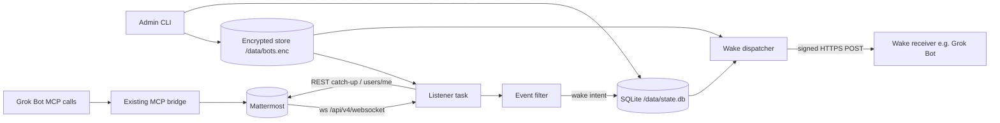
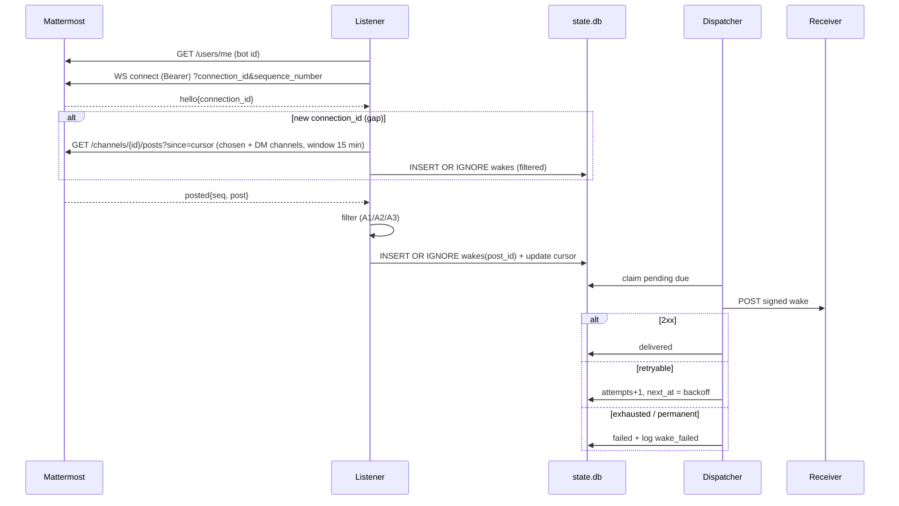

# eng-run plan-review live-bots-delta-no-allowlist

## Summary
- role: plan-review; runner: codex (codex); exit code: 0; started 2026-10-27 13:55:54
- review file: thoughts/shared/verification/2026-10-27-live-bots-delta-no-allowlist-plan-review.md - 8 finding(s): 4 high, 4 medium
- set plan_review: thoughts/shared/verification/2026-10-27-live-bots-delta-no-allowlist-plan-review.md in thoughts/shared/plans/2026-10-27-live-bots-delta-no-allowlist.md
- next: disposition every finding (fixed / accepted-risk with Rob / rejected + reason); run .eng/bin/eng-check .

## Command
````
codex exec --sandbox read-only -o thoughts/shared/runs/2026-10-27-plan-review-live-bots-delta-no-allowlist.last-message.txt '<prompt: see run log>'
````

## Prompt
````
You are the independent plan reviewer for this repository (eng-process kit v2.5.6). Do not edit any file except as stated below.

Follow the eng-plan skill (.claude/skills/eng-plan/SKILL.md, steps 8-9 "Mandatory plan review") and .eng/PROCESS.md section 10.

Review thoughts/shared/plans/2026-10-27-live-bots-delta-no-allowlist.md and its slice cards (thoughts/shared/slices/*.md) against the approved design (docs/design/2026-10-26-live-bots.md, REQ ids), the architecture (docs/architecture/2026-10-26-live-bots.md) and the ADRs in docs/decisions/. Look for gaps, wrong ordering, missing tests, missing verification commands, and security holes (auth, tenancy, secrets, input validation).

Executable specs (v2.5, medium/large): check every REQ has at least one spec in tests/acceptance/specs/ tagged @pytest.mark.req("REQ-n") that follows the design's Acceptance examples; specs use domain language only (no URLs, selectors, status codes, sleeps); each spec creates its own data through the DSL; every slice lists `specs:`; the planned channels match triage (medium: api; large: api + one Playwright web journey). Report specs that test implementation instead of behavior.

Output: a numbered list of findings. Each finding on its own line as
  N. [severity] location - finding - suggested fix
with severity one of critical | high | medium | low. If you find nothing, write exactly "No findings."
Your final message is saved by eng-run to thoughts/shared/verification/2026-10-27-live-bots-delta-no-allowlist-plan-review.md (a review-findings artifact); the planner then fills the Findings table dispositions. Never approve anything: only Rob approves (CP-C).
````

## Output
````
Reading additional input from stdin...
OpenAI Codex v0.164.0
--------
workdir: /mnt/d/rob/projects/mmbridge
model: gpt-6.1-sol
provider: openai
approval: never
sandbox: read-only
reasoning effort: none
reasoning summaries: none
session id: 01a17eb8-136a-7c52-9518-42c88953acd3
--------
user
You are the independent plan reviewer for this repository (eng-process kit v2.5.6). Do not edit any file except as stated below.

Follow the eng-plan skill (.claude/skills/eng-plan/SKILL.md, steps 8-9 "Mandatory plan review") and .eng/PROCESS.md section 10.

Review thoughts/shared/plans/2026-10-27-live-bots-delta-no-allowlist.md and its slice cards (thoughts/shared/slices/*.md) against the approved design (docs/design/2026-10-26-live-bots.md, REQ ids), the architecture (docs/architecture/2026-10-26-live-bots.md) and the ADRs in docs/decisions/. Look for gaps, wrong ordering, missing tests, missing verification commands, and security holes (auth, tenancy, secrets, input validation).

Executable specs (v2.5, medium/large): check every REQ has at least one spec in tests/acceptance/specs/ tagged @pytest.mark.req("REQ-n") that follows the design's Acceptance examples; specs use domain language only (no URLs, selectors, status codes, sleeps); each spec creates its own data through the DSL; every slice lists `specs:`; the planned channels match triage (medium: api; large: api + one Playwright web journey). Report specs that test implementation instead of behavior.

Output: a numbered list of findings. Each finding on its own line as
  N. [severity] location - finding - suggested fix
with severity one of critical | high | medium | low. If you find nothing, write exactly "No findings."
Your final message is saved by eng-run to thoughts/shared/verification/2026-10-27-live-bots-delta-no-allowlist-plan-review.md (a review-findings artifact); the planner then fills the Findings table dispositions. Never approve anything: only Rob approves (CP-C).

codex
I’ll read the project state, handoff, and review instructions, then check the plan, slice cards, and executable specs against the approved design and architecture.

exec
/bin/bash -lc 'cat PROJECT_STATE.md' in /mnt/d/rob/projects/mmbridge
 succeeded in 0ms:
---
id: STATE
type: project-state
phase: implement
status: active
owner_agent: claude-code
date: 2026-10-27
links: []
triage: large             # unset | small | medium | large
active_slice: SLICE-20261027-lb4-signed-wake-dispatcher
# Single source of truth for approvals. One item per line: "CP-X: <path> - <decision needed>".
# Later checkpoints (e.g. CP-B while in discover) may be listed early. Quote items containing commas.
pending_approvals: []
# Working agreements (see PROCESS.md section 10). Never hard-code these in design docs.
implementer: claude-code      # who writes code (default: Claude Code on the owner's PC)
planner: grok-bot             # who plans, writes docs, keeps state and process
cross_review: codex-advisory  # codex-advisory | none  (advisory, never a gate)
push_permission: standing     # standing: after eng-verify PASS may push main; tags/force-push still ask (Rob 2026-10-26)
board: none                   # none | vikunja (optional, board only; repo stays the source of truth)
acceptance: executable-specs   # v2.5: tests/acceptance/, see PROCESS.md 13
---
# PROJECT_STATE

> Single entry point. Any agent reads THIS file first, then the latest handoff linked below.
> Update it at the end of every session. Keep it under one screen.

## Current phase
implement (increment A Live bots, Large) - PROCESS.md section 3.

## Goal (one sentence)
A public HTTPS MCP bridge (Python, deployed on Coolify at chats.rmlab.cloud) that lets Grok Bots read and post in Rob's self-hosted Mattermost, each bot using its own Mattermost bot token.

## Active slice
[SLICE-20261027-lb4-signed-wake-dispatcher](thoughts/shared/slices/2026-10-27-lb4-signed-wake-dispatcher.md) (blocked: Issue in Phase 4). Previous: lb3 [done](thoughts/shared/slices/2026-10-27-lb3-listener-filters.md)

## Next action
lb4 implemented except a DM-only bot config: 5/7 lb4 specs green, unit 216 + MCP acceptance 16 green (commit 446047a). BLOCKED on "Issue in Phase 4" (see Blockers). Planner: take the decision to Rob, then the implementer finishes lb4. Codex review of lb4 still to run (codex not installed on the implementer PC). Deploy prerequisites before enabling: Coolify volume /data (uid 10001), env MMB_STORE_KEY, replicas 1.

## Blockers
- 2026-10-27 Issue in Phase 4: specs `test_dm_to_bot_wakes_bot_once` and `test_forged_wake_is_rejected` register a DM-only bot (`given_live_bot("eddie", channels=[])`), but store validation and `admin set-bot` (lb1, PR-6; `tests/unit/test_store.py:107`) reject an empty channel list. Rob decides: allow `channels: []` (suggested, ~10 lines + tests) or change the specs (speclock). Details: lb4 slice card, Blockers.

## Pending approvals
See `pending_approvals` in the front matter (the only copy; `.eng/bin/eng-status` renders it). Do not list items here.

## Back-ups to an earlier phase
<!-- date - from phase -> to phase - why (blameless) - artifacts revised -->
none

## Latest artifacts
<!-- Relative links only; .eng/bin/eng-check verifies they resolve. -->
- Conventions: [AGENTS.md](AGENTS.md)
- Owner guide: [OWNER-GUIDE.md](OWNER-GUIDE.md)
- Definition of Done: [docs/definition-of-done.md](docs/definition-of-done.md)
- Process feedback: [thoughts/shared/process-feedback.md](thoughts/shared/process-feedback.md)
- Design A Live bots (approved; scope REDUCE recorded 2026-10-26): [docs/design/2026-10-26-live-bots.md](docs/design/2026-10-26-live-bots.md)
- Design (approved; scope hold approved): [docs/design/2026-10-25-mmbridge-mcp.md](docs/design/2026-10-25-mmbridge-mcp.md)
- Plan A Live bots (status in front matter): [thoughts/shared/plans/2026-10-27-live-bots.md](thoughts/shared/plans/2026-10-27-live-bots.md)
- Plan review A (AWAITING Codex, mandatory): [thoughts/shared/verification/2026-10-27-live-bots-plan-review.md](thoughts/shared/verification/2026-10-27-live-bots-plan-review.md)
- Review lb2 (addressed): [thoughts/shared/verification/2026-10-27-slice-20261027-lb2-state-db-wake-queue-review.md](thoughts/shared/verification/2026-10-27-slice-20261027-lb2-state-db-wake-queue-review.md)
- Specs A: [tests/acceptance/specs/test_live_bots.py](tests/acceptance/specs/test_live_bots.py)
- Architecture A Live bots (approved): [docs/architecture/2026-10-26-live-bots.md](docs/architecture/2026-10-26-live-bots.md)
- Cross-model review A (awaiting Codex): [thoughts/shared/verification/2026-10-26-live-bots-arch-review.md](thoughts/shared/verification/2026-10-26-live-bots-arch-review.md)
- Architecture: [docs/architecture/2026-10-25-mmbridge-mcp.md](docs/architecture/2026-10-25-mmbridge-mcp.md)
- ADRs 0001-0010 (all accepted): [docs/decisions/](docs/decisions/)
- Latest handoff: [thoughts/shared/handoffs/2026-10-27_12-53-47_lb4-blocked-dm-only-bot.md](thoughts/shared/handoffs/2026-10-27_12-53-47_lb4-blocked-dm-only-bot.md)
- Review lb3 (addressed, no findings): [thoughts/shared/verification/2026-10-27-slice-20261027-lb3-listener-filters-review.md](thoughts/shared/verification/2026-10-27-slice-20261027-lb3-listener-filters-review.md)
- Changelog: [CHANGELOG.md](CHANGELOG.md)
- Plan (approved): [thoughts/shared/plans/2026-10-25-mmbridge-mcp.md](thoughts/shared/plans/2026-10-25-mmbridge-mcp.md)
- Verification s1 (PASS): [thoughts/shared/verification/2026-10-26-s1-verify.md](thoughts/shared/verification/2026-10-26-s1-verify.md)
- Slices: [thoughts/shared/slices/](thoughts/shared/slices/)
- Specs: [tests/acceptance/specs/test_mmbridge.py](tests/acceptance/specs/test_mmbridge.py)
- Research A Live bots (accepted): [thoughts/shared/research/2026-10-26-live-bots-current-code.md](thoughts/shared/research/2026-10-26-live-bots-current-code.md)
- Research: [thoughts/shared/research/2026-10-25-mmbridge-current-code.md](thoughts/shared/research/2026-10-25-mmbridge-current-code.md)
- Deferred work: [TODOS.md](TODOS.md)
- Retro (done): [thoughts/shared/retros/2026-10-26-v0.2.0.md](thoughts/shared/retros/2026-10-26-v0.2.0.md)

## Approval log
<!-- One row per decision. Artifact cell names the file path(s). Decision: approved | accepted | partially accepted | deferred | rejected.
     Pre-kit decisions: back-fill with Checkpoint "pre-kit" and Decision "approved (back-filled, pre-kit)". .eng/bin/eng-check matches rows to statuses. -->
| Date | Checkpoint | Artifact | Decision (Rob) |
|---|---|---|---|
| 2026-10-27 | CP-S | thoughts/shared/slices/2026-10-27-lb3-listener-filters.md | approved (verify PASS; ws_spike hello+ping reply+posted on Coolify; via Eddie) |
| 2026-10-27 | CP-S | thoughts/shared/slices/2026-10-27-lb2-state-db-wake-queue.md | approved (verify PASS; empty-DB admin failed/stats deferred; via Eddie) |
| 2026-10-27 | CP-S | thoughts/shared/slices/2026-10-27-lb1-bot-store-admin-cli.md | approved (verify PASS; live container/Coolify check deferred, not yet redeployed; via Eddie) |
| 2026-10-27 | CP-C | thoughts/shared/plans/2026-10-27-live-bots.md | approved speclock sha256:3108f1fe6a93cfae |
| 2026-10-27 | CP-B | docs/architecture/2026-10-26-live-bots.md | approved (incl. stored-token security review) |
| 2026-10-27 | CP-B | docs/decisions/0006-encrypted-token-store.md, docs/decisions/0007-mattermost-websocket-listener.md, docs/decisions/0008-signed-wake-webhook.md, docs/decisions/0009-listener-state-persistence.md, docs/decisions/0010-acceptance-tests-live-bots.md | accepted (ADR-0006..0010) |
| 2026-10-26 | CP-R | thoughts/shared/research/2026-10-26-live-bots-current-code.md | accepted (via Eddie) |
| 2026-10-26 | CP-A (scope) | docs/design/2026-10-26-live-bots.md | approved (REDUCE: In A1, A2, A3 own-post, A4, A7, A8 one bot, hand-set channels; Out A6, A3 bot-to-bot caps, A5/A5b/A5c auto-join deferred by Rob after first proposal; via Eddie) |
| 2026-10-26 | CP-A | docs/design/2026-10-26-live-bots.md | approved (problem, REQ-A1..A8 incl. A5/A5b/A5c/A6, acceptance examples; via Eddie; later clarified: one-bot wedge = whole v1 ship, multi-bot later increment) |
| 2026-10-26 | triage (size) | docs/design/2026-10-26-live-bots.md | accepted (large confirmed; via Eddie) |
| 2026-10-26 | CP-S | thoughts/shared/slices/2026-10-26-d-hardening-xff-bearer.md | approved (live: FORWARDED_ALLOW_IPS working, logs show public client IPs; 1 container; via Eddie) |
| 2026-10-26 | triage (size) | thoughts/shared/slices/2026-10-26-d-hardening-xff-bearer.md | approved (small confirmed, security; via Eddie) |
| 2026-10-26 | CP-P | CHANGELOG.md (v0.2.0, commit 9946445, tag v0.2.0) | approved (release v0.2.0) |
| 2026-10-26 | CP-S | thoughts/shared/slices/2026-10-25-s3-dm.md | approved (live same-channel dual DM, ping via dm_read, nobody -> unknown_user)
| 2026-10-26 | CP-S | thoughts/shared/slices/2026-10-25-s2-post-read-channel.md | approved (live post/read/not_member)
| 2026-10-25 | CP-A | docs/design/2026-10-25-mmbridge-mcp.md | approved (problem, REQ-1..8, acceptance examples) |
| 2026-10-25 | CP-A (scope) | docs/design/2026-10-25-mmbridge-mcp.md | approved (scope mode hold: REQ-1..8 in; @mention wakes, auto-join, multi-bot, threads/reactions/files out) |
| 2026-10-25 | CP-B | docs/architecture/2026-10-25-mmbridge-mcp.md | approved |
| 2026-10-25 | CP-B | docs/decisions/0001-credential-handoff-bearer-per-call.md, docs/decisions/0002-mattermost-http-client.md, docs/decisions/0003-mcp-surface-streamable-http.md, docs/decisions/0004-per-token-in-memory-rate-limit.md, docs/decisions/0005-structured-logs-public-health.md | accepted (ADR-0001..0005) |
| 2026-10-26 | CP-C | thoughts/shared/plans/2026-10-25-mmbridge-mcp.md | approved speclock sha256:2e4855ad12913e1f |
| 2026-10-26 | CP-S | thoughts/shared/slices/2026-10-25-s1-auth-list-channels.md | approved (manual verification approved by Rob; verify PASS; review F1/F2 accepted-risk) |

exec
/bin/bash -lc 'python3 .eng/bin/eng-check .' in /mnt/d/rob/projects/mmbridge
 succeeded in 1309ms:
eng-check: OK - 0 error(s), 0 warning(s), 88 artifact(s) checked

exec
/bin/bash -lc 'cat .claude/skills/eng-plan/SKILL.md .eng/PROCESS.md' in /mnt/d/rob/projects/mmbridge
 succeeded in 0ms:
---
name: eng-plan
description: Write an implementation plan as vertical slices with automated and manual success criteria. Use after research (and architecture for large work) is approved, before any code changes.
---
# eng-plan

Session: standard Start/Finish per `.eng/PROCESS.md` section 8 (kit: `PROCESS.md`). Scripts: `.eng/bin/eng-check`, `.eng/bin/eng-status`, `.eng/bin/eng-new`.

## Inputs (files only)
- Approved design doc, research doc, accepted ADRs, approved architecture (large); .eng/bin/eng-check enforces these
- `AGENTS.md` (test/lint commands); PROJECT_STATE working agreements

## Outputs
- `thoughts/shared/plans/<date>-<slug>.md`
- One slice card per phase: `thoughts/shared/slices/*` (`status: todo`, `plan:`/`plan_phase:` set)
- Medium/large: the **mandatory** Codex plan review `thoughts/shared/verification/<date>-<slug>-plan-review.md`, linked from the plan's `plan_review:`

## Steps
1. Be skeptical: verify research claims you rely on against the code.
2. Propose the phase outline (slice names, order) to Rob before details; get buy-in.
3. Each phase is a **vertical slice**: thin, end-to-end, demoable; contract/mock first. No horizontal DB -> API -> UI phases.
4. Program design in Implementation Approach: key types/signatures, call path, file-tree diff.
5. Each phase: Changes Required, Success Criteria split into **Automated Verification** (exact commands) and **Manual Verification**.
6. Write each slice card so the implementer (PROJECT_STATE `implementer`, normally Claude Code on Rob's PC) can run it cold from `eng-resume` + `eng-implement-slice`. Mark auth/tenancy/security slices: they always get the cross-model review.
7. Fill **What We're NOT Doing** and a short **Demo script** (3-6 steps Rob can follow to see it work). Resolve all open questions.
7a. **Executable specs (medium/large, v2.5; PROCESS.md 13):** if `tests/acceptance/` is missing, run `python3 .eng/bin/eng-spec init .`. Turn the design's Acceptance examples into specs in `tests/acceptance/specs/` (domain language, DSL calls only, `@pytest.mark.req("REQ-n")`; medium: api channel; large: plus one `@pytest.mark.channels("api", "ui")` journey). Extend the DSL interface as needed (assertion steps named `assert_*`/`then_*`/...). Fill every slice card's `reqs:` and `specs:` (or `specs: none - <reason>`). Fill Testing Strategy. Then `python3 .eng/bin/eng-spec lock .` and include the printed `approved speclock sha256:<hex>` decision in the CP-C Approval log row Rob approves. Drivers can stay stubs until the slices that need them.
8. **Mandatory plan review (medium/large; small exempt)**, after the plan and slice cards are drafted and before asking for CP-C. Rob (or the implementer) runs Codex non-interactively from the repo root on his machine; `.eng/bin/eng-status` prints the command with real paths:
   `codex exec "review <plan path> and the slice cards <slice glob> against <design doc> (REQ ids), <architecture doc> and <ADR range> for gaps, wrong ordering, missing tests, and security holes; output a numbered list of findings with severity" -o thoughts/shared/verification/<date>-<slug>-plan-review.md`
   Or: `python3 .eng/bin/eng-run plan-review <plan>` (runner from `.eng/runners.toml`; writes the findings file, a run log, and sets an empty `plan_review:`). Chet/Dave may run it on Rob's PC with his approval; `--dry-run` shows the command.
9. Codex has written the review file (`-o`; eng-run pre-fills the Findings table as `open`). Add the review-findings front matter and Findings table above the raw output (template `review-findings.md`); one row per finding with severity (critical/high/medium/low) and disposition: `fixed` (say where; update plan/cards), `accepted-risk` (only after Rob approves; record "Rob <date>"), or `rejected` (with a reason **and evidence**: a file:line or a test reference; eng-check warns otherwise). Set `plan_review:` in the plan to that path. No critical/high may stay `open`. Plan approved before reviews were mandatory: run it retroactively before the next slice, or log Rob's waiver row (PROCESS.md 10).
10. `.eng/bin/eng-check .` must pass (it enforces the plan review once a slice starts).

## Exit criteria
All required sections; every phase has both criteria types; slice cards exist; no open questions; (M/L) plan review linked with no open critical/high finding.

## Approval stop (Rob)
**CP-C Plan**: `CP-C: <plan path> - approve plan`. Medium/large: ask only once the plan review is clean. On approval set plan `approved`, log it, set `phase: implement`, `active_slice:` the first slice card. Then the slice is ready: start it with `python3 .eng/bin/eng-run implement <plan> <slice-id>` (CP-C approval covers this unless Rob said otherwise) and show Rob the "ready to implement" message as FYI (`.eng/bin/eng-status` prints it; paste prompt only as fallback; PROCESS.md section 10). You own the run's completion: stay on it (or get woken by the `[hooks] implement_on_complete` hook), then read the run log + latest handoff and continue to eng-verify / CP-S or surface the blocker. Same for a headless `eng-run plan-review`: set the wake pair (hook `plan_review_on_complete` or general `on_complete`, plus a timeout, S 45m) and classify a timeout with the `.running.md` PID marker (PROCESS.md section 10; platform failures to Ulrik).

## Finish
Standard: end with eng-handoff.
<!-- Copy of eng-process kit v2.5.6 PROCESS.md, vendored by eng-init. Do not edit here. -->
# Engineering Process (canonical, kit v2.1)

One human approver (Rob, "the owner"), several interchangeable AI agents. **All state lives in files; the repo is the single source of truth.** Any agent must be able to pick up the project from `PROJECT_STATE.md` + the latest handoff alone. This file is the only place the phase-to-skill routing lives (section 3); `AGENTS.md` and skills reference it, and `.eng/PROCESS.md` is a pinned read-only copy written by `eng-init`.

## 1. Repo layout (created by `<kit>/bin/eng-init`)
```
PROJECT_STATE.md          single entry point: phase, triage, working agreements, active slice, next action, approvals
AGENTS.md  (CLAUDE.md -> @AGENTS.md)   commands, architecture map, conventions
OWNER-GUIDE.md            plain-language guide + glossary for the owner
CHANGELOG.md  TODOS.md    release notes; deferred work and scope cuts
docs/definition-of-done.md
docs/vision/              long-lived product vision / feature list (type vision)
docs/design/              design docs per increment (problem -> requirements -> scope [-> architecture])
docs/architecture/        optional separate architecture docs for large work (type architecture)
docs/decisions/           ADRs NNNN-slug.md, id ADR-NNNN, append-only
thoughts/shared/research/         codebase research: what the code IS (type research)
thoughts/shared/market-research/  external/market/methods research (type market-research)
thoughts/shared/briefs/           project briefs for a new implementer/reviewer (type project-brief)
thoughts/shared/{plans,slices,handoffs,retros}/
thoughts/shared/verification/     verification reports + independent review findings (*-review.md)
thoughts/shared/review-notes/     owner's scratch notes; agents don't edit; not checked
thoughts/shared/inbox.md          owner incoming-thoughts inbox (v2.5.6); append-only on capture prefixes; not checked
thoughts/shared/inbox/            rotated inbox archives YYYY-MM-DD-HHMM-inbox.md (committed)
thoughts/shared/process-feedback.md  friction log for the kit (type process-feedback)
.eng/bin/                 vendored kit scripts (eng-check, eng-status, eng-new, eng-init, englib.py); plain python3
.eng/templates/  .eng/PROCESS.md  .eng/VERSION   vendored templates, this file, kit version
.claude/skills/eng-*/SKILL.md     vendored skills (Claude Code project-skill location)
.eng/templates/  .eng/PROCESS.md  .eng/VERSION    kit copy (templates used by .eng/bin/eng-new)
```
Every checked artifact starts with front matter: `id, type, phase, status, owner_agent, date, links`. `.eng/bin/eng-check` enforces it. Inline lists may quote items containing commas (`["a, b", c]`); dash lists also work.

## 2. Triage (`eng-triage`, first step for any request)
| Size | Signal | Phases |
|---|---|---|
| **Small** | about 1 file or an obvious fix, no new interface, no data change, reversible | Implement -> Verify -> Ship (one slice card, no plan) |
| **Medium** | a few files, one component, known patterns | Discover (short design doc) -> Research -> Plan -> Implement -> Verify -> Ship -> Reflect |
| **Large** | new component/interface/data model, cross-cutting, brownfield risk, security/money/data | all nine phases, all checkpoints |
When in doubt, size up. Re-triage if research reveals more than expected. Record it in `PROJECT_STATE.md` (`triage:`).

**Readiness check.** When a project claims to be at a later phase (e.g. "we're already on slice 1"), `eng-triage` verifies that every earlier phase's artifacts and approvals exist for its size (table below; `.eng/bin/eng-status` prints `readiness:` and `.eng/bin/eng-check` fails on gaps). If anything is missing, set `phase` back to the earliest incomplete phase, list exactly what is missing under Blockers, and record the back-up (section 4a).

| To be in phase | Small | Medium | Large |
|---|---|---|---|
| research | n/a | approved design (CP-A) | approved design (CP-A) |
| architecture | n/a | n/a | + approved codebase research (CP-R) |
| plan | n/a | approved design; research doc exists | + approved architecture (CP-B logged, or approved `docs/architecture/` doc) |
| implement | slice card | + approved plan (CP-C) with clean plan review | + approved plan (CP-C) with clean plan review |
| verify | slice card | same as implement | same as implement |
| ship | + verification `pass` (CP-D) | + verification `pass` | + verification `pass` |

## 3. Phases (and the skill for each: this is the routing table)
| # | Phase | Skill | Entry | Output | Exit criteria | Checkpoint |
|---|---|---|---|---|---|---|
| 0 | (any session) | eng-resume to start, eng-handoff to end; eng-triage for new requests; eng-project-init to adopt | | | | |
| 1 | Discover | eng-discover | triaged M/L | `docs/design/*` (+ optional `docs/vision/`, `thoughts/shared/market-research/`) | problem, metric, testable requirements; no `[NEEDS CLARIFICATION]` | **CP-A Product** |
| 2 | Scope | eng-scope-review | CP-A approved | design doc Scope section (baseline = approved requirements list); cuts -> TODOS.md; ADR if durable | mode chosen relative to baseline, in/out lists | (part of CP-A for L) |
| 3 | Research | eng-research | approved design | `thoughts/shared/research/*` | code *as is* with file:line; no recommendations | **CP-R Research** (L; optional M) |
| 4 | Architecture | eng-architecture-review | research approved | design doc Architecture section **or** `docs/architecture/*` linked from it; ADRs | contracts, data, sequence, failure modes, rollback, observability, security | **CP-B Architecture** (L) |
| 5 | Plan | eng-plan | prerequisites (section 2) | `thoughts/shared/plans/*` + slice cards + **mandatory Codex plan review** (M, L) | vertical slices, each with automated + manual criteria; What We're NOT Doing; no open critical/high review finding | **CP-C Plan** (M, L) |
| 6 | Implement | eng-implement-slice (run by the implementer) | plan approved, slice next, no pending approvals | code + tests, plan checkboxes, slice card; then independent review findings | slice's automated criteria pass; review findings answered | **CP-S Slice** per slice |
| 7 | Verify | eng-verify | all slices `review`/`done` | `thoughts/shared/verification/*` | every criterion re-executed; DoD pass; verdict PASS | **CP-D Done** |
| 8 | Ship | eng-ship | verification PASS | CHANGELOG entry, VERSION (if used), PR | CI green, PR opened | **CP-P PR merge/deploy** (Rob merges) |
| 9 | Reflect | eng-retro | shipped (or weekly, or each advisor consultation) | `thoughts/shared/retros/*` + edits | process-feedback pass done; each change applied to a file | none |

**One phase per session, one artifact, then stop for approval.** Discovery tends to pre-draft later artifacts (architecture, plan). That's allowed only as input. **Wording, used everywhere:** `input` = a pre-draft written in an earlier phase than its own, not yet worked on in its own phase; `draft` = being written in its own phase; `in-review` = waiting for Rob. None of these is an approval, and neither is any invented status like `approved-for-review` (`.eng/bin/eng-check` rejects those). Pre-drafts carry `status: input` and the heading note "input, not approved"; their own phase's skill turns them into `draft`. The owner may choose to group phases in one session once familiar with the process; record that in the handoff.

## 4. Approval checkpoints
- **Front matter `pending_approvals` is the single source of truth.** Item format: `CP-X: <path>[ + <path>] - <decision needed>`; paths must exist (CP-P may name a PR URL). The body section only points at it; `.eng/bin/eng-status` renders it. `.eng/bin/eng-check` fails if the body lists CP items that differ.
- Checkpoints for **later** phases may be pending early (e.g. CP-B auth/hosting questions during Discover). A pending checkpoint for an **earlier** phase than the current one blocks (`.eng/bin/eng-check` error); so does any missing prerequisite (section 2), for every phase, not just implement/verify/ship.
- **Owner review workflow.** Rob may jot notes in `thoughts/shared/review-notes/<owner>-review-notes.md`. Agents never edit or act on it until he says the notes are ready. Approvals arrive in chat. The agent then records each one in (1) the PROJECT_STATE Approval log row, (2) the artifact `status`, and (3) an ADR if the decision is durable, removes the pending item, and commits. The repo, not the chat, is the official record. `.eng/bin/eng-check` cross-checks the log and statuses both ways.
- **Notes rotation.** When a cycle finalizes (a slice reaches `done`, or a ship), if the scratch file has notes: `git mv` it to `<cycle-id>-<owner>-review-notes.md` and recreate the empty scratch file from `.eng/templates/review-notes.md`. Done in eng-handoff and eng-ship.
- **Owner inbox (v2.5.6).** Random thoughts and feature ideas go in `thoughts/shared/inbox.md`: Rob edits it directly or prefixes a message with `note:`/`n:`/`idea:`/`feature:`/`future feature:`/`ff:`/`capture:`/`cap:`, and the agent appends the item verbatim. Nothing else happens until he says "process incoming" / "check idea log" / "process notes". Then the agent walks each item with him (classify, clarify one question at a time, move it to its home or act, or defer). Once all are settled it moves the file to `thoughts/shared/inbox/YYYY-MM-DD-HHMM-inbox.md` with a status/action per item and recreates the live inbox holding only deferred items (with deferral date). See skill eng-inbox.
- Rejection: status back to `draft`, reasons in the artifact; for research, discard and redo rather than patch.
- ADR statuses: `proposed | accepted | partially-accepted | deferred | rejected | deprecated | superseded`. `partially-accepted` requires a `## Parts` section marking each part; `deferred` sets `revisit:`.

### 4a. Backing up to an earlier phase (blameless)
Discovering that an earlier artifact is wrong is normal. Any agent or the owner can call "back up to <phase>" (usually Discover): set `phase` back, set the design doc back to `draft` and any later-phase pre-drafts to `input`, revise them, move affected approvals back to `pending_approvals`, and add a line to PROJECT_STATE "Back-ups to an earlier phase": date, from -> to, why, artifacts revised. No blame, just the reason.

**Approvals live only in the Approval log table** (`| date | CP-X | path | decision |`). `eng-check` flags an approval written anywhere else in PROJECT_STATE.md (a prose line like "CP-C approved by Rob", a row-like line outside the table, a stray line inside the section), and any `approved` status without a table row.

**Design changes after CP-A.** Once the design doc is approved, editing it needs re-approval: set it back to `in-review` and request CP-A again, then log a **new** Approval log row (newer date). To make the check exact, put the content hash in the decision cell: `approved sha256:<first 12+ hex of sha256 of the file, LF line endings>`. Without a hash, `eng-check` warns when git shows a commit touching the approved design dated after the latest CP-A row. Edits during phase `discover` are never flagged. It also warns when plan or slice drafts exist while no design doc is approved (except triage small, or unset: size unknown before triage). Both checks are errors since v2.5.0.

## 5. WIP rules
- One project phase at a time; **max 1 slice `in-progress`** (enforced). Max open PRs = what Rob can review (default 1).
- Pull the next slice only when the previous is `done` or explicitly `blocked` with a reason.
- A slice is ~100-200 changed lines, end-to-end, demoable. Bigger -> split before starting.
- Deferrals and unrelated discoveries go to `TODOS.md`, not into the current slice.

## 6. Definition of Done
`docs/definition-of-done.md` (project may extend, never weaken). Core: criteria re-executed in the verifying session; tests incl. regression; no weakened gates; docs, CHANGELOG, ADRs, TODOS updated; verification PASS; state + handoff written.

## 7. Context hygiene
- **One phase per session.** Start fresh; load only PROJECT_STATE, the latest handoff, and the inputs the skill names.
- **~40% rule of thumb:** no context meter exists, so use proxies: when you've read >~15 files, done >~30 tool calls, or been corrected twice, compact: write progress into the artifact + handoff and end the session.
- **Compaction is into files**, never into memory: plan checkboxes, slice progress log, handoff.
- **Sub-tasks for search:** delegate wide searches to sub-agents returning paths + file:line; read critical artifacts directly and fully.
- Codebase research documents what *is*; opinions belong in market research, architecture or plan.
- Keep AGENTS.md short: only what an agent cannot infer from code.

## 8. Session convention (every skill's Start and Finish)
Skills say "Session: standard" instead of repeating this.
- **Start:** new session. Read only `PROJECT_STATE.md`, the latest handoff it links, and the skill's Inputs. Run `.eng/bin/eng-check .`; if it fails for a reason this skill must not fix, stop and report. If `pending_approvals` holds a checkpoint this skill needs, stop.
- **Finish:** update PROJECT_STATE (`phase`, `active_slice`, `pending_approvals`, `owner_agent`, `date`, Next action, Blockers, Latest artifacts) as part of **eng-handoff**, which is the session end. It writes `thoughts/shared/handoffs/YYYY-MM-DD_HH-MM-SS_<slug>.md` (Tasks+status, Critical References, Recent changes file:line, Learnings, Artifacts, Approvals, Next Steps naming the next skill), runs `.eng/bin/eng-check .` (must pass) and commits the docs. eng-handoff and eng-resume don't call themselves.
- **Resume:** eng-resume reads PROJECT_STATE, the linked handoff fully, then only its Critical References; verifies Recent changes exist (git); reports discrepancies; proceeds only if no needed approval is pending.
- If the next agent must ask "what was I doing?", the handoff is defective. Log it in `process-feedback.md`.
- Session handoff and **project brief** are different: the handoff passes one session to the next; a brief (`.eng/bin/eng-new brief`) orients a new implementer or reviewer and points at the plan and state.

## 9. Rules for every agent
Recommend; Rob decides. Never weaken a gate or use `--no-verify`. A report is a claim until re-executed. Stop and report on plan/code mismatch ("Issue in Phase N") instead of improvising. No fix without root cause; after 3 failed fixes, stop and hand off. Log process friction in `thoughts/shared/process-feedback.md` as you hit it.

## 10. Working agreements (standard; values in PROJECT_STATE front matter)
| Field | Default | Meaning |
|---|---|---|
| `implementer` | `claude-code` | Who writes code: Claude Code on the owner's own PC. Never name it in design docs; reference this field. |
| `planner` | `grok-bot` | Grok Bot assistants plan, write docs, keep state and process. They don't write production code. |
| `cross_review` | `codex-advisory` | Independent cross-model review; advisory, never a gate. `none` disables. |
| `push_permission` | `ask` | `ask` = ask the owner before each push; `standing` = may push the slice branch without asking (never merge). |
| `board` | `none` | Optional Kanban (e.g. self-hosted Vikunja, deferred). If used: board only, one card per slice linking to the repo plan/slice card. The repo stays the single source of truth; never record decisions on the board. |

**Implementer hand-off loop.**
1. When a slice is ready (plan approved with its mandatory plan review clean (M/L), slice is next in PROJECT_STATE `active_slice` with `status: todo`, `pending_approvals` empty, `.eng/bin/eng-check` OK), the planner **starts** implementation on the owner's PC: `python3 .eng/bin/eng-run implement <plan> <slice-id>` (or `eng run implement ...` with the global CLI), then tells Rob once, as FYI, with the standard message from `.eng/templates/ready-to-implement.md` (`.eng/bin/eng-status` prints it filled). Bots run eng-run on Rob's PC only with Rob's approval; his CP-C / slice-ready approval covers starting implement unless he said otherwise (if PROJECT_STATE has no standing note, a one-line "start implement?" is enough). **Fallback:** if eng-run or the Claude CLI is unavailable, or Rob wants to drive Claude interactively, send the paste prompt from the same message: `Run eng-resume, then eng-implement-slice for <slice> per <plan>`. Work keeps running until Rob interjects or a real decision is due: CP-S, a push when `push_permission: ask`, eng-check failures, locked-spec issues, open critical/high plan-review findings, blockers. **Completion signal:** whoever starts `eng-run implement` owns its completion. Stay on the run (or resume when the process exits), then read the new run log in `thoughts/shared/runs/` plus the latest handoff / PROJECT_STATE, and either continue (eng-verify, request CP-S) or surface the blocker to Rob. No fire-and-forget: Rob should never have to paste the handoff filename back. If the starter cannot stay attached, configure the opt-in `[hooks] implement_on_complete` in `.eng/runners.toml` (e.g. curl a planner routine webhook) so the planner is woken on every exit, ok or failed. Same rule for headless plan-review / code-review runs; see "Wake pair + PID harness" below.
2. The implementer runs the slice on the owner's PC, ends with eng-handoff.
3. **Independent review (advisory):** before eng-verify, the cross-model review runs on the slice diff. Findings go to `thoughts/shared/verification/<date>-<slice>-review.md` (`.eng/bin/eng-new review <slug>`). The implementer fixes or answers each finding, then eng-verify runs.
4. The planner picks up the implementer's handoff and runs `eng-verify` and `.eng/bin/eng-check`, then requests CP-S.

**Mandatory plan review (medium and large; small exempt).** After the plan and slice cards are drafted and before CP-C, Codex reviews them non-interactively from the repo root on the owner's machine:
`codex exec "review <plan path> and the slice cards <slice glob> against <design doc> (REQ ids), <architecture doc> and <ADR range> for gaps, wrong ordering, missing tests, and security holes; output a numbered list of findings with severity" -o thoughts/shared/verification/<date>-<slug>-plan-review.md`
`.eng/bin/eng-status` prints this command with the real paths while CP-C is pending. **Codex output always goes straight to a file in the repo, never only the terminal:** `-o`/`--output-last-message <path>` writes the final review to the review file. Then turn that file into the findings artifact in place: add the review-findings front matter and Findings table (from `templates/review-findings.md`) above the raw output, which stays under "Reviewer raw output". Link it it from the plan's `plan_review:` field. Each finding gets a severity (critical/high/medium/low) and a disposition: `fixed` (where), `accepted-risk` (only with Rob's approval, recorded in the row), or `rejected` (with a reason). `.eng/bin/eng-check` fails, for medium/large triage, if a slice is in-progress or the phase is implement/verify/ship without a linked plan review, or with any critical/high finding still `open`. **Grandfathered plans** (approved before the review was mandatory): before the next slice starts, either run the review retroactively (same command, link it in `plan_review:`, fix/disposition findings), or record Rob's waiver in the Approval log: `| <date> | CP-C | <plan path> | waiver: plan review - approved by Rob |`. eng-check's error names both routes. This is the one review that is a gate; slice-diff and architecture reviews stay advisory.

**Cross-model review (Codex), advisory.** Run it on every slice diff before Rob approves the slice (always for auth, tenancy or security work), and on architecture docs for large work (plans: see the mandatory review above). Skip it for small or docs-only changes (write "skipped: <reason>" in the verification report). In Claude Code, gstack's `/codex` calls the real Codex CLI (diffs: `codex review --base <base> > thoughts/shared/verification/<date>-<slice-slug>-review.md`; documents: `codex exec "<prompt>" -o thoughts/shared/verification/<date>-<slug>-review.md`; always written into the repo). That needs `npm install -g @openai/codex` and `codex login` once on the owner's PC. Findings are recorded in the findings file and summarized in the verification report's "Cross-model review" section. They are advice: Rob decides, and no finding blocks by itself.

**Windows owner machines.**
- Line endings: set per command, not globally: `git -c core.autocrlf=false <cmd>` (or `input`). Kit files are LF.
- Encoding: write files as UTF-8 **without BOM** (PowerShell 5: `Out-File -Encoding utf8` adds a BOM; use `[IO.File]::WriteAllText` or PowerShell 7 `utf8NoBOM`). The scripts tolerate a BOM and print ASCII only.
- Archiving a repo to move it: include dotfiles and `.git` (`tar -czf repo.tgz -C <parent> <repo>`; Explorer's "Send to zip" can skip them).

**Headless agent runs (`eng-run`, v2.3).** From the repo root: `python3 .eng/bin/eng-run plan-review <plan>`, `... implement <plan> <slice-id>`, `... code-review <slice-id | --base REF>`. Prompts are `.eng/prompts/<role>.md` (kit-owned); the runner per role is `.eng/runners.toml` (project-owned, created once; defaults implement=claude, plan-review/code-review=codex), overridable by `ENG_RUNNER_<ROLE>` or `--runner` (`claude`, `codex`, or a `[runners.<name>]` `command` runner). Rules: every run writes a run log `thoughts/shared/runs/<date>-<role>-<target>.md` (command, prompt, output, exit code); every review also writes a review-findings file in `thoughts/shared/verification/` with rows `open` until dispositioned; review output never lives only in the terminal. Plan reviews set an empty `plan_review:` so eng-check's gate applies. eng-run refuses a review by the same runner that implemented the slice (run log, else PROJECT_STATE `implementer`) unless `--allow-self-review`, which must be named in the verification report. `--dry-run` prints the exact command without running. Bots (Chet, Dave) may run eng-run on Rob's PC only with Rob's approval for that run.

**Wake pair + PID harness (every autonomous eng-run role, v2.5.4).** Applies to `plan-review`, `implement` and `code-review` alike; the starter still owns completion and fire-and-forget stays forbidden. Set up both halves when you start a run you will not watch:
- (A) **Callback:** opt-in `[hooks]` in `.eng/runners.toml`. Role-specific `implement_on_complete` / `plan_review_on_complete` / `code_review_on_complete` wins; else the general `on_complete` fires for any role. Runs on every exit (ok or failed) after the run log is written; env `ENG_ROLE ENG_EXIT_CODE ENG_STATUS ENG_RUN_LOG ENG_REPO ENG_PLAN ENG_SLICE ENG_HANDOFF ENG_PID ENG_ENG_RUN_PID`.
- (B) **Effort-based timeout routine** as backup. Starting points by effort: S 45m, M 2h, L 4h (reviews are usually S, implement M or L).
- **PID marker:** right after the runner starts, eng-run writes `thoughts/shared/runs/<stem>.running.md` (`status: running`, `pid`, `eng_run_pid`, `role`, `slice`, `target`, `started`, `run_log`) and deletes it when it writes the finished run log (which also records `pid` / `eng_run_pid`). Marker present = still running or died abruptly.
- **When the timeout fires,** classify with the marker: (1) pid alive past the deadline: soft ping to Rob, optionally extend once by one band; (2) pid dead and a finished run log or new handoff exists: missed callback, wake the starter to resume from it; (3) pid dead and no completion artifact: auto-troubleshoot. Known project-side fixes (config, prompt, missing dependency in the repo) get one retry; otherwise hand platform / environment / silent-subprocess failures to **Ulrik** (sys admin) with: (a) what failed (role + exact command), (b) exact error or symptom plus paths (run log, handoff, marker), (c) what was already tried, (d) machine label and whether it is a registered computer (e.g. Merkle) or the shared box. The project bot owns the re-launch after Ulrik's fix.

## 10a. The kit travels with the repo
The kit is vendored into every repo, so any agent on any machine (box, WSL, Git Bash, macOS) has it without the kit source: skills in `.claude/skills/<name>/SKILL.md`, scripts in `.eng/bin/`, prompts in `.eng/prompts/`, version in `.eng/VERSION`. Always call scripts by repo-relative path from the repo root, through the interpreter (no shebang reliance): `python3 .eng/bin/eng-check .` on Linux/macOS/WSL/Git Bash, `python .eng/bin/eng-check .` or `py .eng/bin/eng-check .` on native Windows. Every path the scripts compare or print is normalized to POSIX form (`/`), so backslash paths in front matter, links or the Approval log work too; always write `/` in docs. Commit `.eng/` and `.claude/skills/`. Never edit vendored files in a repo; change the kit and re-vendor.
- **Upgrade an existing repo** (planner, from the kit source): `<kit>/bin/eng-init <repo> --upgrade`. It overwrites only kit-owned files (`.eng/bin`, `.eng/templates`, `.eng/prompts`, `.eng/PROCESS.md`, `.eng/VERSION`, `.claude/skills/eng-*`), never project files; commit the result as "chore: vendor eng-process vX.Y.Z".
- `--upgrade` also: refreshes template comments/help text in project files (AGENTS.md, CLAUDE.md, OWNER-GUIDE.md, PROJECT_STATE.md body, DoD, ...) only where a section is still unchanged kit boilerplate, and prints every owner-edited stale section to update by hand (never overwrites owner content; front matter untouched); adds an empty `plan_review:` to plans lacking it; maintains the `# >>> eng-process defaults` block in `.gitignore` (`__pycache__/`, `*.pyc`, `.venv/`, ...) adding only lines not already present anywhere in the file (no duplicate block), and prints (never runs) `git rm -r --cached -- <files>` for tracked files the ignore rules now match. `__pycache__`/`.pyc` are never vendored. Stale sections are reported by name with a short diff. New checks start warn-only for one version (stray approvals: warn until v2.4.0; `eng-check --strict` makes them errors).
- `eng-check` fails if `.eng/bin` or `.claude/skills/eng-*` is missing, and warns when `.eng/VERSION` is older than the kit running it (or `$ENG_KIT/VERSION` if set).
- **Optional global install on a dev machine:** copy the skills to Claude Code's personal skill dir so they work in every repo: `mkdir -p ~/.claude/skills && cp -r <repo>/.claude/skills/eng-* ~/.claude/skills/` (WSL: inside the WSL home; Git Bash: `%USERPROFILE%\.claude\skills`). Project skills in the repo are still the source of truth; scripts are always taken from the repo's `.eng/bin/`.

## 11. Brownfield adoption and migration
Use `<kit>/bin/eng-init <repo> --brownfield` (eng-project-init "brownfield mode"). It lists every pre-existing markdown file with a suggested destination and type (a heuristic from its name and path; confirm each).
1. **Never delete history.** Move pre-kit docs with `git mv <old> <new>` in a dedicated commit (`chore: adopt eng-process layout`) so `git log --follow` works. Don't mix moves with content edits in one commit.
2. **Map each doc** to a kit location and type: vision/feature list -> `docs/vision/`; design/spec -> `docs/design/`; architecture -> `docs/architecture/`; codebase notes -> `thoughts/shared/research/`; external/market research -> `thoughts/shared/market-research/`; plans -> `thoughts/shared/plans/`; orientation docs for an implementer -> `thoughts/shared/briefs/`. Add front matter; unknown status -> `draft`.
3. **ADRs:** kit format is `docs/decisions/NNNN-slug.md` with id `ADR-NNNN` (4 digits). Migrate `ADR-001` style: `git mv docs/adr/001-x.md docs/decisions/0001-x.md`, set `id: ADR-0001`, then rewrite cross-references (`grep -rl 'ADR-0\?\([0-9]\{2,3\}\)'` then `sed -E 's/ADR-([0-9]{3})\b/ADR-0\1/g'`, reviewed). Keep numbers stable; never renumber to close gaps. Map old statuses: Deferred -> `deferred`; "accepted with parts open" -> `partially-accepted` + `## Parts`.
4. **Back-fill the Approval log** for decisions already accepted before the kit: one row per artifact, Checkpoint `pre-kit`, Decision `approved (back-filled, pre-kit)` / `accepted (...)`, date = original decision date if known. Set statuses to match. `.eng/bin/eng-check` then passes the log/status cross-check.
5. Delete only generated or duplicate files, and only with Rob's OK. Superseded docs get `status: superseded`.
6. Run the eng-triage **readiness check** to set the true phase.

## 12. Learning loop: predictions, evidence, lessons, adoption
- **Predictions.** Every ADR, advisor-consultation note and retro recommendation records *Expected outcome*, *Check date* and *What would prove it wrong* (templates `adr.md`, `retro.md`). eng-retro scores each past entry whose check date has passed as **right / wrong / unclear** with one line of evidence, in the retro and on the entry's `Score:` line.
- **Rejecting a finding.** A rejected Codex (or any reviewer) finding needs evidence in its Reason cell: a `file:line` (e.g. `src/auth.py:42`) or a test reference (e.g. `tests/test_auth.py::test_expired_token`). `eng-check` fails rejected rows without either (an error since v2.5.0). Retros record the **review hit-rate**: findings accepted vs rejected, and real bugs caught.
- **Research provenance.** Each research file starts with a provenance header: per source, the source (URL or repo), the commit (repos: pinned SHA) or date read (web), and `verified` (checked against the source by the author) or `unverified`. Pin cloned source repos to a commit and record it. When a consultation or decision relies on research, run a **staleness diff** first (`git -C <src> fetch && git -C <src> log --oneline <pinned>..origin/HEAD -- <paths relied on>`; web sources: re-read the page) and note the result. **Snapshot** a web page (save a copy next to the research with its fetch date) only when a decision-driving claim rests on it, and do it at re-derivation time, not by default. See `SOURCES.md`.
- **Kit lessons.** Format **"when X, do Y, because Z"** with origin, confirmation count and status (`templates/kit-lesson.md`). A lesson is a *hypothesis* until a second project confirms it. eng-retro proposes them; **Rob approves** each before it enters the kit's `LESSONS.md`.
- **Design adoption.** `process-feedback.md` has a *Design adoption* section: each kit step adopted or skipped, with reason. A skip the owner made knowingly (informed-owner skip) is recorded but not counted. **Two counted non-safety skips of the same step raise a redesign flag** for that step. **Any skip of a safety gate** (personal data handling, mandatory plan review, CP approvals) **is escalated to Rob immediately.**
- **Waste and time.** Each retro answers "which step felt like waste?" and records rough time per phase, so the kit can be trimmed with evidence.
- **Frontend legibility.** Architecture reviews always ask: *Can the owner judge this frontend's behaviour and code? If not, what reduces that gap?* Plans include a short **Demo script**. Frontend CI checks are opt-in and size-dependent: `.eng/templates/ci-checklist.md` (not enforced by eng-check).

## 13. Executable specifications (v2.5; Dave Farley's ATDD four-layer model)
**Two kinds of "spec", one direction.** *Design-side specs* (the design doc, the architecture doc, ADRs) say **what**
to build and **how** to build it; they are the authority. *Executable specs* are the **test-side** expression of the
design doc's requirements (REQ-n) and its plain-language acceptance examples: pytest tests in domain language under
`tests/acceptance/specs/`, each pointing back at its requirement with `@pytest.mark.req("REQ-n")` (the design doc's
id). They never introduce requirements; a spec without a REQ, or a REQ without a spec, is a gap to fix in the design
doc or the specs.

**Four layers** (`.eng/templates/acceptance/`, copied by `eng-spec init`):
1. **Specs** (`specs/`): what, never how; no URLs, selectors, status codes or sleeps; each creates its own data.
2. **DSL** (`dsl.py`): the shared domain vocabulary; aliases names per run (functional and temporal isolation).
3. **Protocol drivers** (`drivers/`): `api` (httpx), `ui` (Playwright), `mcp`. All system knowledge lives here.
4. **System under test**: deployed like production, started outside the tests; external systems stubbed at its boundary.

**By size.** Small: unchanged (unit/regression tests; no executable specs). Medium: specs on the API channel.
Large: API channel plus one Playwright web journey (`@pytest.mark.channels("api", "ui")`), with an ADR from
`.eng/templates/adr-acceptance-tests.md`.

**Approvals.**
- **CP-A:** Rob approves the plain-language Given/When/Then examples in the design doc's "Acceptance examples".
- **CP-C:** the planner writes the specs and the DSL interface, runs `.eng/bin/eng-spec lock .`, and the CP-C Approval
  log row records `approved speclock sha256:<hex>` (hash of `tests/acceptance/spec-lock.json`, printed by the command).
- **Locked:** spec files, and the DSL public interface (public step names, parameters, docstrings).
- **Flagged:** DSL assertion-step bodies (`assert_`/`then_`/`expect_`/`check_`/`verify_`); the Codex code review must
  name each changed step.
- **Free:** drivers, private DSL helpers (`_x`), `conftest.py`.
- An edit to a locked spec or the DSL interface during implementation is **not** a hard failure: `eng-run implement`
  prints a WARNING and writes an OWNER REVIEW entry in the run log, and `eng-check` warns until Rob re-approves
  (re-lock, new CP-C row) or the edit is reverted.

**Slices.** Each slice card lists `reqs:` and `specs:` (pytest node ids) or `specs: none - <reason>`. The implementer
runs them first and confirms they are red, then makes them green without touching locked files.

**Verify.** Re-run the acceptance suite on every planned channel; paste `eng-spec trace .` (REQ -> specs) with results
into the verification report; `eng-spec status .` must be clean or re-approved.

**eng-check (warn-only until v2.6.0; `--strict` makes them errors)**, active only when the project opted in
(`acceptance: executable-specs` in PROJECT_STATE, or a spec lock exists) and triage is not small:
`speclock-not-approved`, `spec-changed-without-approval`, `dsl-interface-changed`, `dsl-assertion-changed` (cleared
when a review-findings file names the step), `slice-without-spec`, `spec-unknown-node`, `req-without-spec` (at
verify/ship).

**Migration / grandfathering.** Existing projects are unaffected until they opt in with `eng-spec init .` (after
`eng-init --upgrade`). A project mid-increment may opt in at its next plan (CP-C); approved designs without
"Acceptance examples" are grandfathered, and their examples are written straight into specs at CP-C.


exec
/bin/bash -lc 'cat thoughts/shared/handoffs/2026-10-27_12-53-47_lb4-blocked-dm-only-bot.md thoughts/shared/plans/2026-10-27-live-bots-delta-no-allowlist.md' in /mnt/d/rob/projects/mmbridge
 succeeded in 0ms:
---
id: HANDO-20261027-lb4-blocked-dm-only-bot
type: handoff
phase: implement
status: complete
owner_agent: claude-code
date: 2026-10-27T12:53:47-05:00
links: [thoughts/shared/plans/2026-10-27-live-bots.md, thoughts/shared/slices/2026-10-27-lb4-signed-wake-dispatcher.md]
git_commit: 446047a
branch: main
next_skill: eng-implement-slice
---
# Handoff: lb4 blocked on a DM-only bot config (Issue in Phase 4)
<!-- Session handoff (agent to agent, one session). A standing orientation for a new implementer is a project brief: .eng/bin/eng-new brief. -->

## Task(s)
- SLICE-20261027-lb4-signed-wake-dispatcher (plan Phase 4): **blocked**. Test-first. The dispatcher, the HMAC receiver and the in-process live driver are done, and 5 of 7 lb4 specs are green. Two specs need a DM-only bot (`channels=[]`), which lb1 validation rejects. Reported as "Issue in Phase 4" rather than improvised.

## Critical References
- thoughts/shared/slices/2026-10-27-lb4-signed-wake-dispatcher.md (Progress log, Blockers with the suggested resolution, deviations)
- thoughts/shared/plans/2026-10-27-live-bots.md Phase 4
- docs/decisions/0008-signed-wake-webhook.md

## Recent changes
- app/wake.py:37 `sign`, :41 `verify`, :59 `Dispatcher`, :77 `tick` (owner heartbeat/standby, recover_stale, prune at start and every 6 h, claim 4), :97 `_send` (bot_rotated, attempt-stamped signed body, 5 s timeout, retry classes)
- app/listener.py:70 writes meta `bot_user_id`
- tests/unit/test_wake.py (40 tests), tests/unit/test_listener.py:122 (meta assertion)
- tests/acceptance/drivers/wake_receiver.py (new), tests/acceptance/drivers/live.py (in-process mode), tests/acceptance/drivers/fake_mattermost.py (`mm_ids=True`)
- Commit 446047a

## Learnings
- In-process driver pattern: a background event loop thread for fake MM, listener and dispatcher. Fake mutations (`add_post`) must run on that loop (`_call`), because the session queues are asyncio queues. `admin.main` runs on the spec thread (it calls `asyncio.run` itself).
- `assert_not_woken` needs a barrier, not just a sleep: post a marker DM, wait for its wake, then check. The ws events are ordered and the dispatcher claims in rowid order.
- SQLite INTEGER columns keep fractional `next_at` as REAL, so a scaled backoff (`WAKE_BACKOFF_SCALE=0.05`) works without schema changes.
- Codex CLI is not installed on this implementer PC, so the slice-diff review could not run.

## Artifacts
- app/wake.py, app/listener.py
- tests/unit/test_wake.py, tests/unit/test_listener.py
- tests/acceptance/drivers/live.py, tests/acceptance/drivers/wake_receiver.py, tests/acceptance/drivers/fake_mattermost.py
- thoughts/shared/slices/2026-10-27-lb4-signed-wake-dispatcher.md (status blocked)
- thoughts/shared/plans/2026-10-27-live-bots.md (Phase 4 unit box ticked)
- PROJECT_STATE.md (Blockers, Next action)

## Approvals
- Requested (decision for Rob, via the planner): resolve the Issue in Phase 4. Option A (suggested): allow an empty `channels` list in `store.validate` and `admin set-bot` (DM-only bot, REQ-A2), and flip `tests/unit/test_store.py:107`. Option B: change the two specs (needs a re-lock/CP-C).
- None granted this session.

## Action Items & Next Steps
1. Planner: put the Issue in Phase 4 to Rob; record the decision (approval log, plus an ADR-0006 note if Option A).
2. Implementer: eng-implement-slice lb4 again to apply the decision. Then run the PR-12 spec command; it should show exactly 7 passed.
3. Run the Codex slice review where codex is available: `python3 .eng/bin/eng-run code-review SLICE-20261027-lb4-signed-wake-dispatcher` (security slice). Answer its findings, then slice -> review, then eng-verify.
4. Not pushed.

## Other Notes
- Verification at 446047a: unit 216 passed (exit 0); acceptance default 16 passed / 9 skipped (exit 0); eng-spec status matches lock; PR-12 lb4 specs 5 passed / 2 failed (blocked). Out of scope but green: `test_bot_token_never_appears_in_logs_output_or_wakes`.
- No locked spec, no DSL file, no DSL assertion step body edited.
- Untracked files left as found: thoughts/shared/inbox.md, thoughts/shared/inbox-local-bak-1793080755/, the eng-run `.running.md` marker.
- No CHANGELOG entry: nothing is user-visible until lb5 wires the listener.
---
id: PLAN-20261027-live-bots-delta-no-allowlist
type: plan
phase: plan
status: in-review
owner_agent: grok-bot
date: 2026-10-27
links: [thoughts/shared/plans/2026-10-27-live-bots.md, docs/design/2026-10-26-live-bots.md, docs/architecture/2026-10-26-live-bots.md, tests/acceptance/specs/test_live_bots.py]
---
# Plan delta: drop the channel allow-list (Live bots v1)

Source: Rob decision 2026-10-27 (via Eddie). Amends [the approved plan](2026-10-27-live-bots.md). CP-C approved by Rob 2026-10-27 (see PROJECT_STATE Approval log); specs re-lock happens in slice lb4b.

## Overview
Remove the per-bot channel allow-list; channel wakes come from Mattermost membership plus a wake rule.

## Desired End State
One bot, configured with token + wake URL + secret only, wakes on DMs and on every post (incl. @channel/@here/@all and thread replies) in any channel it is a member of; specs re-locked in lb4b.

## What We're NOT Doing
Ignore-list (later), auto-join (REQ-A5), multi-bot (REQ-A6), mention-only filtering.

## Decision
- No per-bot channel allow-list, no `--channels` CLI step.
- Bot wakes on (1) every DM to the bot (unchanged, REQ-A2) and (2) channel posts (O/P) in channels the bot is a Mattermost member of WHERE a wake rule fires.
- Optional ignore-list: out of scope (later, only if blast radius becomes real).

## Resolved with CP-C (Rob 2026-10-27)
- D1 Channel wake rule: **every post** (by someone else, non-system) in any channel the bot is a Mattermost member of. No mention required.
- D2 `@channel` / `@here` / `@all`: **wake** (same as any post).
- D3 Thread-follow: **wake** on threaded replies in threads the bot posted in. In v1 this is already covered by D1 (all posts in member channels wake, replies carry `root_id`); keep a spec so it stays true if an ignore-list is added later.
- DMs still wake (REQ-A2). Group DMs (G) still dropped.

## Requirement / doc changes (CP-A-level text, ride along with CP-C)
- docs/design/2026-10-26-live-bots.md: REQ-A1 -> "WHEN any new post by someone else appears in a channel the bot is a member of THE SYSTEM SHALL deliver one wake"; RESOLVED Q3 note superseded; metric "chosen channel" -> "member channel".
- docs/architecture/2026-10-26-live-bots.md: store schema drops `channels`; CLI line drops `--channels`; filter rules (line ~64): O/P wake whenever the post reaches the bot's websocket (membership is the filter); catch-up iterates the bot's member channels (`GET /users/me/teams/{team}/channels`) + DM channels, not a chosen list.
- ADR-0006 text: config = token, wake URL, wake secret (no channel ids). ADR-0007 unchanged in substance.
- Plan: Phase 1 PR-6 (`channels` validation) removed; Phase 3 `decide(event, bot_user_id, chosen)` -> `decide(event, bot_user_id)`; Phase 5 PR-2 "channel set change" and PR-3 catch-up list -> member channels; deploy step `set-bot ... --channels main/town-square` -> no `--channels`.

## Code touch points
| Area | File | Change |
|---|---|---|
| store | app/store.py | `BotConfig.channels` removed (or optional, default `[]`, ignored); `validate` drops the channels rule; `load` tolerates a legacy `channels` key (ignored) so existing `/data/bots.enc` keeps loading; `version` stays 1 |
| admin | app/admin.py | drop `--channels`, `_channel_specs`, member-channel resolution (`_member_channel` import); `show`/`set-bot` output without channels; passing `--channels` -> clear `invalid_argument: channels no longer used` |
| filter | app/live_filter.py | O/P: always wake (membership is the filter); drop `chosen` arg; D unchanged; own/system/G drops unchanged |
| listener | app/listener.py | stop passing a chosen set |
| catch-up (lb5) | app/listener.py / lb5 | iterate member + DM channels; still only enqueue posts that pass `decide` |
| unit tests | tests/unit/test_store.py:105-106, test_admin.py, test_live_filter.py, test_listener.py | channels cases removed; filter cases: any member-channel post wakes, @channel wakes, thread reply wakes with root_id |
| DSL | tests/acceptance/dsl.py:147 | `given_live_bot(name, channels=())` -> `given_live_bot(name)` (DSL interface change -> re-lock) |
| driver | tests/acceptance/drivers/live.py | admin setup without `--channels` |
| specs (locked) | tests/acceptance/specs/test_live_bots.py | see below |
| lock | tests/acceptance/spec-lock.json | regenerate via eng-spec after CP-C (new sha) |

## Locked spec changes (re-lock in lb4b under this CP-C)
- `test_mention_in_chosen_channel_wakes_bot_once` -> `test_mention_in_member_channel_wakes_bot_once` (drop `channels=`).
- `test_post_without_mention_in_chosen_channel_also_wakes_bot` -> `test_post_without_mention_in_member_channel_also_wakes_bot` (drop `channels=`).
- `test_post_in_member_channel_not_chosen_does_not_wake` -> DELETE (no "chosen" concept).
- ADD `test_channel_wide_mention_wakes_bot_once` (`@channel`) and `test_reply_in_thread_bot_posted_in_wakes_bot_once` (root_id in wake).
- All other specs: remove the `channels=` argument only.
- Plan PR-12 node-id list updated to the new names.

## Unblocking lb4 (recommended)
Minimal change, no spec edits, no re-lock: make the store and `admin set-bot` accept an EMPTY channel list (lb4 Option A, ~10 lines in `store.validate` + admin; flip `tests/unit/test_store.py:106` `_raw(channels=[])` to accepted). The two blocked specs (`test_dm_to_bot_wakes_bot_once`, `test_forged_wake_is_rejected` use `channels=[]`) then pass -> 7/7 under the CURRENT lock. This is forward-compatible with full removal.
Then (CP-C approved) do the allow-list removal as its own slice (proposed `lb4b-drop-allowlist`, before lb5) or fold into lb5; lb5 catch-up must use member channels either way.

## Phase 1: Drop allow-list (proposed slice lb4b, after lb4)
Changes per the touch-point table above.
### Success Criteria
#### Automated Verification
- [ ] `.venv/bin/pytest tests/unit -q` exit 0 incl. member-channel/@channel/thread-reply filter cases and legacy-`channels`-key load test
- [ ] `.venv/bin/pytest -q --channel live tests/acceptance/specs/test_live_bots.py` (re-locked specs for lb4b scope) exit 0; `python3 .eng/bin/eng-spec status .` matches the new lock; `python3 .eng/bin/eng-check .` exit 0
#### Manual Verification
- [ ] Rob: after redeploy, `set-bot` without `--channels`; a plain post and an `@channel` post in a member channel each wake once; a thread reply wakes with root_id; a DM wakes.

exec
/bin/bash -lc 'cat docs/design/2026-10-26-live-bots.md docs/architecture/2026-10-26-live-bots.md' in /mnt/d/rob/projects/mmbridge
 succeeded in 0ms:
---
id: DESIGN-20261026-live-bots
type: design
phase: discover
status: approved
owner_agent: grok-bot
date: 2026-10-26
links: [docs/design/2026-10-25-mmbridge-mcp.md, TODOS.md]
---
# Design: A Live bots (wake-ups, auto-join/invites, multi-bot registry)

## Triage: LARGE (confirmed by Rob 2026-10-26, via Eddie)
Rationale:
1. New long-lived component: a listener (Mattermost websocket/event stream) running continuously, unlike today's stateless per-call MCP bridge.
2. New outbound interface: a wake callback on @mention / DM / channel activity, delivered as a generic HTTPS webhook (POST, JSON payload, shared-secret/HMAC auth) per Q6.
3. New persistent state: multi-bot registry (bot identity -> MM token -> wake target) means storing credentials server-side, reversing ADR-0001 (per-call Bearer, no stored tokens) -> new ADR + security review.
4. Changes REQ-7 (no implicit join) for auto-join/invite handling.
5. Multiple slices across deploy (Coolify single container, reconnect, dedupe, rate limits), observability and security; revert is not one commit.

## Problem
Today a Grok Bot only sees Mattermost when it actively calls `read_channel`/`dm_read` (v1 bridge, ADR-0001: per-call Bearer, stateless). So a person who @mentions or DMs a bot gets no reply until that bot happens to poll, which in practice means only when Rob separately prompts the bot. Mattermost therefore does not behave like a chat with live bots; Rob is the relay. Secondarily, Rob must add each bot to each channel by hand (REQ-7 forbids implicit join), and each bot is configured individually with no central list.
Known evidence: deferred out of v1 wedge on 2026-10-25 (TODOS items 3-5, P2/P3). Q1 RESOLVED (Rob 2026-10-26): no current pain from missed/late mentions. The driver is capability, not incident evidence: Rob wants to group chat with bots in Mattermost (open source, self-hosted) without depending on proprietary solutions.

## Users and success metric
- Primary: Rob, and teammates (e.g. Ulrik) who message bots in Mattermost.
- Secondary: each Grok Bot (receives wakes), Rob as operator (registers bots).
- Current workaround: none needed for pain (Rob: "No pain"); group chat with bots is simply not possible today without Rob relaying. Goal is a non-proprietary group-chat-with-bots setup.
- Metric (confirmed by Rob 2026-10-26): for a registered bot, a post in a chosen channel or a DM produces a wake delivered to that bot within 10 s, for >=95% of messages over a 7-day window, with 0 duplicate wakes and 0 bot-to-bot loops. (Bot reply latency itself depends on Grok Bot and is reported, not gated.)

## Narrowest wedge
(Clarified 2026-10-26, Rob, superseding the CP-A note: the one-bot wedge IS the v1 boundary of increment A, i.e. the whole first ship, delivered as several slices; multi-bot is a later increment.)
RESOLVED Q3 (2026-10-26, Rob): wider wedge. ONE registered bot, woken on ALL activity (every new post) in chosen channels it is a member of, plus DMs to it; not @mention+DM only. Channels are chosen explicitly per bot (config list); no auto-join, no multi-bot registry beyond a single configured entry. Proves listener, wake contract, dedupe, reconnect end to end. Auto-join (REQ-A5, Q4: accept invites automatically) and multi-bot (REQ-A6) follow as later slices or a later increment per scope review.

## Requirements (acceptance criteria)
Wedge (proposed in):
- [ ] REQ-A1: WHEN any new post (by someone other than the bot itself) appears in a channel chosen for the registered bot (and the bot is a member) THE SYSTEM SHALL deliver one wake to that bot's Grok Bot containing channel, sender, message text and post id, within the metric latency.
- [ ] REQ-A2: WHEN a user sends a DM to the registered bot THE SYSTEM SHALL deliver one wake with sender, message text and post id.
- [ ] REQ-A3: WHEN the post author is the bot itself or any registered bot THE SYSTEM SHALL NOT deliver a wake (loop prevention) EXCEPT bot-to-bot wakes permitted under the Q5 loop caps (max 1 bot-to-bot wake per minute and 5 per hour per bot pair; on exceeding, bot-to-bot wakes pause for 24 hours unless Rob @mentions both bots in one post that says "continue", which clears the pause). A bot's own posts never wake itself.
- [ ] REQ-A4: WHEN the listener loses its Mattermost connection THE SYSTEM SHALL reconnect automatically and SHALL deliver each qualifying post at most once (and, for posts during an outage up to the configurable catch-up window proposed in the plan, at least once).
- [ ] REQ-A7: THE SYSTEM SHALL NOT expose stored bot tokens in logs, tool output or wake payloads, and SHALL authenticate every wake to the Grok Bot so a forged wake is rejected.
- [ ] REQ-A8: WHEN wake delivery fails THE SYSTEM SHALL retry with backoff a bounded number of times and record the failure for the operator.
Later (proposed out of wedge, scope review decides):
- [ ] REQ-A5: WHEN a registered bot is invited/added to a channel (public or private) by any user THE SYSTEM SHALL automatically accept: ensure the bot is a member and add that channel to the bot's chosen-channel list, so subsequent posts there wake it per REQ-A1, without operator action or redeploy (amends v1 REQ-7 for the listener only; the v1 MCP tools still never join implicitly).
- [ ] REQ-A5b: WHEN a registered bot auto-accepts an invite THE SYSTEM SHALL record the event (channel, inviter, time) for the operator and SHALL deliver one wake to the bot announcing the join (channel, inviter).
- [ ] REQ-A5c: WHEN a registered bot is removed from a channel THE SYSTEM SHALL drop that channel from its chosen list and SHALL NOT wake the bot for that channel afterwards, and SHALL NOT rejoin it automatically unless invited again.
- [ ] REQ-A6: THE SYSTEM SHALL keep a registry of multiple bots, each with its own token and wake target, and route each event only to the bot(s) it concerns.

## Acceptance examples
- REQ-A1: Given bot "eddie" is registered and a member of Town Square, When Rob posts "@eddie what is on deck?" there, Then Eddie is woken once with the channel, Rob as sender and the text. / Given the same, When Rob posts "eddie is great" without @, Then Eddie is also woken once. / Given Eddie is a member of a channel NOT in its chosen list, When Rob posts there without @mention, Then no wake.
- REQ-A2: Given bot "eddie" is registered, When Ulrik DMs eddie "ping", Then Eddie is woken once with Ulrik as sender and "ping".
- REQ-A3: Given bots "eddie" and "grok" are registered, When eddie posts "@grok hi", Then grok is woken if within caps (1/min, 5/hour); the 6th within an hour triggers a 24h pause, logged, no wake. When Rob posts "@eddie @grok continue" during a pause, Then the pause clears. / When eddie's own post contains "@eddie", Then no wake.
- REQ-A4: Given the connection drops for 30 s, When Rob @mentions eddie during the gap, Then after reconnect Eddie is woken exactly once for that post.
- REQ-A7: Given a wake arrives without the shared secret, Then the Grok Bot side rejects it; Given any log or tool output, Then no bot token appears.
- REQ-A8: Given the Grok Bot wake target is down, When Rob @mentions eddie, Then delivery is retried and, if still failing, the operator can see the failed wake.
- REQ-A5: Given bot "eddie" is registered and not a member of "dev", When Ulrik adds eddie to "dev", Then eddie is a member, "dev" is in its chosen list with no redeploy, and When Rob then posts "hello" in "dev", Eddie is woken once.
- REQ-A5b: Given the same invite, Then the operator log shows channel "dev", inviter Ulrik and time, and Eddie receives exactly one join wake naming "dev" and Ulrik.
- REQ-A5c: Given eddie is in "dev" via auto-accept, When Rob removes eddie from "dev", Then a later post in "dev" produces no wake and eddie is not re-added; When Rob re-invites eddie, Then REQ-A5 applies again.
- REQ-A6: examples after scope review decides the multi-bot slice.

## Constraints and assumptions
- Deployed as single container on Coolify (confirmed by Ulrik 2026-10-26).
- RESOLVED Q4 (2026-10-26, Rob): accept channel invites automatically for Live bots v1 (any invite by any user of Rob's Mattermost, no allow-list). REQ-7 amended for the listener only.
- RESOLVED Q5 (2026-10-26, Rob): bot-to-bot wakes allowed with caps: 1 loop/min, 5 loops/hour, then 24h pause. Override: Rob @mentions both bots and says "continue". Caps are starting defaults and must be configurable (Rob does not want to be locked into limits).
- RESOLVED Q6 (2026-10-26, Rob): wake via a generic HTTPS webhook (configurable URL per bot, JSON POST, authenticated by shared secret/HMAC signature). Not Grok Bot-specific. A Grok Bot-specific inbound integration may be researched later and built as a follow-up only if necessary. Outage catch-up window: default to be proposed in the plan (not blocking).
- RESOLVED Q7 (2026-10-26, Rob): bot tokens live in an encrypted token store on the bridge (not Coolify env secrets), so adding a bot needs no redeploy. This revises ADR-0001 (stored tokens accepted for the listener); a new ADR superseding that part of ADR-0001 + security review required.
- Assumption: a Mattermost bot account can open the websocket with its own token and see all posts/DMs for channels it belongs to.

## Alternatives considered
| Option | Pros | Cons |
|---|---|---|
| MM websocket listener in mmbridge (lean) | real-time, one deploy, reuses bot tokens | stateful, reconnect/dedupe logic, stored tokens |
| MM outgoing webhooks / plugin | no long-lived socket | per-channel config, outgoing webhooks don't cover DMs, plugin effort |
| Grok Bot routine polling dm_read/read_channel | no new infra, no stored tokens | latency minutes, cost, misses metric |

## Scope decision (filled by eng-scope-review)
**Baseline (approved at CP-A 2026-10-26):** REQ-A1, A2, A3, A4, A5, A5b, A5c, A6, A7, A8.
**Mode: REDUCE - approved by Rob 2026-10-26 (via Eddie): "Approve scope but also defer auto-join A5".**
Rationale: the one-bot wedge is the whole first ship of increment A; multi-bot is a later increment. A1/A2/A4/A7/A8 are the minimum for the metric with one bot. A3 own-post suppression is needed even with one bot; its bot-to-bot caps (Q5) only matter with 2+ bots, so they move with A6. The first proposal (commit 5b7c3b1) held A5/A5b/A5c; Rob then also deferred the A5 suite, so the first ship uses a hand-set channel list only (Q4 auto-accept is deferred, not reversed).
- **In (v1 ship, ONE bot, hand-set channel list):** REQ-A1, REQ-A2, REQ-A3 (own-post suppression only), REQ-A4, REQ-A7, REQ-A8.
- **Out -> TODOS.md (later increments):** REQ-A6 multi-bot registry/routing; REQ-A3 bot-to-bot part (caps 1/min, 5/hour, 24h pause, Rob "continue" override, Q5); REQ-A5, A5b, A5c auto-accept invites / record+announce join / drop channel on removal (Q4). v1 REQ-7 (no implicit join) stays unamended for this ship.
- **Still deferred (unchanged):** thread replies, reactions, file attachments; Grok Bot-specific inbound wake path (Q6).
- Flagged outside blast radius (not a cut): encrypted token store (Q7) still needed for the one bot, so the ADR-0001 revision stays in scope -> new ADR + security review at CP-B.

## Architecture (filled by eng-architecture-review)
Separate doc (large): [docs/architecture/2026-10-26-live-bots.md](../architecture/2026-10-26-live-bots.md) - listener in-process (ADR-0007), encrypted token store (ADR-0006), signed wake webhook (ADR-0008), SQLite state on /data volume (ADR-0009), acceptance channels (ADR-0010). Status: proposed, CP-B pending.

## Open questions (for Rob, via Eddie, one at a time in this order)
None. Q1-Q7 all resolved 2026-10-26.
---
id: ARCH-20261026-live-bots
type: architecture
phase: architecture
status: approved
owner_agent: grok-bot
date: 2026-10-26
links: [docs/design/2026-10-26-live-bots.md, thoughts/shared/research/2026-10-26-live-bots-current-code.md]
design: docs/design/2026-10-26-live-bots.md
---
# Architecture: Live bots one-bot v1
Implements REQ-A1, A2, A3 (own-post only), A4, A7, A8 of [the design](../design/2026-10-26-live-bots.md) (scope REDUCE, one bot, hand-set channel list). Grounded in [research](../../thoughts/shared/research/2026-10-26-live-bots-current-code.md) (CP-R accepted). Triage: large. Out of scope here: A5/A5b/A5c, A6, bot-to-bot caps, threads-as-feature, reactions, files, Grok Bot-specific receive.

## Components and boundaries
| Component | Module (new unless noted) | Responsibility |
|---|---|---|
| MCP bridge (existing, unchanged) | app/main.py, app/mcp.py, app/service.py | per-call Bearer MCP tools (ADR-0001 still governs this path) |
| Token/bot store | app/store.py | encrypted file holding the ONE bot config: token, wake URL, wake secret, chosen channel ids (ADR-0006) |
| Admin CLI | app/admin.py (`python -m app.admin`) | operator sets/rotates bot config, lists failed wakes; run via Coolify terminal (no HTTP admin endpoint in v1) |
| Listener | app/listener.py | one asyncio task started in FastAPI lifespan; Mattermost websocket, auth, seq tracking, reconnect, REST catch-up (ADR-0007) |
| Event filter | app/live_filter.py | pure function: posted event -> wake or drop (A1/A2/A3) |
| State DB | app/state.py | SQLite on persistent volume: dedupe ledger, wake queue, per-channel cursor (ADR-0009) |
| Wake dispatcher | app/wake.py | signed HTTPS POST, retry/backoff, failure record (ADR-0008) |
| Mattermost REST client (existing) | app/mattermost.py | reused by listener for users/me, channel lookups, catch-up |

Boundaries: Mattermost (websocket + REST, same stack network), wake receiver (any HTTPS endpoint; Grok Bot-specific receive deferred), persistent volume `/data`, env secret `MMB_STORE_KEY`.



## Contracts / interfaces
### Bot config (decrypted in memory only)
```json
{"version":1,"bot":{"token":"<mm bot token>","wake_url":"https://...","wake_secret":"<32+ random bytes b64>","channels":["<channel_id>"]} }
```
Channel ids (not names) are stored; the CLI resolves `team/channel` names to ids once and refuses channels the bot is not a member of (REQ-7 unamended: never joins).

### Admin CLI
- `python -m app.admin set-bot --token-stdin --wake-url URL --channels team/chan,...` (wake secret generated and printed once, or `--wake-secret-stdin`)
- `python -m app.admin show` (token masked to last 4 chars, secret never shown)
- `python -m app.admin failed [--retry POST_ID]` list/requeue failed wakes; `python -m app.admin stats` latency p95 and counts
- Listener re-reads the store when its mtime changes (checked every 30 s); no redeploy needed to change token/channels.

### Mattermost websocket (OQ1; sources: docs.mattermost.com/api/reference/mattermost-api "WebSocket" section, mattermost/mattermost webapp/platform/client/src/websocket.ts, mattermost-webapp PR #7921 "Reliable Websockets", issue mattermost/mattermost#30388; read 2026-10-26)
- Connect `ws://mattermost:8065/api/v4/websocket` with `Authorization: Bearer <token>` header (documented standard auth; the `authentication_challenge` action `{"seq":1,"action":"authentication_challenge","data":{"token":..} }` -> `{"status":"OK","seq_reply":1}` is the fallback).
- First event `hello` with `data.connection_id`; events carry an increasing `seq` starting at 0; replies to client actions carry `seq_reply` instead and are not part of the event sequence.
- Reconnect with query `?connection_id=<id>&sequence_number=<next seq>`: same `connection_id` in the new hello => server resumes from that seq; different id (long timeout, server restart, seq not found) => events lost, run REST catch-up and reset expected seq to 0 (the #30388 reconnect-loop bug comes from not resetting).
- Event of interest: `posted`; `data.post` is a JSON string (id, user_id, channel_id, root_id, type, message, create_at); `data.channel_type` (`D` DM, `O`/`P` channel, `G` group). Other events ignored in v1.
- To verify against Rob's Mattermost version in the first slice (spike), owner: implementer.

### Filter rules (REQ-A1/A2/A3)
Drop when: `post.user_id == bot.user_id` (A3); `post.type` non-empty (system messages); `channel_type == G` (group DMs out of v1); `channel_type in O,P` and channel not in chosen list (A1). Wake when: `channel_type == D` (A2; the bot only receives its own DMs) or chosen channel (A1). Thread replies (root_id set) are new posts and DO wake, with `root_id` in the payload; thread-specific behaviour stays deferred.

### Wake HTTP contract (ADR-0008, generic; OQ3)
`POST <wake_url>`, `Content-Type: application/json`, timeout 5 s, headers:
- `X-MMB-Delivery: <post_id>` (idempotency key; receiver should drop repeats)
- `X-MMB-Timestamp: <unix seconds>`
- `X-MMB-Signature: v1=<hex HMAC-SHA256(wake_secret, timestamp + "." + raw_body)>`
```json
{"version":1,"kind":"post","delivery_id":"<post_id>","attempt":1,
 "bot":{"user_id":"..","username":"eddie"},
 "channel":{"id":"..","name":"town-square","display_name":"Town Square","type":"O|P|D","team":"main"},
 "sender":{"user_id":"..","username":"rob"},
 "post":{"id":"..","message":"..","create_at":"2026-10-26T12:00:00Z","root_id":null} }
```
Receiver verification: recompute HMAC with constant-time compare, reject if `|now - ts| > 300 s`, reject unknown version. Response: 2xx delivered; 408/429/5xx/timeout/connect error retry; other 4xx permanent failure (no retry). Payload never contains the token (REQ-A7).

## Data ownership and schemas
- `/data/bots.enc`: owned by store module, Fernet ciphertext of the bot config JSON, file mode 0600, uid 10001. Key: env `MMB_STORE_KEY` (Coolify secret). ADR-0006.
- `/data/state.db` (SQLite, WAL), owned by state module, ADR-0009:
  - `wakes(post_id TEXT PK, channel_id, payload_json, status TEXT CHECK(status IN ('pending','delivered','failed')), attempts INT, next_at INT, last_error TEXT, created_at INT, updated_at INT)`; no tokens/secrets stored; message text is stored (needed for retry) and pruned 7 days after terminal state.
  - `cursors(channel_id TEXT PK, last_create_at INT)` - highest create_at seen per chosen channel and DM channel; used for catch-up.
  - `meta(key PK, value)` - ws connection_id, last seq, single-listener lease.
- Dedupe: `INSERT OR IGNORE` on `wakes.post_id` is the single at-most-once gate for both websocket and catch-up paths.

## Sequence

Catch-up window default 15 min (`LIVE_CATCHUP_MINUTES`, design Q6 note: default proposed here, final in plan); posts older than the window during an outage are logged as `catchup_skipped` count, not woken. DM channel ids for catch-up come from `GET /users/me/teams/{team}/channels` filtered to type D plus any DM channel seen on the socket. First start ever: cursors initialised to now (no backfill of history).

## Failure modes and error handling
| Error | Trigger | Handler | User-visible result | Test |
|---|---|---|---|---|
| Store key missing/wrong | `MMB_STORE_KEY` unset or decrypt fails | listener not started; MCP tools unaffected | `/health` `listener:"off"`, log `store_unreadable` (no key material) | unit: bad key |
| No volume / not writable | `/data` absent or read-only | listener not started | `/health` `listener:"off"`, log `state_unwritable` | unit: ro dir |
| Flag off | `LIVE_BOTS_ENABLED` not true | listener not started | `listener:"disabled"` | unit |
| Bot token invalid | users/me or WS 401 | stop, retry every 5 min (store may be fixed) | log `mm_unauthorized`, health `degraded` | acceptance: fake 401 |
| WS drop / MM restart | close, or no frame 60 s (ping 30 s) | reconnect, backoff 1->60 s jitter | none if gap healed; log `ws_reconnect` | acceptance REQ-A4 |
| Seq gap / new connection_id | hello id changed or seq jump | REST catch-up within window, dedupe via ledger | exactly one wake per post | acceptance REQ-A4 |
| Outage > window | gap longer than catch-up window | skip older posts | log `catchup_skipped n=` | unit |
| Malformed event | JSON/field errors | drop event, continue | log `event_invalid` | unit |
| Channel unavailable | catch-up 403 / bot removed | skip channel, keep listening | log `channel_unavailable` | unit |
| Wake retryable failure | 5xx/408/429/timeout | backoff 2,4,8,16,32 s (5 attempts, `WAKE_MAX_ATTEMPTS`) | after exhaustion `failed` row + log `wake_failed` + `admin failed` | acceptance REQ-A8 |
| Wake permanent failure | other 4xx (e.g. 401 bad signature) | mark failed immediately | same | unit |
| Crash after 2xx before mark | process killed mid-delivery | pending re-sent on restart with same `X-MMB-Delivery` | receiver dedupes; residual duplicate risk documented | unit |
| Listener task crash | unexpected exception | caught, logged `listener_error`, task restarted with backoff | health `degraded` | unit |
| Restart | deploy/restart | pending rows resumed, cursors used for catch-up | none | acceptance |

No silent failures: every drop/skip path logs a structured event with a reason code.

## Rollback, partial deploy, feature flags
- `LIVE_BOTS_ENABLED` (default false). Deploy with flag off first: MCP bridge behaviour unchanged (existing specs stay green). Turn on after store + volume set up.
- Rollback: flag off (env change + restart) or redeploy previous image; `/data` files are ignored by older images. Delete `/data/bots.enc` to destroy the stored token.
- Single process only: uvicorn runs without `--workers` (Dockerfile:19); Coolify replicas must stay 1. Defence in depth: SQLite lease row in `meta` (owner + heartbeat 30 s, `BEGIN IMMEDIATE`); a second listener that cannot take the lease stays idle and logs `listener_lease_held`.

## Observability
- Structured JSON logs (ADR-0005 style; Redact filter applies): `listener_start/stop`, `ws_connected` (connection_id), `ws_reconnect` (attempt, delay), `catchup` (channels, posts, skipped), `event_dropped` (reason), `wake_enqueued`, `wake_delivered` (post_id, attempt, latency_ms from create_at), `wake_retry`, `wake_failed` (status, error class), `store_updated` (fields, never values). Never token, secret, signature or message body.
- `/health` adds `listener: disabled|off|connecting|ok|degraded` and `wake_failed_24h: <int>` - no ids or names (public endpoint, ADR-0005).
- Metric support (design: wake within 10 s for >=95% over 7 days, 0 dupes, 0 loops): `wake_delivered.latency_ms` in logs; `admin stats` prints p95 and counts from state.db.

## Security (STRIDE quick pass)
This is the security review required by Q7 (stored tokens revise ADR-0001).
| Threat | Vector | Mitigation |
|---|---|---|
| Spoofing | forged wake to receiver | HMAC-SHA256 over ts+body, 300 s window, per-bot secret (ADR-0008) |
| Spoofing | fake Mattermost on network | MM reached over internal stack network only (as today); `MATTERMOST_URL` operator-set |
| Tampering | edit store/state on volume | Fernet authenticated encryption (tamper -> decrypt fails, listener off); state.db holds no secrets; volume mounted only to this container |
| Repudiation | who changed bot config | admin CLI logs `store_updated` (fields changed, never values) |
| Info disclosure | token in logs/output/payload | token only in decrypted memory + MM Authorization header; Redact filter; `show` masks; payload has no token (tested, REQ-A7) |
| Info disclosure | volume/backup leak | ciphertext only; key in Coolify env, not on volume; message text in state.db is residual risk (pruned 7 d) - for Rob at CP-B |
| Info disclosure | key + volume both leaked (Coolify host compromise) | out of scope: host compromise also exposes Mattermost; rotate bot token + key via CLI |
| DoS | wake receiver slow | 5 s timeout, bounded attempts, queue in SQLite, dispatcher concurrency 4 |
| DoS | reconnect storm | capped exponential backoff with jitter |
| Elevation | admin surface | no HTTP admin endpoint; CLI needs container shell (Coolify access) |
| Elevation | listener joins channels | never: no join calls (REQ-7 unamended) |
| Loops | bot wakes itself | own-post filter A3; bot-to-bot needs A6 (deferred) |

## Owner legibility (standing question)
n.a. - no UI in this increment (backend listener, CLI, webhook). Owner-judgeable evidence instead: acceptance specs in domain language (ADR-0010), a CP-S demo script (post in Town Square -> receiver log shows one signed wake), and `admin stats`.

## Research open questions
| OQ | Resolution |
|---|---|
| OQ1 MM websocket events/auth/seq | Resolved in Contracts above from external docs (provenance listed there); verify against Rob's MM version in slice 1. Owner: implementer. |
| OQ2 Coolify volume | Required deploy prerequisite (see below): persistent volume at `/data`, writable by uid 10001, replicas=1. Coolify setup owned by Rob; open deploy prerequisite for CP-B, not a design blocker. |
| OQ3 Grok Bot webhook verify | Generic signed contract (ADR-0008). Grok Bot-specific receive still deferred; if Grok Bot cannot verify HMAC, a relay/Grok-specific follow-up goes to TODOS. Owner: Rob/Eddie after v1. |
| OQ4 WS client lib | `websockets` only transitive via `uvicorn[standard]` (uvicorn 0.34.0 METADATA: `websockets>=10.4; extra == 'standard'`); ADR-0007 pins it explicitly. Encryption adds pinned `cryptography` (ADR-0006). |

## Deploy prerequisites (Rob, Coolify)
1. Persistent volume -> `/data` (writable by uid 10001).
2. Env secret `MMB_STORE_KEY` (Fernet key; generate with `python -c "from cryptography.fernet import Fernet;print(Fernet.generate_key().decode())"`).
3. Container terminal: `python -m app.admin set-bot ...` with bot token, wake URL, channels.
4. Then env `LIVE_BOTS_ENABLED=true`.
5. Replicas stay 1.

## ADRs
- [ADR-0006 Encrypted token store](../decisions/0006-encrypted-token-store.md) (partially supersedes ADR-0001 for the listener)
- [ADR-0007 Mattermost websocket listener](../decisions/0007-mattermost-websocket-listener.md)
- [ADR-0008 Signed wake webhook](../decisions/0008-signed-wake-webhook.md)
- [ADR-0009 Listener state persistence](../decisions/0009-listener-state-persistence.md)
- [ADR-0010 Acceptance tests for Live bots](../decisions/0010-acceptance-tests-live-bots.md)
- Advisory cross-model review: [findings](../../thoughts/shared/verification/2026-10-26-live-bots-arch-review.md) (awaiting Codex run by Rob)

exec
/bin/bash -lc 'rg --files thoughts/shared/slices docs/decisions tests/acceptance' in /mnt/d/rob/projects/mmbridge
 succeeded in 0ms:
docs/decisions/0005-structured-logs-public-health.md
docs/decisions/0008-signed-wake-webhook.md
docs/decisions/0004-per-token-in-memory-rate-limit.md
docs/decisions/0003-mcp-surface-streamable-http.md
docs/decisions/0002-mattermost-http-client.md
docs/decisions/0001-credential-handoff-bearer-per-call.md
docs/decisions/0006-encrypted-token-store.md
docs/decisions/0007-mattermost-websocket-listener.md
docs/decisions/0009-listener-state-persistence.md
docs/decisions/0010-acceptance-tests-live-bots.md
tests/acceptance/dsl.py
tests/acceptance/README.md
tests/acceptance/spec-lock.json
tests/acceptance/conftest.py
tests/acceptance/specs/test_mmbridge.py
tests/acceptance/specs/test_live_bots.py
tests/acceptance/drivers/mcp.py
tests/acceptance/drivers/live.py
tests/acceptance/drivers/fake_mattermost.py
tests/acceptance/drivers/api.py
tests/acceptance/drivers/wake_receiver.py
tests/acceptance/drivers/ui.py
tests/acceptance/drivers/__init__.py
thoughts/shared/slices/2026-10-26-d-hardening-xff-bearer.md
thoughts/shared/slices/2026-10-25-s3-dm.md
thoughts/shared/slices/2026-10-25-s2-post-read-channel.md
thoughts/shared/slices/2026-10-25-s1-auth-list-channels.md
thoughts/shared/slices/2026-10-27-lb3-listener-filters.md
thoughts/shared/slices/2026-10-27-lb2-state-db-wake-queue.md
thoughts/shared/slices/2026-10-27-lb1-bot-store-admin-cli.md
thoughts/shared/slices/2026-10-27-lb4-signed-wake-dispatcher.md
thoughts/shared/slices/2026-10-27-lb5-wireup-reconnect-acceptance.md

codex
I’m applying the eng-plan review steps. The delta proposes removing channel selection, but the design, architecture, and specs still describe selected channels. I’ll check the migration, approval record, and remaining slice instructions for gaps.

exec
/bin/bash -lc 'cat thoughts/shared/plans/2026-10-27-live-bots.md tests/acceptance/dsl.py' in /mnt/d/rob/projects/mmbridge
 succeeded in 0ms:
---
id: PLAN-20261027-live-bots
type: plan
phase: plan
status: approved            # input (pre-draft from an earlier phase) | draft | in-review | approved | in-progress | done | superseded
owner_agent: grok-bot
date: 2026-10-27
links: [docs/design/2026-10-26-live-bots.md, docs/architecture/2026-10-26-live-bots.md, thoughts/shared/research/2026-10-26-live-bots-current-code.md]
plan_review: thoughts/shared/verification/2026-10-27-live-bots-plan-review-2.md
---
# Plan: Live bots one-bot v1

## Overview
Add a listener to mmbridge so ONE registered Mattermost bot is woken (signed HTTPS webhook) on every new post in hand-chosen channels and on DMs, with dedupe, reconnect/catch-up, retries and no token exposure. Implements REQ-A1, A2, A3 (own-post only), A4, A7, A8 of the [design](../../../docs/design/2026-10-26-live-bots.md) per the approved [architecture](../../../docs/architecture/2026-10-26-live-bots.md) and ADR-0006..0010. Research: [current code](../research/2026-10-26-live-bots-current-code.md). Five vertical slices in the order Rob approved (2026-10-27).

## Current State Analysis
Verified against code 2026-10-27 (commit 808f988):
- `app/main.py:15-37` `create_app()` builds FastAPI with an existing `lifespan` (`app/main.py:21-24`) that only runs the MCP session manager -> listener/dispatcher tasks hook in here.
- `app/main.py:29-31` `/health` returns `{"ok": true}` only.
- `app/mattermost.py:20-62` `Client(token, base_url, transport)` with `get`/`post`, `__repr__` hides the token (`:27`); REST only, no websocket.
- `app/logging.py` (46 lines) has the structured logger + redaction used for Bearer tokens; to be extended to stored secrets.
- `requirements.txt`: fastapi, uvicorn[standard]==0.34.0, mcp, httpx; no `cryptography`, `websockets` only transitive (research OQ4).
- `Dockerfile:11-12` runs as uid 10001 (`appuser`); no /data.
- `tests/acceptance/drivers/fake_mattermost.py` REST-only; conftest channels `api|ui|mcp`.
- No state, no store, ADR-0001 stateless per-call Bearer remains for the MCP path.

## Desired End State
With volume `/data`, `MMB_STORE_KEY`, bot set via `python -m app.admin set-bot`, and `LIVE_BOTS_ENABLED=true`: a post in a chosen channel or a DM to the bot produces exactly one signed wake at the configured URL within 10 s; own posts never wake; drops heal via resume or 15-min REST catch-up with no duplicates; receiver failures retry (5 attempts, 2-32 s) then appear in `admin failed`; no token in logs/output/payloads. Verified by `.venv/bin/pytest tests/acceptance --channel live -q` (9 specs) green against the container plus the existing 16 MCP specs and unit tests, and a live CP-S demo.

### Key Discoveries
- Lifespan hook point already exists (`app/main.py:21-24`).
- Token redaction lives in one place (`app/logging.py`) - extend, don't duplicate.
- conftest channel filter (`tests/acceptance/conftest.py:18-26`) lets live specs skip on the default `mcp` channel, so the existing suite stays green until slices build the live driver.

## What We're NOT Doing
- REQ-A5/A5b/A5c auto-join/invite handling (REQ-7 unamended: listener never joins).
- REQ-A6 multi-bot registry (store holds exactly one bot; `version` field leaves room).
- REQ-A3 bot-to-bot wakes and loop caps (only own-post suppression).
- Group DMs (`G`), reactions, files, edits/deletes, thread-specific behaviour (replies wake as posts with `root_id`).
- HTTP admin endpoint; Grok Bot-specific receiver/relay (generic HMAC webhook only).
- Backfill of history on first start; catch-up beyond the window; multiple replicas.

## Implementation Approach
Call path (runtime): lifespan -> `store.load(/data/bots.enc, MMB_STORE_KEY)` + `State(/data/state.db)` -> `Listener.run()` (WS `posted` -> `live_filter.decide` -> `state.enqueue` INSERT OR IGNORE) || `Dispatcher.run()` (`state.claim_due` -> `wake.sign` -> POST -> mark_*). Operator path: `python -m app.admin` -> store/state.

Key signatures:
```python
# app/store.py
@dataclass
class BotConfig: token: str; wake_url: str; wake_secret: str; channels: list[str]; version: int = 1
def load(path: str, key: str | None) -> BotConfig        # StoreError('store_key_missing'|'store_unreadable')
def save(path: str, key: str, cfg: BotConfig) -> None    # atomic, 0600
# app/state.py
class State:
    def __init__(self, path: str)                         # StateError('state_unwritable')
    def enqueue(self, post_id: str, channel_id: str, payload: dict) -> bool
    def claim_due(self, now: int, limit: int = 4) -> list[Wake]
    def mark_delivered(self, post_id) / mark_retry(self, post_id, err, next_at) / mark_failed(self, post_id, err)
    def get_cursor(self, channel_id) -> int | None / set_cursor(self, channel_id, create_at)
    def get_meta(self, key) / set_meta(self, key, value) / requeue(self, post_id) / prune(self, days=7)
# app/live_filter.py
def decide(event: dict, bot_user_id: str, chosen: set[str]) -> WakeIntent | None
# app/listener.py
class Listener:
    def __init__(self, cfg: BotConfig, state: State, client_factory, ws_connect, clock=time.time)
    async def run(self) -> None
# app/wake.py
def sign(secret: str, ts: int, body: bytes) -> str          # 'v1=' + hex hmac_sha256(secret, f"{ts}." + body)
def verify(secret: str, headers: Mapping, body: bytes, now: int, window: int = 300) -> bool
class Dispatcher:
    def __init__(self, state: State, cfg: BotConfig, http: httpx.AsyncClient, max_attempts: int = 5)
    async def run(self) -> None
```
Config (env): `LIVE_BOTS_ENABLED` (default false), `MMB_STORE_KEY`, `MMB_DATA_DIR` (/data), `LIVE_CATCHUP_MINUTES` (15, resolves design Q6 default), `WAKE_MAX_ATTEMPTS` (5), `WAKE_BACKOFF_SCALE` (1.0; tests only), `LIVE_ALLOW_HTTP_WAKE` (false; tests only).

File-tree diff:
```
app/store.py        + (S1)     app/admin.py    + (S1, S2 failed/stats)
app/state.py        + (S2)     app/live_filter.py + (S3)   app/listener.py + (S3, S5 reconnect)
app/wake.py         + (S4)     app/main.py     ~ (S5 lifespan, /health)
app/logging.py      ~ (S1 redact stored secrets)
requirements.txt    ~ cryptography (S1), websockets (S3)    Dockerfile ~ /data (S1)
tests/unit/test_store.py, test_admin.py, test_state.py, test_live_filter.py, test_listener.py, test_wake.py, test_main_live.py +
tests/acceptance/drivers/fake_mattermost.py ~ websocket (S3)   drivers/live.py ~ stub -> in-process (S4) -> container (S5)
tests/acceptance/specs/test_live_bots.py, dsl.py (live steps), conftest.py (live channel)   [CP-C plan artifacts, locked]
```

## Phase 1: Encrypted bot store + admin CLI
Slice card: [thoughts/shared/slices/2026-10-27-lb1-bot-store-admin-cli.md](../slices/2026-10-27-lb1-bot-store-admin-cli.md)
### Changes Required
- `app/store.py` (new): BotConfig, Fernet load/save, atomic 0600 write, masked repr, StoreError.
- `app/admin.py` (new): `set-bot`, `show`; resolves `team/channel` to ids with `app/mattermost.Client`, refuses non-member channels, https-only wake URL, secret generated + printed once.
- `app/logging.py`: redact stored token and wake secret; `store_updated` logs field names only.
- `requirements.txt` + `cryptography` pin; `Dockerfile` mkdir /data chown 10001.
- (PR-7) `python -m app.admin rotate-key --old-key-env --new-key-env`: decrypt with `MultiFernet([new, old])`, re-encrypt with new, atomic replace; `load` accepts comma-separated `MMB_STORE_KEY` (new,old) per ADR-0006.
- (PR-6) Validation on `load` and `set-bot`: `version == 1` (else `store_unreadable: unsupported_version`), required fields non-empty, `wake_url` https (unless `LIVE_ALLOW_HTTP_WAKE`), `channels` list of 26-char ids, `wake_secret` >= 32 bytes of entropy (generated secrets 32 random bytes urlsafe; supplied `--wake-secret` < 32 chars refused).
### Success Criteria
#### Automated Verification
- [x] `.venv/bin/pytest tests/unit -q` exit 0 incl. new `tests/unit/test_store.py` (roundtrip, wrong key -> store_unreadable, missing key, tamper, file mode 0600, repr masks) and `tests/unit/test_admin.py` (show masks to last 4, secret never printed after set, non-member channel refused with zero join calls, http wake URL refused, token absent from captured logs/stdout); (PR-7) rotate-key roundtrip: old-key file readable with `new,old`, after rotate readable with new only, old alone -> store_unreadable, file mode stays 0600; (PR-6) load rejects version 2, missing field, short secret, http url, malformed channel id; set-bot refuses `--wake-secret` shorter than 32
- [x] `.venv/bin/pytest tests/acceptance -q` exit 0 (existing 16 specs; live skipped)
- [x] `python3 .eng/bin/eng-check .` exit 0; `python3 .eng/bin/eng-spec status .` matches lock
- [x] `docker build -t mmbridge:lb1 .` exit 0
#### Manual Verification
- [ ] Rob (local or Coolify terminal): `set-bot` with a real bot token -> `show` displays masked token and channel ids; `xxd /data/bots.enc | head` shows no plaintext.

**Stop:** pause for Rob's manual verification (CP-S) before Phase 2.

---

## Phase 2: State DB + wake queue
Slice card: [thoughts/shared/slices/2026-10-27-lb2-state-db-wake-queue.md](../slices/2026-10-27-lb2-state-db-wake-queue.md)
### Changes Required
- `app/state.py` (new): schema (wakes/cursors/meta, WAL), enqueue dedupe, claim/mark/requeue/prune, cursors, meta, StateError.
- Backoff `next_delay(attempt)`; `WAKE_MAX_ATTEMPTS`.
- `app/admin.py`: `failed [--retry]`, `stats`.
- (PR-1) Atomic claim: `claim_due` runs in one `BEGIN IMMEDIATE` transaction, `UPDATE wakes SET status='in_flight', claimed_by=?, lease_until=now+30 WHERE post_id IN (SELECT ... status IN ('queued','retry') AND next_at<=now LIMIT ?) RETURNING *`; only rows it flipped are returned. `mark_*` require `claimed_by` match. Crash recovery: `recover_stale(now)` returns `in_flight` rows with `lease_until < now` to `retry` (called at dispatcher start and each loop). Single dispatcher owner per process via `meta.dispatcher_owner` (instance id + heartbeat; a second owner with a live heartbeat refuses to start).
- (PR-3) `enqueue_and_advance(post_id, channel_id, payload, create_at)`: enqueue + cursor update in one transaction; cursor only moves forward (`max`).
- (PR-9) Wake row stores `post_create_at` (Mattermost `create_at`, ms) and `delivered_at`; `stats` latency p50/p95 = `delivered_at - post_create_at`, not enqueue time.
- (PR-8) `prune(days=7)` deletes only `delivered|failed` rows older than 7 d; scheduled at runtime by the dispatcher (on start and every 6 h, injectable clock) - wired in Phase 4/5.
### Success Criteria
#### Automated Verification
- [x] `.venv/bin/pytest tests/unit -q` exit 0 incl. `tests/unit/test_state.py` (second enqueue of same post_id returns False and leaves one row; claim_due respects next_at; retry->failed after max attempts; requeue; prune after 7 d terminal; read-only dir -> state_unwritable; schema has no token/secret column) and admin `failed`/`stats` tests; (PR-1) two concurrent `claim_due` callers (threads, separate connections) never receive the same post_id; claimed row is `in_flight` and not re-claimable; `recover_stale` returns expired in_flight to retry and leaves live leases; `mark_delivered` with wrong claimer is a no-op; second dispatcher owner refused while heartbeat fresh, allowed after expiry; (PR-3) enqueue_and_advance is atomic (injected failure after insert rolls back both) and cursor never moves backward; (PR-9) stats latency computed from post_create_at with fixed clock; (PR-8) prune keeps queued/retry/in_flight of any age
- [x] `.venv/bin/pytest tests/acceptance -q` exit 0; `python3 .eng/bin/eng-check .` exit 0
#### Manual Verification
- [ ] Rob: `python -m app.admin failed` and `stats` on an empty DB print a clear empty result.

**Stop:** pause for Rob's manual verification before Phase 3.

---

## Phase 3: Listener + filters (fake MM websocket)
Slice card: [thoughts/shared/slices/2026-10-27-lb3-listener-filters.md](../slices/2026-10-27-lb3-listener-filters.md)
### Changes Required
- `app/live_filter.py` (new): pure decide() per architecture Filter rules.
- `app/listener.py` (new): users/me, WS connect with Bearer, hello/seq, ping/idle, posted -> enqueue + cursor; payload per ADR-0008 schema (no token).
- `tests/acceptance/drivers/fake_mattermost.py`: websocket endpoint (hello, seq, posted, drop).
- `requirements.txt`: pin `websockets`.
- OQ1 spike vs Rob's MM version, recorded in slice progress log.
- (PR-3) Listener writes via `state.enqueue_and_advance` (atomic enqueue + cursor).
### Success Criteria
#### Automated Verification
- [x] `.venv/bin/pytest tests/unit -q` exit 0 incl. `tests/unit/test_live_filter.py` (chosen channel wakes; non-chosen O/P drops; D wakes; G drops; own post drops; system type drops; malformed drops; thread reply wakes with root_id) and `tests/unit/test_listener.py` (against fake WS: qualifying posts land once in state.db; Bearer header sent; token absent from logs)
- [x] `.venv/bin/pytest tests/acceptance -q` exit 0; `python3 .eng/bin/eng-check .` exit 0
#### Manual Verification
- [ ] Implementer/Rob: spike script against real Mattermost prints hello + one `posted` event shape matching the contract (token redacted).

**Stop:** pause for Rob's manual verification before Phase 4.

---

## Phase 4: Signed wake dispatcher (HMAC, retries, fake receiver)
Slice card: [thoughts/shared/slices/2026-10-27-lb4-signed-wake-dispatcher.md](../slices/2026-10-27-lb4-signed-wake-dispatcher.md)
### Changes Required
- `app/wake.py` (new): sign/verify, Dispatcher (headers, 5 s timeout, concurrency 4, retry classes, wake_failed log).
- `tests/acceptance/drivers/live.py`: in-process mode (listener + dispatcher + fake MM + HMAC-verifying receiver; admin CLI for setup).
- (PR-1) Dispatcher uses atomic `claim_due` with its instance id, calls `recover_stale` at start and every loop, holds `meta.dispatcher_owner` heartbeat.
- (PR-8) Dispatcher schedules `state.prune(7)` on start and every 6 h.
- (PR-2) Wakes are bound to the config generation: wake row records `cfg_gen` (hash of bot user id + wake_url + secret version); the dispatcher signs with the CURRENT secret and POSTs to the CURRENT wake_url at send time (never a cached copy); if the bot user id changed, queued/retry wakes of the old bot are marked `failed` with `bot_rotated` (visible in `admin failed`).
### Success Criteria
#### Automated Verification
- [x] `.venv/bin/pytest tests/unit -q` exit 0 incl. `tests/unit/test_wake.py` (known-vector signature; verify rejects bad sig, stale ts > 300 s, unknown version; 2xx delivered; 503/429/408/timeout retry with 2,4,8,16,32 s; 401 permanent failed; payload/headers never contain token); (PR-5) dispatcher-generated requests captured at the fake receiver: `X-MMB-Signature` equals `sign(secret, X-MMB-Timestamp, raw body)` recomputed independently, timestamp within 5 s of clock, body byte-identical to signed bytes; tampered body / tampered ts / skew 301 s / `v2=` prefix / missing header each rejected by `verify`, and the receiver returns 401 so the dispatcher records permanent failure; (PR-1) dispatcher crash mid-POST (task cancelled) -> after restart `recover_stale` redelivers exactly once (receiver dedupes on X-MMB-Delivery); two dispatchers on one DB never double-send; (PR-8) prune runs at start and after advancing fake clock 6 h, removing 8-day-old delivered rows; (PR-2) secret/url rotated in store after enqueue -> delivery uses new url+secret; bot id rotated -> old queued wakes failed `bot_rotated`
- [ ] (PR-12) `.venv/bin/pytest -q --channel live tests/acceptance/specs/test_live_bots.py::test_mention_in_chosen_channel_wakes_bot_once tests/acceptance/specs/test_live_bots.py::test_post_without_mention_in_chosen_channel_also_wakes_bot tests/acceptance/specs/test_live_bots.py::test_post_in_member_channel_not_chosen_does_not_wake tests/acceptance/specs/test_live_bots.py::test_dm_to_bot_wakes_bot_once tests/acceptance/specs/test_live_bots.py::test_bots_own_post_never_wakes_itself tests/acceptance/specs/test_live_bots.py::test_forged_wake_is_rejected tests/acceptance/specs/test_live_bots.py::test_failed_wake_is_retried_then_visible_to_operator` exit 0 (exactly 7 passed, node ids = lb4 `specs:`)
- [ ] `.venv/bin/pytest tests/acceptance -q` exit 0; `python3 .eng/bin/eng-check .` exit 0
#### Manual Verification
- [ ] Rob: run receiver example from README against a local dispatcher; a hand-tampered request is rejected.

**Stop:** pause for Rob's manual verification before Phase 5.

---

## Phase 5: Wire-up + LIVE_BOTS_ENABLED + reconnect; acceptance green
Slice card: [thoughts/shared/slices/2026-10-27-lb5-wireup-reconnect-acceptance.md](../slices/2026-10-27-lb5-wireup-reconnect-acceptance.md)
### Changes Required
- `app/main.py`: lifespan starts tasks when flag true and store/state OK; `/health` `listener` field.
- `app/listener.py`: reconnect/backoff, resume via connection_id+sequence_number, catch-up within `LIVE_CATCHUP_MINUTES`, seq reset, 401 retry 5 min, store mtime reload 30 s, lease.
- `tests/acceptance/drivers/live.py`: container mode per ADR-0010.
- README/OWNER-GUIDE deploy prerequisites + receiver verification snippet; CHANGELOG Unreleased.
- (PR-2) Coordinated reload: a single `ConfigHolder` owns the current `BotConfig` + generation; the 30 s mtime watcher reloads once (validated per PR-6; invalid file keeps previous config and logs `store_reload_failed`) and notifies both listener and dispatcher. Token or bot change -> listener reconnects with new token and re-resolves users/me; channel set change -> filter uses new set for subsequent events; wake_url/secret change -> dispatcher picks it up on next send.
- (PR-3) Catch-up: per channel page `GET /channels/{id}/posts?since=<cursor>&page=N&per_page=200` until empty (and `GET /posts/{id}` order), process ascending `(create_at, post_id)`, cursor stored as `(create_at, post_id)` so equal-timestamp posts are neither skipped nor duplicated (enqueue dedupe is the backstop); DM discovery during outage via `GET /users/me/channels?include_deleted=false` (type D, last_post_at > cursor/startup) before catch-up; each post enqueued with atomic `enqueue_and_advance`.
- (PR-4) Resume with seq gap: if the first event after resume has `seq != last_seq+1`, treat as missed events and run catch-up (same as new connection id). Supervisor: listener and dispatcher run under a supervisor task that restarts a crashed task with backoff 1->60 s, logs `task_crashed`, sets health `degraded` while restarting; MCP keeps serving. On startup with pending `queued/retry/in_flight` wakes, the dispatcher delivers them (after `recover_stale`).
- (PR-10) `/health` per architecture: `listener: disabled|off|connecting|ok|degraded`, `wake_failed_24h: <int>`; no secrets.
### Success Criteria
#### Automated Verification
- [ ] `.venv/bin/pytest tests/unit -q` exit 0 incl. `tests/unit/test_main_live.py` (flag off -> disabled; bad key -> off, MCP still works; ro /data -> off; (PR-10) health `connecting` before hello then `ok`, `wake_failed_24h` counts failed rows in last 24 h only; (PR-4) listener task raising -> supervisor restarts it, health degraded then ok, MCP `/mcp` still answers; dispatcher task raising -> restarted; startup with pre-existing queued + stale in_flight wakes delivers each exactly once) and reconnect unit tests (same id resumes; new id -> catch-up + seq reset; outage > window -> catchup_skipped; (PR-4) same id but seq gap -> catch-up; (PR-3) catch-up over 450 posts paginates 3 pages, all enqueued once; two posts with equal create_at straddling a page boundary both enqueued once; DM channel created during outage discovered and caught up; crash between pages resumes from last committed cursor with no loss/dup; (PR-2) store change of token -> listener reconnects with new Bearer; channels change -> new set applied; invalid store edit -> old config kept, `store_reload_failed`)
- [ ] `docker build -t mmbridge:lb5 .` exit 0, then `.venv/bin/pytest tests/acceptance --channel live -q` exit 0 (all 9 specs, container mode)
- [ ] `.venv/bin/pytest tests/acceptance -q` exit 0 (16 MCP specs); `python3 .eng/bin/eng-check .` exit 0; `python3 .eng/bin/eng-spec status .` matches lock
#### Manual Verification
- [ ] Rob on Coolify: Demo script below end to end; restart Mattermost container mid-demo, post during restart, exactly one wake after.

**Stop:** CP-S, then eng-ship.

## Demo script
1. Coolify: volume `/data`, env `MMB_STORE_KEY`, replicas 1; deploy.
2. Container terminal: `echo "$TOKEN" | python -m app.admin set-bot --token-stdin --wake-url https://<receiver> --channels main/town-square`; note the printed wake secret into the receiver.
3. Set `LIVE_BOTS_ENABLED=true`, redeploy; `curl https://chats.rmlab.cloud/health` -> `listener: "ok"`, `wake_failed_24h: 0`.
4. Post "eddie is great" in Town Square and DM the bot "ping": receiver shows two wakes, signatures valid, within 10 s. Bot posts as itself: no wake.
5. Stop the receiver, post again: `python -m app.admin failed` lists it after retries; `--retry <post_id>` delivers once the receiver is back.

## Testing Strategy
- Unit (tests/unit): store crypto/masking, admin CLI, state ledger/backoff, filter table, listener vs fake WS, wake sign/verify/retry classes, lifespan gating.
- Integration: listener + state against fake MM websocket (S3); listener + dispatcher + receiver in-process (S4).
- Acceptance (executable specs, ADR-0010): `tests/acceptance/specs/test_live_bots.py`, 9 specs tagged REQ-A1 (3), A2 (1), A3 (1), A4 (1), A7 (2), A8 (1); channel `live` (fake MM REST+WS, HMAC-verifying wake receiver, admin CLI; in-process from S4, real container from S5). No UI channel (no UI in this increment, ADR-0010). Existing 16 MCP specs stay green as regression. Live specs skip on the default channel until their slice. Speclock: `python3 .eng/bin/eng-spec lock .`; record `approved speclock sha256:<hex>` in the CP-C row.
- (PR-11) Traceability: every phase's verification and the final verification report run `python3 .eng/bin/eng-spec status .` (matches lock) and `python3 .eng/bin/eng-spec trace .` (every REQ-A1/A2/A3/A4/A7/A8 maps to >=1 spec; output pasted into the verification report).
- Manual: per-phase checks above; CP-S live demo on Coolify (fake drift check per ADR-0010).

## Risks, Rollback, Migration
- Flag `LIVE_BOTS_ENABLED` default false: every slice deploys dark; rollback = flag off (MCP path untouched). Code rollback = revert slice commits.
- Fake WS drift from real Mattermost: OQ1 spike in S3 + live CP-S.
- Message text in state.db: residual risk accepted at CP-B, pruned 7 d.
- Data: new files only on /data; no migration of existing state.

## References
- Design: docs/design/2026-10-26-live-bots.md
- Architecture: docs/architecture/2026-10-26-live-bots.md
- Research: thoughts/shared/research/2026-10-26-live-bots-current-code.md
- ADRs: docs/decisions/0006..0010 (+0001 for MCP path)
- Plan review (mandatory, Codex 2026-10-27, all findings fixed): thoughts/shared/verification/2026-10-27-live-bots-plan-review-2.md (supersedes stub `-plan-review.md`)
"""Domain-specific language for the mmbridge executable specs (layer 2).

The public interface below (method names, parameters, docstrings) is locked at CP-C with the specs.
Bodies may change freely, EXCEPT assertion steps (assert_*): eng-check flags those.
The driver runs the real bridge (FastAPI app, /mcp) against a fake Mattermost (/api/v4 stub)
that records every call. How-it-works detail lives in drivers/.
"""


class Dsl:
    """Domain: Grok Bots acting in Mattermost through the bridge."""

    def __init__(self, driver):
        self._d = driver
        self._last = None

    # --- Given: the Mattermost world -------------------------------------------------
    def given_bot(self, name="eddie"):
        """A Mattermost bot account exists with a valid token; later calls use it."""
        self._d.given_bot(name)

    def given_channel(self, team="rmlab", channel="dev", members=()):
        """A channel exists in a team; listed bots/users are members."""
        self._d.given_channel(team, channel, list(members))

    def given_channel_posts(self, team="rmlab", channel="dev", count=30):
        """The channel already contains `count` posts, oldest first."""
        self._d.given_channel_posts(team, channel, count)

    def given_user(self, username="rob"):
        """A human Mattermost user exists."""
        self._d.given_user(username)

    def given_dm_post(self, author="rob", bot="eddie", message="ping"):
        """A user wrote a message to the bot in their DM."""
        self._d.given_dm_post(author, bot, message)

    def given_no_user(self, username="nobody"):
        """No Mattermost user with this username exists."""
        self._d.given_no_user(username)

    def given_no_channel(self, team="rmlab", channel="ghost"):
        """No channel with this name exists in the team (the team itself exists)."""
        self._d.given_no_channel(team, channel)

    def given_mattermost_down(self):
        """Mattermost is unreachable from the bridge."""
        self._d.given_mattermost_down()

    # --- When: the bot uses the bridge ---------------------------------------------
    def as_bot(self, name):
        """Later calls are made by this (already given) bot, with its own credential."""
        self._d.as_bot(name)

    def list_channels(self, credential="valid"):
        """The bot asks for its channels. credential: "valid" (the bot's token), "missing"
        (no Authorization header) or "invalid" (a Bearer token Mattermost rejects)."""
        self._last = self._d.call("list_channels", {}, credential=credential)

    def post(self, channel="dev", message="build is green", team="rmlab"):
        """The bot posts a message to a channel."""
        self._last = self._d.call("post_channel", {"team": team, "channel": channel, "message": message})

    def read_channel(self, channel="dev", limit=None, team="rmlab"):
        """The bot reads recent posts of a channel (limit=None: default count)."""
        args = {"team": team, "channel": channel}
        if limit is not None:
            args["limit"] = limit
        self._last = self._d.call("read_channel", args)

    def dm_send(self, username="rob", message="hello"):
        """The bot sends a DM to a user."""
        self._last = self._d.call("dm_send", {"username": username, "message": message})

    def dm_read(self, username="rob"):
        """The bot reads its DM with a user."""
        self._last = self._d.call("dm_read", {"username": username})

    # --- Then ------------------------------------------------------------------------
    def assert_refused(self):
        """The call was refused at the bridge (HTTP 401, missing/malformed credential) and Mattermost was never called."""
        assert self._last["http_status"] == 401, self._last
        assert self._d.mattermost_calls() == [], self._d.mattermost_calls()

    def assert_channels(self, expected, team="rmlab"):
        """The returned channels are exactly `expected` (names) in `team`."""
        got = sorted((c["team"], c["name"]) for c in self._last["result"]["channels"])
        assert got == sorted((team, n) for n in expected), got

    def assert_post_visible(self, channel="dev", author="eddie", message="build is green"):
        """Mattermost holds the message in the channel, authored by the bot; a post id came back."""
        assert self._last["result"].get("post_id"), self._last
        assert (author, message) in self._d.channel_posts(channel), self._d.channel_posts(channel)

    def assert_newest_posts(self, count):
        """Exactly the `count` newest seeded posts came back (same ids and text), newest first, each with author, time and text."""
        posts = self._last["result"]["posts"]
        assert len(posts) == count, len(posts)
        assert all(p.get("author") and p.get("create_at") and "message" in p for p in posts), posts
        times = [p["create_at"] for p in posts]
        assert times == sorted(times, reverse=True), times
        expected = self._d.newest_posts(count)  # [(id, message)] newest first, from the fake world
        assert [(p["id"], p["message"]) for p in posts] == expected, (posts, expected)

    def assert_default_post_count(self):
        """The default number (20) of newest posts came back."""
        self.assert_newest_posts(20)

    def assert_dm_visible(self, username="rob", bot="eddie", message="hello"):
        """The DM between bot and user holds the message from the bot."""
        assert self._last["result"].get("post_id"), self._last
        assert (bot, message) in self._d.dm_posts(bot, username), self._d.dm_posts(bot, username)

    def assert_single_dm_conversation(self, username="rob", bot="eddie"):
        """Only one direct conversation exists between bot and user."""
        assert self._d.dm_channel_count(bot, username) == 1

    def assert_dm_contains(self, author="rob", message="ping"):
        """The returned DM posts include the message from that author."""
        posts = self._last["result"]["posts"]
        assert any(p["author"] == author and p["message"] == message for p in posts), posts

    def assert_error(self, code):
        """The tool returned an error with this code and a human message."""
        err = self._last["error"]
        assert err and err["code"] == code and err["message"], self._last

    def assert_nothing_posted_or_joined(self):
        """The bridge made no post and no join call to Mattermost."""
        writes = [c for c in self._d.mattermost_calls() if c[0] == "POST" and
                  (c[1].endswith("/posts") or "/members" in c[1])]
        assert writes == [], writes

    def assert_nothing_changed_in_mattermost(self):
        """No post, channel, DM conversation or membership was created in the Mattermost world."""
        assert self._d.world_changes() == [], self._d.world_changes()

    def assert_credential_not_exposed(self):
        """The bot's token appears nowhere in the response or the bridge logs."""
        tok = self._d.current_token()
        assert tok not in repr(self._last), "token in response"
        assert tok not in self._d.bridge_logs(), "token in logs"

    # --- Live bots (REQ-A1..A8, ADR-0010): listener -> signed wake at a receiver ----------
    # Driven by the "live" channel: real container image + fake Mattermost (REST + websocket)
    # + local wake receiver that captures and HMAC-verifies every wake. Bot set up via admin CLI.
    def given_live_bot(self, name="eddie", channels=()):
        """Bot `name` is the registered live bot (via the admin CLI), listening on the chosen
        channels (names; the bot must be a member). Listener is enabled and connected."""
        self._d.given_live_bot(name, list(channels))

    def given_member_channel(self, channel="town-square", members=(), team="rmlab"):
        """A channel exists; listed bots/users are members (no choice made by this)."""
        self._d.given_channel(team, channel, list(members))

    def given_wake_target_down(self):
        """The bot's wake receiver fails every request (HTTP 503) from now on."""
        self._d.given_wake_target_down()

    def post_in(self, channel="town-square", message="hello", as_user="rob"):
        """A Mattermost user (or bot) posts in a channel; the listener sees it live."""
        self._d.post_in(channel, message, as_user)

    def dm(self, bot="eddie", message="ping", as_user="ulrik"):
        """A user sends a direct message to the bot."""
        self._d.dm(bot, message, as_user)

    def drop_connection(self, seconds=30):
        """Mattermost drops the listener's websocket and refuses reconnects for `seconds`
        (simulated); posts made meanwhile are only reachable by catch-up after reconnect."""
        self._d.drop_connection(seconds)

    def restore_connection(self):
        """Mattermost accepts connections again; the listener reconnects on its own."""
        self._d.restore_connection()

    def send_forged_wake(self):
        """Someone posts a wake to the receiver without a valid signature."""
        self._last = self._d.send_forged_wake()

    def assert_woken_once(self, bot="eddie", channel="town-square", sender="rob", message=None):
        """Exactly one correctly signed wake for this post reached the bot's receiver, naming
        channel, sender, message text and post id (within the 10 s metric)."""
        self._d.assert_woken_once(bot, channel, sender, message)

    def assert_not_woken(self, bot="eddie", message=None):
        """No wake (for this message, or at all when message is None) reached the receiver
        within the settle time."""
        self._d.assert_not_woken(bot, message)

    def assert_forged_wake_rejected(self):
        """The receiver rejected the unsigned/forged wake (signature check failed)."""
        self._d.assert_forged_wake_rejected(self._last)

    def assert_no_token_anywhere(self, bot="eddie"):
        """The bot's Mattermost token appears in no log line, admin CLI output, or wake
        payload/header captured during the scenario."""
        self._d.assert_no_token_anywhere(bot)

    def assert_wake_retried(self, minimum=2):
        """The receiver saw at least `minimum` delivery attempts for the same delivery id."""
        self._d.assert_wake_retried(minimum)

    def assert_failed_wake_visible(self, message=None):
        """After retries are exhausted the operator sees the failed wake (admin CLI `failed`)."""
        self._d.assert_failed_wake_visible(message)

exec
/bin/bash -lc 'cat thoughts/shared/slices/2026-10-27-lb*.md' in /mnt/d/rob/projects/mmbridge
 succeeded in 0ms:
---
id: SLICE-20261027-lb1-bot-store-admin-cli
type: slice
phase: implement
status: done             # todo | in-progress | blocked | review | done
owner_agent: claude-code
date: 2026-10-27
links: [thoughts/shared/plans/2026-10-27-live-bots.md]
plan: thoughts/shared/plans/2026-10-27-live-bots.md
plan_phase: 1
review: required (security: stored token, ADR-0006) - thoughts/shared/verification/2026-10-27-slice-20261027-lb1-bot-store-admin-cli-review.md
reqs: [REQ-A7]
specs: none - no listener yet; REQ-A7 token-secrecy for store/CLI proven by unit tests, end-to-end spec test_bot_token_never_appears_in_logs_output_or_wakes turns green in slice 5
---
# Slice 1: Encrypted bot store + admin CLI

Plan: [thoughts/shared/plans/2026-10-27-live-bots.md](../plans/2026-10-27-live-bots.md) Phase 1. Architecture: docs/architecture/2026-10-26-live-bots.md. **Security-relevant: gets the cross-model review.**

## Outcome (user-visible, demoable)
Operator can `python -m app.admin set-bot/show` inside the container; config sits Fernet-encrypted at /data/bots.enc and the token never appears in output or logs.

## Acceptance criteria
- [x] `app/store.py`: `BotConfig` dataclass (token, wake_url, wake_secret, channels:list[str] ids, version=1); `load(path, key) -> BotConfig`, `save(path, key, cfg)` atomic (tmp+rename, mode 0600); `StoreError(code)` codes `store_key_missing`, `store_unreadable`; `__repr__` masks token+secret
- [x] `app/admin.py` (`python -m app.admin`): `set-bot --token-stdin --wake-url URL --channels team/chan,...` resolves names to ids via existing `app/mattermost.Client` (`/users/me`, channel by name, `members/me`) and refuses non-member channels (never joins); generates 32-byte wake secret printed once unless `--wake-secret-stdin`; `show` masks token to last 4, never prints secret; `wake_url` must be https (http only if `LIVE_ALLOW_HTTP_WAKE=true`, for tests)
- [x] Logs `store_updated` with field names only; `app/logging.py` redact filter extended to the stored token/secret
- [x] `requirements.txt`: pin `cryptography`; Dockerfile creates /data owned by uid 10001
- [x] No listener, no state DB, no HTTP surface change; `/health` unchanged
- [x] (PR-7) `admin rotate-key` via MultiFernet (ADR-0006); `MMB_STORE_KEY` accepts `new,old`; tests per plan Phase 1
- [x] (PR-6) Config validation on load/set-bot: version==1, required fields, https wake_url, channel id format, wake secret >= 32 chars; tests per plan Phase 1
- [x] Plan Phase 1 Automated Verification all exit 0; existing MCP suite (`.venv/bin/pytest tests/unit -q && .venv/bin/pytest tests/acceptance -q`) still green

## Tasks
- [x] Run this slice's executable specs (specs:) and confirm they fail for the right reason (red) - n/a, see specs:
- [x] Write failing unit tests (tests/unit/) for the behaviours above
- [x] Implement
- [x] Run Phase 1 automated verification (plan), including this slice's specs (now green)
- [x] Do not edit locked files: tests/acceptance/specs/**, DSL public interface (CP-C speclock)

## Size check
~180 lines + tests (actual: store 163 + admin 137 + logging +16; tests 330)

## Progress log
<!-- date - agent - what changed (file:line) -->
- 2026-10-27 - claude-code - red first: tests/unit/test_store.py + test_admin.py failed at collection (no app.store/app.admin).
- 2026-10-27 - claude-code - app/store.py (new, BotConfig/validate/load/save/rotate, MultiFernet, atomic 0600 via mkstemp+fsync+os.replace); app/admin.py (new, set-bot/show/rotate-key; reuses app/service._member_channel so never joins); app/logging.py register_secret + literal redaction; requirements.txt cryptography==50.0.2; Dockerfile /data 700 uid 10001. Commit cf78905.
- 2026-10-27 - claude-code - verification: `pytest tests/unit -q` 114 passed (exit 0; 43 new); `pytest tests/acceptance -q` 16 passed 9 skipped (exit 0); `eng-check .` OK exit 0; `eng-spec status .` matches lock; `docker build -t mmbridge:lb1 .` exit 0. Container smoke: /data drwx------ appuser; `admin show` with no store -> `store_unreadable: file`; http wake URL refused; saved file 0600, no plaintext.

- 2026-10-27 - claude-code - Codex slice review (`eng-run code-review`, diff 691f4ac...cf78905): no findings; review file set `addressed`. Slice -> review; awaiting planner eng-verify + CP-S manual check.

## Blockers / deviations from plan
- Minor (detail-level, no plan conflict): `StoreError` has a third code `store_invalid` for save-time validation (load-time failures stay `store_unreadable: <reason>`); `StoreError.detail` carries the field/reason. Supplied wake secret comes in via `--wake-secret-stdin` (second stdin line) as in the card/architecture, not a `--wake-secret` argv flag (plan PR-6 wording), so it never lands in shell history. `rotate-key` defaults: `--new-key-env MMB_STORE_KEY_NEW`, `--old-key-env MMB_STORE_KEY`.
- Heads-up for lb4/lb5: PR-6 requires 26-char channel ids, but `FakeMattermost.add_channel` makes ids like `c-rmlab-dev`; test_admin re-ids channels locally. The live driver (admin CLI setup against the fake) will need 26-char ids in the fake.
---
id: SLICE-20261027-lb2-state-db-wake-queue
type: slice
phase: implement
status: done             # todo | in-progress | blocked | review | done
owner_agent: claude-code
date: 2026-10-27
links: [thoughts/shared/plans/2026-10-27-live-bots.md]
plan: thoughts/shared/plans/2026-10-27-live-bots.md
plan_phase: 2
review: required (persistence/dedupe correctness, ADR-0009) - thoughts/shared/verification/2026-10-27-slice-20261027-lb2-state-db-wake-queue-review.md
reqs: [REQ-A4, REQ-A8]
specs: none - no event source/receiver yet; at-most-once ledger and retry bookkeeping proven by unit tests; specs for A4/A8 turn green in slices 4-5
---
# Slice 2: State DB + wake queue

Plan: [thoughts/shared/plans/2026-10-27-live-bots.md](../plans/2026-10-27-live-bots.md) Phase 2. Architecture: docs/architecture/2026-10-26-live-bots.md. **Security-relevant: gets the cross-model review.**

## Outcome (user-visible, demoable)
`app/state.py` gives a SQLite (WAL) ledger: enqueue a wake once per post id, claim due wakes, mark delivered/retry/failed, cursors, meta; `admin failed`/`admin stats` read it.

## Acceptance criteria
- [x] `app/state.py`: `State(path)`; schema per architecture (`wakes`, `cursors`, `meta`); `enqueue(post_id, channel_id, payload) -> bool` (INSERT OR IGNORE: the single dedupe gate); `claim_due(now, limit) -> list[Wake]`; `mark_delivered`, `mark_retry(post_id, err, next_at)`, `mark_failed(post_id, err)`; `requeue(post_id)`; `get/set_cursor`; `get/set_meta`; `prune(older_than_days=7)`; no tokens/secrets columns
- [x] Backoff helper `next_delay(attempt) -> 2,4,8,16,32 s`, `WAKE_MAX_ATTEMPTS` default 5
- [x] `app/admin.py`: `failed [--retry POST_ID]`, `stats` (counts, p95 enqueue->delivered latency)
- [x] Unwritable /data -> `StateError('state_unwritable')`
- [x] (PR-1) Atomic `claim_due` (BEGIN IMMEDIATE + in_flight + claimed_by + lease), `recover_stale`, claimer-checked `mark_*`, `meta.dispatcher_owner` heartbeat; concurrency/crash tests per plan Phase 2
- [x] (PR-3) `enqueue_and_advance` atomic enqueue+cursor, cursor `(create_at, post_id)` forward-only
- [x] (PR-9) store `post_create_at`/`delivered_at`; `stats` latency = delivered_at - post_create_at
- [x] (PR-8) `prune(7)` terminal-only; tests keep non-terminal rows
- [x] Plan Phase 2 Automated Verification all exit 0; existing MCP suite (`.venv/bin/pytest tests/unit -q && .venv/bin/pytest tests/acceptance -q`) still green

## Tasks
- [x] Run this slice's executable specs (specs:) and confirm they fail for the right reason (red) - n/a, see specs:
- [x] Write failing unit tests (tests/unit/) for the behaviours above
- [x] Implement
- [x] Run Phase 2 automated verification (plan), including this slice's specs (now green)
- [x] Do not edit locked files: tests/acceptance/specs/**, DSL public interface (CP-C speclock)

## Size check
~170 lines + tests

## Progress log
<!-- date - agent - what changed (file:line) -->
- 2026-10-27 - claude-code - specs: none (n/a). Wrote tests first: tests/unit/test_state.py (20 tests) + 4 admin tests in tests/unit/test_admin.py; red = `ImportError: cannot import name 'state'` / argparse exit 2 for `failed`/`stats`.
- 2026-10-27 - claude-code - app/state.py (new): schema + WAL + write probe (`State.__init__`, StateError('state_unwritable')); `enqueue` INSERT OR IGNORE; `enqueue_and_advance` + `_advance` forward-only `(create_at, post_id)` row-value compare; `claim_due` BEGIN IMMEDIATE + `UPDATE ... RETURNING` (in_flight, claimed_by, lease_until=now+30, attempts+1); claimer-checked `mark_delivered|mark_failed|mark_retry` (mark_retry -> 'failed' at max_attempts); `recover_stale`; `requeue` (failed only); `claim_owner` (meta.dispatcher_owner heartbeat, TTL 60 s); `prune` terminal-only; `stats` counts + p50/p95 of delivered_at - post_create_at (ms); `next_delay` 2..32 s x WAKE_BACKOFF_SCALE; WAKE_MAX_ATTEMPTS default 5.
- 2026-10-27 - claude-code - app/admin.py: `failed [--retry POST_ID]` (never prints message text; unknown/non-failed -> `not_found`), `stats` ("no wakes yet" on empty DB); StateError -> `error: state_unwritable`. Commit 6551dd9.
- 2026-10-27 - claude-code - Phase 2 automated verification: `.venv/bin/pytest tests/unit -q` exit 0 (138 passed); `.venv/bin/pytest tests/acceptance -q` exit 0 (16 passed, 9 live skipped); `python3 .eng/bin/eng-check .` exit 0; `python3 .eng/bin/eng-spec status .` matches lock. Concurrency/owner/stale tests run 5x, stable.
- 2026-10-27 - claude-code - Codex slice review (eng-run code-review, base 37e7131): 1 finding P2 (Windows collection: `os.geteuid` in skipif) fixed dc9efe0; review file status addressed. Re-ran `.venv/bin/pytest tests/unit -q` exit 0 (138 passed). Slice -> review.

## Blockers / deviations from plan
- Status values follow plan PR-1 (`queued|retry|in_flight|delivered|failed`), not the older architecture CHECK (`pending|delivered|failed`).
- Cursor API follows PR-3 (`(create_at, post_id)`) rather than the plan's earlier key signature: `get_cursor -> (create_at, post_id) | None`, `set_cursor(channel_id, create_at, post_id="")`.
- Additions not named in the plan signature block: `State(path, instance_id=None, clock=time.time, max_attempts=None)`; `enqueue(..., post_create_at=None)`; `claim_owner(now, ttl=60)` for the dispatcher heartbeat; read helpers `wake`, `wakes`, `failed`, `stats`; `mark_retry` returns 'retry'|'failed'|None.
- `attempts` is incremented at claim time (so the claimed Wake carries the attempt number for the lb4 payload); a stale lease recovered by `recover_stale` counts as an attempt.
- `mark_failed` is claimer-checked; lb4's `bot_rotated` (failing queued rows not claimed) will need its own method.
- Size: app/state.py 272 lines (estimate ~170) because of PR-1/3/8/9 additions.
---
id: SLICE-20261027-lb3-listener-filters
type: slice
phase: implement
status: done                 # todo | in-progress | blocked | review | done
owner_agent: claude-code
date: 2026-10-27
links: [thoughts/shared/plans/2026-10-27-live-bots.md]
plan: thoughts/shared/plans/2026-10-27-live-bots.md
plan_phase: 3
review: required (long-lived network component, ADR-0007) - thoughts/shared/verification/2026-10-27-slice-20261027-lb3-listener-filters-review.md (Codex: no findings; addressed)
reqs: [REQ-A1, REQ-A2, REQ-A3]
specs: none - wakes are only observable at a receiver after slice 4; this slice proves filter + listener->state.db with unit tests and an integration test against the fake MM websocket (specs for A1/A2/A3 turn green in slice 4)
---
# Slice 3: Listener + filters (fake MM websocket)

Plan: [thoughts/shared/plans/2026-10-27-live-bots.md](../plans/2026-10-27-live-bots.md) Phase 3. Architecture: docs/architecture/2026-10-26-live-bots.md. **Security-relevant: gets the cross-model review.**

## Outcome (user-visible, demoable)
Against a fake Mattermost websocket, the listener authenticates, tracks seq, and puts exactly the qualifying posts (chosen channels + DMs, not own/system/group posts) into the wake queue.

## Acceptance criteria
- [x] `app/live_filter.py`: pure `decide(event: dict, bot_user_id: str, chosen: set[str]) -> WakeIntent | None` (rules from architecture Filter rules; malformed -> None + `event_invalid`)
- [x] `app/listener.py`: `Listener(cfg, state, client_factory, ws_connect)`; `run()` = GET /users/me -> WS connect `Authorization: Bearer` -> hello(connection_id) -> on `posted` decide -> build payload (channel/sender lookups cached) -> `state.enqueue` + cursor; seq tracking, ping 30 s/idle 60 s; no reconnect/catch-up yet (slice 5)
- [ ] Spike (OQ1): confirm hello/seq/posted shape against Rob's Mattermost version; record result in progress log
- [x] `tests/acceptance/drivers/fake_mattermost.py`: websocket endpoint (hello, seq, posted, drop) - reusable by the live driver
- [x] `requirements.txt`: pin `websockets` explicitly (ADR-0007)
- [x] (PR-3) Listener persists via `state.enqueue_and_advance`
- [x] Plan Phase 3 Automated Verification all exit 0; existing MCP suite (`.venv/bin/pytest tests/unit -q && .venv/bin/pytest tests/acceptance -q`) still green

## Tasks
- [x] Run this slice's executable specs (specs:) and confirm they fail for the right reason (red) - n/a, see specs:
- [x] Write failing unit tests (tests/unit/) for the behaviours above
- [x] Implement
- [x] Run Phase 3 automated verification (plan), including this slice's specs (now green)
- [x] Do not edit locked files: tests/acceptance/specs/**, DSL public interface (CP-C speclock)

## Size check
~200 lines + tests (split filter/listener if larger)

## Progress log
<!-- date - agent - what changed (file:line) -->
- 2026-10-27 - claude-code - Red first: test_live_filter.py / test_listener.py failed on ModuleNotFoundError (app.live_filter, app.listener) before code existed.
- 2026-10-27 - claude-code - `app/live_filter.py:40` `decide()` + `WakeIntent` (frozen; carries event `hints` for lookup fallbacks). Malformed -> None + `event_invalid` (reason only, never message text); non-`posted` events ignored silently. Commit 8174ba2.
- 2026-10-27 - claude-code - `app/listener.py`: `ws_url` :32, `connect` :38 (websockets, protocol keepalive off, own redacted `mmbridge.ws` logger :27), `Listener.run` :63 (users/me -> WS Bearer -> read loop), `_read` :79 (hello -> `meta.ws_connection_id`, status ok; `posted` -> decide -> payload -> `state.enqueue_and_advance` via to_thread), `_track_seq` :111 (`ws_seq_gap` logged; catch-up is slice 5), `_ping` :119 (Mattermost `ping` action every 30 s; any frame resets the 60 s idle timer; idle -> `ws_idle`, run returns), `_payload` :137 (ADR-0008 schema, `attempt: 1` placeholder for lb4; channel/team/user lookups cached, event hints on MMError). One connection per `run()`; MMError/handshake errors propagate (reconnect/401 policy is slice 5). Commit c170d0d.
- 2026-10-27 - claude-code - `tests/acceptance/drivers/fake_mattermost.py`: GET channels/{id}, teams/{id}, users/{id}; `/api/v4/websocket` (Bearer, hello{connection_id, server_version}, per-connection seq, `posted` broadcast to members incl. author, ping action -> `{status, seq_reply}`), controls `ws_send_raw`, `ws_resend_last`, `ws_skip_seq`, `ws_drop`, `ws_answer_pings`; `serve()` runs it on a free 127.0.0.1 port (uvicorn) so tests use the real `websockets` client - reusable by the live driver. `add_post(..., type, root_id)`.
- 2026-10-27 - claude-code - Security finding during TDD: `websockets` logs handshake request headers (incl. `Authorization: Bearer <token>`) at DEBUG. Fixed with a dedicated `mmbridge.ws` logger (RedactFilter, INFO) passed to `websockets.connect`; test runs with that logger at DEBUG too, and a mutation check (filter removed) makes it fail.
- 2026-10-27 - claude-code - OQ1 spike: `python -m app.ws_spike` (`app/ws_spike.py`; token on stdin, prints hello / ping-reply / posted / post key->type shapes, no token, no message text); tested against the fake. **Not run against Rob's Mattermost** (no token/network in this session) -> this is the Phase 3 manual check: in the Coolify container terminal `echo "$TOKEN" | python -m app.ws_spike`, then post in a channel the bot is in. Contract the fake/listener assume: hello `{event:"hello", seq:0, data:{connection_id, server_version} }`; posted `{event:"posted", seq, data:{channel_type, channel_name, channel_display_name, sender_name, team_id, post:<JSON string>}, broadcast:{channel_id} }`; ping reply `{status:"OK", seq_reply}`.
- 2026-10-27 - claude-code - `requirements.txt`: `websockets==17.3` (version already resolved via uvicorn[standard]).
- 2026-10-27 - claude-code - Automated verification: `.venv/bin/pytest tests/unit -q` exit 0 (176 passed, 3 consecutive runs), `.venv/bin/pytest tests/acceptance -q` exit 0 (16 passed, 9 skipped), `python3 .eng/bin/eng-check .` exit 0, `python3 .eng/bin/eng-spec status .` matches lock; extra: `docker build -t mmbridge:lb3 .` exit 0 and `import websockets, app.listener, app.ws_spike` inside the image OK.

## Blockers / deviations from plan
- `Listener.__init__` has extra keyword args beyond the plan signature: `base_url` (default `MATTERMOST_URL`; ws URL derived from it), `ping_s`, `idle_s` (tests). `ws_connect` defaults to `app.listener.connect`.
- Ping/idle uses the Mattermost application-level `ping` action (reply is a frame, so it resets the idle timer) instead of protocol pings; to confirm in the OQ1 spike output (`ping reply shape`).
- Size: ~300 app lines (filter 75, listener 152, spike 71) + fake 150 + tests; split into two commits (filter / listener) rather than two slices.
- No CHANGELOG entry: nothing user-visible yet (listener not wired until lb5; spike is a dev check).
- No locked spec or DSL file touched.
---
id: SLICE-20261027-lb4-signed-wake-dispatcher
type: slice
phase: implement
status: blocked             # todo | in-progress | blocked | review | done
owner_agent: claude-code
date: 2026-10-27
links: [thoughts/shared/plans/2026-10-27-live-bots.md]
plan: thoughts/shared/plans/2026-10-27-live-bots.md
plan_phase: 4
review: required (security: wake authentication REQ-A7, ADR-0008) - thoughts/shared/verification/2026-10-27-lb4-review.md
reqs: [REQ-A1, REQ-A2, REQ-A3, REQ-A7, REQ-A8]
specs: [tests/acceptance/specs/test_live_bots.py::test_mention_in_chosen_channel_wakes_bot_once, tests/acceptance/specs/test_live_bots.py::test_post_without_mention_in_chosen_channel_also_wakes_bot, tests/acceptance/specs/test_live_bots.py::test_post_in_member_channel_not_chosen_does_not_wake, tests/acceptance/specs/test_live_bots.py::test_dm_to_bot_wakes_bot_once, tests/acceptance/specs/test_live_bots.py::test_bots_own_post_never_wakes_itself, tests/acceptance/specs/test_live_bots.py::test_forged_wake_is_rejected, tests/acceptance/specs/test_live_bots.py::test_failed_wake_is_retried_then_visible_to_operator]
---
# Slice 4: Signed wake dispatcher (HMAC, retries, fake receiver)

Plan: [thoughts/shared/plans/2026-10-27-live-bots.md](../plans/2026-10-27-live-bots.md) Phase 4. Architecture: docs/architecture/2026-10-26-live-bots.md. **Security-relevant: gets the cross-model review.**

## Outcome (user-visible, demoable)
Queued wakes reach a receiver as signed HTTPS POSTs (HMAC-SHA256 over ts.body); failures retry with backoff then show in `admin failed`; the live driver (in-process listener + dispatcher + fake MM + HMAC-verifying receiver) turns A1/A2/A3/A7-forged/A8 specs green.

## Acceptance criteria
- [x] `app/wake.py`: `sign(secret, ts, body) -> 'v1=<hex>'`; `verify(secret, headers, body, now, window=300) -> bool` (constant-time; used by test receiver and documented for receivers); `Dispatcher(state, cfg, http)` loop: claim_due -> POST with `X-MMB-Delivery/Timestamp/Signature`, 5 s timeout, concurrency 4; 2xx delivered; 408/429/5xx/timeout/connect retry; other 4xx failed; log `wake_failed`; payload has no token
- [x] `tests/acceptance/drivers/live.py` + wake receiver: in-process mode (listener + dispatcher tasks against fake MM + receiver); admin CLI invoked as subprocess/function
- [x] Test-only fast backoff via env (`WAKE_BACKOFF_SCALE`) so A8 spec runs in seconds
- [x] (PR-1) Dispatcher: atomic claim with instance id, `recover_stale` at start + each loop, owner heartbeat; crash-mid-POST and two-dispatcher tests
- [x] (PR-2) Sign/POST with current config at send time; bot-id rotation fails old wakes `bot_rotated`; rotation tests
- [x] (PR-5) Bridge-generated signature tests (independent recompute, ts skew, byte-identical body) + tamper/skew/unknown-version/missing-header rejection
- [x] (PR-8) Runtime prune scheduling (start + every 6 h) with fake-clock test
- [ ] (PR-12) Phase 4 acceptance run uses explicit node ids (see plan), expects exactly 7 passed
- [ ] Plan Phase 4 Automated Verification all exit 0; existing MCP suite (`.venv/bin/pytest tests/unit -q && .venv/bin/pytest tests/acceptance -q`) still green

## Tasks
- [x] Run this slice's executable specs (specs:) and confirm they fail for the right reason (red) (`.venv/bin/pytest -q --channel live <node ids from specs:>`)
- [x] Write failing unit tests (tests/unit/) for the behaviours above
- [x] Implement (except the blocked DM-only bot config, see Blockers)
- [ ] Run Phase 4 automated verification (plan), including this slice's specs (now green)
- [x] Do not edit locked files: tests/acceptance/specs/**, DSL public interface (CP-C speclock)

## Size check
~200 lines + driver

## Progress log
<!-- date - agent - what changed (file:line) -->
- 2026-10-27 - claude-code - Red first: all 7 `specs:` failed with `NotImplementedError: live driver step 'given_channel' not built yet` (stub driver, the right reason). `tests/unit/test_wake.py` failed at collection (no `app.wake`).
- 2026-10-27 - claude-code - `app/wake.py:37` `sign`, `:41` `verify` (lower-cased headers, `v1=` only, int ts, |skew| <= 300, `hmac.compare_digest`; the MAC is computed over the raw timestamp header bytes). `:59` `Dispatcher(state, cfg, http, max_attempts, clock, poll_s, concurrency)`: `cfg` is a BotConfig or a zero-arg provider that is read at every send (PR-2). `:77` `tick()`: `claim_owner` heartbeat (standby while another owner is fresh) -> `recover_stale` -> prune(7) at start and every 6 h -> `claim_due(now, 4)` -> concurrent `_send`. `:97` `_send`: rotated bot -> `failed bot_rotated`; body = payload with `attempt` = claim attempt (signed bytes = sent bytes); 5 s timeout; 2xx delivered (`wake_delivered` latency_ms), 408/429/5xx/timeout/connect -> `mark_retry` with `state.next_delay` (logs `wake_retry`, or `wake_failed` once max attempts is reached), other 4xx -> failed. Logs carry post_id/attempt/error only.
- 2026-10-27 - claude-code - `app/listener.py:70` stores meta `bot_user_id` after users/me (the dispatcher's rotation check).
- 2026-10-27 - claude-code - `tests/acceptance/drivers/wake_receiver.py` (new): HMAC-verifying receiver (401 invalid, 503 when `down`, `hang` event, dedupes on X-MMB-Delivery). `tests/acceptance/drivers/live.py`: in-process mode (background loop: served fake MM + Listener + Dispatcher; receiver via ASGI transport at https://receiver.test/wake; real `app.admin.main set-bot`/`failed` on a temp /data with a fresh key; the printed secret goes to the receiver; `WAKE_BACKOFF_SCALE=0.05`; `assert_not_woken` uses a marker-DM barrier; signatures are re-verified independently with hashlib). `drop/restore_connection` are left for lb5. `fake_mattermost.py`: `FakeMattermost(mm_ids=True)` gives 26-char channel ids (lb1 heads-up).
- 2026-10-27 - claude-code - Tests: `tests/unit/test_wake.py` 40 (known vector; verify reject table; signature recomputed from the captured request; 5 s timeout; 2xx; retry classes with 2/4/8/16/32 then failed + one `wake_failed`; 4xx permanent; receiver 401 -> failed; attempt signed; concurrency 4; no token/secret/message in payload, headers or logs; crash mid-POST -> exactly once after restart; two dispatchers no double-send; standby takeover; run() recovers stale; prune at start and at +6 h; url/secret rotated after enqueue -> new values; bot rotated -> `bot_rotated`), + listener meta assertion. Mutation check: dropping the own-post / not-chosen filter rules makes the A1-not-chosen and A3 specs fail.
- 2026-10-27 - claude-code - Verification (commit 446047a): `.venv/bin/pytest tests/unit -q` exit 0 (216 passed); `.venv/bin/pytest tests/acceptance -q` exit 0 (16 passed, 9 skipped); `python3 .eng/bin/eng-spec status .` exit 0 (matches lock); PR-12 spec run exit 1: **5 passed, 2 failed** (`test_dm_to_bot_wakes_bot_once`, `test_forged_wake_is_rejected`), both because of the blocker below. Also ran (not in this slice) `test_bot_token_never_appears_in_logs_output_or_wakes`: passed.
- 2026-10-27 - claude-code - Codex slice-diff review NOT run: `codex` CLI is not installed on this machine (`which codex` is empty). Required for this slice (security): the planner should run `python3 .eng/bin/eng-run code-review SLICE-20261027-lb4-signed-wake-dispatcher` where Codex is available.

## Blockers / deviations from plan
- **Issue in Phase 4: spec tests/acceptance/specs/test_live_bots.py::test_dm_to_bot_wakes_bot_once and ::test_forged_wake_is_rejected - both call `given_live_bot("eddie", channels=[])` (a DM-only bot), but lb1's store validation (PR-6, `app/store.py:66-68`, locked in by `tests/unit/test_store.py:107` "channels=[] rejected") and `admin set-bot --channels` (required, `app/admin.py:52-62`) refuse an empty channel list.** The driver goes through the real admin CLI (DSL docstring "via the admin CLI"), which answers `error: invalid_argument: channels must be team/channel,... (got '')`. I did not improvise: no store/admin change, no driver workaround (such as registering a dummy channel). Decision needed (Rob/planner). Suggested minimal resolution: allow an empty `channels` list (a DM-only bot is valid per REQ-A2): `store.validate` accepts `[]` (each id still 26 chars), `set-bot --channels ""` (or optional) stores `[]`, and `test_store.py:107` flips to "empty list accepted". That is about 10 lines plus tests. The dispatcher and receiver behind both specs are built, and the forged-wake path is unit-tested (`test_verify_rejects`, `test_receiver_rejecting_signature_is_permanent_failure`).
- Deviation (PR-2, design detail): no `cfg_gen` column. The bot identity of a wake is the `bot.user_id` already in its payload, and the dispatcher compares it with meta `bot_user_id` (written by the listener after users/me). url/secret are read from the config provider at send time, so they need no generation, and no schema migration is needed. Behaviour matches the plan's tests.
- Deviation (small): a second dispatcher whose owner heartbeat is fresh does not exit. It stands by (`tick()` returns 0, logs `dispatcher_standby`) and takes over after the heartbeat expires (60 s). The plan says "refuses to start"; standby is a superset and still never sends.
- Codex review not run (codex CLI unavailable here); see the progress log.
---
id: SLICE-20261027-lb5-wireup-reconnect-acceptance
type: slice
phase: implement
status: todo             # todo | in-progress | blocked | review | done
owner_agent: claude-code
date: 2026-10-27
links: [thoughts/shared/plans/2026-10-27-live-bots.md]
plan: thoughts/shared/plans/2026-10-27-live-bots.md
plan_phase: 5
review: required (security + deploy: lifespan, reconnect, token secrecy end to end) - thoughts/shared/verification/2026-10-27-lb5-review.md
reqs: [REQ-A1, REQ-A2, REQ-A3, REQ-A4, REQ-A7, REQ-A8]
specs: [tests/acceptance/specs/test_live_bots.py::test_post_during_connection_drop_wakes_exactly_once_after_reconnect, tests/acceptance/specs/test_live_bots.py::test_bot_token_never_appears_in_logs_output_or_wakes]
---
# Slice 5: Wire-up + LIVE_BOTS_ENABLED + reconnect; acceptance green

Plan: [thoughts/shared/plans/2026-10-27-live-bots.md](../plans/2026-10-27-live-bots.md) Phase 5. Architecture: docs/architecture/2026-10-26-live-bots.md. **Security-relevant: gets the cross-model review.**

## Outcome (user-visible, demoable)
In the real container, `LIVE_BOTS_ENABLED=true` starts listener + dispatcher from FastAPI lifespan, `/health` reports listener state, drops reconnect with resume or REST catch-up (15 min window) with exactly-once wakes; full live acceptance suite green against the container.

## Acceptance criteria
- [ ] `app/main.py`: lifespan starts listener+dispatcher tasks only if flag true and store+state readable; `/health` adds `listener: disabled|off|connecting|ok|degraded` and `wake_failed_24h` (no secrets); MCP path unchanged
- [ ] `app/listener.py`: reconnect backoff 1->60 s jitter, `?connection_id&sequence_number`, new id -> REST catch-up `GET /channels/{id}/posts?since=` for chosen+DM channels within `LIVE_CATCHUP_MINUTES` (default 15), seq reset to 0; 401 -> retry every 5 min; store mtime re-read every 30 s; single-listener lease in meta
- [ ] `tests/acceptance/drivers/live.py`: container mode (docker image, temp /data, fakes on host network) per ADR-0010; scenario log capture for token scan
- [ ] README/OWNER-GUIDE: deploy prerequisites + receiver HMAC verification snippet; CHANGELOG Unreleased
- [ ] (PR-2) `ConfigHolder` coordinated reload for listener+dispatcher; invalid edit keeps old config; token/channel/url/secret rotation tests
- [ ] (PR-3) Catch-up pagination, `(create_at, post_id)` ordering for equal timestamps, DM discovery via `/users/me/channels`, atomic cursor; crash-between-pages recovery test
- [ ] (PR-4) Seq-gap on resume triggers catch-up; supervisor restarts crashed listener/dispatcher (MCP stays up, health degraded); startup delivers pending wakes exactly once
- [ ] (PR-10) `/health` `listener: disabled|off|connecting|ok|degraded` + `wake_failed_24h` per architecture (replaces `on`)
- [ ] (PR-11) Verification report includes `eng-spec status .` and `eng-spec trace .` output
- [ ] Plan Phase 5 Automated Verification all exit 0; existing MCP suite (`.venv/bin/pytest tests/unit -q && .venv/bin/pytest tests/acceptance -q`) still green

## Tasks
- [ ] Run this slice's executable specs (specs:) and confirm they fail for the right reason (red) (`.venv/bin/pytest -q --channel live <node ids from specs:>`)
- [ ] Write failing unit tests (tests/unit/) for the behaviours above
- [ ] Implement
- [ ] Run Phase 5 automated verification (plan), including this slice's specs (now green)
- [ ] Do not edit locked files: tests/acceptance/specs/**, DSL public interface (CP-C speclock)

## Size check
~200 lines + driver/docs

## Progress log
<!-- date - agent - what changed (file:line) -->

## Blockers / deviations from plan
none

exec
/bin/bash -lc 'cat tests/acceptance/specs/test_live_bots.py tests/acceptance/conftest.py docs/decisions/*.md' in /mnt/d/rob/projects/mmbridge
 succeeded in 0ms:
"""Executable specs (layer 1) for Live bots one-bot v1 (REQ-A1, A2, A3 own-post, A4, A7, A8).
From docs/design/2026-10-26-live-bots.md Acceptance examples. Locked at CP-C. ADR-0010.
Run: pytest tests/acceptance --channel live  (skipped on other channels)."""
import pytest

pytestmark = pytest.mark.channels("live")


@pytest.mark.req("REQ-A1")
def test_mention_in_chosen_channel_wakes_bot_once(app):
    app.given_member_channel("town-square", members=["eddie", "rob"])
    app.given_live_bot("eddie", channels=["town-square"])
    app.post_in("town-square", "@eddie what is on deck?", as_user="rob")
    app.assert_woken_once("eddie", channel="town-square", sender="rob", message="@eddie what is on deck?")


@pytest.mark.req("REQ-A1")
def test_post_without_mention_in_chosen_channel_also_wakes_bot(app):
    app.given_member_channel("town-square", members=["eddie", "rob"])
    app.given_live_bot("eddie", channels=["town-square"])
    app.post_in("town-square", "eddie is great", as_user="rob")
    app.assert_woken_once("eddie", channel="town-square", sender="rob", message="eddie is great")


@pytest.mark.req("REQ-A1")
def test_post_in_member_channel_not_chosen_does_not_wake(app):
    app.given_member_channel("town-square", members=["eddie", "rob"])
    app.given_member_channel("off-topic", members=["eddie", "rob"])
    app.given_live_bot("eddie", channels=["town-square"])
    app.post_in("off-topic", "anyone around?", as_user="rob")
    app.assert_not_woken("eddie", message="anyone around?")


@pytest.mark.req("REQ-A2")
def test_dm_to_bot_wakes_bot_once(app):
    app.given_live_bot("eddie", channels=[])
    app.dm("eddie", "ping", as_user="ulrik")
    app.assert_woken_once("eddie", channel=None, sender="ulrik", message="ping")


@pytest.mark.req("REQ-A3")
def test_bots_own_post_never_wakes_itself(app):
    app.given_member_channel("town-square", members=["eddie", "rob"])
    app.given_live_bot("eddie", channels=["town-square"])
    app.post_in("town-square", "@eddie note to self", as_user="eddie")
    app.assert_not_woken("eddie")


@pytest.mark.req("REQ-A4")
def test_post_during_connection_drop_wakes_exactly_once_after_reconnect(app):
    app.given_member_channel("town-square", members=["eddie", "rob"])
    app.given_live_bot("eddie", channels=["town-square"])
    app.drop_connection(30)
    app.post_in("town-square", "@eddie are you there?", as_user="rob")
    app.restore_connection()
    app.assert_woken_once("eddie", channel="town-square", sender="rob", message="@eddie are you there?")


@pytest.mark.req("REQ-A7")
def test_forged_wake_is_rejected(app):
    app.given_live_bot("eddie", channels=[])
    app.send_forged_wake()
    app.assert_forged_wake_rejected()


@pytest.mark.req("REQ-A7")
def test_bot_token_never_appears_in_logs_output_or_wakes(app):
    app.given_member_channel("town-square", members=["eddie", "rob"])
    app.given_live_bot("eddie", channels=["town-square"])
    app.post_in("town-square", "hello eddie", as_user="rob")
    app.dm("eddie", "ping", as_user="ulrik")
    app.assert_woken_once("eddie", channel="town-square", sender="rob", message="hello eddie")
    app.assert_no_token_anywhere("eddie")


@pytest.mark.req("REQ-A8")
def test_failed_wake_is_retried_then_visible_to_operator(app):
    app.given_member_channel("town-square", members=["eddie", "rob"])
    app.given_live_bot("eddie", channels=["town-square"])
    app.given_wake_target_down()
    app.post_in("town-square", "@eddie status?", as_user="rob")
    app.assert_wake_retried(minimum=2)
    app.assert_failed_wake_visible(message="@eddie status?")
"""Acceptance-test wiring: channel option, driver fixture, markers. Not locked; edit freely."""
import os
import pytest

from dsl import Dsl


def pytest_addoption(parser):
    parser.addoption("--channel", default=os.environ.get("ACCEPTANCE_CHANNEL", "mcp"),
                     choices=["api", "ui", "mcp", "live"], help="protocol driver to run the specs through")


def pytest_configure(config):
    config.addinivalue_line("markers", "req(id): design-doc requirement this executable spec covers")
    config.addinivalue_line("markers", "channels(*names): channels this spec runs on (default: api)")


def pytest_collection_modifyitems(config, items):
    ch = config.getoption("--channel")
    here = os.path.dirname(os.path.abspath(__file__))
    for item in items:
        if not str(item.path).startswith(here + os.sep):
            continue  # only acceptance specs are channel-filtered (`pytest tests` must still run tests/unit)
        m = item.get_closest_marker("channels")
        if ch not in (m.args if m else ("api",)):
            item.add_marker(pytest.mark.skip(reason="not a %s-channel spec" % ch))


@pytest.fixture
def driver(request):
    ch = request.config.getoption("--channel")
    base = os.environ.get("ACCEPTANCE_BASE_URL", "http://127.0.0.1:8000")
    if ch == "api":
        from drivers.api import ApiDriver
        d = ApiDriver(base)
    elif ch == "ui":
        from drivers.ui import UiDriver
        d = UiDriver(base, page=request.getfixturevalue("page"))   # page fixture from pytest-playwright
    elif ch == "live":
        # Live bots (ADR-0010): container + fake MM websocket + wake receiver; built in slices 3-5.
        from drivers.live import LiveDriver
        d = LiveDriver()
    else:
        # In-process bridge (app.main:app) over Streamable HTTP + fake Mattermost; built in slice 1.
        from drivers.mcp import McpDriver
        d = McpDriver()
    yield d
    d.close()


@pytest.fixture
def app(driver):
    """The DSL every spec talks to."""
    return Dsl(driver)
---
id: ADR-0001
type: adr
phase: architecture
status: accepted         # proposed | accepted | partially-accepted | deferred | rejected | deprecated | superseded
owner_agent: Eddie
date: 2026-10-25
links: [docs/design/2026-10-25-mmbridge-mcp.md, docs/architecture/2026-10-25-mmbridge-mcp.md]
superseded_by: none
revisit: none            # for deferred: the trigger or date to revisit
---
# ADR-0001: Credential handoff: per-call bearer Mattermost bot token, never stored

## Status
proposed

## Context
REQ-1 requires the bridge to act only as the calling bot's identity and refuse missing/invalid credentials; the design forbids a shared all-powerful credential. Grok Bot MCP connections can send a static custom header per connection. The current skeleton echoes all request headers including `Authorization` (`app/main.py:25`), which would leak tokens.

## Decision
We will require every MCP request to carry `Authorization: Bearer <mattermost-bot-token>`, configured per Grok Bot MCP connection. The bridge will hold the token only in request scope and never persist it; only a SHA-256 hash is kept in memory (rate-limit key, ADR-0004, and a 60 s `users/me` identity cache). Each call is validated via Mattermost `GET /api/v4/users/me` (cache miss). Missing/malformed header returns HTTP 401 before any Mattermost call; Mattermost 401 returns an `unauthorized` error. We will remove the catch-all echo route (unknown paths return 404) so no header is ever reflected.

## Consequences
Positive: no secret storage in the bridge; identity isolation is inherited from Mattermost; adding a bot needs no bridge deploy. Negative: token travels on every call (TLS terminates at Coolify proxy; private hop to container is plain HTTP inside the stack network); one extra `users/me` call per cache miss. Neutral: token rotation happens in Grok Bot connector config.

## Prediction (scored in a later eng-retro)
- Expected outcome: Two bots on the same bridge post under their own names; unauthenticated calls get 401 with zero Mattermost calls; no response or log contains a token (asserted by tests).
- Check date: after slice 1 ships
- What would prove it wrong: Grok Bot cannot send a per-connection Authorization header, or a token string appears in any response/log.
- Score: right (retro 2026-10-26-v0.2.0: live Grok Bot header reaches bridge; 401 w/o auth; no token in logs)
---
id: ADR-0002
type: adr
phase: architecture
status: accepted         # proposed | accepted | partially-accepted | deferred | rejected | deprecated | superseded
owner_agent: Eddie
date: 2026-10-25
links: [docs/design/2026-10-25-mmbridge-mcp.md, docs/architecture/2026-10-25-mmbridge-mcp.md]
superseded_by: none
revisit: none            # for deferred: the trigger or date to revisit
---
# ADR-0002: Mattermost access via async HTTP client to MATTERMOST_URL /api/v4

## Status
proposed

## Context
Mattermost runs in the same Coolify stack, reachable privately at `http://mattermost:8065` (`app/mattermost.py:12`, `coolify-service.snippet.yaml:13`). Options: official Go/JS drivers (wrong language), community `mattermostdriver` (sync, stale), or thin direct HTTP.

## Decision
We will use a thin `httpx.AsyncClient` wrapper over `MATTERMOST_URL` (default `http://mattermost:8065`) + `/api/v4`, passing the caller's bearer token (bot access token / PAT) per request with no client-level credential. Timeout 10 s; no automatic retries on writes; one retry on idempotent GETs for connect errors only. Endpoints: `users/me`, `users/me/teams`, `users/me/teams/{team_id}/channels`, `teams/name/{team}/channels/name/{channel}`, `channels/{id}/members/me`, `channels/{id}/posts`, `posts`, `users/username/{username}`, `channels/direct`, `users/ids`.

## Consequences
Positive: one small dependency, async, easy to stub with `respx`. Negative: we own a handful of endpoint shapes. Neutral: traffic stays on the private network.

## Prediction (scored in a later eng-retro)
- Expected outcome: Client module stays small (~200 lines) and all REQ-2..6 calls are covered by stubbed tests.
- Check date: after slice 2 ships
- What would prove it wrong: We end up reimplementing large parts of a driver (pagination, websockets) in v1.
- Score: right (retro 2026-10-26-v0.2.0: app/mattermost.py 62 lines; all tools stub-tested)
---
id: ADR-0003
type: adr
phase: architecture
status: accepted         # proposed | accepted | partially-accepted | deferred | rejected | deprecated | superseded
owner_agent: Eddie
date: 2026-10-25
links: [docs/design/2026-10-25-mmbridge-mcp.md, docs/architecture/2026-10-25-mmbridge-mcp.md]
superseded_by: none
revisit: none            # for deferred: the trigger or date to revisit
---
# ADR-0003: MCP surface: Streamable HTTP at https://chats.rmlab.cloud/mcp with five tools

## Status
proposed

## Context
Grok Bot connects to remote MCP servers over HTTPS. The MCP spec deprecates HTTP+SSE in favour of Streamable HTTP. The official Python `mcp` SDK (FastMCP) provides a Streamable HTTP ASGI app that mounts into FastAPI.

## Decision
We will mount the official `mcp` SDK (pinned) Streamable HTTP transport at `/mcp`, stateless, JSON responses, inside the existing FastAPI app. Tools: `list_channels()`, `post_channel(team, channel, message)`, `read_channel(team, channel, limit=20, max 100)`, `dm_send(username, message)`, `dm_read(username, limit=20, max 100)`. Tool errors are results with `isError: true` and structured `{code, message}`; codes: `unauthorized`, `not_member`, `unknown_channel`, `unknown_user`, `invalid_argument`, `rate_limited`, `mattermost_unavailable`, `mattermost_error`. SSE is a fallback only if Grok Bot cannot use Streamable HTTP.

## Consequences
Positive: standard transport, no session state. Negative: SDK churn (pin it). Neutral: tool names become a public contract.

## Prediction (scored in a later eng-retro)
- Expected outcome: A Grok Bot connector lists the five tools and passes the REQ-1..8 acceptance examples end to end.
- Check date: after slice 1 ships (first live connector test)
- What would prove it wrong: Grok Bot's connector cannot handshake with Streamable HTTP and needs SSE.
- Score: right (retro 2026-10-26-v0.2.0: live list_channels via Grok Bot Streamable HTTP connector)
---
id: ADR-0004
type: adr
phase: architecture
status: accepted         # proposed | accepted | partially-accepted | deferred | rejected | deprecated | superseded
owner_agent: Eddie
date: 2026-10-25
links: [docs/design/2026-10-25-mmbridge-mcp.md, docs/architecture/2026-10-25-mmbridge-mcp.md]
superseded_by: none
revisit: none            # for deferred: the trigger or date to revisit
---
# ADR-0004: Rate limiting: per-token in-memory token bucket (v1); Redis deferred

## Status
accepted

## Context
The bridge is public; a runaway bot loop could flood Mattermost. One container instance in v1; no shared store in the stack.

## Decision
We will apply an in-memory token bucket keyed by SHA-256(token): 60 tool calls/min (burst 60; amended 2026-10-26 by Rob — was burst 10; matches plan test / implemented capacity) and 20 writes/min (`post_channel` + `dm_send`) per token. Exceeded calls return `rate_limited` with `retry_after_s`. Requests without a valid-looking bearer are limited to 30/min per client IP. Limits are env-configurable (`RL_CALLS_PER_MIN`, `RL_WRITES_PER_MIN`, `RL_ANON_PER_MIN`). Redis-backed limiting is deferred (revisit: a second replica or multi-host deploy).

## Consequences
Positive: zero infra. Negative: limits reset on restart and are per replica. Neutral: Mattermost's own rate limit remains a backstop.

## Prediction (scored in a later eng-retro)
- Expected outcome: No legitimate bot use hits the limit; a loop is throttled within a minute.
- Check date: 2 weeks after first live use
- What would prove it wrong: Normal bot use regularly gets rate_limited, or we run more than one replica.
- Score: unscored
---
id: ADR-0005
type: adr
phase: architecture
status: accepted         # proposed | accepted | partially-accepted | deferred | rejected | deprecated | superseded
owner_agent: Eddie
date: 2026-10-25
links: [docs/design/2026-10-25-mmbridge-mcp.md, docs/architecture/2026-10-25-mmbridge-mcp.md]
superseded_by: none
revisit: none            # for deferred: the trigger or date to revisit
---
# ADR-0005: Observability: structured JSON logs without secrets; /health public

## Status
proposed

## Context
Coolify collects container stdout. Tokens must never appear in logs or responses (REQ-8). Coolify/Docker healthchecks call `/health` unauthenticated (`Dockerfile:15`).

## Decision
We will emit one JSON log line per tool call: timestamp, request id, tool, bot username/user id (from `users/me`), token hash prefix (8 hex), outcome code, Mattermost HTTP status, latency ms. We will never log headers, tokens or message bodies (lengths only). A redaction filter strips `Bearer ...` and token-like strings from log messages and exception text. `/health` stays public, unauthenticated, returns `{"ok": true}` only and does not call Mattermost (liveness only).

## Consequences
Positive: debuggable per bot without secrets. Negative: no message content in logs. Neutral: no metrics stack in v1.

## Prediction (scored in a later eng-retro)
- Expected outcome: Any failed call can be diagnosed from logs alone; grepping logs for test tokens finds nothing.
- Check date: after slice 1 ships
- What would prove it wrong: A token or message body is found in logs, or an incident cannot be diagnosed from logs.
- Score: right (retro 2026-10-26-v0.2.0: Coolify logs show username + hash prefix only)
---
id: ADR-0006
type: adr
phase: architecture
status: accepted         # proposed | accepted | partially-accepted | deferred | rejected | deprecated | superseded
owner_agent: grok-bot
date: 2026-10-26
links: [docs/design/2026-10-26-live-bots.md, docs/architecture/2026-10-26-live-bots.md, docs/decisions/0001-credential-handoff-bearer-per-call.md]
superseded_by: none
revisit: none            # for deferred: the trigger or date to revisit
---
# ADR-0006: Encrypted token store (partially supersedes ADR-0001)

## Status
proposed

## Context
Design Q7 (Rob 2026-10-26): the Live bots listener must hold the bot's Mattermost token continuously, outside any MCP call, and changing the bot must not need a redeploy. ADR-0001 says tokens are never stored. That remains true for the MCP tool path; it cannot hold for the listener.

## Decision
We will store the one bot's config (token, wake URL, wake secret, chosen channel ids) in `/data/bots.enc`, a Fernet ciphertext (AES-128-CBC + HMAC-SHA256, `cryptography` package, new pinned dep) on the persistent volume, mode 0600. The key comes from env `MMB_STORE_KEY` (Coolify secret), never written to disk. Written only by the admin CLI (`python -m app.admin`) inside the container; no HTTP admin endpoint. Decrypted config is held in memory only; the token is never logged, returned, or placed in wake payloads. Key rotation: `admin rotate-key` re-encrypts (MultiFernet). This supersedes ADR-0001 only for the listener; the MCP path stays per-call bearer, never stored. On acceptance ADR-0001 gets a note "partially superseded by ADR-0006 (listener)".

## Consequences
Positive: no redeploy to change the bot; volume/backups leak only ciphertext. Negative: a long-lived secret now exists in the bridge; key+volume compromise exposes the token; operator needs container shell. Neutral: one bot in v1; format has `version` and a `bot` object so A6 can widen it to a list.

## Prediction (scored in a later eng-retro)
- Expected outcome: token never appears in logs, /health, tool output or wake payloads (tested); token rotation via CLI takes effect within 60 s without redeploy.
- Check date: after the Live bots v1 ship
- What would prove it wrong: a token string found in any log/output; Rob needs a redeploy to change the bot; key management proves too awkward in Coolify.
- Score: unscored
---
id: ADR-0007
type: adr
phase: architecture
status: accepted         # proposed | accepted | partially-accepted | deferred | rejected | deprecated | superseded
owner_agent: grok-bot
date: 2026-10-26
links: [docs/design/2026-10-26-live-bots.md, docs/architecture/2026-10-26-live-bots.md]
superseded_by: none
revisit: none            # for deferred: the trigger or date to revisit
---
# ADR-0007: Mattermost websocket listener inside the bridge process

## Status
proposed

## Context
REQ-A1/A2/A4 need real-time post events. Research: no background task or WS client exists; single uvicorn process (Dockerfile:19); `websockets` arrives only transitively via `uvicorn[standard]` (OQ4). Mattermost exposes `/api/v4/websocket` with header auth, `hello{connection_id}`, per-event `seq`, and resume via `connection_id` + `sequence_number` query params (OQ1).

## Decision
We will run one asyncio listener task from the FastAPI lifespan, gated by `LIVE_BOTS_ENABLED`, using the `websockets` library pinned explicitly in requirements.txt. Auth with `Authorization: Bearer` on the handshake. Track `seq`; on reconnect pass `connection_id` and next sequence; if the hello brings a new connection_id (or a seq gap) run a REST catch-up of chosen + DM channels since the stored cursor, bounded by `LIVE_CATCHUP_MINUTES` (default 15). Ping every 30 s, treat 60 s silence as dead; backoff 1 s doubling to 60 s with jitter. Exactly one listener per deployment (replicas=1 plus SQLite lease, ADR-0009). Rejected: separate worker container (two deploys, shared volume); MM outgoing webhooks (no DMs); polling (latency).

## Consequences
Positive: one deploy, real-time, reuses existing MM REST client. Negative: bridge becomes stateful; listener bugs share the process with MCP tools (mitigated: task exceptions caught and restarted, flag to disable). Neutral: Mattermost version-specific behaviour verified in the first slice.

## Prediction (scored in a later eng-retro)
- Expected outcome: >=95% of wakes within 10 s over 7 days; a 30 s connection drop yields exactly one wake per gap post.
- Check date: 7 days after v1 is enabled
- What would prove it wrong: reconnect loops, missed posts after MM restarts, or MCP tool latency regressions caused by the listener.
- Score: unscored
---
id: ADR-0008
type: adr
phase: architecture
status: accepted         # proposed | accepted | partially-accepted | deferred | rejected | deprecated | superseded
owner_agent: grok-bot
date: 2026-10-26
links: [docs/design/2026-10-26-live-bots.md, docs/architecture/2026-10-26-live-bots.md]
superseded_by: none
revisit: none            # for deferred: the trigger or date to revisit
---
# ADR-0008: Generic signed wake webhook

## Status
proposed

## Context
Design Q6: wake via generic HTTPS webhook, JSON POST, authenticated by shared secret/HMAC; Grok Bot-specific receive deferred (OQ3). REQ-A7: forged wakes must be rejectable. REQ-A8: bounded retries with a failure record.

## Decision
We will POST the JSON payload defined in the architecture doc to the bot's `wake_url` (https required; http only with `WAKE_ALLOW_HTTP=true` for tests) with headers `X-MMB-Delivery` (post id), `X-MMB-Timestamp`, `X-MMB-Signature: v1=hex(HMAC-SHA256(secret, ts + "." + body))`. Receivers verify in constant time and reject skew > 300 s. 2xx = delivered; 408/429/5xx/network = retry at 2,4,8,16,32 s (5 attempts, configurable); other 4xx = permanent. Failures persist as `failed` rows (ADR-0009), are logged `wake_failed`, listed by `admin failed`, and can be requeued. Per-bot secret >= 32 random bytes, generated by the CLI.

## Consequences
Positive: works with any receiver; forgery and replay resistant; idempotency key lets receivers drop rare duplicates. Negative: Grok Bot may not natively verify HMAC - may need a relay or Grok-specific follow-up. Neutral: `version` field allows later contract changes.

## Prediction (scored in a later eng-retro)
- Expected outcome: a verifying receiver accepts all real wakes and rejects tampered/stale ones in tests; failed wakes are visible to Rob.
- Check date: after the Live bots v1 ship
- What would prove it wrong: the actual Grok Bot target cannot receive/verify the webhook at all, forcing a different wake path.
- Score: unscored
---
id: ADR-0009
type: adr
phase: architecture
status: accepted         # proposed | accepted | partially-accepted | deferred | rejected | deprecated | superseded
owner_agent: grok-bot
date: 2026-10-26
links: [docs/design/2026-10-26-live-bots.md, docs/architecture/2026-10-26-live-bots.md]
superseded_by: none
revisit: none            # for deferred: the trigger or date to revisit
---
# ADR-0009: Listener state in SQLite on a persistent volume

## Status
proposed

## Context
REQ-A4 needs at-most-once delivery and catch-up across reconnects and restarts; REQ-A8 needs a durable failure record. Today all state is in memory and no volume exists (research Q5, OQ2).

## Decision
We will keep `/data/state.db` (stdlib `sqlite3`, WAL, via `asyncio.to_thread`) with tables `wakes` (post_id PK = dedupe ledger + delivery queue), `cursors` (per-channel last create_at) and `meta` (connection_id, seq, single-listener lease). `INSERT OR IGNORE` on post_id is the only enqueue gate for both socket and catch-up. Terminal rows pruned after 7 days. A Coolify persistent volume at `/data` writable by uid 10001 is a required deploy prerequisite; without it the listener refuses to start (MCP unaffected). Rejected: Postgres/Redis (extra service), in-memory (loses dedupe on restart).

## Consequences
Positive: zero new services; durable dedupe and queue. Negative: needs a volume; single writer means one replica. Neutral: residual duplicate if the process dies between receiver 2xx and marking delivered - mitigated by the `X-MMB-Delivery` idempotency key.

## Prediction (scored in a later eng-retro)
- Expected outcome: 0 duplicate wakes from the bridge over 7 days including at least one restart.
- Check date: 7 days after v1 is enabled
- What would prove it wrong: SQLite lock errors under load, or duplicate wakes logged after restarts.
- Score: unscored
---
id: ADR-0010
type: adr
phase: architecture
status: accepted         # proposed | accepted | partially-accepted | deferred | rejected | deprecated | superseded
owner_agent: grok-bot
date: 2026-10-26
links: [docs/design/2026-10-26-live-bots.md, docs/architecture/2026-10-26-live-bots.md]
superseded_by: none
revisit: none            # for deferred: the trigger or date to revisit
---
# ADR-0010: Acceptance tests for Live bots (four-layer model)

## Status
proposed

## Context
Large work (PROCESS 13). REQ-A1/A2/A3/A4/A7/A8 are event-driven: the observable outcome is a wake at a receiver, not an MCP response. The existing suite has an api/MCP driver and a REST-only fake Mattermost (research Q10). No UI in this increment.

## Decision
We will write acceptance tests as executable specifications in four layers (Dave Farley):
1. Specs in `tests/acceptance/specs/test_live_bots.py`, domain language only, tagged `@pytest.mark.req("REQ-An")`.
2. The shared DSL (`tests/acceptance/dsl.py`) gains steps such as `post_in(channel, text, as_user)`, `dm(bot, text, as_user)`, `drop_connection(seconds)`, `wake_target_down()`, `assert_woken_once(...)`, `assert_not_woken(...)`, `assert_failed_wake_visible()`, `assert_no_token_anywhere()`.
3. Protocol drivers: `mattermost` = fake Mattermost extended with a websocket endpoint (hello, seq, posted, drop/resume) plus existing REST; `wake` = local receiver capturing requests and verifying HMAC; existing `api` (MCP) driver for regression. No Playwright channel: no UI in this increment (n.a.).
4. SUT deployed like production: the real container image started outside the tests with a temp `/data` volume, `MMB_STORE_KEY`, `LIVE_BOTS_ENABLED=true`, `MATTERMOST_URL` and `wake_url` pointing at the fakes (external systems stubbed at the boundary); bot configured via the real admin CLI.
Specs and the DSL public interface are locked at CP-C. DSL assertion-step changes must be covered by code review. Drivers are freely editable.

## Consequences
- Positive: specs read as REQ-A examples; real reconnect/dedupe exercised against the fake WS.
- Negative: the fake WS must track Mattermost's real seq/resume semantics (fake drift risk; mitigated by a live check at CP-S).
- Neutral: changing a spec after CP-C needs Rob's re-approval.

## Prediction (scored in a later eng-retro)
- Expected outcome: no shipped REQ-A without a passing spec; live CP-S checks agree with the fake.
- Check date: after the Live bots v1 ship
- What would prove it wrong: live behaviour differs from the fake WS in a way specs did not catch, or specs rewritten in most slices.
- Score: unscored

exec
/bin/bash -lc 'cat tests/acceptance/specs/test_live_bots.py docs/decisions/0010-acceptance-tests-live-bots.md thoughts/shared/slices/2026-10-27-lb5-wireup-reconnect-acceptance.md tests/acceptance/conftest.py' in /mnt/d/rob/projects/mmbridge
 succeeded in 0ms:
"""Executable specs (layer 1) for Live bots one-bot v1 (REQ-A1, A2, A3 own-post, A4, A7, A8).
From docs/design/2026-10-26-live-bots.md Acceptance examples. Locked at CP-C. ADR-0010.
Run: pytest tests/acceptance --channel live  (skipped on other channels)."""
import pytest

pytestmark = pytest.mark.channels("live")


@pytest.mark.req("REQ-A1")
def test_mention_in_chosen_channel_wakes_bot_once(app):
    app.given_member_channel("town-square", members=["eddie", "rob"])
    app.given_live_bot("eddie", channels=["town-square"])
    app.post_in("town-square", "@eddie what is on deck?", as_user="rob")
    app.assert_woken_once("eddie", channel="town-square", sender="rob", message="@eddie what is on deck?")


@pytest.mark.req("REQ-A1")
def test_post_without_mention_in_chosen_channel_also_wakes_bot(app):
    app.given_member_channel("town-square", members=["eddie", "rob"])
    app.given_live_bot("eddie", channels=["town-square"])
    app.post_in("town-square", "eddie is great", as_user="rob")
    app.assert_woken_once("eddie", channel="town-square", sender="rob", message="eddie is great")


@pytest.mark.req("REQ-A1")
def test_post_in_member_channel_not_chosen_does_not_wake(app):
    app.given_member_channel("town-square", members=["eddie", "rob"])
    app.given_member_channel("off-topic", members=["eddie", "rob"])
    app.given_live_bot("eddie", channels=["town-square"])
    app.post_in("off-topic", "anyone around?", as_user="rob")
    app.assert_not_woken("eddie", message="anyone around?")


@pytest.mark.req("REQ-A2")
def test_dm_to_bot_wakes_bot_once(app):
    app.given_live_bot("eddie", channels=[])
    app.dm("eddie", "ping", as_user="ulrik")
    app.assert_woken_once("eddie", channel=None, sender="ulrik", message="ping")


@pytest.mark.req("REQ-A3")
def test_bots_own_post_never_wakes_itself(app):
    app.given_member_channel("town-square", members=["eddie", "rob"])
    app.given_live_bot("eddie", channels=["town-square"])
    app.post_in("town-square", "@eddie note to self", as_user="eddie")
    app.assert_not_woken("eddie")


@pytest.mark.req("REQ-A4")
def test_post_during_connection_drop_wakes_exactly_once_after_reconnect(app):
    app.given_member_channel("town-square", members=["eddie", "rob"])
    app.given_live_bot("eddie", channels=["town-square"])
    app.drop_connection(30)
    app.post_in("town-square", "@eddie are you there?", as_user="rob")
    app.restore_connection()
    app.assert_woken_once("eddie", channel="town-square", sender="rob", message="@eddie are you there?")


@pytest.mark.req("REQ-A7")
def test_forged_wake_is_rejected(app):
    app.given_live_bot("eddie", channels=[])
    app.send_forged_wake()
    app.assert_forged_wake_rejected()


@pytest.mark.req("REQ-A7")
def test_bot_token_never_appears_in_logs_output_or_wakes(app):
    app.given_member_channel("town-square", members=["eddie", "rob"])
    app.given_live_bot("eddie", channels=["town-square"])
    app.post_in("town-square", "hello eddie", as_user="rob")
    app.dm("eddie", "ping", as_user="ulrik")
    app.assert_woken_once("eddie", channel="town-square", sender="rob", message="hello eddie")
    app.assert_no_token_anywhere("eddie")


@pytest.mark.req("REQ-A8")
def test_failed_wake_is_retried_then_visible_to_operator(app):
    app.given_member_channel("town-square", members=["eddie", "rob"])
    app.given_live_bot("eddie", channels=["town-square"])
    app.given_wake_target_down()
    app.post_in("town-square", "@eddie status?", as_user="rob")
    app.assert_wake_retried(minimum=2)
    app.assert_failed_wake_visible(message="@eddie status?")
---
id: ADR-0010
type: adr
phase: architecture
status: accepted         # proposed | accepted | partially-accepted | deferred | rejected | deprecated | superseded
owner_agent: grok-bot
date: 2026-10-26
links: [docs/design/2026-10-26-live-bots.md, docs/architecture/2026-10-26-live-bots.md]
superseded_by: none
revisit: none            # for deferred: the trigger or date to revisit
---
# ADR-0010: Acceptance tests for Live bots (four-layer model)

## Status
proposed

## Context
Large work (PROCESS 13). REQ-A1/A2/A3/A4/A7/A8 are event-driven: the observable outcome is a wake at a receiver, not an MCP response. The existing suite has an api/MCP driver and a REST-only fake Mattermost (research Q10). No UI in this increment.

## Decision
We will write acceptance tests as executable specifications in four layers (Dave Farley):
1. Specs in `tests/acceptance/specs/test_live_bots.py`, domain language only, tagged `@pytest.mark.req("REQ-An")`.
2. The shared DSL (`tests/acceptance/dsl.py`) gains steps such as `post_in(channel, text, as_user)`, `dm(bot, text, as_user)`, `drop_connection(seconds)`, `wake_target_down()`, `assert_woken_once(...)`, `assert_not_woken(...)`, `assert_failed_wake_visible()`, `assert_no_token_anywhere()`.
3. Protocol drivers: `mattermost` = fake Mattermost extended with a websocket endpoint (hello, seq, posted, drop/resume) plus existing REST; `wake` = local receiver capturing requests and verifying HMAC; existing `api` (MCP) driver for regression. No Playwright channel: no UI in this increment (n.a.).
4. SUT deployed like production: the real container image started outside the tests with a temp `/data` volume, `MMB_STORE_KEY`, `LIVE_BOTS_ENABLED=true`, `MATTERMOST_URL` and `wake_url` pointing at the fakes (external systems stubbed at the boundary); bot configured via the real admin CLI.
Specs and the DSL public interface are locked at CP-C. DSL assertion-step changes must be covered by code review. Drivers are freely editable.

## Consequences
- Positive: specs read as REQ-A examples; real reconnect/dedupe exercised against the fake WS.
- Negative: the fake WS must track Mattermost's real seq/resume semantics (fake drift risk; mitigated by a live check at CP-S).
- Neutral: changing a spec after CP-C needs Rob's re-approval.

## Prediction (scored in a later eng-retro)
- Expected outcome: no shipped REQ-A without a passing spec; live CP-S checks agree with the fake.
- Check date: after the Live bots v1 ship
- What would prove it wrong: live behaviour differs from the fake WS in a way specs did not catch, or specs rewritten in most slices.
- Score: unscored
---
id: SLICE-20261027-lb5-wireup-reconnect-acceptance
type: slice
phase: implement
status: todo             # todo | in-progress | blocked | review | done
owner_agent: claude-code
date: 2026-10-27
links: [thoughts/shared/plans/2026-10-27-live-bots.md]
plan: thoughts/shared/plans/2026-10-27-live-bots.md
plan_phase: 5
review: required (security + deploy: lifespan, reconnect, token secrecy end to end) - thoughts/shared/verification/2026-10-27-lb5-review.md
reqs: [REQ-A1, REQ-A2, REQ-A3, REQ-A4, REQ-A7, REQ-A8]
specs: [tests/acceptance/specs/test_live_bots.py::test_post_during_connection_drop_wakes_exactly_once_after_reconnect, tests/acceptance/specs/test_live_bots.py::test_bot_token_never_appears_in_logs_output_or_wakes]
---
# Slice 5: Wire-up + LIVE_BOTS_ENABLED + reconnect; acceptance green

Plan: [thoughts/shared/plans/2026-10-27-live-bots.md](../plans/2026-10-27-live-bots.md) Phase 5. Architecture: docs/architecture/2026-10-26-live-bots.md. **Security-relevant: gets the cross-model review.**

## Outcome (user-visible, demoable)
In the real container, `LIVE_BOTS_ENABLED=true` starts listener + dispatcher from FastAPI lifespan, `/health` reports listener state, drops reconnect with resume or REST catch-up (15 min window) with exactly-once wakes; full live acceptance suite green against the container.

## Acceptance criteria
- [ ] `app/main.py`: lifespan starts listener+dispatcher tasks only if flag true and store+state readable; `/health` adds `listener: disabled|off|connecting|ok|degraded` and `wake_failed_24h` (no secrets); MCP path unchanged
- [ ] `app/listener.py`: reconnect backoff 1->60 s jitter, `?connection_id&sequence_number`, new id -> REST catch-up `GET /channels/{id}/posts?since=` for chosen+DM channels within `LIVE_CATCHUP_MINUTES` (default 15), seq reset to 0; 401 -> retry every 5 min; store mtime re-read every 30 s; single-listener lease in meta
- [ ] `tests/acceptance/drivers/live.py`: container mode (docker image, temp /data, fakes on host network) per ADR-0010; scenario log capture for token scan
- [ ] README/OWNER-GUIDE: deploy prerequisites + receiver HMAC verification snippet; CHANGELOG Unreleased
- [ ] (PR-2) `ConfigHolder` coordinated reload for listener+dispatcher; invalid edit keeps old config; token/channel/url/secret rotation tests
- [ ] (PR-3) Catch-up pagination, `(create_at, post_id)` ordering for equal timestamps, DM discovery via `/users/me/channels`, atomic cursor; crash-between-pages recovery test
- [ ] (PR-4) Seq-gap on resume triggers catch-up; supervisor restarts crashed listener/dispatcher (MCP stays up, health degraded); startup delivers pending wakes exactly once
- [ ] (PR-10) `/health` `listener: disabled|off|connecting|ok|degraded` + `wake_failed_24h` per architecture (replaces `on`)
- [ ] (PR-11) Verification report includes `eng-spec status .` and `eng-spec trace .` output
- [ ] Plan Phase 5 Automated Verification all exit 0; existing MCP suite (`.venv/bin/pytest tests/unit -q && .venv/bin/pytest tests/acceptance -q`) still green

## Tasks
- [ ] Run this slice's executable specs (specs:) and confirm they fail for the right reason (red) (`.venv/bin/pytest -q --channel live <node ids from specs:>`)
- [ ] Write failing unit tests (tests/unit/) for the behaviours above
- [ ] Implement
- [ ] Run Phase 5 automated verification (plan), including this slice's specs (now green)
- [ ] Do not edit locked files: tests/acceptance/specs/**, DSL public interface (CP-C speclock)

## Size check
~200 lines + driver/docs

## Progress log
<!-- date - agent - what changed (file:line) -->

## Blockers / deviations from plan
none
"""Acceptance-test wiring: channel option, driver fixture, markers. Not locked; edit freely."""
import os
import pytest

from dsl import Dsl


def pytest_addoption(parser):
    parser.addoption("--channel", default=os.environ.get("ACCEPTANCE_CHANNEL", "mcp"),
                     choices=["api", "ui", "mcp", "live"], help="protocol driver to run the specs through")


def pytest_configure(config):
    config.addinivalue_line("markers", "req(id): design-doc requirement this executable spec covers")
    config.addinivalue_line("markers", "channels(*names): channels this spec runs on (default: api)")


def pytest_collection_modifyitems(config, items):
    ch = config.getoption("--channel")
    here = os.path.dirname(os.path.abspath(__file__))
    for item in items:
        if not str(item.path).startswith(here + os.sep):
            continue  # only acceptance specs are channel-filtered (`pytest tests` must still run tests/unit)
        m = item.get_closest_marker("channels")
        if ch not in (m.args if m else ("api",)):
            item.add_marker(pytest.mark.skip(reason="not a %s-channel spec" % ch))


@pytest.fixture
def driver(request):
    ch = request.config.getoption("--channel")
    base = os.environ.get("ACCEPTANCE_BASE_URL", "http://127.0.0.1:8000")
    if ch == "api":
        from drivers.api import ApiDriver
        d = ApiDriver(base)
    elif ch == "ui":
        from drivers.ui import UiDriver
        d = UiDriver(base, page=request.getfixturevalue("page"))   # page fixture from pytest-playwright
    elif ch == "live":
        # Live bots (ADR-0010): container + fake MM websocket + wake receiver; built in slices 3-5.
        from drivers.live import LiveDriver
        d = LiveDriver()
    else:
        # In-process bridge (app.main:app) over Streamable HTTP + fake Mattermost; built in slice 1.
        from drivers.mcp import McpDriver
        d = McpDriver()
    yield d
    d.close()


@pytest.fixture
def app(driver):
    """The DSL every spec talks to."""
    return Dsl(driver)

exec
/bin/bash -lc 'cat docs/decisions/0006-encrypted-token-store.md docs/decisions/0007-mattermost-websocket-listener.md docs/decisions/0008-signed-wake-webhook.md docs/decisions/0009-listener-state-persistence.md' in /mnt/d/rob/projects/mmbridge
 succeeded in 0ms:
---
id: ADR-0006
type: adr
phase: architecture
status: accepted         # proposed | accepted | partially-accepted | deferred | rejected | deprecated | superseded
owner_agent: grok-bot
date: 2026-10-26
links: [docs/design/2026-10-26-live-bots.md, docs/architecture/2026-10-26-live-bots.md, docs/decisions/0001-credential-handoff-bearer-per-call.md]
superseded_by: none
revisit: none            # for deferred: the trigger or date to revisit
---
# ADR-0006: Encrypted token store (partially supersedes ADR-0001)

## Status
proposed

## Context
Design Q7 (Rob 2026-10-26): the Live bots listener must hold the bot's Mattermost token continuously, outside any MCP call, and changing the bot must not need a redeploy. ADR-0001 says tokens are never stored. That remains true for the MCP tool path; it cannot hold for the listener.

## Decision
We will store the one bot's config (token, wake URL, wake secret, chosen channel ids) in `/data/bots.enc`, a Fernet ciphertext (AES-128-CBC + HMAC-SHA256, `cryptography` package, new pinned dep) on the persistent volume, mode 0600. The key comes from env `MMB_STORE_KEY` (Coolify secret), never written to disk. Written only by the admin CLI (`python -m app.admin`) inside the container; no HTTP admin endpoint. Decrypted config is held in memory only; the token is never logged, returned, or placed in wake payloads. Key rotation: `admin rotate-key` re-encrypts (MultiFernet). This supersedes ADR-0001 only for the listener; the MCP path stays per-call bearer, never stored. On acceptance ADR-0001 gets a note "partially superseded by ADR-0006 (listener)".

## Consequences
Positive: no redeploy to change the bot; volume/backups leak only ciphertext. Negative: a long-lived secret now exists in the bridge; key+volume compromise exposes the token; operator needs container shell. Neutral: one bot in v1; format has `version` and a `bot` object so A6 can widen it to a list.

## Prediction (scored in a later eng-retro)
- Expected outcome: token never appears in logs, /health, tool output or wake payloads (tested); token rotation via CLI takes effect within 60 s without redeploy.
- Check date: after the Live bots v1 ship
- What would prove it wrong: a token string found in any log/output; Rob needs a redeploy to change the bot; key management proves too awkward in Coolify.
- Score: unscored
---
id: ADR-0007
type: adr
phase: architecture
status: accepted         # proposed | accepted | partially-accepted | deferred | rejected | deprecated | superseded
owner_agent: grok-bot
date: 2026-10-26
links: [docs/design/2026-10-26-live-bots.md, docs/architecture/2026-10-26-live-bots.md]
superseded_by: none
revisit: none            # for deferred: the trigger or date to revisit
---
# ADR-0007: Mattermost websocket listener inside the bridge process

## Status
proposed

## Context
REQ-A1/A2/A4 need real-time post events. Research: no background task or WS client exists; single uvicorn process (Dockerfile:19); `websockets` arrives only transitively via `uvicorn[standard]` (OQ4). Mattermost exposes `/api/v4/websocket` with header auth, `hello{connection_id}`, per-event `seq`, and resume via `connection_id` + `sequence_number` query params (OQ1).

## Decision
We will run one asyncio listener task from the FastAPI lifespan, gated by `LIVE_BOTS_ENABLED`, using the `websockets` library pinned explicitly in requirements.txt. Auth with `Authorization: Bearer` on the handshake. Track `seq`; on reconnect pass `connection_id` and next sequence; if the hello brings a new connection_id (or a seq gap) run a REST catch-up of chosen + DM channels since the stored cursor, bounded by `LIVE_CATCHUP_MINUTES` (default 15). Ping every 30 s, treat 60 s silence as dead; backoff 1 s doubling to 60 s with jitter. Exactly one listener per deployment (replicas=1 plus SQLite lease, ADR-0009). Rejected: separate worker container (two deploys, shared volume); MM outgoing webhooks (no DMs); polling (latency).

## Consequences
Positive: one deploy, real-time, reuses existing MM REST client. Negative: bridge becomes stateful; listener bugs share the process with MCP tools (mitigated: task exceptions caught and restarted, flag to disable). Neutral: Mattermost version-specific behaviour verified in the first slice.

## Prediction (scored in a later eng-retro)
- Expected outcome: >=95% of wakes within 10 s over 7 days; a 30 s connection drop yields exactly one wake per gap post.
- Check date: 7 days after v1 is enabled
- What would prove it wrong: reconnect loops, missed posts after MM restarts, or MCP tool latency regressions caused by the listener.
- Score: unscored
---
id: ADR-0008
type: adr
phase: architecture
status: accepted         # proposed | accepted | partially-accepted | deferred | rejected | deprecated | superseded
owner_agent: grok-bot
date: 2026-10-26
links: [docs/design/2026-10-26-live-bots.md, docs/architecture/2026-10-26-live-bots.md]
superseded_by: none
revisit: none            # for deferred: the trigger or date to revisit
---
# ADR-0008: Generic signed wake webhook

## Status
proposed

## Context
Design Q6: wake via generic HTTPS webhook, JSON POST, authenticated by shared secret/HMAC; Grok Bot-specific receive deferred (OQ3). REQ-A7: forged wakes must be rejectable. REQ-A8: bounded retries with a failure record.

## Decision
We will POST the JSON payload defined in the architecture doc to the bot's `wake_url` (https required; http only with `WAKE_ALLOW_HTTP=true` for tests) with headers `X-MMB-Delivery` (post id), `X-MMB-Timestamp`, `X-MMB-Signature: v1=hex(HMAC-SHA256(secret, ts + "." + body))`. Receivers verify in constant time and reject skew > 300 s. 2xx = delivered; 408/429/5xx/network = retry at 2,4,8,16,32 s (5 attempts, configurable); other 4xx = permanent. Failures persist as `failed` rows (ADR-0009), are logged `wake_failed`, listed by `admin failed`, and can be requeued. Per-bot secret >= 32 random bytes, generated by the CLI.

## Consequences
Positive: works with any receiver; forgery and replay resistant; idempotency key lets receivers drop rare duplicates. Negative: Grok Bot may not natively verify HMAC - may need a relay or Grok-specific follow-up. Neutral: `version` field allows later contract changes.

## Prediction (scored in a later eng-retro)
- Expected outcome: a verifying receiver accepts all real wakes and rejects tampered/stale ones in tests; failed wakes are visible to Rob.
- Check date: after the Live bots v1 ship
- What would prove it wrong: the actual Grok Bot target cannot receive/verify the webhook at all, forcing a different wake path.
- Score: unscored
---
id: ADR-0009
type: adr
phase: architecture
status: accepted         # proposed | accepted | partially-accepted | deferred | rejected | deprecated | superseded
owner_agent: grok-bot
date: 2026-10-26
links: [docs/design/2026-10-26-live-bots.md, docs/architecture/2026-10-26-live-bots.md]
superseded_by: none
revisit: none            # for deferred: the trigger or date to revisit
---
# ADR-0009: Listener state in SQLite on a persistent volume

## Status
proposed

## Context
REQ-A4 needs at-most-once delivery and catch-up across reconnects and restarts; REQ-A8 needs a durable failure record. Today all state is in memory and no volume exists (research Q5, OQ2).

## Decision
We will keep `/data/state.db` (stdlib `sqlite3`, WAL, via `asyncio.to_thread`) with tables `wakes` (post_id PK = dedupe ledger + delivery queue), `cursors` (per-channel last create_at) and `meta` (connection_id, seq, single-listener lease). `INSERT OR IGNORE` on post_id is the only enqueue gate for both socket and catch-up. Terminal rows pruned after 7 days. A Coolify persistent volume at `/data` writable by uid 10001 is a required deploy prerequisite; without it the listener refuses to start (MCP unaffected). Rejected: Postgres/Redis (extra service), in-memory (loses dedupe on restart).

## Consequences
Positive: zero new services; durable dedupe and queue. Negative: needs a volume; single writer means one replica. Neutral: residual duplicate if the process dies between receiver 2xx and marking delivered - mitigated by the `X-MMB-Delivery` idempotency key.

## Prediction (scored in a later eng-retro)
- Expected outcome: 0 duplicate wakes from the bridge over 7 days including at least one restart.
- Check date: 7 days after v1 is enabled
- What would prove it wrong: SQLite lock errors under load, or duplicate wakes logged after restarts.
- Score: unscored

exec
/bin/bash -lc 'nl -ba thoughts/shared/plans/2026-10-27-live-bots-delta-no-allowlist.md' in /mnt/d/rob/projects/mmbridge
 succeeded in 0ms:
     1	---
     2	id: PLAN-20261027-live-bots-delta-no-allowlist
     3	type: plan
     4	phase: plan
     5	status: in-review
     6	owner_agent: grok-bot
     7	date: 2026-10-27
     8	links: [thoughts/shared/plans/2026-10-27-live-bots.md, docs/design/2026-10-26-live-bots.md, docs/architecture/2026-10-26-live-bots.md, tests/acceptance/specs/test_live_bots.py]
     9	---
    10	# Plan delta: drop the channel allow-list (Live bots v1)
    11	
    12	Source: Rob decision 2026-10-27 (via Eddie). Amends [the approved plan](2026-10-27-live-bots.md). CP-C approved by Rob 2026-10-27 (see PROJECT_STATE Approval log); specs re-lock happens in slice lb4b.
    13	
    14	## Overview
    15	Remove the per-bot channel allow-list; channel wakes come from Mattermost membership plus a wake rule.
    16	
    17	## Desired End State
    18	One bot, configured with token + wake URL + secret only, wakes on DMs and on every post (incl. @channel/@here/@all and thread replies) in any channel it is a member of; specs re-locked in lb4b.
    19	
    20	## What We're NOT Doing
    21	Ignore-list (later), auto-join (REQ-A5), multi-bot (REQ-A6), mention-only filtering.
    22	
    23	## Decision
    24	- No per-bot channel allow-list, no `--channels` CLI step.
    25	- Bot wakes on (1) every DM to the bot (unchanged, REQ-A2) and (2) channel posts (O/P) in channels the bot is a Mattermost member of WHERE a wake rule fires.
    26	- Optional ignore-list: out of scope (later, only if blast radius becomes real).
    27	
    28	## Resolved with CP-C (Rob 2026-10-27)
    29	- D1 Channel wake rule: **every post** (by someone else, non-system) in any channel the bot is a Mattermost member of. No mention required.
    30	- D2 `@channel` / `@here` / `@all`: **wake** (same as any post).
    31	- D3 Thread-follow: **wake** on threaded replies in threads the bot posted in. In v1 this is already covered by D1 (all posts in member channels wake, replies carry `root_id`); keep a spec so it stays true if an ignore-list is added later.
    32	- DMs still wake (REQ-A2). Group DMs (G) still dropped.
    33	
    34	## Requirement / doc changes (CP-A-level text, ride along with CP-C)
    35	- docs/design/2026-10-26-live-bots.md: REQ-A1 -> "WHEN any new post by someone else appears in a channel the bot is a member of THE SYSTEM SHALL deliver one wake"; RESOLVED Q3 note superseded; metric "chosen channel" -> "member channel".
    36	- docs/architecture/2026-10-26-live-bots.md: store schema drops `channels`; CLI line drops `--channels`; filter rules (line ~64): O/P wake whenever the post reaches the bot's websocket (membership is the filter); catch-up iterates the bot's member channels (`GET /users/me/teams/{team}/channels`) + DM channels, not a chosen list.
    37	- ADR-0006 text: config = token, wake URL, wake secret (no channel ids). ADR-0007 unchanged in substance.
    38	- Plan: Phase 1 PR-6 (`channels` validation) removed; Phase 3 `decide(event, bot_user_id, chosen)` -> `decide(event, bot_user_id)`; Phase 5 PR-2 "channel set change" and PR-3 catch-up list -> member channels; deploy step `set-bot ... --channels main/town-square` -> no `--channels`.
    39	
    40	## Code touch points
    41	| Area | File | Change |
    42	|---|---|---|
    43	| store | app/store.py | `BotConfig.channels` removed (or optional, default `[]`, ignored); `validate` drops the channels rule; `load` tolerates a legacy `channels` key (ignored) so existing `/data/bots.enc` keeps loading; `version` stays 1 |
    44	| admin | app/admin.py | drop `--channels`, `_channel_specs`, member-channel resolution (`_member_channel` import); `show`/`set-bot` output without channels; passing `--channels` -> clear `invalid_argument: channels no longer used` |
    45	| filter | app/live_filter.py | O/P: always wake (membership is the filter); drop `chosen` arg; D unchanged; own/system/G drops unchanged |
    46	| listener | app/listener.py | stop passing a chosen set |
    47	| catch-up (lb5) | app/listener.py / lb5 | iterate member + DM channels; still only enqueue posts that pass `decide` |
    48	| unit tests | tests/unit/test_store.py:105-106, test_admin.py, test_live_filter.py, test_listener.py | channels cases removed; filter cases: any member-channel post wakes, @channel wakes, thread reply wakes with root_id |
    49	| DSL | tests/acceptance/dsl.py:147 | `given_live_bot(name, channels=())` -> `given_live_bot(name)` (DSL interface change -> re-lock) |
    50	| driver | tests/acceptance/drivers/live.py | admin setup without `--channels` |
    51	| specs (locked) | tests/acceptance/specs/test_live_bots.py | see below |
    52	| lock | tests/acceptance/spec-lock.json | regenerate via eng-spec after CP-C (new sha) |
    53	
    54	## Locked spec changes (re-lock in lb4b under this CP-C)
    55	- `test_mention_in_chosen_channel_wakes_bot_once` -> `test_mention_in_member_channel_wakes_bot_once` (drop `channels=`).
    56	- `test_post_without_mention_in_chosen_channel_also_wakes_bot` -> `test_post_without_mention_in_member_channel_also_wakes_bot` (drop `channels=`).
    57	- `test_post_in_member_channel_not_chosen_does_not_wake` -> DELETE (no "chosen" concept).
    58	- ADD `test_channel_wide_mention_wakes_bot_once` (`@channel`) and `test_reply_in_thread_bot_posted_in_wakes_bot_once` (root_id in wake).
    59	- All other specs: remove the `channels=` argument only.
    60	- Plan PR-12 node-id list updated to the new names.
    61	
    62	## Unblocking lb4 (recommended)
    63	Minimal change, no spec edits, no re-lock: make the store and `admin set-bot` accept an EMPTY channel list (lb4 Option A, ~10 lines in `store.validate` + admin; flip `tests/unit/test_store.py:106` `_raw(channels=[])` to accepted). The two blocked specs (`test_dm_to_bot_wakes_bot_once`, `test_forged_wake_is_rejected` use `channels=[]`) then pass -> 7/7 under the CURRENT lock. This is forward-compatible with full removal.
    64	Then (CP-C approved) do the allow-list removal as its own slice (proposed `lb4b-drop-allowlist`, before lb5) or fold into lb5; lb5 catch-up must use member channels either way.
    65	
    66	## Phase 1: Drop allow-list (proposed slice lb4b, after lb4)
    67	Changes per the touch-point table above.
    68	### Success Criteria
    69	#### Automated Verification
    70	- [ ] `.venv/bin/pytest tests/unit -q` exit 0 incl. member-channel/@channel/thread-reply filter cases and legacy-`channels`-key load test
    71	- [ ] `.venv/bin/pytest -q --channel live tests/acceptance/specs/test_live_bots.py` (re-locked specs for lb4b scope) exit 0; `python3 .eng/bin/eng-spec status .` matches the new lock; `python3 .eng/bin/eng-check .` exit 0
    72	#### Manual Verification
    73	- [ ] Rob: after redeploy, `set-bot` without `--channels`; a plain post and an `@channel` post in a member channel each wake once; a thread reply wakes with root_id; a DM wakes.

exec
/bin/bash -lc "rg -n 'def given_live_bot|def dm\\(|def given_channel|def post_in|container|LIVE_TEST' tests/acceptance/drivers/live.py; python3 .eng/bin/eng-spec trace ." in /mnt/d/rob/projects/mmbridge
 succeeded in 354ms:
9:lb5 adds container mode (real image) and drop/restore connection.
92:    def given_channel(self, team, channel, members):
103:    def given_live_bot(self, name, channels):
136:    def post_in(self, channel, message, as_user):
139:    def dm(self, bot, message, as_user):
| REQ | design doc | specs | result |
|---|---|---|---|
| REQ-1 | docs/design/2026-10-25-mmbridge-mcp.md | tests/acceptance/specs/test_mmbridge.py | <pass/fail from the full suite run> |
| REQ-2 | docs/design/2026-10-25-mmbridge-mcp.md | tests/acceptance/specs/test_mmbridge.py | <pass/fail from the full suite run> |
| REQ-3 | docs/design/2026-10-25-mmbridge-mcp.md | tests/acceptance/specs/test_mmbridge.py | <pass/fail from the full suite run> |
| REQ-4 | docs/design/2026-10-25-mmbridge-mcp.md | tests/acceptance/specs/test_mmbridge.py | <pass/fail from the full suite run> |
| REQ-5 | docs/design/2026-10-25-mmbridge-mcp.md | tests/acceptance/specs/test_mmbridge.py | <pass/fail from the full suite run> |
| REQ-6 | docs/design/2026-10-25-mmbridge-mcp.md | tests/acceptance/specs/test_mmbridge.py | <pass/fail from the full suite run> |
| REQ-7 | docs/design/2026-10-25-mmbridge-mcp.md | tests/acceptance/specs/test_mmbridge.py | <pass/fail from the full suite run> |
| REQ-8 | docs/design/2026-10-25-mmbridge-mcp.md | tests/acceptance/specs/test_mmbridge.py | <pass/fail from the full suite run> |
| REQ-7 | docs/design/2026-10-26-live-bots.md | tests/acceptance/specs/test_mmbridge.py | <pass/fail from the full suite run> |
| REQ-A1 | (not in an approved design) | tests/acceptance/specs/test_live_bots.py | |
| REQ-A2 | (not in an approved design) | tests/acceptance/specs/test_live_bots.py | |
| REQ-A3 | (not in an approved design) | tests/acceptance/specs/test_live_bots.py | |
| REQ-A4 | (not in an approved design) | tests/acceptance/specs/test_live_bots.py | |
| REQ-A7 | (not in an approved design) | tests/acceptance/specs/test_live_bots.py | |
| REQ-A8 | (not in an approved design) | tests/acceptance/specs/test_live_bots.py | |

exec
/bin/bash -lc 'python3 .eng/bin/eng-check .' in /mnt/d/rob/projects/mmbridge
 succeeded in 1193ms:
eng-check: OK - 0 error(s), 0 warning(s), 88 artifact(s) checked

codex
1. [high] thoughts/shared/plans/2026-10-27-live-bots-delta-no-allowlist.md:12,52-59 - The delta claims CP-C approval, but PROJECT_STATE records only the original plan and original speclock; revised specs and DSL are deferred until implementation - Draft the revised specs and DSL before implementation, generate the new lock, and have Rob approve the concrete delta and hash after review.
2. [high] thoughts/shared/plans/2026-10-27-live-bots-delta-no-allowlist.md:34-38 - The approved design still requires chosen channels, including an acceptance example explicitly forbidding the behavior this delta introduces; architecture and ADR-0007 also retain chosen-channel catch-up - Reconcile the requirement, acceptance examples, scope text, architecture, and ADR amendment records before implementing the changed contract.
3. [high] thoughts/shared/plans/2026-10-27-live-bots-delta-no-allowlist.md:64-67; thoughts/shared/slices/2026-10-27-lb5-wireup-reconnect-acceptance.md - No lb4b slice card exists, placement remains “own slice or fold into lb5,” and existing cards retain chosen-channel behavior and obsolete spec references - Choose the sequence, create the lb4b card with reqs, specs, security review, and exact verification commands, and update dependent cards and plan references.
4. [high] thoughts/shared/plans/2026-10-27-live-bots-delta-no-allowlist.md:36,47 - Catch-up expands to all member channels without defining complete cross-team discovery, pagination, refresh timing, or handling of newly discovered channels; a team-scoped endpoint alone cannot establish complete coverage - Specify discovery across all memberships plus DMs, preserve first-start semantics, and test multiple teams, membership changes, and posts during an outage in a newly discovered channel.
5. [medium] thoughts/shared/plans/2026-10-27-live-bots-delta-no-allowlist.md:45-58 - Removing the allow-list leaves membership as the disclosure boundary, but planned tests only prove positive delivery - Add behavioral coverage proving posts in non-member private channels produce no wake or implicit join, while member private-channel posts wake; retain system, own-post, and group-DM exclusion coverage.
6. [medium] thoughts/shared/plans/2026-10-27-live-bots-delta-no-allowlist.md:58; tests/acceptance/dsl.py - The proposed thread spec needs thread creation, replying, and correlation assertions, but the DSL provides none; asserting root_id alone would test payload structure without proving the intended conversation behavior - Define domain steps for replying to a bot’s thread and asserting the wake identifies that thread, then draft the REQ-A1-tagged scenario before locking.
7. [medium] thoughts/shared/plans/2026-10-27-live-bots-delta-no-allowlist.md:71-73 - lb4b requires the entire live suite and a deployed demo before lb5 supplies reconnect, container mode, and application startup wiring - Use explicit lb4b-supported node ids and an in-process demo, then require the full container suite and deployed demo in lb5.
8. [medium] tests/acceptance/specs/test_live_bots.py:6; docs/decisions/0010-acceptance-tests-live-bots.md - All live specs run exclusively on the live channel; there is no API-channel execution or Playwright journey required by the requested large-work criteria, although ADR-0010 explicitly exempts UI - Record Rob’s explicit disposition of this deviation and clarify whether live satisfies API coverage, or add the required channels and journey.
tokens used
47,759
1. [high] thoughts/shared/plans/2026-10-27-live-bots-delta-no-allowlist.md:12,52-59 - The delta claims CP-C approval, but PROJECT_STATE records only the original plan and original speclock; revised specs and DSL are deferred until implementation - Draft the revised specs and DSL before implementation, generate the new lock, and have Rob approve the concrete delta and hash after review.
2. [high] thoughts/shared/plans/2026-10-27-live-bots-delta-no-allowlist.md:34-38 - The approved design still requires chosen channels, including an acceptance example explicitly forbidding the behavior this delta introduces; architecture and ADR-0007 also retain chosen-channel catch-up - Reconcile the requirement, acceptance examples, scope text, architecture, and ADR amendment records before implementing the changed contract.
3. [high] thoughts/shared/plans/2026-10-27-live-bots-delta-no-allowlist.md:64-67; thoughts/shared/slices/2026-10-27-lb5-wireup-reconnect-acceptance.md - No lb4b slice card exists, placement remains “own slice or fold into lb5,” and existing cards retain chosen-channel behavior and obsolete spec references - Choose the sequence, create the lb4b card with reqs, specs, security review, and exact verification commands, and update dependent cards and plan references.
4. [high] thoughts/shared/plans/2026-10-27-live-bots-delta-no-allowlist.md:36,47 - Catch-up expands to all member channels without defining complete cross-team discovery, pagination, refresh timing, or handling of newly discovered channels; a team-scoped endpoint alone cannot establish complete coverage - Specify discovery across all memberships plus DMs, preserve first-start semantics, and test multiple teams, membership changes, and posts during an outage in a newly discovered channel.
5. [medium] thoughts/shared/plans/2026-10-27-live-bots-delta-no-allowlist.md:45-58 - Removing the allow-list leaves membership as the disclosure boundary, but planned tests only prove positive delivery - Add behavioral coverage proving posts in non-member private channels produce no wake or implicit join, while member private-channel posts wake; retain system, own-post, and group-DM exclusion coverage.
6. [medium] thoughts/shared/plans/2026-10-27-live-bots-delta-no-allowlist.md:58; tests/acceptance/dsl.py - The proposed thread spec needs thread creation, replying, and correlation assertions, but the DSL provides none; asserting root_id alone would test payload structure without proving the intended conversation behavior - Define domain steps for replying to a bot’s thread and asserting the wake identifies that thread, then draft the REQ-A1-tagged scenario before locking.
7. [medium] thoughts/shared/plans/2026-10-27-live-bots-delta-no-allowlist.md:71-73 - lb4b requires the entire live suite and a deployed demo before lb5 supplies reconnect, container mode, and application startup wiring - Use explicit lb4b-supported node ids and an in-process demo, then require the full container suite and deployed demo in lb5.
8. [medium] tests/acceptance/specs/test_live_bots.py:6; docs/decisions/0010-acceptance-tests-live-bots.md - All live specs run exclusively on the live channel; there is no API-channel execution or Playwright journey required by the requested large-work criteria, although ADR-0010 explicitly exempts UI - Record Rob’s explicit disposition of this deviation and clarify whether live satisfies API coverage, or add the required channels and journey.
````

## Result (final message, -o file)
````
1. [high] thoughts/shared/plans/2026-10-27-live-bots-delta-no-allowlist.md:12,52-59 - The delta claims CP-C approval, but PROJECT_STATE records only the original plan and original speclock; revised specs and DSL are deferred until implementation - Draft the revised specs and DSL before implementation, generate the new lock, and have Rob approve the concrete delta and hash after review.
2. [high] thoughts/shared/plans/2026-10-27-live-bots-delta-no-allowlist.md:34-38 - The approved design still requires chosen channels, including an acceptance example explicitly forbidding the behavior this delta introduces; architecture and ADR-0007 also retain chosen-channel catch-up - Reconcile the requirement, acceptance examples, scope text, architecture, and ADR amendment records before implementing the changed contract.
3. [high] thoughts/shared/plans/2026-10-27-live-bots-delta-no-allowlist.md:64-67; thoughts/shared/slices/2026-10-27-lb5-wireup-reconnect-acceptance.md - No lb4b slice card exists, placement remains “own slice or fold into lb5,” and existing cards retain chosen-channel behavior and obsolete spec references - Choose the sequence, create the lb4b card with reqs, specs, security review, and exact verification commands, and update dependent cards and plan references.
4. [high] thoughts/shared/plans/2026-10-27-live-bots-delta-no-allowlist.md:36,47 - Catch-up expands to all member channels without defining complete cross-team discovery, pagination, refresh timing, or handling of newly discovered channels; a team-scoped endpoint alone cannot establish complete coverage - Specify discovery across all memberships plus DMs, preserve first-start semantics, and test multiple teams, membership changes, and posts during an outage in a newly discovered channel.
5. [medium] thoughts/shared/plans/2026-10-27-live-bots-delta-no-allowlist.md:45-58 - Removing the allow-list leaves membership as the disclosure boundary, but planned tests only prove positive delivery - Add behavioral coverage proving posts in non-member private channels produce no wake or implicit join, while member private-channel posts wake; retain system, own-post, and group-DM exclusion coverage.
6. [medium] thoughts/shared/plans/2026-10-27-live-bots-delta-no-allowlist.md:58; tests/acceptance/dsl.py - The proposed thread spec needs thread creation, replying, and correlation assertions, but the DSL provides none; asserting root_id alone would test payload structure without proving the intended conversation behavior - Define domain steps for replying to a bot’s thread and asserting the wake identifies that thread, then draft the REQ-A1-tagged scenario before locking.
7. [medium] thoughts/shared/plans/2026-10-27-live-bots-delta-no-allowlist.md:71-73 - lb4b requires the entire live suite and a deployed demo before lb5 supplies reconnect, container mode, and application startup wiring - Use explicit lb4b-supported node ids and an in-process demo, then require the full container suite and deployed demo in lb5.
8. [medium] tests/acceptance/specs/test_live_bots.py:6; docs/decisions/0010-acceptance-tests-live-bots.md - All live specs run exclusively on the live channel; there is no API-channel execution or Playwright journey required by the requested large-work criteria, although ADR-0010 explicitly exempts UI - Record Rob’s explicit disposition of this deviation and clarify whether live satisfies API coverage, or add the required channels and journey.
````
