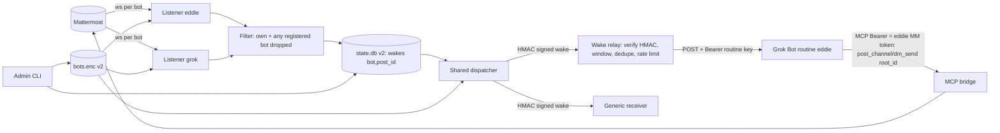
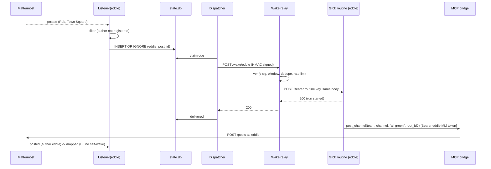

# eng-run plan-review grok-webhook-multibot

## Summary
- role: plan-review; runner: codex (codex); exit code: 0; started 2026-10-28 21:22:40
- review file: thoughts/shared/verification/2026-10-28-grok-webhook-multibot-plan-review.md - 8 finding(s): 3 high, 5 medium
- set plan_review: thoughts/shared/verification/2026-10-28-grok-webhook-multibot-plan-review.md in thoughts/shared/plans/2026-10-28-grok-webhook-multibot.md
- next: disposition every finding (fixed / accepted-risk with Rob / rejected + reason); run .eng/bin/eng-check .

## Command
````
codex exec --sandbox read-only -o thoughts/shared/runs/2026-10-28-plan-review-grok-webhook-multibot.last-message.txt '<prompt: see run log>'
````

## Prompt
````
You are the independent plan reviewer for this repository (eng-process kit v2.5.9). Do not edit any file except as stated below.

Follow the eng-plan skill (.claude/skills/eng-plan/SKILL.md, steps 8-9 "Mandatory plan review") and .eng/PROCESS.md section 10.

Review thoughts/shared/plans/2026-10-28-grok-webhook-multibot.md and its slice cards (thoughts/shared/slices/2026-10-28-b-s1-relay-grok-wake-one-bot.md thoughts/shared/slices/2026-10-28-b-s2-round-trip-reply-root-id.md thoughts/shared/slices/2026-10-28-b-s3-multi-bot-registry-routing.md) against the approved design (docs/design/2026-10-28-grok-webhook-multibot.md, REQ ids), the architecture (docs/architecture/2026-10-28-grok-webhook-multibot.md) and the ADRs in docs/decisions/. Look for gaps, wrong ordering, missing tests, missing verification commands, and security holes (auth, tenancy, secrets, input validation).

Executable specs (v2.5, medium/large): check every REQ has at least one spec in tests/acceptance/specs/ tagged @pytest.mark.req("REQ-n") that follows the design's Acceptance examples; specs use domain language only (no URLs, selectors, status codes, sleeps); each spec creates its own data through the DSL; every slice lists `specs:`; the planned channels match triage (medium: api; large: api + one Playwright web journey). Report specs that test implementation instead of behavior.

Output: a numbered list of findings. Each finding on its own line as
  N. [severity] location - finding - suggested fix
with severity one of critical | high | medium | low. If you find nothing, write exactly "No findings."
Your final message is saved by eng-run to thoughts/shared/verification/2026-10-28-grok-webhook-multibot-plan-review.md (a review-findings artifact); the planner then fills the Findings table dispositions. Never approve anything: only Rob approves (CP-C).
````

## Output
````
Reading additional input from stdin...
OpenAI Codex v0.164.0
--------
workdir: /mnt/d/rob/projects/mmbridge
model: gpt-6.1-sol
provider: openai
approval: never
sandbox: read-only
reasoning effort: none
reasoning summaries: none
session id: 01a18577-7529-7e40-bd79-0b53b00c42c3
--------
user
You are the independent plan reviewer for this repository (eng-process kit v2.5.9). Do not edit any file except as stated below.

Follow the eng-plan skill (.claude/skills/eng-plan/SKILL.md, steps 8-9 "Mandatory plan review") and .eng/PROCESS.md section 10.

Review thoughts/shared/plans/2026-10-28-grok-webhook-multibot.md and its slice cards (thoughts/shared/slices/2026-10-28-b-s1-relay-grok-wake-one-bot.md thoughts/shared/slices/2026-10-28-b-s2-round-trip-reply-root-id.md thoughts/shared/slices/2026-10-28-b-s3-multi-bot-registry-routing.md) against the approved design (docs/design/2026-10-28-grok-webhook-multibot.md, REQ ids), the architecture (docs/architecture/2026-10-28-grok-webhook-multibot.md) and the ADRs in docs/decisions/. Look for gaps, wrong ordering, missing tests, missing verification commands, and security holes (auth, tenancy, secrets, input validation).

Executable specs (v2.5, medium/large): check every REQ has at least one spec in tests/acceptance/specs/ tagged @pytest.mark.req("REQ-n") that follows the design's Acceptance examples; specs use domain language only (no URLs, selectors, status codes, sleeps); each spec creates its own data through the DSL; every slice lists `specs:`; the planned channels match triage (medium: api; large: api + one Playwright web journey). Report specs that test implementation instead of behavior.

Output: a numbered list of findings. Each finding on its own line as
  N. [severity] location - finding - suggested fix
with severity one of critical | high | medium | low. If you find nothing, write exactly "No findings."
Your final message is saved by eng-run to thoughts/shared/verification/2026-10-28-grok-webhook-multibot-plan-review.md (a review-findings artifact); the planner then fills the Findings table dispositions. Never approve anything: only Rob approves (CP-C).

codex
I’ll read the plan-review rules and repository state, then check the plan, slice cards, and acceptance specs against the approved design and architecture.
exec
/bin/bash -lc 'cat PROJECT_STATE.md' in /mnt/d/rob/projects/mmbridge
 succeeded in 0ms:
---
id: STATE
type: project-state
phase: plan
status: active
owner_agent: grok-bot
date: 2026-10-28
links: []
triage: large             # unset | small | medium | large
active_slice: SLICE-20261027-lb5-wireup-reconnect-acceptance
# Single source of truth for approvals. One item per line: "CP-X: <path> - <decision needed>".
# Later checkpoints (e.g. CP-B while in discover) may be listed early. Quote items containing commas.
pending_approvals: []
# Working agreements (see PROCESS.md section 10). Never hard-code these in design docs.
implementer: claude-code      # who writes code (default: Claude Code on the owner's PC)
planner: grok-bot             # who plans, writes docs, keeps state and process
cross_review: codex-advisory  # codex-advisory | none  (advisory, never a gate)
push_permission: standing     # standing: after eng-verify PASS may push main; tags/force-push still ask (Rob 2026-10-26)
board: none                   # none | vikunja (optional, board only; repo stays the source of truth)
acceptance: executable-specs   # v2.5: tests/acceptance/, see PROCESS.md 13
---
# PROJECT_STATE

> Single entry point. Any agent reads THIS file first, then the latest handoff linked below.
> Update it at the end of every session. Keep it under one screen.

## Current phase
plan (increment B: Grok Bot webhook wake + multi-bot; architecture B done, see Approval log). v0.3.0 Live bots shipped 2026-10-28 (93b4f7d, tag v0.3.0).

## Goal (one sentence)
A public HTTPS MCP bridge (Python, deployed on Coolify at chats.rmlab.cloud) that lets Grok Bots read and post in Rob's self-hosted Mattermost, each bot using its own Mattermost bot token.

## Active slice
[SLICE-20261027-lb5-wireup-reconnect-acceptance](thoughts/shared/slices/2026-10-27-lb5-wireup-reconnect-acceptance.md) (done; CP-S logged 2026-10-28, verify PASS 8f987e7). Previous: lb4b [done](thoughts/shared/slices/2026-10-27-lb4b-drop-allowlist.md)

## Next action
Plan B drafted (3 slices, speclock 32118b1e5aa406c0); mandatory plan review (eng-run plan-review) -> disposition findings -> CP-C. Open: live Mattermost-restart resume check (TODOS, deferred); OWNER-GUIDE pointer (TODOS P2); flaky timing tests (TODOS P2).

## Blockers
- none

## Pending approvals
See `pending_approvals` in the front matter (the only copy; `.eng/bin/eng-status` renders it). Do not list items here.

## Back-ups to an earlier phase
<!-- date - from phase -> to phase - why (blameless) - artifacts revised -->
none

## Latest artifacts
<!-- Relative links only; .eng/bin/eng-check verifies they resolve. -->
- Plan B (draft, plan review running; CP-C pending): [thoughts/shared/plans/2026-10-28-grok-webhook-multibot.md](thoughts/shared/plans/2026-10-28-grok-webhook-multibot.md); slices B-s1..B-s3 in thoughts/shared/slices/; specs [tests/acceptance/specs/test_grok_multibot.py](tests/acceptance/specs/test_grok_multibot.py)
- Architecture B (approved): [docs/architecture/2026-10-28-grok-webhook-multibot.md](docs/architecture/2026-10-28-grok-webhook-multibot.md); ADR-0011, 0013..0016 (accepted), ADR-0012 (rejected) in [docs/decisions/](docs/decisions/)
- Cross-model review B (awaiting Codex): [thoughts/shared/verification/2026-10-28-grok-webhook-multibot-arch-review.md](thoughts/shared/verification/2026-10-28-grok-webhook-multibot-arch-review.md)
- Research B (accepted): [thoughts/shared/research/2026-10-28-grok-webhook-multibot-current-code.md](thoughts/shared/research/2026-10-28-grok-webhook-multibot-current-code.md)
- Design B Grok Bot webhook + multi-bot (approved; scope HOLD approved 2026-10-28): [docs/design/2026-10-28-grok-webhook-multibot.md](docs/design/2026-10-28-grok-webhook-multibot.md)
- Conventions: [AGENTS.md](AGENTS.md)
- Owner guide: [OWNER-GUIDE.md](OWNER-GUIDE.md)
- Definition of Done: [docs/definition-of-done.md](docs/definition-of-done.md)
- Retro v0.3.0 (done, changes applied 2026-10-28): [thoughts/shared/retros/2026-10-28-v0.3.0-live-bots.md](thoughts/shared/retros/2026-10-28-v0.3.0-live-bots.md)
- Process feedback: [thoughts/shared/process-feedback.md](thoughts/shared/process-feedback.md)
- Design A Live bots (approved; scope REDUCE recorded 2026-10-26): [docs/design/2026-10-26-live-bots.md](docs/design/2026-10-26-live-bots.md)
- Design (approved; scope hold approved): [docs/design/2026-10-25-mmbridge-mcp.md](docs/design/2026-10-25-mmbridge-mcp.md)
- Plan A Live bots (status in front matter): [thoughts/shared/plans/2026-10-27-live-bots.md](thoughts/shared/plans/2026-10-27-live-bots.md)
- Plan review A (AWAITING Codex, mandatory): [thoughts/shared/verification/2026-10-27-live-bots-plan-review.md](thoughts/shared/verification/2026-10-27-live-bots-plan-review.md)
- Review lb2 (addressed): [thoughts/shared/verification/2026-10-27-slice-20261027-lb2-state-db-wake-queue-review.md](thoughts/shared/verification/2026-10-27-slice-20261027-lb2-state-db-wake-queue-review.md)
- Verify lb5 (PASS): [thoughts/shared/verification/2026-10-28-lb5-wireup-reconnect-acceptance-verify.md](thoughts/shared/verification/2026-10-28-lb5-wireup-reconnect-acceptance-verify.md)
- Review lb5 (round 6 clean): [thoughts/shared/verification/2026-10-28-slice-20261027-lb5-wireup-reconnect-acceptance-review-6.md](thoughts/shared/verification/2026-10-28-slice-20261027-lb5-wireup-reconnect-acceptance-review-6.md)
- Specs A: [tests/acceptance/specs/test_live_bots.py](tests/acceptance/specs/test_live_bots.py)
- Architecture A Live bots (approved): [docs/architecture/2026-10-26-live-bots.md](docs/architecture/2026-10-26-live-bots.md)
- Cross-model review A (awaiting Codex): [thoughts/shared/verification/2026-10-26-live-bots-arch-review.md](thoughts/shared/verification/2026-10-26-live-bots-arch-review.md)
- Architecture: [docs/architecture/2026-10-25-mmbridge-mcp.md](docs/architecture/2026-10-25-mmbridge-mcp.md)
- ADRs 0001-0010 (all accepted): [docs/decisions/](docs/decisions/)
- Verification lb4b (PASS): [thoughts/shared/verification/2026-10-27-lb4b-drop-allowlist.md](thoughts/shared/verification/2026-10-27-lb4b-drop-allowlist.md)
- Latest handoff: [thoughts/shared/handoffs/2026-10-28_19-30-00_arch-b-awaiting-cp-b.md](thoughts/shared/handoffs/2026-10-28_19-30-00_arch-b-awaiting-cp-b.md)
- Review lb4b (addressed, no findings): [thoughts/shared/verification/2026-10-27-slice-20261027-lb4b-drop-allowlist-review.md](thoughts/shared/verification/2026-10-27-slice-20261027-lb4b-drop-allowlist-review.md)
- Review lb3 (addressed, no findings): [thoughts/shared/verification/2026-10-27-slice-20261027-lb3-listener-filters-review.md](thoughts/shared/verification/2026-10-27-slice-20261027-lb3-listener-filters-review.md)
- Changelog: [CHANGELOG.md](CHANGELOG.md)
- Plan (approved): [thoughts/shared/plans/2026-10-25-mmbridge-mcp.md](thoughts/shared/plans/2026-10-25-mmbridge-mcp.md)
- Verification s1 (PASS): [thoughts/shared/verification/2026-10-26-s1-verify.md](thoughts/shared/verification/2026-10-26-s1-verify.md)
- Slices: [thoughts/shared/slices/](thoughts/shared/slices/)
- Specs: [tests/acceptance/specs/test_mmbridge.py](tests/acceptance/specs/test_mmbridge.py)
- Research A Live bots (accepted): [thoughts/shared/research/2026-10-26-live-bots-current-code.md](thoughts/shared/research/2026-10-26-live-bots-current-code.md)
- Research: [thoughts/shared/research/2026-10-25-mmbridge-current-code.md](thoughts/shared/research/2026-10-25-mmbridge-current-code.md)
- Deferred work: [TODOS.md](TODOS.md)
- Retro (done): [thoughts/shared/retros/2026-10-26-v0.2.0.md](thoughts/shared/retros/2026-10-26-v0.2.0.md)

## Approval log
<!-- One row per decision. Artifact cell names the file path(s). Decision: approved | accepted | partially accepted | deferred | rejected.
     Pre-kit decisions: back-fill with Checkpoint "pre-kit" and Decision "approved (back-filled, pre-kit)". .eng/bin/eng-check matches rows to statuses. -->
| Date | Checkpoint | Artifact | Decision (Rob) |
|---|---|---|---|
| 2026-10-28 | CP-B | docs/architecture/2026-10-28-grok-webhook-multibot.md, docs/decisions/0011-hmac-to-bearer-wake-relay.md, docs/decisions/0013-multi-bot-store-v2.md, docs/decisions/0014-multi-bot-runtime-state-v2.md, docs/decisions/0015-thread-replies-root-id.md, docs/decisions/0016-acceptance-tests-increment-b.md | approved (architecture B + ADR-0011, 0013..0016 accepted; ADR-0012 claim_wake stays rejected; ops accepted for now: relay Bearer key + routine URL in Coolify env on relay, not mmbridge admin; same bot name ties Mattermost bot, relay and Grok routine; RELAY_BOT_<name>_HMAC_SECRET = copy of the bot wake secret; via Eddie) |
| 2026-10-28 | CP-R | thoughts/shared/research/2026-10-28-grok-webhook-multibot-current-code.md | accepted (via Eddie) |
| 2026-10-28 | CP-A (scope) | docs/design/2026-10-28-grok-webhook-multibot.md | approved (HOLD: In REQ-B1..B8; Out web admin, bot-to-bot wakes/caps, channel ignore-list; A5 suite stays in TODOS; via Eddie) |
| 2026-10-28 | CP-A | docs/design/2026-10-28-grok-webhook-multibot.md | approved (problem, REQ-B1..B8, acceptance examples; Grok wake contract locked: POST per-routine URL, Bearer key, any JSON body, 200=run started; via Eddie) |
| 2026-10-28 | retro | thoughts/shared/retros/2026-10-28-v0.3.0-live-bots.md | approved (all proposals: process changes 1-3 applied; kit lessons K-1..K-4 to Yana; via Eddie) |
| 2026-10-28 | CP-S | thoughts/shared/slices/2026-10-27-lb5-wireup-reconnect-acceptance.md | approved (verify PASS 8f987e7; Coolify steps 1-4 and 6 good; step 5 restart Mattermost mid-demo / real-MM resume+catch-up check deferred by Rob; rollback not exercised, LIVE_BOTS_ENABLED left on; via Eddie) |
| 2026-10-28 | CP-S | thoughts/shared/slices/2026-10-27-lb4b-drop-allowlist.md | approved (verify PASS 14ecd18; demo set-bot + --channels reject; live Mattermost->receiver e2e deferred until listener/dispatcher wired in lb5) |
| 2026-10-27 | CP-C | thoughts/shared/plans/2026-10-27-live-bots-delta-no-allowlist.md | approved speclock sha256:ea6a99cbd5601d05 |
| 2026-10-27 | CP-A | docs/design/2026-10-26-live-bots.md | approved amendment: drop allow-list sha256:0f250a0276b5 (via Eddie) |
| 2026-10-27 | CP-S | thoughts/shared/slices/2026-10-27-lb4-signed-wake-dispatcher.md | approved (verify PASS 219a9a1; README wake-receiver/tamper demo deferred - no set-bot/wake secret yet; via Eddie) |
| 2026-10-27 | CP-S | thoughts/shared/slices/2026-10-27-lb3-listener-filters.md | approved (verify PASS; ws_spike hello+ping reply+posted on Coolify; via Eddie) |
| 2026-10-27 | CP-S | thoughts/shared/slices/2026-10-27-lb2-state-db-wake-queue.md | approved (verify PASS; empty-DB admin failed/stats deferred; via Eddie) |
| 2026-10-27 | CP-S | thoughts/shared/slices/2026-10-27-lb1-bot-store-admin-cli.md | approved (verify PASS; live container/Coolify check deferred, not yet redeployed; via Eddie) |
| 2026-10-28 | CP-P | CHANGELOG.md (v0.3.0, commit 93b4f7d, tag v0.3.0) | approved (release v0.3.0; Rob via Eddie; wake rule stays every-post, no @mention change) |
| 2026-10-27 | CP-C | thoughts/shared/plans/2026-10-27-live-bots.md | approved speclock sha256:3108f1fe6a93cfae |
| 2026-10-27 | CP-B | docs/architecture/2026-10-26-live-bots.md | approved (incl. stored-token security review) |
| 2026-10-27 | CP-B | docs/decisions/0006-encrypted-token-store.md, docs/decisions/0007-mattermost-websocket-listener.md, docs/decisions/0008-signed-wake-webhook.md, docs/decisions/0009-listener-state-persistence.md, docs/decisions/0010-acceptance-tests-live-bots.md | accepted (ADR-0006..0010) |
| 2026-10-26 | CP-R | thoughts/shared/research/2026-10-26-live-bots-current-code.md | accepted (via Eddie) |
| 2026-10-26 | CP-A (scope) | docs/design/2026-10-26-live-bots.md | approved (REDUCE: In A1, A2, A3 own-post, A4, A7, A8 one bot, hand-set channels; Out A6, A3 bot-to-bot caps, A5/A5b/A5c auto-join deferred by Rob after first proposal; via Eddie) |
| 2026-10-26 | CP-A | docs/design/2026-10-26-live-bots.md | approved (problem, REQ-A1..A8 incl. A5/A5b/A5c/A6, acceptance examples; via Eddie; later clarified: one-bot wedge = whole v1 ship, multi-bot later increment) |
| 2026-10-26 | triage (size) | docs/design/2026-10-26-live-bots.md | accepted (large confirmed; via Eddie) |
| 2026-10-26 | CP-S | thoughts/shared/slices/2026-10-26-d-hardening-xff-bearer.md | approved (live: FORWARDED_ALLOW_IPS working, logs show public client IPs; 1 container; via Eddie) |
| 2026-10-26 | triage (size) | thoughts/shared/slices/2026-10-26-d-hardening-xff-bearer.md | approved (small confirmed, security; via Eddie) |
| 2026-10-26 | CP-P | CHANGELOG.md (v0.2.0, commit 9946445, tag v0.2.0) | approved (release v0.2.0) |
| 2026-10-26 | CP-S | thoughts/shared/slices/2026-10-25-s3-dm.md | approved (live same-channel dual DM, ping via dm_read, nobody -> unknown_user)
| 2026-10-26 | CP-S | thoughts/shared/slices/2026-10-25-s2-post-read-channel.md | approved (live post/read/not_member)
| 2026-10-25 | CP-A | docs/design/2026-10-25-mmbridge-mcp.md | approved (problem, REQ-1..8, acceptance examples) |
| 2026-10-25 | CP-A (scope) | docs/design/2026-10-25-mmbridge-mcp.md | approved (scope mode hold: REQ-1..8 in; @mention wakes, auto-join, multi-bot, threads/reactions/files out) |
| 2026-10-25 | CP-B | docs/architecture/2026-10-25-mmbridge-mcp.md | approved |
| 2026-10-25 | CP-B | docs/decisions/0001-credential-handoff-bearer-per-call.md, docs/decisions/0002-mattermost-http-client.md, docs/decisions/0003-mcp-surface-streamable-http.md, docs/decisions/0004-per-token-in-memory-rate-limit.md, docs/decisions/0005-structured-logs-public-health.md | accepted (ADR-0001..0005) |
| 2026-10-26 | CP-C | thoughts/shared/plans/2026-10-25-mmbridge-mcp.md | approved speclock sha256:2e4855ad12913e1f |
| 2026-10-26 | CP-S | thoughts/shared/slices/2026-10-25-s1-auth-list-channels.md | approved (manual verification approved by Rob; verify PASS; review F1/F2 accepted-risk) |

exec
/bin/bash -lc 'cat .claude/skills/eng-plan/SKILL.md .eng/PROCESS.md' in /mnt/d/rob/projects/mmbridge
 succeeded in 0ms:
---
name: eng-plan
description: Write an implementation plan as vertical slices with automated and manual success criteria. Use after research (and architecture for large work) is approved, before any code changes.
---
# eng-plan

Session: standard. **Start:** read only `PROJECT_STATE.md`, the latest handoff it links, and this skill's Inputs; run `.eng/bin/eng-check .` and stop and report if it fails for a reason this skill must not fix; stop if `pending_approvals` holds a checkpoint this skill needs. **Finish:** run eng-handoff (updates PROJECT_STATE phase / active_slice / pending_approvals / owner_agent / date / Next action / Blockers / Latest artifacts, writes the handoff, eng-check must pass, commits docs). Edge cases: `.eng/PROCESS.md` section 8. Scripts: `.eng/bin/eng-check`, `.eng/bin/eng-status`, `.eng/bin/eng-new`.

## Inputs (files only)
- Approved design doc, research doc, accepted ADRs, approved architecture (large); .eng/bin/eng-check enforces these
- `AGENTS.md` (test/lint commands); PROJECT_STATE working agreements

## Outputs
- `thoughts/shared/plans/<date>-<slug>.md`
- One slice card per phase: `thoughts/shared/slices/*` (`status: todo`, `plan:`/`plan_phase:` set)
- Medium/large: the **mandatory** Codex plan review `thoughts/shared/verification/<date>-<slug>-plan-review.md`, linked from the plan's `plan_review:`

## Steps
1. Be skeptical: verify research claims you rely on against the code.
2. Propose the phase outline (slice names, order) to Rob before details; get buy-in.
3. Each phase is a **vertical slice**: thin, end-to-end, demoable; contract/mock first. No horizontal DB -> API -> UI phases.
4. Program design in Implementation Approach: key types/signatures, call path, file-tree diff.
5. Each phase: Changes Required, Success Criteria split into **Automated Verification** (exact commands) and **Manual Verification**.
5b. **Risk you uncovered (L-008):** if the plan or a slice exists mainly to mitigate a risk **you** found, stop with **Decision needed** (risk, friction/ops cost, narrower alternative) before CP-C. See `.eng/templates/owner-update.md`.
6. Write each slice card so the implementer (PROJECT_STATE `implementer`, normally Claude Code on Rob's PC) can run it cold from `eng-resume` + `eng-implement-slice`. Mark auth/tenancy/security slices: they always get the cross-model review.
7. Fill **What We're NOT Doing** and a short **Demo script** (3-6 steps Rob can follow to see it work). Resolve all open questions.
7a. **Executable specs (medium/large, v2.5; PROCESS.md 13):** if `tests/acceptance/` is missing, run `python3 .eng/bin/eng-spec init .`. Turn the design's Acceptance examples into specs in `tests/acceptance/specs/` (domain language, DSL calls only, `@pytest.mark.req("REQ-n")`; medium: api channel; large: plus one `@pytest.mark.channels("api", "ui")` journey). Extend the DSL interface as needed (assertion steps named `assert_*`/`then_*`/...). Fill every slice card's `reqs:` and `specs:` (or `specs: none - <reason>`). Fill Testing Strategy. Then `python3 .eng/bin/eng-spec lock .` and include the printed `approved speclock sha256:<hex>` decision in the CP-C Approval log row Rob approves. Drivers can stay stubs until the slices that need them.
8. **Mandatory plan review (medium/large; small exempt)**, after the plan and slice cards are drafted and before asking for CP-C. The **planner starts** it on the owner's PC — do not hand Rob the command as the default. Prefer `python3 .eng/bin/eng-run plan-review <plan>` (writes findings + run log, sets empty `plan_review:`). Tell Rob once as FYI. **Stay attached** until eng-run exits (default). Detach only if `[hooks] plan_review_on_complete` or `on_complete` is non-empty, and set a timeout routine (S 45m). Fallback only if eng-run/Codex is unavailable or Rob wants to drive it: `codex exec "review <plan path> and the slice cards <slice glob> against <design doc> (REQ ids), <architecture doc> and <ADR range> for gaps, wrong ordering, missing tests, and security holes; output a numbered list of findings with severity" -o thoughts/shared/verification/<date>-<slug>-plan-review.md` (`.eng/bin/eng-status` still prints the command as the fallback). `--dry-run` shows the eng-run command.
9. Codex has written the review file (`-o`; eng-run pre-fills the Findings table as `open`). Add the review-findings front matter and Findings table above the raw output (template `review-findings.md`); one row per finding with severity (critical/high/medium/low) and disposition: `fixed` (say where; update plan/cards), `accepted-risk` (only after Rob approves; record "Rob <date>"), or `rejected` (with a reason **and evidence**: a file:line or a test reference; eng-check warns otherwise). Set `plan_review:` in the plan to that path. No critical/high may stay `open`. Plan approved before reviews were mandatory: run it retroactively before the next slice, or log Rob's waiver row (PROCESS.md 10).
10. `.eng/bin/eng-check .` must pass (it enforces the plan review once a slice starts).

## Exit criteria
All required sections; every phase has both criteria types; slice cards exist; no open questions; (M/L) plan review linked with no open critical/high finding.

## Approval stop (Rob)
**CP-C Plan**: `CP-C: <plan path> - approve plan`. Medium/large: ask only once the plan review is clean. On approval set plan `approved`, log it, set `phase: implement`, `active_slice:` the first slice card. Then the slice is ready: start it with `python3 .eng/bin/eng-run implement <plan> <slice-id>` (CP-C approval covers this unless Rob said otherwise) and show Rob the "ready to implement" message as FYI (`.eng/bin/eng-status` prints it; paste prompt only as fallback; PROCESS.md section 10). You own the run's completion: stay on it (or get woken by the `[hooks] implement_on_complete` hook), then read the run log + latest handoff and continue to eng-verify / CP-S or surface the blocker. Same for a headless `eng-run plan-review`: stay attached, or wake pair (non-empty `plan_review_on_complete` / `on_complete` plus timeout S 45m) and classify with the `.running.md` PID marker (PROCESS.md section 10; platform failures to Ulrik). Never end the turn while the run is still going unless the hook is live.

## Finish
Standard: end with eng-handoff.
<!-- Copy of eng-process kit v2.5.9 PROCESS.md, vendored by eng-init. Do not edit here. -->
# Engineering Process (canonical, kit v2.5.9)

One human approver (Rob, "the owner"), several interchangeable AI agents. **All state lives in files; the repo is the single source of truth.** Any agent must be able to pick up the project from `PROJECT_STATE.md` + the latest handoff alone. This file is the only place the phase-to-skill routing lives (section 3); `AGENTS.md` and skills reference it, and `.eng/PROCESS.md` is a pinned read-only copy written by `eng-init`.

## 1. Repo layout (created by `<kit>/bin/eng-init`)
```
PROJECT_STATE.md          single entry point: phase, triage, working agreements, active slice, next action, approvals
AGENTS.md  (CLAUDE.md -> @AGENTS.md)   commands, architecture map, conventions
OWNER-GUIDE.md            plain-language guide + glossary for the owner
CHANGELOG.md  TODOS.md    release notes; deferred work and scope cuts
docs/definition-of-done.md
docs/vision/              long-lived product vision / feature list (type vision)
docs/design/              design docs per increment (problem -> requirements -> scope [-> architecture])
docs/architecture/        optional separate architecture docs for large work (type architecture)
docs/decisions/           ADRs NNNN-slug.md, id ADR-NNNN, append-only
thoughts/shared/research/         codebase research: what the code IS (type research)
thoughts/shared/market-research/  external/market/methods research (type market-research)
thoughts/shared/briefs/           project briefs for a new implementer/reviewer (type project-brief)
thoughts/shared/{plans,slices,handoffs,retros}/
thoughts/shared/verification/     verification reports + independent review findings (*-review.md)
thoughts/shared/review-notes/     owner's scratch notes; agents don't edit; not checked
thoughts/shared/inbox.md          owner incoming-thoughts inbox (v2.5.6); append-only on capture prefixes; not checked
thoughts/shared/inbox/            rotated inbox archives YYYY-MM-DD-HHMM-inbox.md (committed)
thoughts/shared/process-feedback.md  friction log for the kit (type process-feedback)
.eng/bin/                 vendored kit scripts (eng-check, eng-status, eng-new, eng-init, englib.py); plain python3
.eng/templates/  .eng/PROCESS.md  .eng/VERSION   vendored templates, this file, kit version
.claude/skills/eng-*/SKILL.md     vendored skills (Claude Code project-skill location)
.eng/templates/  .eng/PROCESS.md  .eng/VERSION    kit copy (templates used by .eng/bin/eng-new)
```
Every checked artifact starts with front matter: `id, type, phase, status, owner_agent, date, links`. `.eng/bin/eng-check` enforces it. Inline lists may quote items containing commas (`["a, b", c]`); dash lists also work.

## 2. Triage (`eng-triage`, first step for any request)
| Size | Signal | Phases |
|---|---|---|
| **Small** | about 1 file or an obvious fix, no new interface, no data change, reversible | Implement -> Verify -> Ship (one slice card, no plan) |
| **Medium** | a few files, one component, known patterns | Discover (short design doc) -> Research -> Plan -> Implement -> Verify -> Ship -> Reflect |
| **Large** | new component/interface/data model, cross-cutting, brownfield risk, security/money/data | all nine phases, all checkpoints |
When in doubt, size up. Re-triage if research reveals more than expected. Record it in `PROJECT_STATE.md` (`triage:`).

**Readiness check.** When a project claims to be at a later phase (e.g. "we're already on slice 1"), `eng-triage` verifies that every earlier phase's artifacts and approvals exist for its size (table below; `.eng/bin/eng-status` prints `readiness:` and `.eng/bin/eng-check` fails on gaps). If anything is missing, set `phase` back to the earliest incomplete phase, list exactly what is missing under Blockers, and record the back-up (section 4a).

| To be in phase | Small | Medium | Large |
|---|---|---|---|
| research | n/a | approved design (CP-A) | approved design (CP-A) |
| architecture | n/a | n/a | + approved codebase research (CP-R) |
| plan | n/a | approved design; research doc exists | + approved architecture (CP-B logged, or approved `docs/architecture/` doc) |
| implement | slice card | + approved plan (CP-C) with clean plan review | + approved plan (CP-C) with clean plan review |
| verify | slice card | same as implement | same as implement |
| ship | + verification `pass` (CP-D) | + verification `pass` | + verification `pass` |

## 3. Phases (and the skill for each: this is the routing table)
| # | Phase | Skill | Entry | Output | Exit criteria | Checkpoint |
|---|---|---|---|---|---|---|
| 0 | (any session) | eng-resume to start, eng-handoff to end; eng-triage for new requests; eng-project-init to adopt | | | | |
| 1 | Discover | eng-discover | triaged M/L | `docs/design/*` (+ optional `docs/vision/`, `thoughts/shared/market-research/`) | problem, metric, testable requirements; no `[NEEDS CLARIFICATION]` | **CP-A Product** |
| 2 | Scope | eng-scope-review | CP-A approved | design doc Scope section (baseline = approved requirements list); cuts -> TODOS.md; ADR if durable | mode chosen relative to baseline, in/out lists | (part of CP-A for L) |
| 3 | Research | eng-research | approved design | `thoughts/shared/research/*` | code *as is* with file:line; no recommendations | **CP-R Research** (L; optional M) |
| 4 | Architecture | eng-architecture-review | research approved | design doc Architecture section **or** `docs/architecture/*` linked from it; ADRs | contracts, data, sequence, failure modes, rollback, observability, security | **CP-B Architecture** (L) |
| 5 | Plan | eng-plan | prerequisites (section 2) | `thoughts/shared/plans/*` + slice cards + **mandatory Codex plan review** (M, L) | vertical slices, each with automated + manual criteria; What We're NOT Doing; no open critical/high review finding | **CP-C Plan** (M, L) |
| 6 | Implement | eng-implement-slice (run by the implementer) | plan approved, slice next, no pending approvals | code + tests, plan checkboxes, slice card; then independent review findings | slice's automated criteria pass; review findings answered | **CP-S Slice** per slice |
| 7 | Verify | eng-verify | all slices `review`/`done` | `thoughts/shared/verification/*` | every criterion re-executed; DoD pass; verdict PASS | **CP-D Done** |
| 8 | Ship | eng-ship | verification PASS | CHANGELOG entry, VERSION (if used), PR | CI green, PR opened | **CP-P PR merge/deploy** (Rob merges) |
| 9 | Reflect | eng-retro | shipped (or weekly, or each advisor consultation) | `thoughts/shared/retros/*` + edits | process-feedback pass done; each change applied to a file | none |

**One phase per session, one artifact, then stop for approval.** Discovery tends to pre-draft later artifacts (architecture, plan). That's allowed only as input. **Wording, used everywhere:** `input` = a pre-draft written in an earlier phase than its own, not yet worked on in its own phase; `draft` = being written in its own phase; `in-review` = waiting for Rob. None of these is an approval, and neither is any invented status like `approved-for-review` (`.eng/bin/eng-check` rejects those). Pre-drafts carry `status: input` and the heading note "input, not approved"; their own phase's skill turns them into `draft`. The owner may choose to group phases in one session once familiar with the process; record that in the handoff.

## 4. Approval checkpoints
- **Front matter `pending_approvals` is the single source of truth.** Item format: `CP-X: <path>[ + <path>] - <decision needed>`; paths must exist (CP-P may name a PR URL). The body section only points at it; `.eng/bin/eng-status` renders it. `.eng/bin/eng-check` fails if the body lists CP items that differ.
- Checkpoints for **later** phases may be pending early (e.g. CP-B auth/hosting questions during Discover). A pending checkpoint for an **earlier** phase than the current one blocks (`.eng/bin/eng-check` error); so does any missing prerequisite (section 2), for every phase, not just implement/verify/ship.
- **Owner review workflow.** Rob may jot notes in `thoughts/shared/review-notes/<owner>-review-notes.md`. Agents never edit or act on it until he says the notes are ready. Approvals arrive in chat. The agent then records each one in (1) the PROJECT_STATE Approval log row, (2) the artifact `status`, and (3) an ADR if the decision is durable, removes the pending item, and commits. The repo, not the chat, is the official record. `.eng/bin/eng-check` cross-checks the log and statuses both ways.
- **Notes rotation.** When a cycle finalizes (a slice reaches `done`, or a ship), if the scratch file has notes: `git mv` it to `<cycle-id>-<owner>-review-notes.md` and recreate the empty scratch file from `.eng/templates/review-notes.md`. Done in eng-handoff and eng-ship.
- **Owner inbox (v2.5.6).** Random thoughts and feature ideas go in `thoughts/shared/inbox.md`: Rob edits it directly or prefixes a message with `note:`/`n:`/`idea:`/`feature:`/`future feature:`/`ff:`/`capture:`/`cap:`, and the agent appends the item verbatim. Nothing else happens until he says "process incoming" / "check idea log" / "process notes". Then the agent walks each item with him (classify, clarify one question at a time, move it to its home or act, or defer). Once all are settled it moves the file to `thoughts/shared/inbox/YYYY-MM-DD-HHMM-inbox.md` with a status/action per item and recreates the live inbox holding only deferred items (with deferral date). See skill eng-inbox.
- Rejection: status back to `draft`, reasons in the artifact; for research, discard and redo rather than patch.
- ADR statuses: `proposed | accepted | partially-accepted | deferred | rejected | deprecated | superseded`. `partially-accepted` requires a `## Parts` section marking each part; `deferred` sets `revisit:`.

### 4a. Backing up to an earlier phase (blameless)
Discovering that an earlier artifact is wrong is normal. Any agent or the owner can call "back up to <phase>" (usually Discover): set `phase` back, set the design doc back to `draft` and any later-phase pre-drafts to `input`, revise them, move affected approvals back to `pending_approvals`, and add a line to PROJECT_STATE "Back-ups to an earlier phase": date, from -> to, why, artifacts revised. No blame, just the reason.

**Approvals live only in the Approval log table** (`| date | CP-X | path | decision |`). `eng-check` flags an approval written anywhere else in PROJECT_STATE.md (a prose line like "CP-C approved by Rob", a row-like line outside the table, a stray line inside the section), and any `approved` status without a table row.

**Design changes after CP-A.** Once the design doc is approved, editing it needs re-approval: set it back to `in-review` and request CP-A again, then log a **new** Approval log row (newer date). To make the check exact, put the content hash in the decision cell: `approved sha256:<first 12+ hex of sha256 of the file, LF line endings>`. Without a hash, `eng-check` warns when git shows a commit touching the approved design dated after the latest CP-A row. Edits during phase `discover` are never flagged. It also warns when plan or slice drafts exist while no design doc is approved (except triage small, or unset: size unknown before triage). Both checks are errors since v2.5.0.

## 5. WIP rules
- One project phase at a time; **max 1 slice `in-progress`** (enforced). Max open PRs = what Rob can review (default 1).
- Pull the next slice only when the previous is `done` or explicitly `blocked` with a reason.
- A slice is ~100-200 changed lines, end-to-end, demoable. Bigger -> split before starting.
- Deferrals and unrelated discoveries go to `TODOS.md`, not into the current slice.

## 6. Definition of Done
`docs/definition-of-done.md` (project may extend, never weaken). Core: criteria re-executed in the verifying session; tests incl. regression; no weakened gates; docs, CHANGELOG, ADRs, TODOS updated; verification PASS; state + handoff written. Also in the DoD template: default `pytest tests` (or project equivalent) with zero silent collection skips; time/rate tests use an injected/frozen clock from slice 1 (LESSONS L-003).

## 7. Context hygiene
- **One phase per session.** Start fresh; load only PROJECT_STATE, the latest handoff, and the inputs the skill names.
- **~40% rule of thumb:** no context meter exists, so use proxies: when you've read >~15 files, done >~30 tool calls, or been corrected twice, compact: write progress into the artifact + handoff and end the session.
- **Compaction is into files**, never into memory: plan checkboxes, slice progress log, handoff.
- **Sub-tasks for search:** delegate wide searches to sub-agents returning paths + file:line; read critical artifacts directly and fully.
- Codebase research documents what *is*; opinions belong in market research, architecture or plan.
- Keep AGENTS.md short: only what an agent cannot infer from code.

## 8. Session convention (every skill's Start and Finish)
Skills say "Session: standard" instead of repeating this.
- **Start:** new session. Read only `PROJECT_STATE.md`, the latest handoff it links, and the skill's Inputs. Run `.eng/bin/eng-check .`; if it fails for a reason this skill must not fix, stop and report. If `pending_approvals` holds a checkpoint this skill needs, stop.
- **Finish:** update PROJECT_STATE (`phase`, `active_slice`, `pending_approvals`, `owner_agent`, `date`, Next action, Blockers, Latest artifacts) as part of **eng-handoff**, which is the session end. It writes `thoughts/shared/handoffs/YYYY-MM-DD_HH-MM-SS_<slug>.md` (Tasks+status, Critical References, Recent changes file:line, Learnings, Artifacts, Approvals, Next Steps naming the next skill), runs `.eng/bin/eng-check .` (must pass) and commits the docs. eng-handoff and eng-resume don't call themselves.
- **Resume:** eng-resume reads PROJECT_STATE, the linked handoff fully, then only its Critical References; verifies Recent changes exist (git); reports discrepancies; proceeds only if no needed approval is pending.
- **Latest artifacts (v2.5.8):** PROJECT_STATE `## Latest artifacts` lists the current increment / in-play artifacts only, plus the standing links (AGENTS.md, OWNER-GUIDE.md, docs/definition-of-done.md, thoughts/shared/process-feedback.md, latest handoff). Finished increments move to the optional `## Prior increments` section, which eng-resume does not read. eng-check warns above 12 in-play links.
- **Approval log size (v2.5.8):** eng-check warns when the `## Approval log` table exceeds 40 rows or the section exceeds 3072 bytes. When this fires on an active project, reopen the Approval-log archive design; from then on eng-check must treat the archive as part of the log. No archive exists yet.
- **Stale kit:** when eng-check warns that `.eng/VERSION` is older than the kit, eng-resume asks Rob once per session (Action-for-Rob shape) whether to run `eng upgrade .`, unless `kit_upgrade: deferred` is set in PROJECT_STATE front matter or in `thoughts/shared/process-feedback.md`.
- If the next agent must ask "what was I doing?", the handoff is defective. Log it in `process-feedback.md`.
- Session handoff and **project brief** are different: the handoff passes one session to the next; a brief (`.eng/bin/eng-new brief`) orients a new implementer or reviewer and points at the plan and state.

## 9. Rules for every agent
Recommend; Rob decides. Never weaken a gate or use `--no-verify`. A report is a claim until re-executed. Stop and report on plan/code mismatch ("Issue in Phase N") instead of improvising. No fix without root cause; after 3 failed fixes, stop and hand off. Log process friction in `thoughts/shared/process-feedback.md` as you hit it (in-session; the retro reads that log, not handoffs).

**Owner-facing updates (every project bot).** When you message Rob, use the shape in `.eng/templates/owner-update.md` (LESSONS L-007): (1) brief status prose, or skip if nothing new; (2) a labeled `**Action for Rob**` numbered list — one concrete step per line, pasteable commands each in their own fenced block — or the exact line `No action for you.`; (3) end with the decision he owes when any (`approve` / `defer` / `needs fixes` / `hold` / named CP). Never bury his todos inside a paragraph that mixes status, review results, and an inline list. In sample commands, never use valid shell syntax as an edit placeholder (`$TOKEN`, `${BOT_TOKEN}`); use `PASTE_BOT_TOKEN_HERE` or tell him to paste at the prompt.

**Risk mitigations the agent uncovered.** If the agent finds a risk and would design a mitigation into the design doc, architecture, or plan, that mitigation is not free to absorb. Before it lands: name the risk; cost it (money and especially friction/ops burden); offer a narrower alternative; stop with L-007 **Decision needed** (absorb / accept risk / defer / narrower). Soft acknowledgment is not approval of the cost. Shape: `.eng/templates/owner-update.md` (LESSONS L-008).

## 10. Working agreements (standard; values in PROJECT_STATE front matter)
| Field | Default | Meaning |
|---|---|---|
| `implementer` | `claude-code` | Who writes code: Claude Code on the owner's own PC. Never name it in design docs; reference this field. |
| `planner` | `grok-bot` | Grok Bot assistants plan, write docs, keep state and process. They don't write production code. |
| `cross_review` | `codex-advisory` | Independent cross-model review; advisory, never a gate. `none` disables. |
| `push_permission` | `ask` | `ask` = ask the owner before each push (**except docs-only**); `standing` = after eng-verify PASS, may push to `main` without asking; **docs-only commits always push to `main` without asking** (both modes); tags and force-push still ask; never merge without the owner. Docs-only = documentation/process prose only (Markdown under docs/, thoughts/, templates, PROCESS, README, CHANGELOG, OWNER-GUIDE, AGENTS, LESSONS, skill wording) — no source, tests, scripts, behavior-shipping VERSION, or runtime config (e.g. `runners.toml`). |
| `board` | `none` | Optional Kanban (e.g. self-hosted Vikunja, deferred). If used: board only, one card per slice linking to the repo plan/slice card. The repo stays the single source of truth; never record decisions on the board. |

**Implementer hand-off loop.**
1. When a slice is ready (plan approved with its mandatory plan review clean (M/L), slice is next in PROJECT_STATE `active_slice` with `status: todo`, `pending_approvals` empty, `.eng/bin/eng-check` OK), the planner **starts** implementation on the owner's PC: `python3 .eng/bin/eng-run implement <plan> <slice-id>` (or `eng run implement ...` with the global CLI), then tells Rob once, as FYI, with the standard message from `.eng/templates/ready-to-implement.md` (`.eng/bin/eng-status` prints it filled). His CP-C / slice-ready approval covers starting implement unless he said otherwise — start it; do not block on a one-line ask. **Fallback:** if eng-run or the Claude CLI is unavailable, or Rob wants to drive Claude interactively, send the paste prompt from the same message: `Run eng-resume, then eng-implement-slice for <slice> per <plan>`. Work keeps running until Rob interjects or a real decision is due: CP-S, a push when `push_permission: ask` (docs-only commits push without asking), eng-check failures, locked-spec issues, open critical/high plan-review findings, blockers. **Completion signal:** whoever starts `eng-run implement` owns its completion. Stay on the run (or resume when the process exits), then read the new run log in `thoughts/shared/runs/` plus the latest handoff / PROJECT_STATE, and either continue (eng-verify, request CP-S) or surface the blocker to Rob. No fire-and-forget: Rob should never have to paste the handoff filename back. If the starter cannot stay attached, configure the opt-in `[hooks] implement_on_complete` in `.eng/runners.toml` (e.g. curl a planner routine webhook) so the planner is woken on every exit, ok or failed. Same rule for headless plan-review / code-review runs; see "Wake pair + PID harness" below.
2. The implementer runs the slice on the owner's PC, ends with eng-handoff.
3. **Independent review (advisory):** before eng-verify, the cross-model review runs on the slice diff. Findings go to `thoughts/shared/verification/<date>-<slice>-review.md` (`.eng/bin/eng-new review <slug>`). The implementer fixes or answers each finding, then eng-verify runs.
4. The planner picks up the implementer's handoff and runs `eng-verify` and `.eng/bin/eng-check`, then requests CP-S.

**Mandatory plan review (medium and large; small exempt).** After the plan and slice cards are drafted and before CP-C, the **planner starts** the review on the owner's PC — do not hand Rob the command as the default. Prefer `python3 .eng/bin/eng-run plan-review <plan>` (runner from `.eng/runners.toml`; writes findings + run log and sets empty `plan_review:`). Fallback (eng-run / Codex unavailable, or Rob wants to drive it): `codex exec "review <plan path> and the slice cards <slice glob> against <design doc> (REQ ids), <architecture doc> and <ADR range> for gaps, wrong ordering, missing tests, and security holes; output a numbered list of findings with severity" -o thoughts/shared/verification/<date>-<slug>-plan-review.md`. Drafting the plan for CP-C covers starting this run; tell Rob once as FYI. Own completion (wake pair, PROCESS section 10); then disposition findings and ask for CP-C only when clean. **Codex output always goes straight to a file in the repo, never only the terminal.** Turn that file into the findings artifact in place: add the review-findings front matter and Findings table (from `templates/review-findings.md`) above the raw output ("Reviewer raw output"). Link it from the plan's `plan_review:` field. Each finding gets a severity (critical/high/medium/low) and a disposition: `fixed` (where), `accepted-risk` (only with Rob's approval, recorded in the row), or `rejected` (with a reason). `.eng/bin/eng-check` fails, for medium/large triage, if a slice is in-progress or the phase is implement/verify/ship without a linked plan review, or with any critical/high finding still `open`. **Grandfathered plans** (approved before the review was mandatory): before the next slice starts, either run the review retroactively (same command, link it in `plan_review:`, fix/disposition findings), or record Rob's waiver in the Approval log: `| <date> | CP-C | <plan path> | waiver: plan review - approved by Rob |`. eng-check's error names both routes. This is the one review that is a gate; slice-diff and architecture reviews stay advisory. Work keeps running until Rob interjects or a consequential decision is due (CP approvals, `accepted-risk`, push when `ask` except docs-only, blockers) — starting plan-review / implement / code-review is not a stop.

**Cross-model review (Codex), advisory.** Run it on every slice diff before Rob approves the slice (always for auth, tenancy or security work), and on architecture docs for large work (plans: see the mandatory review above). Skip it for small or docs-only changes (write "skipped: <reason>" in the verification report). In Claude Code, gstack's `/codex` calls the real Codex CLI (diffs: `codex review --base <base> > thoughts/shared/verification/<date>-<slice-slug>-review.md`; documents: `codex exec "<prompt>" -o thoughts/shared/verification/<date>-<slug>-review.md`; always written into the repo). That needs `npm install -g @openai/codex` and `codex login` once on the owner's PC. Findings are recorded in the findings file and summarized in the verification report's "Cross-model review" section. They are advice: Rob decides, and no finding blocks by itself.

**Windows owner machines.**
- Line endings: set per command, not globally: `git -c core.autocrlf=false <cmd>` (or `input`). Kit files are LF.
- Encoding: write files as UTF-8 **without BOM** (PowerShell 5: `Out-File -Encoding utf8` adds a BOM; use `[IO.File]::WriteAllText` or PowerShell 7 `utf8NoBOM`). The scripts tolerate a BOM and print ASCII only.
- Archiving a repo to move it: include dotfiles and `.git` (`tar -czf repo.tgz -C <parent> <repo>`; Explorer's "Send to zip" can skip them).

**Headless agent runs (`eng-run`, v2.3).** From the repo root: `python3 .eng/bin/eng-run plan-review <plan>`, `... implement <plan> <slice-id>`, `... code-review <slice-id | --base REF>`. Prompts are `.eng/prompts/<role>.md` (kit-owned); the runner per role is `.eng/runners.toml` (project-owned, created once; defaults implement=claude, plan-review/code-review=codex), overridable by `ENG_RUNNER_<ROLE>` or `--runner` (`claude`, `codex`, or a `[runners.<name>]` `command` runner). Rules: every run writes a run log `thoughts/shared/runs/<date>-<role>-<target>.md` (command, prompt, output, exit code); every review also writes a review-findings file in `thoughts/shared/verification/` with rows `open` until dispositioned; review output never lives only in the terminal. Plan reviews set an empty `plan_review:` so eng-check's gate applies. eng-run refuses a review by the same runner that implemented the slice (run log, else PROJECT_STATE `implementer`) unless `--allow-self-review`, which must be named in the verification report. `--dry-run` prints the exact command without running. Bots start eng-run on Rob's PC when the process covers it (plan drafted → plan-review; CP-C → implement; slice ready for verify → code-review) and tell him as FYI; ask only for ad-hoc runs outside those paths, or when he said otherwise.

**Wake pair + PID harness (every autonomous eng-run role, v2.5.4; harden v2.5.7).** Applies to `plan-review`, `implement` and `code-review` alike; the starter still owns completion. **Default: stay attached** until eng-run exits (S runs — plan-review / code-review — especially). Fire-and-forget is allowed only when a non-empty `on_complete` / `<role>_on_complete` hook is configured; otherwise eng-run prints a WARNING and eng-check warns on empty `[hooks]`. Set up both halves when you will not watch:
- (A) **Callback:** `[hooks]` in `.eng/runners.toml`. Role-specific `implement_on_complete` / `plan_review_on_complete` / `code_review_on_complete` wins; else the general `on_complete` fires for any role. Runs on every exit (ok or failed) after the run log is written; env `ENG_ROLE ENG_EXIT_CODE ENG_STATUS ENG_RUN_LOG ENG_REPO ENG_PLAN ENG_SLICE ENG_HANDOFF ENG_PID ENG_ENG_RUN_PID`. Empty = stay attached.
- (B) **Effort-based timeout routine** as backup (required if you detach). Starting points by effort: S 45m, M 2h, L 4h (reviews are usually S, implement M or L).
- **PID marker:** right after the runner starts, eng-run writes `thoughts/shared/runs/<stem>.running.md` (`status: running`, `pid`, `eng_run_pid`, `role`, `slice`, `target`, `started`, `run_log`) and deletes it when it writes the finished run log (which also records `pid` / `eng_run_pid`). Marker present = still running or died abruptly.
- **When the timeout fires,** classify with the marker: (1) pid alive past the deadline: soft ping to Rob, optionally extend once by one band; (2) pid dead and a finished run log or new handoff exists: missed callback, wake the starter to resume from it; (3) pid dead and no completion artifact: auto-troubleshoot. Known project-side fixes (config, prompt, missing dependency in the repo) get one retry; otherwise hand platform / environment / silent-subprocess failures to **Ulrik** (sys admin) with: (a) what failed (role + exact command), (b) exact error or symptom plus paths (run log, handoff, marker), (c) what was already tried, (d) machine label and whether it is a registered computer (e.g. Merkle) or the shared box. The project bot owns the re-launch after Ulrik's fix.

## 10a. The kit travels with the repo
The kit is vendored into every repo, so any agent on any machine (box, WSL, Git Bash, macOS) has it without the kit source: skills in `.claude/skills/<name>/SKILL.md`, scripts in `.eng/bin/`, prompts in `.eng/prompts/`, version in `.eng/VERSION`. Always call scripts by repo-relative path from the repo root, through the interpreter (no shebang reliance): `python3 .eng/bin/eng-check .` on Linux/macOS/WSL/Git Bash, `python .eng/bin/eng-check .` or `py .eng/bin/eng-check .` on native Windows. Every path the scripts compare or print is normalized to POSIX form (`/`), so backslash paths in front matter, links or the Approval log work too; always write `/` in docs. Commit `.eng/` and `.claude/skills/`. Never edit vendored files in a repo; change the kit and re-vendor.
- **Upgrade an existing repo** (planner, from the kit source): `<kit>/bin/eng-init <repo> --upgrade`. It overwrites only kit-owned files (`.eng/bin`, `.eng/templates`, `.eng/prompts`, `.eng/PROCESS.md`, `.eng/VERSION`, `.claude/skills/eng-*`), never project files; commit the result as "chore: vendor eng-process vX.Y.Z".
- `--upgrade` also: refreshes template comments/help text in project files (AGENTS.md, CLAUDE.md, OWNER-GUIDE.md, PROJECT_STATE.md body, DoD, ...) only where a section is still unchanged kit boilerplate, and prints every owner-edited stale section to update by hand (never overwrites owner content; front matter untouched); adds an empty `plan_review:` to plans lacking it; maintains the `# >>> eng-process defaults` block in `.gitignore` (`__pycache__/`, `*.pyc`, `.venv/`, ...) adding only lines not already present anywhere in the file (no duplicate block), and prints (never runs) `git rm -r --cached -- <files>` for tracked files the ignore rules now match. `__pycache__`/`.pyc` are never vendored. Stale sections are reported by name with a short diff. New checks start warn-only for one version (stray approvals: warn until v2.4.0; `eng-check --strict` makes them errors).
- `eng-check` fails if `.eng/bin` or `.claude/skills/eng-*` is missing, and warns when `.eng/VERSION` is older than the kit running it (or `$ENG_KIT/VERSION` if set).
- **Optional global install on a dev machine:** copy the skills to Claude Code's personal skill dir so they work in every repo: `mkdir -p ~/.claude/skills && cp -r <repo>/.claude/skills/eng-* ~/.claude/skills/` (WSL: inside the WSL home; Git Bash: `%USERPROFILE%\.claude\skills`). Project skills in the repo are still the source of truth; scripts are always taken from the repo's `.eng/bin/`.

## 11. Brownfield adoption and migration
Use `<kit>/bin/eng-init <repo> --brownfield` (eng-project-init "brownfield mode"). It lists every pre-existing markdown file with a suggested destination and type (a heuristic from its name and path; confirm each).
1. **Never delete history.** Move pre-kit docs with `git mv <old> <new>` in a dedicated commit (`chore: adopt eng-process layout`) so `git log --follow` works. Don't mix moves with content edits in one commit.
2. **Map each doc** to a kit location and type: vision/feature list -> `docs/vision/`; design/spec -> `docs/design/`; architecture -> `docs/architecture/`; codebase notes -> `thoughts/shared/research/`; external/market research -> `thoughts/shared/market-research/`; plans -> `thoughts/shared/plans/`; orientation docs for an implementer -> `thoughts/shared/briefs/`. Add front matter; unknown status -> `draft`.
3. **ADRs:** kit format is `docs/decisions/NNNN-slug.md` with id `ADR-NNNN` (4 digits). Migrate `ADR-001` style: `git mv docs/adr/001-x.md docs/decisions/0001-x.md`, set `id: ADR-0001`, then rewrite cross-references (`grep -rl 'ADR-0\?\([0-9]\{2,3\}\)'` then `sed -E 's/ADR-([0-9]{3})\b/ADR-0\1/g'`, reviewed). Keep numbers stable; never renumber to close gaps. Map old statuses: Deferred -> `deferred`; "accepted with parts open" -> `partially-accepted` + `## Parts`.
4. **Back-fill the Approval log** for decisions already accepted before the kit: one row per artifact, Checkpoint `pre-kit`, Decision `approved (back-filled, pre-kit)` / `accepted (...)`, date = original decision date if known. Set statuses to match. `.eng/bin/eng-check` then passes the log/status cross-check.
5. Delete only generated or duplicate files, and only with Rob's OK. Superseded docs get `status: superseded`.
6. Run the eng-triage **readiness check** to set the true phase.

## 12. Learning loop: predictions, evidence, lessons, adoption
- **Predictions.** Every ADR, advisor-consultation note and retro recommendation records *Expected outcome*, *Check date* and *What would prove it wrong* (templates `adr.md`, `retro.md`). eng-retro scores each past entry whose check date has passed as **right / wrong / unclear** with one line of evidence, in the retro and on the entry's `Score:` line.
- **Rejecting a finding.** A rejected Codex (or any reviewer) finding needs evidence in its Reason cell: a `file:line` (e.g. `src/auth.py:42`) or a test reference (e.g. `tests/test_auth.py::test_expired_token`). `eng-check` fails rejected rows without either (an error since v2.5.0). Retros record the **review hit-rate**: findings accepted vs rejected, and real bugs caught.
- **Research provenance.** Each research file starts with a provenance header: per source, the source (URL or repo), the commit (repos: pinned SHA) or date read (web), and `verified` (checked against the source by the author) or `unverified`. Pin cloned source repos to a commit and record it. When a consultation or decision relies on research, run a **staleness diff** first (`git -C <src> fetch && git -C <src> log --oneline <pinned>..origin/HEAD -- <paths relied on>`; web sources: re-read the page) and note the result. **Snapshot** a web page (save a copy next to the research with its fetch date) only when a decision-driving claim rests on it, and do it at re-derivation time, not by default. See `SOURCES.md`.
- **Kit lessons.** Format **"when X, do Y, because Z"** with origin, confirmation count and status (`templates/kit-lesson.md`). A lesson is a *hypothesis* until a second project confirms it. eng-retro proposes them; **Rob approves** each before it enters the kit's `LESSONS.md`.
- **Design adoption.** `process-feedback.md` has a *Design adoption* section: each kit step adopted or skipped, with reason. A skip the owner made knowingly (informed-owner skip) is recorded but not counted. **Two counted non-safety skips of the same step raise a redesign flag** for that step. **Any skip of a safety gate** (personal data handling, mandatory plan review, CP approvals) **is escalated to Rob immediately.**
- **Waste and time.** Each retro answers "which step felt like waste?" and records rough time per phase, so the kit can be trimmed with evidence.
- **Frontend legibility.** Architecture reviews always ask: *Can the owner judge this frontend's behaviour and code? If not, what reduces that gap?* Plans include a short **Demo script**. Frontend CI checks are opt-in and size-dependent: `.eng/templates/ci-checklist.md` (not enforced by eng-check).

## 13. Executable specifications (v2.5; Dave Farley's ATDD four-layer model)
**Two kinds of "spec", one direction.** *Design-side specs* (the design doc, the architecture doc, ADRs) say **what**
to build and **how** to build it; they are the authority. *Executable specs* are the **test-side** expression of the
design doc's requirements (REQ-n) and its plain-language acceptance examples: pytest tests in domain language under
`tests/acceptance/specs/`, each pointing back at its requirement with `@pytest.mark.req("REQ-n")` (the design doc's
id). They never introduce requirements; a spec without a REQ, or a REQ without a spec, is a gap to fix in the design
doc or the specs.

**Four layers** (`.eng/templates/acceptance/`, copied by `eng-spec init`):
1. **Specs** (`specs/`): what, never how; no URLs, selectors, status codes or sleeps; each creates its own data.
2. **DSL** (`dsl.py`): the shared domain vocabulary; aliases names per run (functional and temporal isolation).
3. **Protocol drivers** (`drivers/`): `api` (httpx), `ui` (Playwright), `mcp`. All system knowledge lives here.
4. **System under test**: deployed like production, started outside the tests; external systems stubbed at its boundary.

**By size.** Small: unchanged (unit/regression tests; no executable specs). Medium: specs on the API channel.
Large: API channel plus one Playwright web journey (`@pytest.mark.channels("api", "ui")`), with an ADR from
`.eng/templates/adr-acceptance-tests.md`.

**Approvals.**
- **CP-A:** Rob approves the plain-language Given/When/Then examples in the design doc's "Acceptance examples".
- **CP-C:** the planner writes the specs and the DSL interface, runs `.eng/bin/eng-spec lock .`, and the CP-C Approval
  log row records `approved speclock sha256:<hex>` (hash of `tests/acceptance/spec-lock.json`, printed by the command).
- **Locked:** spec files, and the DSL public interface (public step names, parameters, docstrings).
- **Flagged:** DSL assertion-step bodies (`assert_`/`then_`/`expect_`/`check_`/`verify_`); the Codex code review must
  name each changed step.
- **Free:** drivers, private DSL helpers (`_x`), `conftest.py`.
- An edit to a locked spec or the DSL interface during implementation is **not** a hard failure: `eng-run implement`
  prints a WARNING and writes an OWNER REVIEW entry in the run log, and `eng-check` warns until Rob re-approves
  (re-lock, new CP-C row) or the edit is reverted.

**Slices.** Each slice card lists `reqs:` and `specs:` (pytest node ids) or `specs: none - <reason>`. The implementer
runs them first and confirms they are red, then makes them green without touching locked files.

**Verify.** Re-run the acceptance suite on every planned channel; paste `eng-spec trace .` (REQ -> specs) with results
into the verification report; `eng-spec status .` must be clean or re-approved.

**eng-check (warn-only until v2.6.0; `--strict` makes them errors)**, active only when the project opted in
(`acceptance: executable-specs` in PROJECT_STATE, or a spec lock exists) and triage is not small:
`speclock-not-approved`, `spec-changed-without-approval`, `dsl-interface-changed`, `dsl-assertion-changed` (cleared
when a review-findings file names the step), `slice-without-spec`, `spec-unknown-node`, `req-without-spec` (at
verify/ship).

**Migration / grandfathering.** Existing projects are unaffected until they opt in with `eng-spec init .` (after
`eng-init --upgrade`). A project mid-increment may opt in at its next plan (CP-C); approved designs without
"Acceptance examples" are grandfathered, and their examples are written straight into specs at CP-C.


exec
/bin/bash -lc 'python3 .eng/bin/eng-check .' in /mnt/d/rob/projects/mmbridge
 succeeded in 1577ms:
WARN  tests/acceptance/spec-lock.json: spec lock differs from the speclock sha256 approved on 2026-10-27 - get Rob's CP-C approval: '| date | CP-C | <plan.md> | approved speclock sha256:<hex> |' (eng-spec lock prints it) [warn-only until v2.6.0; --strict makes it an error]
WARN  .eng/runners.toml: no on_complete hook configured ([hooks] empty or missing) - bots must stay attached to eng-run until exit; fire-and-forget needs a non-empty on_complete / <role>_on_complete (PROCESS.md section 10, LESSONS L-006)
WARN  PROJECT_STATE.md: ## Latest artifacts has 37 in-play links (> 12) - keep only the current increment + standing links; move older ones under ## Prior increments (PROCESS.md section 8)
WARN  PROJECT_STATE.md: ## Approval log is 32 rows / 6296 bytes (> 40 rows or > 3072 bytes) - reopen the Approval-log archive design (CHANGELOG 2.5.8); no archive exists yet
eng-check: OK - 0 error(s), 4 warning(s), 145 artifact(s) checked

exec
/bin/bash -lc 'cat thoughts/shared/handoffs/2026-10-28_19-30-00_arch-b-awaiting-cp-b.md docs/design/2026-10-28-grok-webhook-multibot.md docs/architecture/2026-10-28-grok-webhook-multibot.md' in /mnt/d/rob/projects/mmbridge
 succeeded in 0ms:
---
id: HANDO-20261028-arch-b-awaiting-cp-b
type: handoff
phase: architecture
status: complete
owner_agent: grok-bot
date: 2026-10-28T19:30:00-05:00
links: [docs/design/2026-10-28-grok-webhook-multibot.md, docs/architecture/2026-10-28-grok-webhook-multibot.md]
git_commit: 5f112bb
branch: main
next_skill: eng-plan
---
# Handoff: architecture B drafted, awaiting CP-B

## Tasks + status
- CP-R logged (research B accepted, 5f112bb) - done.
- eng-architecture-review for increment B (REQ-B1..B8) - done; CP-B pending.
- Cross-model review (Codex, advisory) - awaiting Rob.

## Critical references
- docs/architecture/2026-10-28-grok-webhook-multibot.md
- docs/decisions/0011..0016 (proposed)
- thoughts/shared/research/2026-10-28-grok-webhook-multibot-current-code.md

## Recent changes
- New: architecture B doc, ADR-0011..0016, arch review placeholder; design B Architecture section links the doc; PROJECT_STATE updated.

## Learnings
- Grok routines only check a static Bearer key, so replay/forgery defence is mmbridge-side: `claim_wake` MCP tool (ADR-0012).
- Not touched: Rob's uncommitted AGENTS.md, OWNER-GUIDE.md, receiver.py, thoughts/shared/inbox*, runs/ log.

## Approvals
`CP-B: docs/architecture/2026-10-28-grok-webhook-multibot.md + docs/decisions/0011-grok-routine-wake-target.md, docs/decisions/0012-claim-wake-authenticity.md, docs/decisions/0013-multi-bot-store-v2.md, docs/decisions/0014-multi-bot-runtime-state-v2.md, docs/decisions/0015-thread-replies-root-id.md, docs/decisions/0016-acceptance-tests-increment-b.md - approve architecture`

Optional (advisory): run `codex exec "review docs/architecture/2026-10-28-grok-webhook-multibot.md for gaps, risks, contradictions" -o thoughts/shared/verification/2026-10-28-grok-webhook-multibot-arch-review.md`.

## Next steps
On CP-B: ADRs 0011-0016 accepted, architecture approved, one Approval log row; then eng-plan (slices B-s1 Grok wake, B-s2 claim+reply, B-s3 multi-bot).
---
id: DESIG-20261028-grok-webhook-multibot
type: design
phase: discover
status: approved        # input (pre-draft from an earlier phase) | draft | in-review | approved | superseded
owner_agent: grok-bot
date: 2026-10-28
links: [docs/design/2026-10-26-live-bots.md]
# implementer is a PROJECT_STATE working agreement; never name it here
---
# Design: Grok Bot webhook wake and multi-bot (increment B)

## Problem
- v0.3.0 Live bots ships signed wakes (HMAC-SHA256 over timestamp + body, delivery id, 300 s window; ADR-0008) to a generic per-bot wake URL. Today that URL points at a temporary HMAC receiver run by Ulrik, not at a Grok Bot. A wake therefore never reaches a bot that can act on it.
- Rob (operator) has to watch the temp receiver's logs by hand to confirm a wake arrived. There is no true end-to-end check: nobody has seen a Mattermost post cause a Grok Bot to answer in Mattermost.
- The bridge serves exactly one registered bot (multi-bot REQ-A6 deferred in the A scope REDUCE). A retro elsewhere is blocked waiting on 2+ bots being reachable through mmbridge.
- Evidence: TODOS P1 "Grok Bot webhook wake contract (mmbridge -> Grok Bot), not Ulrik temp HMAC receiver" (Rob 2026-10-28); TODOS REQ-A6 multi-bot deferral; lb5 CP-S notes (live check via receiver logs).

## Users and success metric
- Primary user: Rob, talking to his Grok Bots in his self-hosted Mattermost. Secondary: Ulrik (operator, no longer needs to run a temp receiver).
- Primary metric: one bot round-trip - a Mattermost post (channel or DM) wakes one configured Grok Bot through mmbridge and that bot's reply appears in the same channel/DM (thread when the wake named one), observed without reading any receiver log.
- Minor metric: 2+ bots registered on mmbridge, each successfully woken by posts that concern it.

## Narrowest wedge
Slice 1: adapt the existing mmbridge HMAC wake so it is delivered into the Grok Bot inbound webhook for one configured bot; that bot gets a real wake (not the temp receiver). Reply is not required by slice 1 alone. The same increment (one version, multiple slices; Rob option C "prudent") then adds: slice 2 round-trip reply in channel/DM; slice 3 multi-bot registry and routing.

## Requirements (acceptance criteria)
- [ ] REQ-B1: WHEN a qualifying post (as defined by REQ-A1/A2) concerns a bot whose wake target is a Grok Bot inbound webhook THE SYSTEM SHALL deliver the wake in the form that Grok Bot webhook accepts, so the Grok Bot is woken with channel, sender, message text, post id and thread root id when set.
- [ ] REQ-B2: THE SYSTEM SHALL authenticate every wake to the Grok Bot webhook in the way that webhook requires, and a wake that is forged, altered or replayed SHALL NOT wake the bot; no bot token or wake secret SHALL appear in logs, tool output or wake content.
- [ ] REQ-B3: WHEN delivery to the Grok Bot webhook fails THE SYSTEM SHALL keep the existing bounded retry with backoff and record the failure for the operator, delivering each post at most once to the bot.
- [ ] REQ-B4: WHEN the operator configures or changes a bot's wake target (Grok Bot webhook or generic signed webhook) THE SYSTEM SHALL apply it without a redeploy, and the generic signed webhook SHALL keep working for bots that use it.
- [ ] REQ-B5: WHEN a woken Grok Bot replies THE SYSTEM SHALL let that reply be posted as the same bot in the channel or DM that woke it (in the named thread when the wake carried a thread root), and the reply SHALL NOT wake the bot again.
- [ ] REQ-B6: THE SYSTEM SHALL keep a registry of two or more bots, each with its own Mattermost token and wake target, and SHALL route each qualifying post only to the bot(s) it concerns (membership/DM rules of REQ-A1/A2 per bot).
- [ ] REQ-B7: WHEN the post author is any registered bot THE SYSTEM SHALL NOT wake any registered bot from it (bot-to-bot out of this increment), and a bot's own posts never wake itself.
- [ ] REQ-B8: WHEN one registered bot's token is invalid or its wake target is down THE SYSTEM SHALL keep listening and waking for every other registered bot, and SHALL show the operator which bot is failing.

## Acceptance examples
- REQ-B1: Given bot "eddie" is registered with a Grok Bot webhook as wake target and is a member of Town Square, When Rob posts "what is on deck?" there, Then the Eddie Grok Bot is woken once with Town Square, Rob as sender and the text, and nobody had to read a receiver log. / Given the same, When Ulrik DMs eddie "ping", Then Eddie is woken once with Ulrik and "ping".
- REQ-B2: Given someone sends Eddie's webhook a wake not produced by mmbridge, Then Eddie is not woken. / Given a genuine wake is captured and re-sent ten minutes later, Then Eddie is not woken again. / Given any operator log after a day of wakes, Then no token or secret is visible.
- REQ-B3: Given Eddie's Grok Bot webhook is unreachable, When Rob posts in Town Square, Then delivery is retried and, if still failing, the operator sees one failed wake for that post; When the webhook recovers before retries run out, Then Eddie is woken exactly once.
- REQ-B4: Given eddie uses the generic signed webhook, When the operator switches eddie to its Grok Bot webhook, Then the next post wakes the Grok Bot with no redeploy. / Given bot "test" stays on the generic signed webhook, Then its wakes keep arriving signed as before.
- REQ-B5: Given Rob posts "@eddie status?" in Town Square, When Eddie is woken and answers "all green", Then "all green" appears in Town Square as Eddie, and Eddie is not woken by its own answer. / Given Rob replies inside an Eddie thread, Then Eddie's answer lands in that thread. / Given Rob DMs Eddie "hi", Then Eddie's answer appears in that DM.
- REQ-B6: Given bots "eddie" and "grok" are registered and only grok is a member of "dev", When Rob posts in "dev", Then grok is woken once and eddie is not. / Given both are in Town Square, When Rob posts there, Then each is woken once. / Given Rob DMs grok, Then only grok is woken.
- REQ-B7: Given eddie and grok are in Town Square, When eddie posts "@grok hi", Then neither bot is woken.
- REQ-B8: Given grok's token is revoked, When Rob posts in Town Square, Then eddie is still woken once and the operator sees grok marked failing.

## Constraints and assumptions
- Builds on v0.3.0 Live bots (listener, encrypted token store, state.db wake queue, signed dispatcher; ADR-0006..0010). Single container on Coolify.
- Order fixed by Rob 2026-10-28: Grok Bot webhook first, then multi-bot, same version, multi-slice (option C).
- Assumption: the reply path (REQ-B5) can reuse the existing v1 MCP post tools with the bot's own token; architecture confirms.
- Grok Bot wake contract (locked at CP-A, Rob 2026-10-28; source: Grok Bot help, Routines - webhook trigger): each bot routine has its own webhook URL; the caller sends HTTP POST to that per-routine URL with header `Authorization: Bearer <routine key>`; the body is any JSON (fields are ours to define - mmbridge sends channel, sender, message text, post id, thread root id when set); HTTP 200 means the routine run started (not that the bot replied). The bearer key is a secret (REQ-B2: never logged). Replay/forgery protection beyond the bearer key is mmbridge-side (architecture decides). Drives REQ-B1/B2.

## Out of scope
- Web admin UI; bot-to-bot wakes and loop caps (REQ-A3 bot-to-bot part); channel ignore-list. Auto-accept invites (REQ-A5 suite) stays in TODOS.

## Alternatives considered
| Option | Pros | Cons |
|---|---|---|
| Adapter in mmbridge dispatcher: per-bot wake target kind (generic signed / Grok Bot webhook) | one place, reuses queue/retry/dedupe, no extra service | must match Grok Bot webhook contract exactly; two formats to maintain |
| Small relay service that verifies mmbridge HMAC and forwards to Grok Bot | mmbridge unchanged | another deploy to run (the temp-receiver pain again), extra hop and secret |
| Grok Bot routine polls dm_read/read_channel | no webhook contract needed | latency minutes, cost, misses round-trip metric; the reason Live bots was built |

## Scope decision (filled by eng-scope-review)
**Baseline (approved at CP-A 2026-10-28):** REQ-B1, B2, B3, B4, B5, B6, B7, B8.
**Mode: HOLD - approved by Rob 2026-10-28 (via Eddie).**
Rationale: the baseline is already the narrowest set that meets both metrics (one-bot round-trip: B1-B5; 2+ bots: B6-B8); B7 is the safety rail that makes multi-bot shippable without loop caps. Nothing added, nothing cut.
- **In:** REQ-B1, REQ-B2, REQ-B3, REQ-B4, REQ-B5, REQ-B6, REQ-B7, REQ-B8 (one version, multi-slice; order Grok Bot webhook first, then reply, then multi-bot).
- **Out (also recorded in TODOS.md):** web admin UI; bot-to-bot wakes and loop caps (REQ-A3 bot-to-bot part); channel ignore-list. Auto-accept invites (REQ-A5 suite) stays in TODOS.

## Architecture (filled by eng-architecture-review)
See [architecture B](../architecture/2026-10-28-grok-webhook-multibot.md) (in-review, CP-B pending) and ADR-0011..0016. Summary (revised 2026-10-28): mmbridge keeps HMAC-signed wakes only; a thin HMAC->Bearer relay beside mmbridge (Coolify/VPS) verifies and forwards to the Grok routine with its Bearer key; claim_wake rejected (ADR-0012); root_id on reply tools; store v2 named bots; one listener per bot, shared dispatcher, state.db keyed by (bot, post_id).

## Open questions
- Q1 (Rob): Grok Bot inbound webhook contract - resolved 2026-10-28 (see Constraints).
---
id: ARCH-20261028-grok-webhook-multibot
type: architecture
phase: architecture
status: approved
owner_agent: grok-bot
date: 2026-10-28
revised: 2026-10-28 (Rob authenticity decision: HMAC on mmbridge + thin HMAC->Bearer relay; claim_wake dropped)
links: [docs/design/2026-10-28-grok-webhook-multibot.md, thoughts/shared/research/2026-10-28-grok-webhook-multibot-current-code.md]
design: docs/design/2026-10-28-grok-webhook-multibot.md
---
# Architecture: Grok Bot webhook wake, round-trip reply and multi-bot (increment B)
Implements REQ-B1..B8 of [design B](../design/2026-10-28-grok-webhook-multibot.md) (scope HOLD). Grounded in [research B](../../thoughts/shared/research/2026-10-28-grok-webhook-multibot-current-code.md) (CP-R accepted 2026-10-28). Triage: large. Builds on [architecture A](2026-10-26-live-bots.md) and ADR-0006..0010, which stay in force except where an ADR below amends them. Out of scope: web admin UI, bot-to-bot wakes and loop caps, channel ignore-list, auto-accept invites, moving the relay onto the Grok Bot computer (future only).

**Revision 2026-10-28 (Rob decision on authenticity).** mmbridge keeps sending only HMAC-signed wakes (ADR-0008). A thin **wake relay** deployed beside mmbridge (Coolify on the same VPS) verifies the HMAC wake and forwards it to the Grok Bot routine with the routine's Bearer key (ADR-0011, rewritten). mmbridge never holds a Bearer routine key. `claim_wake` is dropped for this increment (ADR-0012 rejected). The residual risk of the Bearer key living on the relay is accepted (low probability; relay rate limit + tripwire).

Slice order (Rob, option C): **B-s1** relay + Grok Bot wake for one bot (B1-B4) -> **B-s2** round-trip reply + wake authenticity at the relay (B2, B5) -> **B-s3** multi-bot registry and routing (B6-B8). One version.

## Components and boundaries
| Component | Module | Change |
|---|---|---|
| Bot store | app/store.py | v2 document: named bots map; per-bot signed wake target `{url, secret}` (ADR-0013); v1 read and migrated |
| Admin CLI | app/admin.py | `set-bot --name`, `--wake-secret-stdin`; new `list`, `remove-bot`, `status`; `failed`/`stats` gain `--bot` (ADR-0013) |
| Wake dispatcher | app/wake.py | one shared dispatcher; per-row bot config lookup; **signed only** (ADR-0008 headers); payload v2 fields added inside the signed body |
| Listener | app/listener.py | one Listener per registered bot (own websocket, own token, own membership); filter also drops posts by ANY registered bot (ADR-0014) |
| Event filter | app/live_filter.py | `decide(event, bot_user_id, registered_ids)` (B7) |
| Runtime | app/live.py | BotSupervisor: starts/stops a Listener per bot on store reload; per-bot status map (B8) |
| State DB | app/state.py | schema v2: wakes keyed `(bot, post_id)`, cursors `(bot, channel_id)`, per-bot meta keys (ADR-0014) |
| MCP bridge | app/mcp.py, app/service.py | `post_channel`/`dm_send` gain optional `root_id` (ADR-0015). No new tool |
| **Wake relay (new, separate deploy)** | `relay/` (own small container, Coolify, same VPS) | verifies ADR-0008 HMAC + timestamp window + delivery-id dedupe; maps bot name -> Grok routine URL + Bearer key; forwards; rate limit + tripwire (ADR-0011) |
| Grok Bot routine (external) | per-bot routine on Grok Bot | receives the wake from the relay, replies with `post_channel`/`dm_send` via the bridge using its own Mattermost token |

External boundaries: Mattermost (ws + REST), the relay's public HTTPS endpoint, Grok Bot routine webhook URLs (HTTPS, per bot, called only by the relay), existing generic signed receivers, `/data` volume, `MMB_STORE_KEY`, relay env secrets.



## Contracts / interfaces
### Bot store v2 (decrypted in memory only; ADR-0013)
```json
{"version":2,"bots":{
  "eddie":{"token":"<mm token>","user_id":"..","wake":{"url":"https://relay.<host>/wake/eddie","secret":"<>=32 chars>"} },
  "test": {"token":"<mm token>","user_id":"..","wake":{"url":"https://recv/wake","secret":"<>=32 chars>"} }} }
```
- Name: `^[a-z0-9][a-z0-9-]{0,31}$`, operator-chosen, stable key for state rows and logs. Token must be unique across bots (same MM user twice is rejected).
- Wake is always signed: `url` https, `secret` >= 32 chars (ADR-0008). Per-bot secret, so the relay can tell bots apart and one leaked secret does not cover the others.
- v1 document `{"version":1,"bot":{...} }` loads as `{"bots":{"<mm username or 'bot'>": {token, wake:{url, secret} }} }`; the first `save` writes v2 and keeps `bots.enc.v1.bak` (0600) for rollback.
- All tokens and secrets are registered with the redact filter on load/save (as today).

### Admin CLI
- `set-bot --name NAME --token-stdin --wake-url URL --wake-secret-stdin`. Creates or replaces that one bot; other bots untouched. Token validated with `/users/me` as today.
- `list` -> one line per bot: name, MM username, token last 4, wake URL host, "secret set (hidden)". `show NAME` same detail for one.
- `remove-bot NAME` -> deletes the bot; its pending wakes are marked `failed` with `bot_removed`.
- `status` -> per bot: listener state (`off|connecting|ok|degraded`), last event age, last wake result, failed_24h.
- `failed [--bot NAME] [--retry BOT:POST_ID]`, `stats [--bot NAME]`.
- Live reload unchanged: ConfigHolder polls `bots.enc` every 30 s; changes apply without redeploy (B4).

### Signed wake from mmbridge (ADR-0008 unchanged on the wire)
Headers exactly as ADR-0008 (`X-MMB-Timestamp`, `X-MMB-Signature` HMAC-SHA256 over `timestamp.body`, `X-MMB-Delivery`). Body adds `version: 2` fields:
```json
{"version":2,"kind":"post","delivery_id":"eddie:<post_id>","attempt":1,"issued_at":"2026-10-28T19:00:00Z",
 "bot":{"name":"eddie","user_id":"..","username":"eddie"},
 "channel":{"id":"..","name":"town-square","display_name":"Town Square","type":"O|P|D","team":"main"},
 "sender":{"user_id":"..","username":"rob"},
 "post":{"id":"..","message":"..","create_at":"..","root_id":null},
 "reply":{"tool":"post_channel","team":"main","channel":"town-square","root_id":"<post.root_id or null>"} }
```
- `reply.tool` is `dm_send` with `username` = sender for `type D`. `reply.root_id` = post `root_id` when set (B5 thread); top-level channel post -> `null` (answer at top level); DMs `null`.
- Generic signed receivers ignore unknown fields (B4 "keeps working"); a receiver that needs strict v1 is out of scope.
- Response mapping in mmbridge unchanged from ADR-0008: 2xx delivered; 408/429/5xx/timeout = retry (2,4,8,16,32 s); other 4xx permanent `failed http_<code>`.

### Wake relay (ADR-0011)
- `POST /wake/<bot>`: verify HMAC with that bot's secret (constant-time), `|now - X-MMB-Timestamp| <= 300 s`, and `X-MMB-Delivery` not seen in the last 24 h (small sqlite or file-backed set on the relay volume). Failure -> `401` (bad sig/stale) or `200 {"status":"duplicate"}` (already forwarded; idempotent so mmbridge retries after a lost response do not re-wake).
- Forward: `POST <routine url>` with `Content-Type: application/json`, `Authorization: Bearer <routine key>`, `X-MMB-Delivery`, body = verified body unchanged; timeout 5 s. Map upstream: 2xx -> `200`; 408/429/5xx/timeout -> `503` (mmbridge retries, relay does not record delivery as seen until upstream 2xx); 401/403/404/other 4xx -> `424 {"upstream":<code>}` (permanent 4xx to mmbridge, logged `upstream_http_<code>`, tripwire on 401/403).
- Config (env / Coolify secrets, never in repo): per bot `RELAY_BOT_<NAME>_HMAC_SECRET`, `..._ROUTINE_URL`, `..._ROUTINE_KEY`. Bearer key and secrets redacted in logs.
- Rate limit: per bot forward cap (default 30/min, burst 10); excess -> `429` (mmbridge retries with backoff).
- Tripwire: log + alert (Mattermost post to an ops channel via a dedicated token, or Coolify notification) when: HMAC failures > 5 in 10 min, rate limit hit, upstream 401/403 (key rotated/revoked), or daily forwarded count deviates from mmbridge `stats` delivered count. Operator response: rotate the routine key.
- `GET /health`: public, counts only.
- Stateless apart from the dedupe set; no Mattermost token, no store key.

### MCP reply tools (ADR-0015)
`post_channel(team, channel, message, root_id=None)`, `dm_send(username, message, root_id=None)`; `root_id` validated as a 26-char Mattermost id, passed as `root_id` on `POST /posts`. Mattermost errors map as today (`not_member`, `unknown_user`, plus `invalid_root` for 400/404 on root).

### Filter (B6, B7; ADR-0014)
`decide(event, bot_user_id, registered_ids)`: drop if `post.user_id in registered_ids` (covers own posts and bot-to-bot), drop system posts and `G` as today; otherwise wake for this listener's bot. `registered_ids` = set of `/users/me` ids of all bots in the store (cached non-secret `user_id` in v2), refreshed on reload.

## Data ownership and schemas (state.db v2; ADR-0014)
- `wakes(bot TEXT, post_id TEXT, channel_id, payload_json, status CHECK IN ('pending','in_flight','delivered','failed'), attempts, next_at, last_error, created_at, updated_at, PRIMARY KEY(bot, post_id))`. `INSERT OR IGNORE` on `(bot, post_id)` is the at-most-once gate per bot (B3, B6).
- `cursors(bot, channel_id, last_create_at, PK(bot, channel_id))`.
- `meta(key PK, value)`: per-bot keys `bot:<name>:identity|user_id|last_event_at|ws_connection_id`; single `dispatcher_owner` lease; listener lease per bot `listener_owner:<name>`.
- Migration (`PRAGMA user_version` 1 -> 2) in one transaction at startup; backup `state.db.v1.bak` first. Idempotent.
- Relay owns only its dedupe set (`delivery_id`, `seen_at`), pruned after 24 h.

## Sequence (round trip via relay)


## Failure modes
| Trigger | Handler | User/operator-visible result | Test |
|---|---|---|---|
| Grok routine 5xx/429/timeout | relay 503 -> mmbridge retry backoff, 5 attempts | wake arrives once on recovery; else one `failed` row, `wake_failed` log with bot name | spec B3, relay unit upstream_retry |
| Grok routine 401/403/404 | relay 424 -> mmbridge permanent fail; relay tripwire | `admin status` shows `wake: failing (http_424)`; relay alert `upstream_http_401` | relay unit upstream_permanent |
| Relay down | mmbridge retry/fail as any signed receiver | `failed` rows, `/health bots_failing` | spec B3 relay_down |
| Forged POST to relay | HMAC fails -> 401, counted; tripwire after threshold | bot not woken | spec B2 forged |
| Replay of captured signed wake | stale timestamp -> 401, or seen delivery -> 200 duplicate, not forwarded | bot not woken twice | spec B2 replay |
| Tampered body | HMAC fails -> 401 | bot not woken | spec B2 tampered |
| Routine Bearer key leaked from relay host | outside mmbridge defence: attacker can call routine directly. Accepted risk (ADR-0011): key only in relay secrets, rotate on tripwire | possible spurious bot run until rotation | n.a. (runbook) |
| Relay flood / runaway | relay per-bot rate limit -> 429 | mmbridge backs off; tripwire alert | relay unit rate_limit |
| One bot token revoked | that Listener `degraded`, retries `auth_retry_s`; others unaffected | `admin status`, log `mm_unauthorized bot=grok`, `/health` counts | spec B8 |
| One bot's wake target down | its rows retry/fail; per-bot cap 2 in flight so one dead target cannot starve others | other bots woken on time | spec B8, unit dispatcher fairness |
| Store reload fails (bad key/corrupt) | keep old config (`store_reload_failed`) | log + status | existing test |
| Bot removed with pending wakes | mark `failed bot_removed` | `admin failed` | unit |
| Bot-authored post (any registered) | filter drop | no wake | spec B7 |
| Reply with bad root_id | MM 400/404 -> `invalid_root` tool error | bot sees error, can retry top-level | unit service |
| state.db v1->v2 migration error | abort live runtime only (MCP path stays up), `live_migration_failed`, health `listener: degraded` | operator restores backup | unit state migrate |

No silent failures: every drop is either a filter rule (counted in `stats`) or logged (mmbridge or relay).

## Rollback, partial deploy, flags
- Flag `LIVE_BOTS_ENABLED` stays the kill switch (MCP path unaffected).
- Per-bot rollback: point a bot's `--wake-url` at another signed receiver or remove it (no redeploy, B4). Relay can be stopped independently; mmbridge just retries/fails those rows.
- Version rollback to v0.3.0: stop container, restore `bots.enc.v1.bak` and `state.db.v1.bak`, deploy v0.3.0. Relay unaffected (v1 signed wakes verify the same; extra fields absent).
- Slices deploy independently: B-s1 relay + one bot; B-s2 adds `root_id` (additive) and relay replay/rate-limit hardening; B-s3 enables >1 bot.

## Observability
- mmbridge logs (JSON, ADR-0005): all live events gain `bot=<name>`; new `bot_started`, `bot_stopped`, `live_migration_*`.
- Relay logs (JSON, same redaction rules): `relay_forwarded`, `relay_rejected{reason=bad_sig|stale|duplicate|rate_limited}`, `relay_upstream{code}`, `relay_tripwire{reason}`.
- `/health` mmbridge: keep `listener` (worst of all bots) and `wake_failed_24h`; add `bots_total`, `bots_failing` counts only. Relay `/health`: counts only.
- `admin status`/`stats --bot` for per-bot detail (B8).

## Security (STRIDE quick pass)
- **Spoofing:** to the relay - per-bot HMAC (ADR-0008); to the routine - Bearer key held only by the relay; to mmbridge MCP - existing per-call MM token (ADR-0001).
- **Tampering:** HMAC over timestamp+body; relay forwards the verified body byte-for-byte.
- **Repudiation:** delivery timestamps in state.db and relay logs per bot.
- **Information disclosure:** HMAC secrets/tokens encrypted at rest in mmbridge (ADR-0006); routine keys only in relay Coolify secrets; all redacted in logs, never in payload; message text pruned after 7 days (as today).
- **DoS:** mmbridge per-bot in-flight cap; relay per-bot rate limit.
- **Elevation:** a bot's token cannot reply as another bot (MM posts as token owner). Accepted residual: a leaked routine key lets someone wake that routine directly, bypassing HMAC (low probability; rate limit + tripwire + rotation runbook; ADR-0011).

## Standing UI question
No UI in this increment (CLI + MCP + relay env). Owner judges behaviour by: `admin list/status` output, relay health/logs, the CP-S demo script (post -> Eddie answers in Town Square/DM/thread; two bots routing; revoke one token; forged/replayed wake ignored), and acceptance specs written in domain language.

## Acceptance tests
ADR-0016: extends ADR-0010 with the real relay container plus a fake Grok routine driver (checks Bearer, records bodies, replies through the real MCP bridge) and multi-bot fake Mattermost users. No Playwright (no UI).

## ADRs
- [ADR-0011](../decisions/0011-hmac-to-bearer-wake-relay.md) HMAC->Bearer wake relay beside mmbridge (rewritten; replaces the earlier Bearer-in-mmbridge proposal; ADR-0008 kept unchanged)
- [ADR-0012](../decisions/0012-claim-wake-authenticity.md) `claim_wake` - **rejected** for increment B (authenticity handled by HMAC + relay)
- [ADR-0013](../decisions/0013-multi-bot-store-v2.md) Multi-bot encrypted store v2 and admin CLI (amends ADR-0006)
- [ADR-0014](../decisions/0014-multi-bot-runtime-state-v2.md) Per-bot listeners, shared dispatcher, state.db v2 (amends ADR-0007, ADR-0009)
- [ADR-0015](../decisions/0015-thread-replies-root-id.md) Thread replies via optional `root_id`
- [ADR-0016](../decisions/0016-acceptance-tests-increment-b.md) Acceptance tests for increment B

## Open questions
- OQ-B1: Grok routine non-200 codes undocumented; relay mapping above is a guess to verify in the B-s1 spike against a real routine (owner: implementer, at CP-S).
- OQ-B2: Does the Grok routine expose the JSON body to the bot verbatim? Verify in B-s1 spike (no claim fallback any more; if not verbatim, reply hints must survive in whatever the routine exposes).
- OQ-B3: Relay code location: `relay/` in this repo (shared HMAC verify code, one CI) vs separate repo. Default: `relay/` here, separate image and Coolify app.
- OQ-B4 (future, not this increment): move the relay onto the Grok Bot computer so the Bearer key never leaves Grok Bot's side.

## Cross-model review
Advisory: [thoughts/shared/verification/2026-10-28-grok-webhook-multibot-arch-review.md](../../thoughts/shared/verification/2026-10-28-grok-webhook-multibot-arch-review.md) (awaiting Codex; re-review needed after this revision).

exec
/bin/bash -lc 'cat thoughts/shared/plans/2026-10-28-grok-webhook-multibot.md thoughts/shared/slices/2026-10-28-b-s*.md' in /mnt/d/rob/projects/mmbridge
 succeeded in 0ms:
---
id: PLAN-20261028-grok-webhook-multibot
type: plan
phase: plan
status: draft            # input (pre-draft from an earlier phase) | draft | in-review | approved | in-progress | done | superseded
owner_agent: grok-bot
date: 2026-10-28
links: [docs/design/2026-10-28-grok-webhook-multibot.md, docs/architecture/2026-10-28-grok-webhook-multibot.md, thoughts/shared/research/2026-10-28-grok-webhook-multibot-current-code.md]
plan_review:
---
# Plan: Grok Bot webhook wake, round-trip reply and multi-bot (increment B)

## Overview
Make a Mattermost post wake a real Grok Bot routine (through a thin HMAC->Bearer wake relay), let that bot answer in the same channel/DM/thread, then serve two or more bots from one mmbridge. Implements REQ-B1..B8 of [design B](../../../docs/design/2026-10-28-grok-webhook-multibot.md) per the approved [architecture B](../../../docs/architecture/2026-10-28-grok-webhook-multibot.md) and ADR-0011, 0013..0016 (ADR-0012 claim_wake rejected). Research: [current code](../research/2026-10-28-grok-webhook-multibot-current-code.md). Three vertical slices, order approved by Rob 2026-10-28 (option C "prudent", thin wedge first): **B-s1** relay + Grok wake for one bot -> **B-s2** round-trip reply + root_id + relay replay/rate-limit hardening -> **B-s3** multi-bot registry and routing. One version (v0.4.0).

## Current State Analysis
Verified against code 2026-10-28 (commit 0430daa):
- `app/wake.py:46` `sign(secret, ts, body)` and `:50` `verify(secret, headers, body, now, window=300)` already exist (ADR-0008) -> the relay reuses `verify` verbatim (strong reason for `relay/` in this repo, OQ-B3).
- `app/wake.py:77-125` `Dispatcher(state, cfg, http)`: single `cfg`; `_send(w, bot_id, cfg)`; response mapping 2xx/408/429/5xx/other-4xx already as the architecture needs -> relay's 503/424/429 map onto existing behaviour with no mmbridge change in B-s1.
- `app/listener.py:447-462` `_payload` emits `version: 1` with `bot`, `channel`, `sender`, `post{id,message,create_at,root_id}`; `delivery_id = post_id`. Already carries everything REQ-B1 needs; `reply` hints and `delivery_id = <bot>:<post_id>` are added in B-s2/B-s3.
- `app/store.py:40-166` `BotConfig` single bot, `version == 1` validated; `load/save/rotate`. Multi-bot v2 is B-s3 only (ADR-0013).
- `app/state.py:94-293` `State` keyed by `post_id` only; `claim_owner(key=...)` already parameterised (reused for per-bot listener lease in B-s3).
- `app/live_filter.py:41` `decide(event, bot_user_id)` -> gains `registered_ids` in B-s3.
- `app/live.py:35-181` `ConfigHolder` (30 s mtime reload) + `LiveRuntime` single listener + dispatcher -> `BotSupervisor` in B-s3. Reload already makes wake-URL changes apply without redeploy (B4 one-bot part works today; B-s1 proves it via the relay).
- `app/service.py:59` `post_channel(c, team, channel, message)`, `:90` `dm_send(c, username, message, *, me)`; `app/mcp.py:91,101` tool signatures; no `root_id` (B-s2, ADR-0015).
- No `relay/` directory exists; `Dockerfile` builds the bridge only; `coolify-service.snippet.yaml` describes one app.
- Acceptance: `tests/acceptance/drivers/live.py` (in-process + container mode, `LIVE_MODE`), `drivers/wake_receiver.py` (HMAC-verifying fake receiver), `drivers/fake_mattermost.py` (REST+WS, one bot). DSL `given_live_bot`, `post_in`, `dm`, `assert_woken_once`, etc. Speclock currently covers `test_live_bots.py` + `test_mmbridge.py`.

## Desired End State
With the relay deployed as its own Coolify app (env per bot `RELAY_BOT_<NAME>_HMAC_SECRET|ROUTINE_URL|ROUTINE_KEY`) and each bot registered on mmbridge with `--wake-url https://<relay>/wake/<name>`: a post in a member channel or a DM starts that bot's Grok routine exactly once within 10 s; the routine replies via `post_channel`/`dm_send` (with `root_id` for threads) as itself and is not re-woken; forged/tampered/replayed wakes never start a routine; two+ bots route independently and one failing bot never blocks the others; operator sees per-bot state in `admin status`. Verified by `.venv/bin/pytest tests/acceptance --channel live -q` (A + B specs) against the mmbridge and relay containers, unit tests, and a live CP-S demo per slice.

### Key Discoveries
- HMAC verify code is reusable as-is (`app/wake.py:50`) -> relay imports a copied/shared module; no second implementation.
- Existing dispatcher response classes already treat 503/429 as retry and 424 as permanent, so B-s1 needs zero mmbridge runtime changes: it is relay + harness + docs.
- Live reload of the store already exists, so REQ-B4 (switch target, no redeploy) is a `set-bot --wake-url` call.

## Open questions resolved in this plan
- **OQ-B1 (non-200 mapping)** - assumed mapping (architecture): upstream 2xx -> relay 200; 408/429/5xx/timeout/connect error -> 503 (mmbridge retries); 401/403/404/other 4xx -> 424 `{"upstream":<code>}` (mmbridge permanent `failed http_424`; relay tripwire on 401/403). **Verified in the B-s1 spike** (`relay/spike_routine.py` against a real Rob routine: valid key -> 200; wrong key; unknown routine URL) and recorded in the B-s1 handoff + ADR-0011 note. Fallback if the real routine returns something unexpected (e.g. 200 on a bad key, or 302): treat any non-2xx not in the retry set as permanent 424 (safe default, never re-wakes), and if a bad key returns 200 the tripwire relies on the daily count check; the deviation is recorded before CP-S.
- **OQ-B2 (body passthrough)** - assumed: the routine exposes the JSON body to the bot verbatim. **Verified in the B-s1 spike** (spike posts a body with a marker; Rob's routine instruction echoes it back to a Mattermost post or Grok chat). Fallback if not verbatim (no claim_wake, ADR-0012 stays rejected): relay additionally sends a compact human-readable `text` field first in the body (`"text": "Mattermost wake: reply with post_channel team=<t> channel=<c> root_id=<r> | from @rob: <message>"`) built only from the verified body, so reply hints survive in whatever the routine exposes; the routine instruction in OWNER-GUIDE tells the bot to parse it. Decision recorded at B-s1 CP-S; B-s2 reply depends on it.
- **OQ-B3 (relay location)** - **decided: `relay/` in this repo**, own `relay/Dockerfile`, own Coolify app (architecture default). Evidence: `app/wake.py:50` verify is shared code, one CI/test run covers both, and the acceptance harness (ADR-0016) builds both images from one checkout. Relay imports nothing else from `app/` (copy of `verify` pinned by a unit test that compares against `app.wake.sign`) so the image stays tiny and has no Mattermost/store code.
- **OQ-B4** - out of this increment (TODOS).

## What We're NOT Doing
- Web admin UI; HTTP admin endpoint.
- Bot-to-bot wakes and loop caps (REQ-A3 bot-to-bot part) - registered-bot posts are always dropped (B7).
- Channel ignore-list; auto-accept invites (REQ-A5 suite, stays in TODOS).
- `claim_wake` or any mmbridge-side Bearer routine key (ADR-0012 rejected; ADR-0011 keeps keys only in relay env).
- Relay admin CLI or relay-side bot store: relay config is Coolify env only (Rob 2026-10-28).
- Moving the relay onto the Grok Bot computer (OQ-B4).
- Group DMs, reactions, files, edits/deletes; multiple replicas of mmbridge or relay.
- Strict-v1 generic receivers (unknown payload fields are additive).

## Implementation Approach
Runtime call path (end state): `Listener(bot)` WS `posted` -> `live_filter.decide(event, bot_user_id, registered_ids)` -> `State.enqueue(bot, post_id, ...)` || shared `Dispatcher.tick` -> `claim_due` -> per-row `cfg.bots[w.bot]` -> `wake.sign` -> POST `https://relay/wake/<bot>` -> relay `verify` + window + dedupe + rate limit -> POST routine URL `Authorization: Bearer <key>` (body byte-for-byte) -> Grok routine -> MCP `post_channel(..., root_id)`/`dm_send(..., root_id)` with the bot's MM token -> Mattermost -> Listener drops (author registered).

Key signatures:
```python
# relay/relay.py (new, B-s1; FastAPI app, own image)
@dataclass(frozen=True)
class RelayBot: name: str; hmac_secret: str; routine_url: str; routine_key: str
def load_bots(env: Mapping[str, str]) -> dict[str, RelayBot]   # RELAY_BOT_<NAME>_{HMAC_SECRET,ROUTINE_URL,ROUTINE_KEY}; <NAME> upper, '-'->'_'
def verify(secret: str, headers: Mapping, body: bytes, now: int, window: int = 300) -> bool   # copy of app.wake.verify
def map_upstream(status: int | None) -> tuple[int, dict]       # None = timeout/connect error
def create_app(env=None, http: httpx.AsyncClient | None = None, clock=time.time, seen: "Seen | None" = None) -> FastAPI
#   POST /wake/{bot} -> 404 unknown bot | 401 bad_sig/stale | 200 duplicate (B-s2) | 429 rate_limited (B-s2) | forward -> map_upstream
#   GET /health -> {"ok": true, "bots": n, "forwarded_24h": n, "rejected_24h": n}
class Seen:                                                     # B-s2: sqlite /data/relay.db, (delivery_id PK, seen_at), prune 24 h
    def __init__(self, path: str); def has(self, d: str) -> bool; def add(self, d: str, now: int) -> None; def prune(self, now: int) -> int
class RateLimit:                                                # B-s2: token bucket per bot, 30/min burst 10 (env RELAY_RATE_PER_MIN, RELAY_BURST)
    def allow(self, bot: str, now: float) -> bool
class Tripwire:                                                 # B-s2: counts bad_sig/rate_limited/upstream_401_403; logs relay_tripwire; optional MM post via RELAY_ALERT_URL/TOKEN
# app/service.py + app/mcp.py (B-s2, ADR-0015)
async def post_channel(c, team, channel, message, root_id: str | None = None) -> dict   # invalid_root on MM 400/404 for root
async def dm_send(c, username, message, *, me, root_id: str | None = None) -> dict
# app/listener.py _payload (B-s2): version 2, reply{tool, team, channel|username, root_id}, issued_at
# app/store.py (B-s3, ADR-0013)
@dataclass
class BotEntry: name: str; token: str; user_id: str; wake_url: str; wake_secret: str
@dataclass
class Store: version: int; bots: dict[str, BotEntry]            # load() migrates v1 -> {"<username>": ...}; save writes v2 + bots.enc.v1.bak
# app/state.py (B-s3, ADR-0014): schema v2, every method takes bot first: enqueue(bot, post_id, ...), mark_*(bot, post_id), get_cursor(bot, ch)...
# app/live_filter.py (B-s3): decide(event, bot_user_id, registered_ids: frozenset[str])
# app/live.py (B-s3): class BotSupervisor: reconcile(store) starts/stops Listener per bot; status() -> dict[name, BotStatus]
# app/wake.py (B-s3): Dispatcher(state, holder, http, per_bot_in_flight=2) - looks up cfg per row
```
Config (env): mmbridge unchanged until B-s3 (`LIVE_BOTS_ENABLED`, `MMB_STORE_KEY`, `MMB_DATA_DIR`, ...). Relay: `RELAY_BOT_<NAME>_HMAC_SECRET` (copy of that bot's mmbridge wake secret), `RELAY_BOT_<NAME>_ROUTINE_URL`, `RELAY_BOT_<NAME>_ROUTINE_KEY`, `RELAY_DATA_DIR` (/data), `RELAY_UPSTREAM_TIMEOUT_S` (5), `RELAY_RATE_PER_MIN` (30), `RELAY_BURST` (10), `RELAY_ALLOW_HTTP_UPSTREAM` (false; tests only), optional `RELAY_ALERT_URL`/`RELAY_ALERT_TOKEN`/`RELAY_ALERT_CHANNEL`.

File-tree diff:
```
relay/relay.py      + (S1; S2 Seen/RateLimit/Tripwire)   relay/Dockerfile + (S1)   relay/requirements.txt + (S1)
relay/spike_routine.py + (S1, OQ-B1/B2 spike, not in image) relay/README.md + (S1)
tests/unit/test_relay.py + (S1, S2)
app/service.py ~ (S2 root_id)   app/mcp.py ~ (S2 root_id)   app/listener.py ~ (S2 payload v2; S3 per bot)
app/store.py ~ (S3 v2)   app/admin.py ~ (S3 --name, list, remove-bot, status, --bot)   app/state.py ~ (S3 schema v2)
app/live_filter.py ~ (S3)   app/live.py ~ (S3 BotSupervisor)   app/wake.py ~ (S3 per-row cfg, fairness)   app/main.py ~ (S3 /health counts)
tests/acceptance/specs/test_grok_multibot.py + (CP-C lock)   tests/acceptance/dsl.py ~ (new steps, CP-C lock)
tests/acceptance/drivers/relay.py + (S1: runs relay in-process or container)   drivers/fake_routine.py + (S1; S2 replies via MCP)
tests/acceptance/drivers/live.py ~ (S1 relay wiring; S3 multi-bot)   drivers/fake_mattermost.py ~ (S3 multiple bot users, revoke)
coolify-service.snippet.yaml ~ (S1 relay app)   README.md / OWNER-GUIDE.md / CHANGELOG.md ~ (each slice; OWNER-GUIDE edits only after Rob's uncommitted changes are in)
```

---

## Phase 1: B-s1 relay + Grok Bot wake for one bot
Slice card: [thoughts/shared/slices/2026-10-28-b-s1-relay-grok-wake-one-bot.md](../slices/2026-10-28-b-s1-relay-grok-wake-one-bot.md). **Security-relevant (auth: HMAC verify, Bearer key handling): cross-model review required.**
### Changes Required
- **Spike first (OQ-B1/B2):** `relay/spike_routine.py` - posts one JSON body with a marker to a real routine URL (key via stdin/env, never argv/log); cases valid key, wrong key, bad URL; prints status codes only. Rob runs it once; results recorded in the handoff and an "Observed" note appended to ADR-0011. Apply the OQ-B1/B2 fallback (see above) if observations differ.
- `relay/relay.py`: `load_bots(env)` (fail start if any bot lacks a field or secret < 32 chars or URL not https unless `RELAY_ALLOW_HTTP_UPSTREAM`); `POST /wake/{bot}`: unknown bot -> 404; read raw body; `verify` (constant-time, 300 s window) else 401 `{"reason":"bad_sig"|"stale"}`; forward body byte-for-byte with `Authorization: Bearer`, `Content-Type: application/json`, `X-MMB-Delivery`, timeout 5 s; `map_upstream`; JSON logs `relay_forwarded`, `relay_rejected{reason}`, `relay_upstream{code}` with a redact filter registered for every secret and key; `GET /health` counts only.
- `relay/Dockerfile` (python slim, non-root uid 10001, `/data` volume, uvicorn), `relay/requirements.txt` (fastapi, uvicorn, httpx pinned as root).
- `tests/unit/test_relay.py`: env parsing (name mapping, missing field, short secret, http url); verify accepts a body signed by `app.wake.sign` (drift guard); bad sig / tampered body / stale ts / missing headers -> 401 and upstream not called; mapping table (200, 204, 408, 429, 500, 503, timeout, connect error -> 503; 401/403/404/400 -> 424 with upstream code); body forwarded byte-identical and Bearer set; key/secret absent from captured logs and responses; unknown bot 404.
- Acceptance harness: `drivers/fake_routine.py` (HTTP server, checks `Authorization: Bearer <key>`, records bodies, 401 on wrong key, can be set down/up); `drivers/relay.py` (in-process relay app, or container `mmbridge-relay:bs1` when `LIVE_MODE=container`); `drivers/live.py` gains `register_bot(name, wake="grok"|"signed")` wiring mmbridge `set-bot --wake-url <relay>/wake/<name>` and relay env with the same secret; implements the B-s1 DSL steps.
- Ops/docs: `coolify-service.snippet.yaml` relay app; `relay/README.md` (env, Coolify setup, key rotation runbook); README section; CHANGELOG Unreleased. OWNER-GUIDE: add "Grok routine setup" only after Rob's uncommitted OWNER-GUIDE.md edits are committed by Rob (else put the text in relay/README.md and note it in the handoff).
### Success Criteria
#### Automated Verification
- [ ] `.venv/bin/pytest tests/unit -q` exit 0 incl. `tests/unit/test_relay.py`
- [ ] `docker build -t mmbridge:bs1 . && docker build -t mmbridge-relay:bs1 relay` exit 0
- [ ] `.venv/bin/pytest -q --channel live <B-s1 node ids from the slice card specs:>` exit 0 (in-process and `LIVE_MODE=container`)
- [ ] `.venv/bin/pytest tests/acceptance --channel live -q` A specs still green; `.venv/bin/pytest tests/acceptance -q` (MCP specs) green
- [ ] `python3 .eng/bin/eng-check .` exit 0; `python3 .eng/bin/eng-spec status .` matches lock
#### Manual Verification
- [ ] Rob: spike run against his real Eddie routine; observed codes for valid / wrong key / bad URL and whether the body is visible verbatim to the bot are written down (OQ-B1/B2 closed or fallback chosen).
- [ ] Rob on Coolify: relay app deployed with eddie env; `set-bot --wake-url https://<relay>/wake/eddie` (existing secret copied into `RELAY_BOT_EDDIE_HMAC_SECRET`); post in Town Square and DM eddie -> Eddie routine run starts each time (seen in Grok Bot routine history), no receiver log needed; `curl -X POST https://<relay>/wake/eddie -d '{}'` -> 401, no run.

**Stop:** CP-S for B-s1 before Phase 2.

---

## Phase 2: B-s2 round-trip reply, root_id, relay replay + rate limit hardening
Slice card: [thoughts/shared/slices/2026-10-28-b-s2-round-trip-reply-root-id.md](../slices/2026-10-28-b-s2-round-trip-reply-root-id.md). **Security-relevant (replay protection, rate limit, tripwire): cross-model review required.**
### Changes Required
- `app/service.py`, `app/mcp.py`: optional `root_id` on `post_channel`/`dm_send` (validated 26-char id via `app/validate.py`; passed on `POST /posts`); MM 400/404 attributable to root -> tool error `invalid_root`; tool schema documents it. Existing MCP specs unchanged.
- `app/listener.py` `_payload`: `version: 2`, `issued_at`, `reply{tool: post_channel|dm_send, team, channel | username, root_id}` per architecture (`root_id` = post.root_id when set, else null; DMs: `dm_send` username=sender). `delivery_id` stays `post_id` until B-s3 (then `<bot>:<post_id>`).
- `relay/relay.py`: `Seen` dedupe (sqlite `/data/relay.db`, delivery id recorded only after upstream 2xx; duplicate -> 200 `{"status":"duplicate"}` not forwarded; prune 24 h); in-flight guard so two concurrent identical deliveries forward once; `RateLimit` per bot -> 429; `Tripwire` (bad_sig > 5 in 10 min, rate limit hit, upstream 401/403) -> `relay_tripwire` log + optional MM alert post; OQ-B2 fallback `text` field if B-s1 spike required it.
- Harness: `fake_routine` acts as the bot on wake: reads `reply` hints (or fallback `text`), calls the real MCP bridge `post_channel`/`dm_send` with the bot's MM token; DSL `given_routine_answers`, `replay_last_wake`, `assert_replied`.
- Unit: `tests/unit/test_service.py`/`test_mcp.py` root_id pass-through + invalid_root + bad id format; listener payload v2 for channel top-level / thread / DM; relay dedupe (lost-response retry -> duplicate, upstream 503 then retry forwards once, concurrent duplicate), prune, rate limit, tripwire thresholds with fake clock.
- Docs: OWNER-GUIDE/relay README routine instruction text ("when woken, answer with the tool and target in `reply`"); CHANGELOG.
### Success Criteria
#### Automated Verification
- [ ] `.venv/bin/pytest tests/unit -q` exit 0 incl. new root_id, payload v2 and relay hardening tests
- [ ] B-s2 node ids from the slice card `specs:` pass with `--channel live` (in-process and container); all B-s1 and A live specs still green
- [ ] `.venv/bin/pytest tests/acceptance -q` (MCP) green; `docker build` both images exit 0
- [ ] `python3 .eng/bin/eng-check .` exit 0; `python3 .eng/bin/eng-spec status .` matches lock
#### Manual Verification
- [ ] Rob: post "@eddie status?" in Town Square -> Eddie's answer appears there as Eddie, and no second Eddie run starts; reply inside an Eddie thread -> answer lands in that thread; DM "hi" -> answer in the DM.
- [ ] Rob/Ulrik: re-POST a captured signed wake (from relay debug or a curl with the same headers) within 5 min -> `duplicate`, no new routine run.

**Stop:** CP-S for B-s2 before Phase 3.

---

## Phase 3: B-s3 multi-bot registry and routing
Slice card: [thoughts/shared/slices/2026-10-28-b-s3-multi-bot-registry-routing.md](../slices/2026-10-28-b-s3-multi-bot-registry-routing.md). **Security-relevant (token store v2 migration, per-bot isolation): cross-model review required.**
### Changes Required
- `app/store.py` v2 (ADR-0013): `Store{version: 2, bots}`; name regex `^[a-z0-9][a-z0-9-]{0,31}$`; token unique across bots; v1 loads as one bot named by MM username (fallback `bot`); first save writes v2 and keeps `bots.enc.v1.bak` 0600; all tokens/secrets registered with redaction; rotate-key covers v2.
- `app/admin.py`: `set-bot --name NAME --token-stdin --wake-url URL [--wake-secret-stdin]`; `list`, `show NAME`, `remove-bot NAME` (pending wakes -> failed `bot_removed`), `status`; `failed [--bot] [--retry BOT:POST_ID]`, `stats [--bot]`. Backward compat: `set-bot` without `--name` on a one-bot store edits that bot.
- `app/state.py` schema v2 (ADR-0014): `wakes PK(bot, post_id)`, `cursors PK(bot, channel_id)`, per-bot meta keys, listener lease `listener_owner:<name>`; migration `user_version 1->2` in one transaction after `state.db.v1.bak`; idempotent; failure -> `live_migration_failed`, live runtime off, MCP up.
- `app/live_filter.py`: `decide(event, bot_user_id, registered_ids)` drops posts by any registered bot (B7).
- `app/live.py`: `BotSupervisor` reconciles listeners on store reload (add/remove/rotate without redeploy); per-bot status `off|connecting|ok|degraded` + last error; one bot's 401 never stops another (B8).
- `app/wake.py`: shared dispatcher, per-row config lookup, `delivery_id = <bot>:<post_id>`, per-bot in-flight cap 2 (fairness), bot removed -> failed.
- `app/main.py` `/health`: add `bots_total`, `bots_failing` (counts only); `listener` = worst bot.
- Harness: fake MM with multiple bot users and `revoke_token`; DSL `register_bot` for several bots, `assert_bot_failing`.
- Unit: store v1->v2 migration + backup + rollback read, name/uniqueness validation; admin commands; state migration (crash mid-migration, idempotent rerun); filter table with registered ids; supervisor add/remove/rotate; dispatcher fairness with one dead target; health counts.
- Docs: README/OWNER-GUIDE multi-bot setup (one relay env block per bot, same name everywhere); CHANGELOG; rollback steps (restore `.v1.bak` files).
### Success Criteria
#### Automated Verification
- [ ] `.venv/bin/pytest tests/unit -q` exit 0 incl. store/state migration, admin, filter, supervisor, fairness tests
- [ ] `docker build -t mmbridge:bs3 . && docker build -t mmbridge-relay:bs3 relay` exit 0; `.venv/bin/pytest tests/acceptance --channel live -q` exit 0 (all A + B specs, container mode)
- [ ] `.venv/bin/pytest tests/acceptance -q` (MCP) green
- [ ] `python3 .eng/bin/eng-check .` exit 0; `python3 .eng/bin/eng-spec status .` matches lock; `python3 .eng/bin/eng-spec trace .` maps every REQ-B1..B8 to >= 1 spec (pasted into verification report)
#### Manual Verification
- [ ] Rob on Coolify: after deploy the existing eddie bot still works (v1 store migrated, `.v1.bak` present); register grok (`set-bot --name grok`, relay env `RELAY_BOT_GROK_*`); post in a channel only grok is in -> only Grok answers; post in Town Square -> both answer once each; eddie posts "@grok hi" -> nobody woken; revoke grok's token in Mattermost -> eddie still answers, `admin status` shows grok degraded.

**Stop:** CP-S for B-s3, then eng-ship (v0.4.0).

## Demo script
1. Coolify: deploy relay app (`relay/Dockerfile`, volume `/data`) with `RELAY_BOT_EDDIE_HMAC_SECRET` (= eddie's mmbridge wake secret), `RELAY_BOT_EDDIE_ROUTINE_URL`, `RELAY_BOT_EDDIE_ROUTINE_KEY`; `curl https://<relay>/health` -> `ok`.
2. mmbridge terminal: `python -m app.admin set-bot --name eddie --token-stdin --wake-url https://<relay>/wake/eddie` (B-s1/B-s2: without `--name`); no redeploy.
3. In Mattermost post "@eddie status?" in Town Square: Eddie answers there as Eddie within ~a minute; no second run. Reply in that thread -> answer in the thread. DM Eddie "hi" -> answer in DM.
4. `curl -X POST https://<relay>/wake/eddie -d '{}'` -> 401; Grok routine history shows no new run.
5. (B-s3) Register grok the same way; post in `dev` (grok only) -> only Grok answers; Town Square -> both answer once; revoke grok's token -> eddie still answers; `python -m app.admin status` shows grok degraded.

## Testing Strategy
- Unit (tests/unit): relay env/verify/mapping/forwarding/redaction (S1), relay dedupe/rate limit/tripwire, root_id service/MCP, payload v2 (S2), store v2 + migration, state v2 + migration, admin, filter, supervisor, dispatcher fairness, health (S3).
- Integration: relay app with httpx MockTransport upstream (S1/S2); mmbridge listener+dispatcher -> in-process relay -> fake routine (S1); fake routine -> real MCP bridge -> fake MM (S2).
- Acceptance (executable specs, ADR-0016): `tests/acceptance/specs/test_grok_multibot.py`, 20 specs tagged REQ-B1 (2), B2 (5), B3 (3), B4 (2), B5 (3), B6 (3), B7 (1), B8 (1); channel `live` (fake MM REST+WS with several bot users, real relay app/image, fake Grok routine that checks Bearer and replies through the real MCP bridge, admin CLI; container mode `LIVE_MODE=container` for both images). No UI channel (no UI; ADR-0016). A specs (`test_live_bots.py`) and MCP specs (`test_mmbridge.py`) stay green as regression. Specs not yet served by an earlier slice fail red until their slice (each slice card lists its node ids). Speclock: `python3 .eng/bin/eng-spec lock .`; CP-C row records `approved speclock sha256:<hex>` (see below).
- Traceability: each slice's verification report includes `eng-spec status .` and `eng-spec trace .`.
- Manual: per-phase checks above; CP-S live demo with a real Grok routine (fake-routine drift check, ADR-0016).

## Spec lock
- Locked files: `tests/acceptance/specs/test_grok_multibot.py`, `test_live_bots.py`, `test_mmbridge.py`, DSL public interface + assertion bodies.
- CP-C decision line: `approved speclock sha256:32118b1e5aa406c0`

## Risks, Rollback, Migration
- Relay is a separate app: stopping it only makes mmbridge retry/fail those rows; MCP path untouched. Flag `LIVE_BOTS_ENABLED` stays the kill switch.
- Fake routine drift from real Grok: B-s1 spike + live CP-S each slice.
- Bearer routine key on relay host (accepted risk ADR-0011): env only, redacted, rate limit + tripwire, rotation runbook in relay/README.md.
- Migration (B-s3): store v1->v2 and state.db v1->v2 with `.v1.bak` backups; rollback to v0.3.0 = restore both backups, deploy v0.3.0; relay unaffected.
- Rob's uncommitted `AGENTS.md`, `OWNER-GUIDE.md`, `receiver.py`, untracked `thoughts/shared/*` files are left alone by every slice; implementer must not stage them.

## References
- Design: docs/design/2026-10-28-grok-webhook-multibot.md
- Architecture: docs/architecture/2026-10-28-grok-webhook-multibot.md
- Research: thoughts/shared/research/2026-10-28-grok-webhook-multibot-current-code.md
- ADRs: docs/decisions/0011, 0013..0016 (accepted), 0012 (rejected); 0006..0010 (A), 0001 (MCP path)
- Plan review (mandatory): set in `plan_review:` by eng-run
---
id: SLICE-20261028-b-s1-relay-grok-wake-one-bot
type: slice
phase: implement
status: todo             # todo | in-progress | blocked | review | done
owner_agent: claude-code
date: 2026-10-28
links: [thoughts/shared/plans/2026-10-28-grok-webhook-multibot.md, docs/architecture/2026-10-28-grok-webhook-multibot.md]
plan: thoughts/shared/plans/2026-10-28-grok-webhook-multibot.md
plan_phase: 1
review: required (security: HMAC verify at relay, Bearer routine key handling, redaction) - thoughts/shared/verification/2026-10-28-slice-20261028-b-s1-relay-grok-wake-one-bot-review.md
reqs: [REQ-B1, REQ-B2, REQ-B3, REQ-B4]
specs: [tests/acceptance/specs/test_grok_multibot.py::test_post_in_member_channel_starts_grok_routine_once, tests/acceptance/specs/test_grok_multibot.py::test_dm_to_bot_starts_grok_routine_once, tests/acceptance/specs/test_grok_multibot.py::test_wake_not_produced_by_mmbridge_does_not_start_routine, tests/acceptance/specs/test_grok_multibot.py::test_altered_wake_does_not_start_routine, tests/acceptance/specs/test_grok_multibot.py::test_wake_replayed_ten_minutes_later_does_not_start_routine_again, tests/acceptance/specs/test_grok_multibot.py::test_no_token_secret_or_routine_key_in_logs_output_or_wakes, tests/acceptance/specs/test_grok_multibot.py::test_routine_recovering_before_retries_run_out_is_started_exactly_once, tests/acceptance/specs/test_grok_multibot.py::test_routine_down_for_good_shows_one_failed_wake, tests/acceptance/specs/test_grok_multibot.py::test_relay_down_then_up_starts_routine_exactly_once, tests/acceptance/specs/test_grok_multibot.py::test_switching_bot_from_signed_webhook_to_grok_applies_without_redeploy]
---
# Slice B-s1: wake relay + Grok Bot wake for one bot

Plan: [thoughts/shared/plans/2026-10-28-grok-webhook-multibot.md](../plans/2026-10-28-grok-webhook-multibot.md) Phase 1. Architecture: docs/architecture/2026-10-28-grok-webhook-multibot.md; ADRs 0011, 0013..0016 (0012 rejected - no claim_wake). **Security-relevant: gets the cross-model review.**

## Outcome (user-visible, demoable)
A Mattermost post in a member channel or a DM to eddie starts the Eddie Grok routine exactly once through the new HMAC->Bearer wake relay (relay/ in this repo, own image + Coolify app); forged, tampered and stale wakes are rejected at the relay; routine/relay outages retry then show one failed wake; switching eddie's wake URL to the relay applies without redeploy. mmbridge runtime code is unchanged (relay + harness + docs). OQ-B1/B2 answered by a spike against a real routine.

## Acceptance criteria
- [ ] **Spike first** `relay/spike_routine.py` (key via stdin/env only): Rob runs against a real routine; record status codes for valid key / wrong key / bad URL and whether the bot sees the JSON body verbatim (OQ-B1/B2) in the handoff + an Observed note in ADR-0011; apply plan fallback if different
- [ ] `relay/relay.py`: `load_bots(env)` (RELAY_BOT_<NAME>_HMAC_SECRET|ROUTINE_URL|ROUTINE_KEY; fail fast on missing field, secret < 32, non-https); `POST /wake/{bot}` 404 unknown / 401 bad_sig|stale (300 s window, constant time) / forward body byte-for-byte with Bearer + X-MMB-Delivery, 5 s timeout; `map_upstream`: 2xx->200, 408/429/5xx/timeout/connect->503, other 4xx->424 {upstream}; `GET /health` counts only; JSON logs with redaction of every secret/key
- [ ] relay `verify` is a copy of `app.wake.verify`; unit test signs with `app.wake.sign` and verifies with the relay (drift guard); relay image imports nothing from `app/`
- [ ] `relay/Dockerfile` (non-root 10001, /data), `relay/requirements.txt` pinned; `coolify-service.snippet.yaml` relay app; `relay/README.md` setup + key rotation runbook
- [ ] `tests/unit/test_relay.py` per plan Phase 1 (env parsing, verify cases, mapping table, byte-identical forward, Bearer set, no key/secret in logs or responses, 404)
- [ ] Harness: `drivers/fake_routine.py` (checks Bearer, records bodies, down/up), `drivers/relay.py` (in-process or `mmbridge-relay:bs1` container), `drivers/live.py` register_bot/switch_wake_target/forge/tamper/replay/relay_down/up + B-s1 assertions
- [ ] README + CHANGELOG Unreleased; OWNER-GUIDE only after Rob commits his pending edits (else text in relay/README.md, noted in handoff)
- [ ] B-s1 specs green; A live + MCP specs still green

## Tasks
- [ ] eng-resume; read plan Phase 1 (Changes Required is the detailed checklist), architecture contracts, ADRs above
- [ ] Run this slice's executable specs (specs:) and confirm they fail for the right reason (red): `.venv/bin/pytest -q --channel live <node ids from specs:>`
- [ ] Write failing unit tests (tests/unit/) for the behaviours above
- [ ] Implement (drivers/DSL bodies may change; spec files and DSL public interface are locked - do not edit them, raise a back-up instead)
- [ ] Run plan Phase 1 Automated Verification; all exit 0; in-process AND `LIVE_MODE=container`
- [ ] Do not stage Rob's uncommitted AGENTS.md, OWNER-GUIDE.md, receiver.py or untracked thoughts/shared files
- [ ] Commit; eng-handoff ("implemented, awaiting review/verify")

## Manual verification (Rob, at CP-S)
See plan Phase 1 Manual Verification.
---
id: SLICE-20261028-b-s2-round-trip-reply-root-id
type: slice
phase: implement
status: todo             # todo | in-progress | blocked | review | done
owner_agent: claude-code
date: 2026-10-28
links: [thoughts/shared/plans/2026-10-28-grok-webhook-multibot.md, docs/architecture/2026-10-28-grok-webhook-multibot.md]
plan: thoughts/shared/plans/2026-10-28-grok-webhook-multibot.md
plan_phase: 2
review: required (security: replay dedupe, rate limit, tripwire; MCP tool surface change) - thoughts/shared/verification/2026-10-28-slice-20261028-b-s2-round-trip-reply-root-id-review.md
reqs: [REQ-B2, REQ-B5]
specs: [tests/acceptance/specs/test_grok_multibot.py::test_wake_replayed_within_window_does_not_start_routine_again, tests/acceptance/specs/test_grok_multibot.py::test_bot_answer_appears_in_channel_and_does_not_wake_it_again, tests/acceptance/specs/test_grok_multibot.py::test_bot_answer_to_thread_reply_lands_in_that_thread, tests/acceptance/specs/test_grok_multibot.py::test_bot_answer_to_dm_appears_in_that_dm]
---
# Slice B-s2: round-trip reply, root_id, relay replay + rate-limit hardening

Plan: [thoughts/shared/plans/2026-10-28-grok-webhook-multibot.md](../plans/2026-10-28-grok-webhook-multibot.md) Phase 2. Architecture: docs/architecture/2026-10-28-grok-webhook-multibot.md; ADRs 0011, 0013..0016 (0012 rejected - no claim_wake). **Security-relevant: gets the cross-model review.**

## Outcome (user-visible, demoable)
Rob posts "@eddie status?" in Town Square, Eddie's answer appears there as Eddie and does not wake Eddie again; a thread reply gets its answer in the thread; a DM gets its answer in the DM. A captured wake re-sent within the window is a relay duplicate (no second run); relay rate-limits per bot and raises a tripwire on bad signatures / upstream 401-403.

## Acceptance criteria
- [ ] `app/service.py` + `app/mcp.py`: optional `root_id` on post_channel/dm_send (26-char id validated), passed to POST /posts; MM 400/404 on root -> `invalid_root`; existing MCP specs unchanged
- [ ] `app/listener.py` payload `version: 2` + `issued_at` + `reply{tool, team, channel|username, root_id}` per architecture contract (thread -> root_id, top-level/DM -> null)
- [ ] relay `Seen` (sqlite /data/relay.db; record only after upstream 2xx; duplicate -> 200 {status: duplicate}, not forwarded; concurrent identical delivery forwards once; prune 24 h)
- [ ] relay `RateLimit` (30/min burst 10 per bot, env) -> 429; `Tripwire` (bad_sig > 5 / 10 min, rate limit hit, upstream 401/403) -> `relay_tripwire` log + optional MM alert
- [ ] If the B-s1 spike chose the OQ-B2 fallback: relay adds the readable `text` reply-hint field built only from the verified body
- [ ] fake routine replies via the real MCP bridge using reply hints; DSL given_routine_answers / replay_last_wake / assert_replied
- [ ] Unit tests per plan Phase 2 (root_id, invalid_root, payload v2 cases, dedupe incl. lost-response retry and 503-then-retry, prune, rate limit, tripwire with fake clock)
- [ ] Routine instruction text documented (relay/README.md or OWNER-GUIDE); CHANGELOG
- [ ] B-s2 specs green; B-s1, A live and MCP specs still green

## Tasks
- [ ] eng-resume; read plan Phase 2 (Changes Required is the detailed checklist), architecture contracts, ADRs above
- [ ] Run this slice's executable specs (specs:) and confirm they fail for the right reason (red): `.venv/bin/pytest -q --channel live <node ids from specs:>`
- [ ] Write failing unit tests (tests/unit/) for the behaviours above
- [ ] Implement (drivers/DSL bodies may change; spec files and DSL public interface are locked - do not edit them, raise a back-up instead)
- [ ] Run plan Phase 2 Automated Verification; all exit 0; in-process AND `LIVE_MODE=container`
- [ ] Do not stage Rob's uncommitted AGENTS.md, OWNER-GUIDE.md, receiver.py or untracked thoughts/shared files
- [ ] Commit; eng-handoff ("implemented, awaiting review/verify")

## Manual verification (Rob, at CP-S)
See plan Phase 2 Manual Verification.
---
id: SLICE-20261028-b-s3-multi-bot-registry-routing
type: slice
phase: implement
status: todo             # todo | in-progress | blocked | review | done
owner_agent: claude-code
date: 2026-10-28
links: [thoughts/shared/plans/2026-10-28-grok-webhook-multibot.md, docs/architecture/2026-10-28-grok-webhook-multibot.md]
plan: thoughts/shared/plans/2026-10-28-grok-webhook-multibot.md
plan_phase: 3
review: required (security: encrypted store v2 migration, per-bot isolation, token uniqueness) - thoughts/shared/verification/2026-10-28-slice-20261028-b-s3-multi-bot-registry-routing-review.md
reqs: [REQ-B4, REQ-B6, REQ-B7, REQ-B8]
specs: [tests/acceptance/specs/test_grok_multibot.py::test_bot_on_generic_signed_webhook_keeps_receiving_signed_wakes, tests/acceptance/specs/test_grok_multibot.py::test_post_in_channel_only_one_bot_is_in_wakes_only_that_bot, tests/acceptance/specs/test_grok_multibot.py::test_post_in_shared_channel_wakes_each_bot_once, tests/acceptance/specs/test_grok_multibot.py::test_dm_to_one_bot_wakes_only_that_bot, tests/acceptance/specs/test_grok_multibot.py::test_post_by_a_registered_bot_wakes_no_bot, tests/acceptance/specs/test_grok_multibot.py::test_revoked_token_of_one_bot_leaves_other_bots_working_and_marks_it_failing]
---
# Slice B-s3: multi-bot registry and routing

Plan: [thoughts/shared/plans/2026-10-28-grok-webhook-multibot.md](../plans/2026-10-28-grok-webhook-multibot.md) Phase 3. Architecture: docs/architecture/2026-10-28-grok-webhook-multibot.md; ADRs 0011, 0013..0016 (0012 rejected - no claim_wake). **Security-relevant: gets the cross-model review.**

## Outcome (user-visible, demoable)
Two or more bots (e.g. eddie, grok, test) registered on one mmbridge, each with its own token and wake target; each post wakes only the bots it concerns, once each; posts by any registered bot wake nobody; a revoked token or dead target for one bot leaves the others working and shows that bot failing in admin status and /health counts. Existing one-bot v1 store and state.db migrate in place with .v1.bak backups.

## Acceptance criteria
- [ ] `app/store.py` v2 (ADR-0013): named bots, name regex, unique tokens, v1->v2 migrate on load, v2 on save with `bots.enc.v1.bak` 0600, redaction for all bots, rotate-key covers v2
- [ ] `app/admin.py`: set-bot --name (+ --wake-secret-stdin), list, show NAME, remove-bot (pending -> failed bot_removed), status, failed/stats --bot, --retry BOT:POST_ID; no --name on one-bot store edits that bot
- [ ] `app/state.py` schema v2 (ADR-0014) with user_version migration in one transaction after `state.db.v1.bak`; idempotent; failure -> live off, MCP up, `live_migration_failed`
- [ ] `app/live_filter.py` decide(event, bot_user_id, registered_ids) drops any registered bot author (B7)
- [ ] `app/live.py` BotSupervisor: listener per bot, reconcile on reload (add/remove/rotate, no redeploy), per-bot status; one bot 401 never affects others (B8)
- [ ] `app/wake.py` per-row config, delivery_id `<bot>:<post_id>`, per-bot in-flight cap 2; `app/main.py` /health bots_total, bots_failing
- [ ] fake MM multiple bot users + revoke; DSL register_bot for several bots, assert_bot_failing
- [ ] Unit tests per plan Phase 3 (migrations incl. crash mid-migration, admin, filter table, supervisor, dispatcher fairness, health)
- [ ] README/OWNER-GUIDE multi-bot setup + rollback; CHANGELOG
- [ ] Full suite: all A + B live specs (container), MCP specs; `eng-spec trace .` maps REQ-B1..B8

## Tasks
- [ ] eng-resume; read plan Phase 3 (Changes Required is the detailed checklist), architecture contracts, ADRs above
- [ ] Run this slice's executable specs (specs:) and confirm they fail for the right reason (red): `.venv/bin/pytest -q --channel live <node ids from specs:>`
- [ ] Write failing unit tests (tests/unit/) for the behaviours above
- [ ] Implement (drivers/DSL bodies may change; spec files and DSL public interface are locked - do not edit them, raise a back-up instead)
- [ ] Run plan Phase 3 Automated Verification; all exit 0; in-process AND `LIVE_MODE=container`
- [ ] Do not stage Rob's uncommitted AGENTS.md, OWNER-GUIDE.md, receiver.py or untracked thoughts/shared files
- [ ] Commit; eng-handoff ("implemented, awaiting review/verify")

## Manual verification (Rob, at CP-S)
See plan Phase 3 Manual Verification.

exec
/bin/bash -lc 'cat tests/acceptance/specs/test_grok_multibot.py tests/acceptance/dsl.py; cat docs/decisions/001*.md' in /mnt/d/rob/projects/mmbridge
 succeeded in 0ms:
"""Executable specs (layer 1) for increment B: Grok Bot webhook wake, round-trip reply, multi-bot
(REQ-B1..B8). From docs/design/2026-10-28-grok-webhook-multibot.md Acceptance examples. Locked at CP-C.
ADR-0016: real mmbridge + real wake relay, fake Grok routine (checks Bearer, replies via the real MCP
bridge), fake Mattermost with several bot users.
Run: pytest tests/acceptance --channel live  (skipped on other channels)."""
import pytest

pytestmark = pytest.mark.channels("live")


# --- REQ-B1: a post wakes the Grok Bot routine (B-s1) ---------------------------------------
@pytest.mark.req("REQ-B1")
def test_post_in_member_channel_starts_grok_routine_once(app):
    app.given_member_channel("town-square", members=["eddie", "rob"])
    app.register_bot("eddie", wake="grok")
    app.post_in("town-square", "what is on deck?", as_user="rob")
    app.assert_routine_started_once("eddie", channel="town-square", sender="rob", message="what is on deck?")


@pytest.mark.req("REQ-B1")
def test_dm_to_bot_starts_grok_routine_once(app):
    app.register_bot("eddie", wake="grok")
    app.dm("eddie", "ping", as_user="ulrik")
    app.assert_routine_started_once("eddie", channel=None, sender="ulrik", message="ping")


# --- REQ-B2: forged, tampered, replayed wakes never start the routine; no secrets leak ------
@pytest.mark.req("REQ-B2")
def test_wake_not_produced_by_mmbridge_does_not_start_routine(app):
    app.register_bot("eddie", wake="grok")
    app.forge_wake("eddie")
    app.assert_relay_rejected("bad_sig")
    app.assert_routine_not_started("eddie")


@pytest.mark.req("REQ-B2")
def test_altered_wake_does_not_start_routine(app):
    app.given_member_channel("town-square", members=["eddie", "rob"])
    app.register_bot("eddie", wake="grok")
    app.post_in("town-square", "deploy at 5", as_user="rob")
    app.assert_routine_started_once("eddie", channel="town-square", sender="rob", message="deploy at 5")
    app.tamper_wake("eddie", message="deploy now")
    app.assert_relay_rejected("bad_sig")
    app.assert_routine_not_started("eddie", message="deploy now")


@pytest.mark.req("REQ-B2")
def test_wake_replayed_ten_minutes_later_does_not_start_routine_again(app):
    app.given_member_channel("town-square", members=["eddie", "rob"])
    app.register_bot("eddie", wake="grok")
    app.post_in("town-square", "status?", as_user="rob")
    app.assert_routine_started_once("eddie", channel="town-square", sender="rob", message="status?")
    app.replay_last_wake("eddie", after_seconds=600)
    app.assert_relay_rejected("stale")
    app.assert_routine_started_once("eddie", channel="town-square", sender="rob", message="status?")


@pytest.mark.req("REQ-B2")
def test_wake_replayed_within_window_does_not_start_routine_again(app):
    app.given_member_channel("town-square", members=["eddie", "rob"])
    app.register_bot("eddie", wake="grok")
    app.post_in("town-square", "status?", as_user="rob")
    app.assert_routine_started_once("eddie", channel="town-square", sender="rob", message="status?")
    app.replay_last_wake("eddie", after_seconds=5)
    app.assert_relay_rejected("duplicate")
    app.assert_routine_started_once("eddie", channel="town-square", sender="rob", message="status?")


@pytest.mark.req("REQ-B2")
def test_no_token_secret_or_routine_key_in_logs_output_or_wakes(app):
    app.given_member_channel("town-square", members=["eddie", "rob"])
    app.register_bot("eddie", wake="grok")
    app.post_in("town-square", "hello", as_user="rob")
    app.dm("eddie", "ping", as_user="ulrik")
    app.forge_wake("eddie")
    app.assert_routine_started_once("eddie", channel=None, sender="ulrik", message="ping")
    app.assert_no_secret_anywhere("eddie")


# --- REQ-B3: delivery failures retry, recover once, or show one failed wake ------------------
@pytest.mark.req("REQ-B3")
def test_routine_recovering_before_retries_run_out_is_started_exactly_once(app):
    app.given_member_channel("town-square", members=["eddie", "rob"])
    app.register_bot("eddie", wake="grok")
    app.grok_routine_down("eddie")
    app.post_in("town-square", "anyone there?", as_user="rob")
    app.assert_wake_retried(minimum=2)
    app.grok_routine_up("eddie")
    app.assert_routine_started_once("eddie", channel="town-square", sender="rob", message="anyone there?")


@pytest.mark.req("REQ-B3")
def test_routine_down_for_good_shows_one_failed_wake(app):
    app.given_member_channel("town-square", members=["eddie", "rob"])
    app.register_bot("eddie", wake="grok")
    app.grok_routine_down("eddie")
    app.post_in("town-square", "anyone there?", as_user="rob")
    app.assert_failed_wake_visible(message="anyone there?")
    app.assert_routine_not_started("eddie", message="anyone there?")


@pytest.mark.req("REQ-B3")
def test_relay_down_then_up_starts_routine_exactly_once(app):
    app.given_member_channel("town-square", members=["eddie", "rob"])
    app.register_bot("eddie", wake="grok")
    app.relay_down()
    app.post_in("town-square", "ping relay", as_user="rob")
    app.assert_wake_retried(minimum=2)
    app.relay_up()
    app.assert_routine_started_once("eddie", channel="town-square", sender="rob", message="ping relay")


# --- REQ-B4: switching wake target without redeploy; generic signed still works -------------
@pytest.mark.req("REQ-B4")
def test_switching_bot_from_signed_webhook_to_grok_applies_without_redeploy(app):
    app.given_member_channel("town-square", members=["eddie", "rob"])
    app.register_bot("eddie", wake="signed")
    app.post_in("town-square", "before switch", as_user="rob")
    app.assert_woken_once("eddie", channel="town-square", sender="rob", message="before switch")
    app.switch_wake_target("eddie", wake="grok")
    app.post_in("town-square", "after switch", as_user="rob")
    app.assert_routine_started_once("eddie", channel="town-square", sender="rob", message="after switch")
    app.assert_not_woken("eddie", message="after switch")


@pytest.mark.req("REQ-B4")
def test_bot_on_generic_signed_webhook_keeps_receiving_signed_wakes(app):
    app.given_member_channel("town-square", members=["eddie", "test", "rob"])
    app.register_bot("eddie", wake="grok")
    app.register_bot("test", wake="signed")
    app.post_in("town-square", "hello both", as_user="rob")
    app.assert_woken_once("test", channel="town-square", sender="rob", message="hello both")
    app.assert_routine_started_once("eddie", channel="town-square", sender="rob", message="hello both")


# --- REQ-B5: round-trip reply in channel / thread / DM, no self-wake (B-s2) -----------------
@pytest.mark.req("REQ-B5")
def test_bot_answer_appears_in_channel_and_does_not_wake_it_again(app):
    app.given_member_channel("town-square", members=["eddie", "rob"])
    app.register_bot("eddie", wake="grok")
    app.given_routine_answers("eddie", "all green")
    app.post_in("town-square", "@eddie status?", as_user="rob")
    app.assert_replied("eddie", where="town-square", text="all green")
    app.assert_routine_started_once("eddie", channel="town-square", sender="rob", message="@eddie status?")
    app.assert_routine_not_started("eddie", message="all green")


@pytest.mark.req("REQ-B5")
def test_bot_answer_to_thread_reply_lands_in_that_thread(app):
    app.given_member_channel("town-square", members=["eddie", "rob"])
    app.register_bot("eddie", wake="grok")
    app.given_routine_answers("eddie", "on it")
    app.post_in("town-square", "nightly report", as_user="eddie")
    app.reply_in_thread("town-square", to_message="nightly report", message="why red?", as_user="rob")
    app.assert_replied("eddie", where="town-square", text="on it", thread="nightly report")


@pytest.mark.req("REQ-B5")
def test_bot_answer_to_dm_appears_in_that_dm(app):
    app.register_bot("eddie", wake="grok")
    app.given_routine_answers("eddie", "hello Rob")
    app.dm("eddie", "hi", as_user="rob")
    app.assert_replied("eddie", where="dm:rob", text="hello Rob")
    app.assert_routine_not_started("eddie", message="hello Rob")


# --- REQ-B6: registry of several bots, routing by membership (B-s3) -------------------------
@pytest.mark.req("REQ-B6")
def test_post_in_channel_only_one_bot_is_in_wakes_only_that_bot(app):
    app.given_member_channel("town-square", members=["eddie", "grok", "rob"])
    app.given_member_channel("dev", members=["grok", "rob"])
    app.register_bot("eddie", wake="grok")
    app.register_bot("grok", wake="grok")
    app.post_in("dev", "build broke", as_user="rob")
    app.assert_routine_started_once("grok", channel="dev", sender="rob", message="build broke")
    app.assert_routine_not_started("eddie", message="build broke")


@pytest.mark.req("REQ-B6")
def test_post_in_shared_channel_wakes_each_bot_once(app):
    app.given_member_channel("town-square", members=["eddie", "grok", "rob"])
    app.register_bot("eddie", wake="grok")
    app.register_bot("grok", wake="grok")
    app.post_in("town-square", "standup", as_user="rob")
    app.assert_routine_started_once("eddie", channel="town-square", sender="rob", message="standup")
    app.assert_routine_started_once("grok", channel="town-square", sender="rob", message="standup")


@pytest.mark.req("REQ-B6")
def test_dm_to_one_bot_wakes_only_that_bot(app):
    app.register_bot("eddie", wake="grok")
    app.register_bot("grok", wake="grok")
    app.dm("grok", "just you", as_user="rob")
    app.assert_routine_started_once("grok", channel=None, sender="rob", message="just you")
    app.assert_routine_not_started("eddie", message="just you")


# --- REQ-B7: posts by any registered bot wake nobody ----------------------------------------
@pytest.mark.req("REQ-B7")
def test_post_by_a_registered_bot_wakes_no_bot(app):
    app.given_member_channel("town-square", members=["eddie", "grok", "rob"])
    app.register_bot("eddie", wake="grok")
    app.register_bot("grok", wake="grok")
    app.post_in("town-square", "@grok hi", as_user="eddie")
    app.assert_routine_not_started("grok", message="@grok hi")
    app.assert_routine_not_started("eddie", message="@grok hi")


# --- REQ-B8: one failing bot does not stop the others ---------------------------------------
@pytest.mark.req("REQ-B8")
def test_revoked_token_of_one_bot_leaves_other_bots_working_and_marks_it_failing(app):
    app.given_member_channel("town-square", members=["eddie", "grok", "rob"])
    app.register_bot("eddie", wake="grok")
    app.register_bot("grok", wake="grok")
    app.revoke_token("grok")
    app.post_in("town-square", "who is alive?", as_user="rob")
    app.assert_routine_started_once("eddie", channel="town-square", sender="rob", message="who is alive?")
    app.assert_bot_failing("grok")
"""Domain-specific language for the mmbridge executable specs (layer 2).

The public interface below (method names, parameters, docstrings) is locked at CP-C with the specs.
Bodies may change freely, EXCEPT assertion steps (assert_*): eng-check flags those.
The driver runs the real bridge (FastAPI app, /mcp) against a fake Mattermost (/api/v4 stub)
that records every call. How-it-works detail lives in drivers/.
"""


class Dsl:
    """Domain: Grok Bots acting in Mattermost through the bridge."""

    def __init__(self, driver):
        self._d = driver
        self._last = None

    # --- Given: the Mattermost world -------------------------------------------------
    def given_bot(self, name="eddie"):
        """A Mattermost bot account exists with a valid token; later calls use it."""
        self._d.given_bot(name)

    def given_channel(self, team="rmlab", channel="dev", members=()):
        """A channel exists in a team; listed bots/users are members."""
        self._d.given_channel(team, channel, list(members))

    def given_channel_posts(self, team="rmlab", channel="dev", count=30):
        """The channel already contains `count` posts, oldest first."""
        self._d.given_channel_posts(team, channel, count)

    def given_user(self, username="rob"):
        """A human Mattermost user exists."""
        self._d.given_user(username)

    def given_dm_post(self, author="rob", bot="eddie", message="ping"):
        """A user wrote a message to the bot in their DM."""
        self._d.given_dm_post(author, bot, message)

    def given_no_user(self, username="nobody"):
        """No Mattermost user with this username exists."""
        self._d.given_no_user(username)

    def given_no_channel(self, team="rmlab", channel="ghost"):
        """No channel with this name exists in the team (the team itself exists)."""
        self._d.given_no_channel(team, channel)

    def given_mattermost_down(self):
        """Mattermost is unreachable from the bridge."""
        self._d.given_mattermost_down()

    # --- When: the bot uses the bridge ---------------------------------------------
    def as_bot(self, name):
        """Later calls are made by this (already given) bot, with its own credential."""
        self._d.as_bot(name)

    def list_channels(self, credential="valid"):
        """The bot asks for its channels. credential: "valid" (the bot's token), "missing"
        (no Authorization header) or "invalid" (a Bearer token Mattermost rejects)."""
        self._last = self._d.call("list_channels", {}, credential=credential)

    def post(self, channel="dev", message="build is green", team="rmlab"):
        """The bot posts a message to a channel."""
        self._last = self._d.call("post_channel", {"team": team, "channel": channel, "message": message})

    def read_channel(self, channel="dev", limit=None, team="rmlab"):
        """The bot reads recent posts of a channel (limit=None: default count)."""
        args = {"team": team, "channel": channel}
        if limit is not None:
            args["limit"] = limit
        self._last = self._d.call("read_channel", args)

    def dm_send(self, username="rob", message="hello"):
        """The bot sends a DM to a user."""
        self._last = self._d.call("dm_send", {"username": username, "message": message})

    def dm_read(self, username="rob"):
        """The bot reads its DM with a user."""
        self._last = self._d.call("dm_read", {"username": username})

    # --- Then ------------------------------------------------------------------------
    def assert_refused(self):
        """The call was refused at the bridge (HTTP 401, missing/malformed credential) and Mattermost was never called."""
        assert self._last["http_status"] == 401, self._last
        assert self._d.mattermost_calls() == [], self._d.mattermost_calls()

    def assert_channels(self, expected, team="rmlab"):
        """The returned channels are exactly `expected` (names) in `team`."""
        got = sorted((c["team"], c["name"]) for c in self._last["result"]["channels"])
        assert got == sorted((team, n) for n in expected), got

    def assert_post_visible(self, channel="dev", author="eddie", message="build is green"):
        """Mattermost holds the message in the channel, authored by the bot; a post id came back."""
        assert self._last["result"].get("post_id"), self._last
        assert (author, message) in self._d.channel_posts(channel), self._d.channel_posts(channel)

    def assert_newest_posts(self, count):
        """Exactly the `count` newest seeded posts came back (same ids and text), newest first, each with author, time and text."""
        posts = self._last["result"]["posts"]
        assert len(posts) == count, len(posts)
        assert all(p.get("author") and p.get("create_at") and "message" in p for p in posts), posts
        times = [p["create_at"] for p in posts]
        assert times == sorted(times, reverse=True), times
        expected = self._d.newest_posts(count)  # [(id, message)] newest first, from the fake world
        assert [(p["id"], p["message"]) for p in posts] == expected, (posts, expected)

    def assert_default_post_count(self):
        """The default number (20) of newest posts came back."""
        self.assert_newest_posts(20)

    def assert_dm_visible(self, username="rob", bot="eddie", message="hello"):
        """The DM between bot and user holds the message from the bot."""
        assert self._last["result"].get("post_id"), self._last
        assert (bot, message) in self._d.dm_posts(bot, username), self._d.dm_posts(bot, username)

    def assert_single_dm_conversation(self, username="rob", bot="eddie"):
        """Only one direct conversation exists between bot and user."""
        assert self._d.dm_channel_count(bot, username) == 1

    def assert_dm_contains(self, author="rob", message="ping"):
        """The returned DM posts include the message from that author."""
        posts = self._last["result"]["posts"]
        assert any(p["author"] == author and p["message"] == message for p in posts), posts

    def assert_error(self, code):
        """The tool returned an error with this code and a human message."""
        err = self._last["error"]
        assert err and err["code"] == code and err["message"], self._last

    def assert_nothing_posted_or_joined(self):
        """The bridge made no post and no join call to Mattermost."""
        writes = [c for c in self._d.mattermost_calls() if c[0] == "POST" and
                  (c[1].endswith("/posts") or "/members" in c[1])]
        assert writes == [], writes

    def assert_nothing_changed_in_mattermost(self):
        """No post, channel, DM conversation or membership was created in the Mattermost world."""
        assert self._d.world_changes() == [], self._d.world_changes()

    def assert_credential_not_exposed(self):
        """The bot's token appears nowhere in the response or the bridge logs."""
        tok = self._d.current_token()
        assert tok not in repr(self._last), "token in response"
        assert tok not in self._d.bridge_logs(), "token in logs"

    # --- Live bots (REQ-A1..A8, ADR-0010): listener -> signed wake at a receiver ----------
    # Driven by the "live" channel: real container image + fake Mattermost (REST + websocket)
    # + local wake receiver that captures and HMAC-verifies every wake. Bot set up via admin CLI.
    def given_live_bot(self, name="eddie"):
        """Bot `name` is the registered live bot (via the admin CLI: token, wake URL and secret;
        no channel list). Listener is enabled and connected; it wakes for DMs and every post in
        channels the bot is a member of."""
        self._d.given_live_bot(name)

    def given_member_channel(self, channel="town-square", members=(), team="rmlab", private=False):
        """A channel exists (public, or private when `private`) on `team`; listed bots/users are
        members. Membership alone decides which channel posts can wake the bot."""
        self._d.given_channel(team, channel, list(members), private=private)

    def given_wake_target_down(self):
        """The bot's wake receiver fails every request (HTTP 503) from now on."""
        self._d.given_wake_target_down()

    def post_in(self, channel="town-square", message="hello", as_user="rob"):
        """A Mattermost user (or bot) posts in a channel; the listener sees it live."""
        self._d.post_in(channel, message, as_user)

    def reply_in_thread(self, channel="town-square", to_message="hello", message="reply", as_user="rob"):
        """A user replies in the thread started by the earlier post `to_message` in `channel`."""
        self._d.reply_in_thread(channel, to_message, message, as_user)

    def dm(self, bot="eddie", message="ping", as_user="ulrik"):
        """A user sends a direct message to the bot."""
        self._d.dm(bot, message, as_user)

    def drop_connection(self, seconds=30):
        """Mattermost drops the listener's websocket and refuses reconnects for `seconds`
        (simulated); posts made meanwhile are only reachable by catch-up after reconnect."""
        self._d.drop_connection(seconds)

    def restore_connection(self):
        """Mattermost accepts connections again; the listener reconnects on its own."""
        self._d.restore_connection()

    def send_forged_wake(self):
        """Someone posts a wake to the receiver without a valid signature."""
        self._last = self._d.send_forged_wake()

    def assert_woken_once(self, bot="eddie", channel="town-square", sender="rob", message=None, thread=None):
        """Exactly one correctly signed wake for this post reached the bot's receiver, naming
        channel, sender, message text and post id (within the 10 s metric); when `thread` is
        given, the wake names the post with that text as its thread root (root_id)."""
        self._d.assert_woken_once(bot, channel, sender, message, thread)

    def assert_not_woken(self, bot="eddie", message=None):
        """No wake (for this message, or at all when message is None) reached the receiver
        within the settle time."""
        self._d.assert_not_woken(bot, message)

    def assert_not_member(self, bot="eddie", channel="hr"):
        """The bot is not a member of `channel`: nothing joined it implicitly (REQ-7)."""
        self._d.assert_not_member(bot, channel)

    def assert_forged_wake_rejected(self):
        """The receiver rejected the unsigned/forged wake (signature check failed)."""
        self._d.assert_forged_wake_rejected(self._last)

    def assert_no_token_anywhere(self, bot="eddie"):
        """The bot's Mattermost token appears in no log line, admin CLI output, or wake
        payload/header captured during the scenario."""
        self._d.assert_no_token_anywhere(bot)

    def assert_wake_retried(self, minimum=2):
        """The receiver saw at least `minimum` delivery attempts for the same delivery id."""
        self._d.assert_wake_retried(minimum)

    def assert_failed_wake_visible(self, message=None):
        """After retries are exhausted the operator sees the failed wake (admin CLI `failed`)."""
        self._d.assert_failed_wake_visible(message)

    # --- Increment B: Grok Bot routine via the wake relay, replies, several bots (ADR-0016) ----
    def register_bot(self, name="eddie", wake="grok"):
        """Register bot `name` on mmbridge through the real admin CLI with its own Mattermost token and
        wake secret, and start the live runtime. wake="grok": wake URL is the relay's /wake/<name>, and
        the relay is configured (same name, same wake secret) to forward to that bot's Grok routine with
        its routine key. wake="signed": wake URL is a generic signed receiver, as in increment A."""
        self._d.register_bot(name, wake)

    def switch_wake_target(self, bot="eddie", wake="grok"):
        """The operator changes the bot's wake target with the admin CLI; no redeploy or restart."""
        self._d.switch_wake_target(bot, wake)

    def given_routine_answers(self, bot="eddie", text="all green"):
        """When the bot's Grok routine is started, the bot answers `text` through the real MCP bridge
        with its own Mattermost token, using the reply target the wake told it about."""
        self._d.given_routine_answers(bot, text)

    def grok_routine_down(self, bot="eddie"):
        """The bot's Grok routine webhook is unreachable (fails with a server error)."""
        self._d.grok_routine_down(bot)

    def grok_routine_up(self, bot="eddie"):
        """The bot's Grok routine webhook accepts calls again."""
        self._d.grok_routine_up(bot)

    def relay_down(self):
        """The wake relay is unreachable from mmbridge."""
        self._d.relay_down()

    def relay_up(self):
        """The wake relay is reachable again."""
        self._d.relay_up()

    def forge_wake(self, bot="eddie"):
        """Someone posts a wake for `bot` to the relay that mmbridge did not produce (no valid signature)."""
        self._last = self._d.forge_wake(bot)

    def tamper_wake(self, bot="eddie", message="deploy now"):
        """Someone captures the last genuine wake for `bot`, changes its message text to `message`, keeps
        the original signature headers, and sends it to the relay."""
        self._last = self._d.tamper_wake(bot, message)

    def replay_last_wake(self, bot="eddie", after_seconds=600):
        """Someone captures the last genuine signed wake for `bot` and re-sends it unchanged to the relay
        `after_seconds` later (simulated clock)."""
        self._last = self._d.replay_last_wake(bot, after_seconds)

    def revoke_token(self, bot="grok"):
        """The bot's Mattermost token is revoked in Mattermost (REST 401, websocket refused)."""
        self._d.revoke_token(bot)

    def assert_routine_started_once(self, bot="eddie", channel="town-square", sender="rob", message=None,
                                    thread=None):
        """Exactly one run of the bot's Grok routine was started for this post (within the 10 s metric),
        called with the bot's routine key, and its wake names the channel (None = DM), the sender, the
        message text and the post id; when `thread` is given, the wake names the post with that text as
        its thread root."""
        self._d.assert_routine_started_once(bot, channel, sender, message, thread)

    def assert_routine_not_started(self, bot="eddie", message=None):
        """No run of the bot's Grok routine was started (for this message, or at all when message is
        None) within the settle time."""
        self._d.assert_routine_not_started(bot, message)

    def assert_relay_rejected(self, reason="bad_sig"):
        """The relay refused the last wake for `reason` (bad_sig | stale | duplicate) and did not forward
        it to any routine."""
        self._d.assert_relay_rejected(self._last, reason)

    def assert_replied(self, bot="eddie", where="town-square", text="all green", thread=None):
        """A post with `text` authored by the bot itself is visible in `where` (a channel name, or
        "dm:<username>" for the DM with that user); when `thread` is given it is a reply in the thread
        whose root has that text, otherwise it is top-level."""
        self._d.assert_replied(bot, where, text, thread)

    def assert_bot_failing(self, bot="grok"):
        """The operator sees this bot marked failing (admin status degraded with its reason; /health
        counts it in bots_failing) while the others stay ok."""
        self._d.assert_bot_failing(bot)

    def assert_no_secret_anywhere(self, bot="eddie"):
        """No Mattermost token, wake secret or Grok routine key of the bot appears in mmbridge or relay
        logs, CLI output, tool results, or any wake body sent to a routine or receiver."""
        self._d.assert_no_secret_anywhere(bot)
---
id: ADR-0010
type: adr
phase: architecture
status: accepted         # proposed | accepted | partially-accepted | deferred | rejected | deprecated | superseded
owner_agent: grok-bot
date: 2026-10-26
links: [docs/design/2026-10-26-live-bots.md, docs/architecture/2026-10-26-live-bots.md]
superseded_by: none
revisit: none            # for deferred: the trigger or date to revisit
---
# ADR-0010: Acceptance tests for Live bots (four-layer model)

## Status
proposed

## Context
Large work (PROCESS 13). REQ-A1/A2/A3/A4/A7/A8 are event-driven: the observable outcome is a wake at a receiver, not an MCP response. The existing suite has an api/MCP driver and a REST-only fake Mattermost (research Q10). No UI in this increment.

## Decision
We will write acceptance tests as executable specifications in four layers (Dave Farley):
1. Specs in `tests/acceptance/specs/test_live_bots.py`, domain language only, tagged `@pytest.mark.req("REQ-An")`.
2. The shared DSL (`tests/acceptance/dsl.py`) gains steps such as `post_in(channel, text, as_user)`, `dm(bot, text, as_user)`, `drop_connection(seconds)`, `wake_target_down()`, `assert_woken_once(...)`, `assert_not_woken(...)`, `assert_failed_wake_visible()`, `assert_no_token_anywhere()`.
3. Protocol drivers: `mattermost` = fake Mattermost extended with a websocket endpoint (hello, seq, posted, drop/resume) plus existing REST; `wake` = local receiver capturing requests and verifying HMAC; existing `api` (MCP) driver for regression. No Playwright channel: no UI in this increment (n.a.).
4. SUT deployed like production: the real container image started outside the tests with a temp `/data` volume, `MMB_STORE_KEY`, `LIVE_BOTS_ENABLED=true`, `MATTERMOST_URL` and `wake_url` pointing at the fakes (external systems stubbed at the boundary); bot configured via the real admin CLI.
Specs and the DSL public interface are locked at CP-C. DSL assertion-step changes must be covered by code review. Drivers are freely editable.

## Consequences
- Positive: specs read as REQ-A examples; real reconnect/dedupe exercised against the fake WS.
- Negative: the fake WS must track Mattermost's real seq/resume semantics (fake drift risk; mitigated by a live check at CP-S).
- Neutral: changing a spec after CP-C needs Rob's re-approval.

## Prediction (scored in a later eng-retro)
- Expected outcome: no shipped REQ-A without a passing spec; live CP-S checks agree with the fake.
- Check date: after the Live bots v1 ship
- What would prove it wrong: live behaviour differs from the fake WS in a way specs did not catch, or specs rewritten in most slices.
- Score: unclear (retro v0.3.0, 2026-10-28): specs pass, but live MM-restart resume unchecked and lb5 reviews found fake drift (team-less D-channel discovery, 9bdff90)
---
id: ADR-0011
type: adr
phase: architecture
status: accepted         # proposed | accepted | partially-accepted | deferred | rejected | deprecated | superseded
owner_agent: grok-bot
date: 2026-10-28
links: [docs/design/2026-10-28-grok-webhook-multibot.md, docs/architecture/2026-10-28-grok-webhook-multibot.md]
supersedes: earlier ADR-0011 draft "Grok Bot routine wake target kind" (Bearer-in-mmbridge, never accepted; commit e9c8bc7)
superseded_by: none
revisit: when moving the relay onto the Grok Bot computer (future)
---
# ADR-0011: HMAC->Bearer wake relay beside mmbridge

## Status
proposed (rewritten 2026-10-28 after Rob's authenticity decision; replaces the Bearer-in-mmbridge draft)

## Context
REQ-B1/B2/B4. The Grok Bot routine wake contract (locked at CP-A): POST to a per-routine URL, `Authorization: Bearer <routine key>`, any JSON body, 200 = run started. The routine cannot verify HMAC, timestamps or replays. ADR-0008 signs wakes with HMAC and sends no Authorization (research Q1, app/wake.py:131-137). The earlier draft added a `grok` wake kind so mmbridge would send the Bearer key itself, plus `claim_wake` (ADR-0012) to recover authenticity. Rob decided instead: keep mmbridge HMAC-only and put a thin relay beside it.

## Decision
- mmbridge keeps sending only ADR-0008 signed wakes (no wake `kind`, no Bearer key in the store). Payload gains v2 fields (bot, reply hints) inside the signed body.
- New small service, the **wake relay**, deployed as its own container on Coolify on the same VPS: `POST /wake/<bot>` verifies HMAC (per-bot secret, constant time), timestamp window 300 s, and delivery-id dedupe (24 h); then forwards the verified body unchanged to that bot's Grok routine URL with `Authorization: Bearer <routine key>`.
- Status mapping back to mmbridge: upstream 2xx -> 200; 408/429/5xx/timeout -> 503 (mmbridge retries); other upstream 4xx -> 424 (permanent); bad sig/stale -> 401; duplicate -> 200 without forwarding.
- Routine URL/key and HMAC secrets live only in relay Coolify secrets; redacted in logs.
- Per-bot rate limit (default 30/min, burst 10) and a tripwire alert (HMAC failure bursts, rate-limit hits, upstream 401/403, forwarded vs mmbridge delivered count drift).
- Future only (not this increment): run the relay on the Grok Bot computer.

## Alternatives
- Bearer-in-mmbridge (`grok` wake kind, previous draft): rejected by Rob; mmbridge would hold routine keys and lose HMAC authenticity end to end.
- `claim_wake` MCP tool: rejected for this increment (ADR-0012).
- Polling by Grok Bot: rejected (latency).

## Consequences
Positive: mmbridge wire format and ADR-0008 unchanged (one format to test); authenticity, tamper and replay checks happen before the routine is woken; Bearer keys isolated from Mattermost tokens and the store key. Negative: one more deploy to run and monitor; the relay holds Bearer keys, and a leaked key lets an attacker wake the routine directly, bypassing HMAC - **accepted risk** (low probability; key only in relay secrets; rate limit + tripwire + rotation runbook). Neutral: retry mapping for undocumented Grok codes verified in the B-s1 spike.

## Prediction (scored in a later eng-retro)
- Expected outcome: a real Grok routine starts on every qualifying post via the relay in B-s1 CP-S; forged/replayed wakes are rejected at the relay; tripwire never fires in normal use.
- Check date: after the increment B ship
- What would prove it wrong: the routine rejects or mangles relayed POSTs, the relay becomes a reliability bottleneck, or a key leak is observed.
---
id: ADR-0012
type: adr
phase: architecture
status: rejected         # proposed | accepted | partially-accepted | deferred | rejected | deprecated | superseded
owner_agent: grok-bot
date: 2026-10-28
links: [docs/design/2026-10-28-grok-webhook-multibot.md, docs/architecture/2026-10-28-grok-webhook-multibot.md]
superseded_by: ADR-0011 (HMAC->Bearer wake relay)
revisit: only if a future wake path reaches Grok Bot without HMAC verification in front of it
---
# ADR-0012: Wake authenticity and replay defence via claim_wake

## Status
rejected (2026-10-28, Rob decision). Kept for the record.

## Context
REQ-B2: forged, altered or replayed wakes must not wake the bot. The earlier ADR-0011 draft sent wakes straight from mmbridge to the Grok routine with a static Bearer key, which cannot verify HMAC or timestamps; `claim_wake` was proposed to recover authenticity on the mmbridge side.

## Original proposal (not adopted)
MCP tool `claim_wake(delivery_id)`, authenticated by the calling bot's MM token; succeeds once per delivered row within 900 s, sets `claimed_at`, returns trusted context; the routine prompt tells the bot to act only on `ok`.

## Decision
Rejected for increment B. Authenticity is enforced before the routine is woken: mmbridge keeps HMAC-signed wakes (ADR-0008) and the relay (ADR-0011) verifies signature, timestamp window and delivery-id dedupe, then holds the Bearer key. No `claim_wake` tool, no `claimed_at` column, no claim instruction in the wake body.

## Consequences
Positive: no extra MCP call per wake; no reliance on the Grok Bot obeying a claim instruction; smaller MCP surface and schema. Negative: if the routine Bearer key leaks from the relay, nothing on the mmbridge side stops a direct forged wake (accepted in ADR-0011). Neutral: round-trip latency metric delivered->claimed is dropped; use delivered->reply post time at CP-S instead.

## Prediction (scored in a later eng-retro)
- Expected outcome: no forged or replayed wake reaches a routine in specs or CP-S without claim_wake.
- Check date: after the increment B ship
- What would prove it wrong: a forged/replayed wake produces a bot reply, showing a mmbridge-side check is still needed.
---
id: ADR-0013
type: adr
phase: architecture
status: accepted         # proposed | accepted | partially-accepted | deferred | rejected | deprecated | superseded
owner_agent: grok-bot
date: 2026-10-28
links: [docs/design/2026-10-28-grok-webhook-multibot.md, docs/architecture/2026-10-28-grok-webhook-multibot.md]
superseded_by: none
revisit: none            # for deferred: the trigger or date to revisit
---
# ADR-0013: Multi-bot encrypted store v2 and admin CLI

## Status
proposed

## Context
REQ-B4/B6. Store holds one bot (app/store.py:88-106, :150-159); CLI has no name and replaces the bot (app/admin.py:73-79). ADR-0006 encryption stays.

## Decision
Store document version 2: `bots` map keyed by operator-chosen name; each bot has `token`, cached `user_id`, `wake` {url, secret} (always HMAC-signed per ADR-0008; Grok routines are reached through the relay, ADR-0011, so no Bearer routine key is stored in mmbridge). v1 loads as one bot named after its MM username and is rewritten as v2 on first save, keeping `bots.enc.v1.bak`. Tokens unique across bots. CLI: `set-bot --name` (create/replace one), `list`, `show NAME`, `remove-bot`, `status`, `--wake-secret-stdin`. Reload every 30 s, no redeploy.

## Consequences
Positive: one file, one key, same rotation; backward compatible. Negative: whole-file rewrite on every change (fine at <10 bots). Neutral: still no web admin (out of scope).

## Prediction (scored in a later eng-retro)
- Expected outcome: Rob registers 2+ bots and repoints a bot's wake URL with no redeploy; v0.3.0 store migrates untouched.
- Check date: after the increment B ship
- What would prove it wrong: migration loses or corrupts the v1 bot, or concurrent CLI writes clobber each other.
---
id: ADR-0014
type: adr
phase: architecture
status: accepted         # proposed | accepted | partially-accepted | deferred | rejected | deprecated | superseded
owner_agent: grok-bot
date: 2026-10-28
links: [docs/design/2026-10-28-grok-webhook-multibot.md, docs/architecture/2026-10-28-grok-webhook-multibot.md]
superseded_by: none
revisit: none            # for deferred: the trigger or date to revisit
---
# ADR-0014: Per-bot listeners, shared dispatcher and state.db v2

## Status
proposed

## Context
REQ-B6/B7/B8. Runtime builds one Listener/Dispatcher (app/live.py:146-157); wakes keyed by post_id only (app/state.py:25-39); filter knows one bot id (app/live_filter.py:70); health has one status word.

## Decision
One Listener task per bot (own websocket on its token, own membership, own catch-up), each under `supervise`, started/stopped by a BotSupervisor on store reload. One shared Dispatcher with per-bot in-flight cap 2. state.db schema v2: wakes and cursors keyed by (bot, ...), per-bot meta keys (no `claimed_at`: ADR-0012 rejected); migrated in one transaction with backup. Filter drops posts authored by any registered bot user id. Per-bot status map exposed via `admin status`; /health shows only counts.

## Consequences
Positive: failure isolation per bot (B8), exact once-per-bot dedupe, simple reuse of the proven Listener. Negative: N websockets (fine for a handful of bots); migration risk. Neutral: a non-registered integration bot can still wake bots (same as today).

## Prediction (scored in a later eng-retro)
- Expected outcome: two bots woken correctly with one revoked token not affecting the other, in specs and CP-S.
- Check date: after the increment B ship
- What would prove it wrong: websocket count or per-bot state causes resource or ordering bugs, or migration fails in production.
---
id: ADR-0015
type: adr
phase: architecture
status: accepted         # proposed | accepted | partially-accepted | deferred | rejected | deprecated | superseded
owner_agent: grok-bot
date: 2026-10-28
links: [docs/design/2026-10-28-grok-webhook-multibot.md, docs/architecture/2026-10-28-grok-webhook-multibot.md]
superseded_by: none
revisit: none            # for deferred: the trigger or date to revisit
---
# ADR-0015: Thread replies via optional root_id

## Status
proposed

## Context
REQ-B5: reply as the same bot in the waking channel/DM, in the named thread when the wake carried a root. Tools take no root_id today (app/service.py:59, :90); bots already reply with their own token through /mcp (research Q7).

## Decision
Add optional `root_id` to `post_channel` and `dm_send`, passed to Mattermost `POST /posts`; validate id format; map MM 400/404 to `invalid_root`. The wake carries `reply` hints (tool, team, channel or username, root_id). No new reply-by-delivery tool. Self-wake already prevented by the filter.

## Consequences
Positive: additive, backward compatible MCP change. Negative: bot must pick the right tool (hints make it explicit). Neutral: top-level posts are answered top-level.

## Prediction (scored in a later eng-retro)
- Expected outcome: Eddie's replies land in the right channel, DM and thread at CP-S.
- Check date: after the increment B ship
- What would prove it wrong: bots misroute replies often enough that a reply-to-wake tool is needed.
---
id: ADR-0016
type: adr
phase: architecture
status: accepted         # proposed | accepted | partially-accepted | deferred | rejected | deprecated | superseded
owner_agent: grok-bot
date: 2026-10-28
links: [docs/design/2026-10-28-grok-webhook-multibot.md, docs/architecture/2026-10-28-grok-webhook-multibot.md]
superseded_by: none
revisit: none            # for deferred: the trigger or date to revisit
---
# ADR-0016: Acceptance tests for increment B (four-layer model)

## Status
proposed

## Context
Large work (PROCESS 13). ADR-0010 suite covers A; B adds a Grok routine target reached via the HMAC->Bearer relay (ADR-0011), round-trip replies and multiple bots. No UI.

## Decision
Specs in `tests/acceptance/specs/test_grok_multibot.py` tagged REQ-B1..B8, domain language. DSL gains `register_bot(name, kind)`, `grok_routine_down/up`, `assert_routine_started_once(bot, ...)`, `relay_down/up`, `replay_last_wake`, `forge_wake`, `tamper_wake`, `assert_relay_rejected(reason)`, `assert_replied(bot, where, text, thread)`, `revoke_token(bot)`, `assert_bot_failing(bot)`. Drivers: real relay container in front of a fake Grok routine (fake checks Bearer, records bodies, acts as the bot and replies via the real MCP bridge; no claim_wake), fake Mattermost extended to multiple bot users, existing wake/MCP drivers. SUT = real mmbridge container image with temp /data plus the real relay image, fakes at the boundary, bots set via the real CLI. No Playwright (no UI). Specs + DSL interface locked at CP-C.

## Consequences
Positive: round-trip exercised end to end without a real Grok. Negative: two images in the harness; fake routine drift from real Grok (mitigated by CP-S live run). Neutral: A specs remain as regression.

## Prediction (scored in a later eng-retro)
- Expected outcome: no shipped REQ-B without a passing spec; CP-S live run agrees with fakes.
- Check date: after the increment B ship
- What would prove it wrong: live Grok behaviour differs from the fake routine in a way specs missed.

exec
/bin/bash -lc 'cat thoughts/shared/plans/2026-10-28-grok-webhook-multibot.md' in /mnt/d/rob/projects/mmbridge
 succeeded in 0ms:
---
id: PLAN-20261028-grok-webhook-multibot
type: plan
phase: plan
status: draft            # input (pre-draft from an earlier phase) | draft | in-review | approved | in-progress | done | superseded
owner_agent: grok-bot
date: 2026-10-28
links: [docs/design/2026-10-28-grok-webhook-multibot.md, docs/architecture/2026-10-28-grok-webhook-multibot.md, thoughts/shared/research/2026-10-28-grok-webhook-multibot-current-code.md]
plan_review:
---
# Plan: Grok Bot webhook wake, round-trip reply and multi-bot (increment B)

## Overview
Make a Mattermost post wake a real Grok Bot routine (through a thin HMAC->Bearer wake relay), let that bot answer in the same channel/DM/thread, then serve two or more bots from one mmbridge. Implements REQ-B1..B8 of [design B](../../../docs/design/2026-10-28-grok-webhook-multibot.md) per the approved [architecture B](../../../docs/architecture/2026-10-28-grok-webhook-multibot.md) and ADR-0011, 0013..0016 (ADR-0012 claim_wake rejected). Research: [current code](../research/2026-10-28-grok-webhook-multibot-current-code.md). Three vertical slices, order approved by Rob 2026-10-28 (option C "prudent", thin wedge first): **B-s1** relay + Grok wake for one bot -> **B-s2** round-trip reply + root_id + relay replay/rate-limit hardening -> **B-s3** multi-bot registry and routing. One version (v0.4.0).

## Current State Analysis
Verified against code 2026-10-28 (commit 0430daa):
- `app/wake.py:46` `sign(secret, ts, body)` and `:50` `verify(secret, headers, body, now, window=300)` already exist (ADR-0008) -> the relay reuses `verify` verbatim (strong reason for `relay/` in this repo, OQ-B3).
- `app/wake.py:77-125` `Dispatcher(state, cfg, http)`: single `cfg`; `_send(w, bot_id, cfg)`; response mapping 2xx/408/429/5xx/other-4xx already as the architecture needs -> relay's 503/424/429 map onto existing behaviour with no mmbridge change in B-s1.
- `app/listener.py:447-462` `_payload` emits `version: 1` with `bot`, `channel`, `sender`, `post{id,message,create_at,root_id}`; `delivery_id = post_id`. Already carries everything REQ-B1 needs; `reply` hints and `delivery_id = <bot>:<post_id>` are added in B-s2/B-s3.
- `app/store.py:40-166` `BotConfig` single bot, `version == 1` validated; `load/save/rotate`. Multi-bot v2 is B-s3 only (ADR-0013).
- `app/state.py:94-293` `State` keyed by `post_id` only; `claim_owner(key=...)` already parameterised (reused for per-bot listener lease in B-s3).
- `app/live_filter.py:41` `decide(event, bot_user_id)` -> gains `registered_ids` in B-s3.
- `app/live.py:35-181` `ConfigHolder` (30 s mtime reload) + `LiveRuntime` single listener + dispatcher -> `BotSupervisor` in B-s3. Reload already makes wake-URL changes apply without redeploy (B4 one-bot part works today; B-s1 proves it via the relay).
- `app/service.py:59` `post_channel(c, team, channel, message)`, `:90` `dm_send(c, username, message, *, me)`; `app/mcp.py:91,101` tool signatures; no `root_id` (B-s2, ADR-0015).
- No `relay/` directory exists; `Dockerfile` builds the bridge only; `coolify-service.snippet.yaml` describes one app.
- Acceptance: `tests/acceptance/drivers/live.py` (in-process + container mode, `LIVE_MODE`), `drivers/wake_receiver.py` (HMAC-verifying fake receiver), `drivers/fake_mattermost.py` (REST+WS, one bot). DSL `given_live_bot`, `post_in`, `dm`, `assert_woken_once`, etc. Speclock currently covers `test_live_bots.py` + `test_mmbridge.py`.

## Desired End State
With the relay deployed as its own Coolify app (env per bot `RELAY_BOT_<NAME>_HMAC_SECRET|ROUTINE_URL|ROUTINE_KEY`) and each bot registered on mmbridge with `--wake-url https://<relay>/wake/<name>`: a post in a member channel or a DM starts that bot's Grok routine exactly once within 10 s; the routine replies via `post_channel`/`dm_send` (with `root_id` for threads) as itself and is not re-woken; forged/tampered/replayed wakes never start a routine; two+ bots route independently and one failing bot never blocks the others; operator sees per-bot state in `admin status`. Verified by `.venv/bin/pytest tests/acceptance --channel live -q` (A + B specs) against the mmbridge and relay containers, unit tests, and a live CP-S demo per slice.

### Key Discoveries
- HMAC verify code is reusable as-is (`app/wake.py:50`) -> relay imports a copied/shared module; no second implementation.
- Existing dispatcher response classes already treat 503/429 as retry and 424 as permanent, so B-s1 needs zero mmbridge runtime changes: it is relay + harness + docs.
- Live reload of the store already exists, so REQ-B4 (switch target, no redeploy) is a `set-bot --wake-url` call.

## Open questions resolved in this plan
- **OQ-B1 (non-200 mapping)** - assumed mapping (architecture): upstream 2xx -> relay 200; 408/429/5xx/timeout/connect error -> 503 (mmbridge retries); 401/403/404/other 4xx -> 424 `{"upstream":<code>}` (mmbridge permanent `failed http_424`; relay tripwire on 401/403). **Verified in the B-s1 spike** (`relay/spike_routine.py` against a real Rob routine: valid key -> 200; wrong key; unknown routine URL) and recorded in the B-s1 handoff + ADR-0011 note. Fallback if the real routine returns something unexpected (e.g. 200 on a bad key, or 302): treat any non-2xx not in the retry set as permanent 424 (safe default, never re-wakes), and if a bad key returns 200 the tripwire relies on the daily count check; the deviation is recorded before CP-S.
- **OQ-B2 (body passthrough)** - assumed: the routine exposes the JSON body to the bot verbatim. **Verified in the B-s1 spike** (spike posts a body with a marker; Rob's routine instruction echoes it back to a Mattermost post or Grok chat). Fallback if not verbatim (no claim_wake, ADR-0012 stays rejected): relay additionally sends a compact human-readable `text` field first in the body (`"text": "Mattermost wake: reply with post_channel team=<t> channel=<c> root_id=<r> | from @rob: <message>"`) built only from the verified body, so reply hints survive in whatever the routine exposes; the routine instruction in OWNER-GUIDE tells the bot to parse it. Decision recorded at B-s1 CP-S; B-s2 reply depends on it.
- **OQ-B3 (relay location)** - **decided: `relay/` in this repo**, own `relay/Dockerfile`, own Coolify app (architecture default). Evidence: `app/wake.py:50` verify is shared code, one CI/test run covers both, and the acceptance harness (ADR-0016) builds both images from one checkout. Relay imports nothing else from `app/` (copy of `verify` pinned by a unit test that compares against `app.wake.sign`) so the image stays tiny and has no Mattermost/store code.
- **OQ-B4** - out of this increment (TODOS).

## What We're NOT Doing
- Web admin UI; HTTP admin endpoint.
- Bot-to-bot wakes and loop caps (REQ-A3 bot-to-bot part) - registered-bot posts are always dropped (B7).
- Channel ignore-list; auto-accept invites (REQ-A5 suite, stays in TODOS).
- `claim_wake` or any mmbridge-side Bearer routine key (ADR-0012 rejected; ADR-0011 keeps keys only in relay env).
- Relay admin CLI or relay-side bot store: relay config is Coolify env only (Rob 2026-10-28).
- Moving the relay onto the Grok Bot computer (OQ-B4).
- Group DMs, reactions, files, edits/deletes; multiple replicas of mmbridge or relay.
- Strict-v1 generic receivers (unknown payload fields are additive).

## Implementation Approach
Runtime call path (end state): `Listener(bot)` WS `posted` -> `live_filter.decide(event, bot_user_id, registered_ids)` -> `State.enqueue(bot, post_id, ...)` || shared `Dispatcher.tick` -> `claim_due` -> per-row `cfg.bots[w.bot]` -> `wake.sign` -> POST `https://relay/wake/<bot>` -> relay `verify` + window + dedupe + rate limit -> POST routine URL `Authorization: Bearer <key>` (body byte-for-byte) -> Grok routine -> MCP `post_channel(..., root_id)`/`dm_send(..., root_id)` with the bot's MM token -> Mattermost -> Listener drops (author registered).

Key signatures:
```python
# relay/relay.py (new, B-s1; FastAPI app, own image)
@dataclass(frozen=True)
class RelayBot: name: str; hmac_secret: str; routine_url: str; routine_key: str
def load_bots(env: Mapping[str, str]) -> dict[str, RelayBot]   # RELAY_BOT_<NAME>_{HMAC_SECRET,ROUTINE_URL,ROUTINE_KEY}; <NAME> upper, '-'->'_'
def verify(secret: str, headers: Mapping, body: bytes, now: int, window: int = 300) -> bool   # copy of app.wake.verify
def map_upstream(status: int | None) -> tuple[int, dict]       # None = timeout/connect error
def create_app(env=None, http: httpx.AsyncClient | None = None, clock=time.time, seen: "Seen | None" = None) -> FastAPI
#   POST /wake/{bot} -> 404 unknown bot | 401 bad_sig/stale | 200 duplicate (B-s2) | 429 rate_limited (B-s2) | forward -> map_upstream
#   GET /health -> {"ok": true, "bots": n, "forwarded_24h": n, "rejected_24h": n}
class Seen:                                                     # B-s2: sqlite /data/relay.db, (delivery_id PK, seen_at), prune 24 h
    def __init__(self, path: str); def has(self, d: str) -> bool; def add(self, d: str, now: int) -> None; def prune(self, now: int) -> int
class RateLimit:                                                # B-s2: token bucket per bot, 30/min burst 10 (env RELAY_RATE_PER_MIN, RELAY_BURST)
    def allow(self, bot: str, now: float) -> bool
class Tripwire:                                                 # B-s2: counts bad_sig/rate_limited/upstream_401_403; logs relay_tripwire; optional MM post via RELAY_ALERT_URL/TOKEN
# app/service.py + app/mcp.py (B-s2, ADR-0015)
async def post_channel(c, team, channel, message, root_id: str | None = None) -> dict   # invalid_root on MM 400/404 for root
async def dm_send(c, username, message, *, me, root_id: str | None = None) -> dict
# app/listener.py _payload (B-s2): version 2, reply{tool, team, channel|username, root_id}, issued_at
# app/store.py (B-s3, ADR-0013)
@dataclass
class BotEntry: name: str; token: str; user_id: str; wake_url: str; wake_secret: str
@dataclass
class Store: version: int; bots: dict[str, BotEntry]            # load() migrates v1 -> {"<username>": ...}; save writes v2 + bots.enc.v1.bak
# app/state.py (B-s3, ADR-0014): schema v2, every method takes bot first: enqueue(bot, post_id, ...), mark_*(bot, post_id), get_cursor(bot, ch)...
# app/live_filter.py (B-s3): decide(event, bot_user_id, registered_ids: frozenset[str])
# app/live.py (B-s3): class BotSupervisor: reconcile(store) starts/stops Listener per bot; status() -> dict[name, BotStatus]
# app/wake.py (B-s3): Dispatcher(state, holder, http, per_bot_in_flight=2) - looks up cfg per row
```
Config (env): mmbridge unchanged until B-s3 (`LIVE_BOTS_ENABLED`, `MMB_STORE_KEY`, `MMB_DATA_DIR`, ...). Relay: `RELAY_BOT_<NAME>_HMAC_SECRET` (copy of that bot's mmbridge wake secret), `RELAY_BOT_<NAME>_ROUTINE_URL`, `RELAY_BOT_<NAME>_ROUTINE_KEY`, `RELAY_DATA_DIR` (/data), `RELAY_UPSTREAM_TIMEOUT_S` (5), `RELAY_RATE_PER_MIN` (30), `RELAY_BURST` (10), `RELAY_ALLOW_HTTP_UPSTREAM` (false; tests only), optional `RELAY_ALERT_URL`/`RELAY_ALERT_TOKEN`/`RELAY_ALERT_CHANNEL`.

File-tree diff:
```
relay/relay.py      + (S1; S2 Seen/RateLimit/Tripwire)   relay/Dockerfile + (S1)   relay/requirements.txt + (S1)
relay/spike_routine.py + (S1, OQ-B1/B2 spike, not in image) relay/README.md + (S1)
tests/unit/test_relay.py + (S1, S2)
app/service.py ~ (S2 root_id)   app/mcp.py ~ (S2 root_id)   app/listener.py ~ (S2 payload v2; S3 per bot)
app/store.py ~ (S3 v2)   app/admin.py ~ (S3 --name, list, remove-bot, status, --bot)   app/state.py ~ (S3 schema v2)
app/live_filter.py ~ (S3)   app/live.py ~ (S3 BotSupervisor)   app/wake.py ~ (S3 per-row cfg, fairness)   app/main.py ~ (S3 /health counts)
tests/acceptance/specs/test_grok_multibot.py + (CP-C lock)   tests/acceptance/dsl.py ~ (new steps, CP-C lock)
tests/acceptance/drivers/relay.py + (S1: runs relay in-process or container)   drivers/fake_routine.py + (S1; S2 replies via MCP)
tests/acceptance/drivers/live.py ~ (S1 relay wiring; S3 multi-bot)   drivers/fake_mattermost.py ~ (S3 multiple bot users, revoke)
coolify-service.snippet.yaml ~ (S1 relay app)   README.md / OWNER-GUIDE.md / CHANGELOG.md ~ (each slice; OWNER-GUIDE edits only after Rob's uncommitted changes are in)
```

---

## Phase 1: B-s1 relay + Grok Bot wake for one bot
Slice card: [thoughts/shared/slices/2026-10-28-b-s1-relay-grok-wake-one-bot.md](../slices/2026-10-28-b-s1-relay-grok-wake-one-bot.md). **Security-relevant (auth: HMAC verify, Bearer key handling): cross-model review required.**
### Changes Required
- **Spike first (OQ-B1/B2):** `relay/spike_routine.py` - posts one JSON body with a marker to a real routine URL (key via stdin/env, never argv/log); cases valid key, wrong key, bad URL; prints status codes only. Rob runs it once; results recorded in the handoff and an "Observed" note appended to ADR-0011. Apply the OQ-B1/B2 fallback (see above) if observations differ.
- `relay/relay.py`: `load_bots(env)` (fail start if any bot lacks a field or secret < 32 chars or URL not https unless `RELAY_ALLOW_HTTP_UPSTREAM`); `POST /wake/{bot}`: unknown bot -> 404; read raw body; `verify` (constant-time, 300 s window) else 401 `{"reason":"bad_sig"|"stale"}`; forward body byte-for-byte with `Authorization: Bearer`, `Content-Type: application/json`, `X-MMB-Delivery`, timeout 5 s; `map_upstream`; JSON logs `relay_forwarded`, `relay_rejected{reason}`, `relay_upstream{code}` with a redact filter registered for every secret and key; `GET /health` counts only.
- `relay/Dockerfile` (python slim, non-root uid 10001, `/data` volume, uvicorn), `relay/requirements.txt` (fastapi, uvicorn, httpx pinned as root).
- `tests/unit/test_relay.py`: env parsing (name mapping, missing field, short secret, http url); verify accepts a body signed by `app.wake.sign` (drift guard); bad sig / tampered body / stale ts / missing headers -> 401 and upstream not called; mapping table (200, 204, 408, 429, 500, 503, timeout, connect error -> 503; 401/403/404/400 -> 424 with upstream code); body forwarded byte-identical and Bearer set; key/secret absent from captured logs and responses; unknown bot 404.
- Acceptance harness: `drivers/fake_routine.py` (HTTP server, checks `Authorization: Bearer <key>`, records bodies, 401 on wrong key, can be set down/up); `drivers/relay.py` (in-process relay app, or container `mmbridge-relay:bs1` when `LIVE_MODE=container`); `drivers/live.py` gains `register_bot(name, wake="grok"|"signed")` wiring mmbridge `set-bot --wake-url <relay>/wake/<name>` and relay env with the same secret; implements the B-s1 DSL steps.
- Ops/docs: `coolify-service.snippet.yaml` relay app; `relay/README.md` (env, Coolify setup, key rotation runbook); README section; CHANGELOG Unreleased. OWNER-GUIDE: add "Grok routine setup" only after Rob's uncommitted OWNER-GUIDE.md edits are committed by Rob (else put the text in relay/README.md and note it in the handoff).
### Success Criteria
#### Automated Verification
- [ ] `.venv/bin/pytest tests/unit -q` exit 0 incl. `tests/unit/test_relay.py`
- [ ] `docker build -t mmbridge:bs1 . && docker build -t mmbridge-relay:bs1 relay` exit 0
- [ ] `.venv/bin/pytest -q --channel live <B-s1 node ids from the slice card specs:>` exit 0 (in-process and `LIVE_MODE=container`)
- [ ] `.venv/bin/pytest tests/acceptance --channel live -q` A specs still green; `.venv/bin/pytest tests/acceptance -q` (MCP specs) green
- [ ] `python3 .eng/bin/eng-check .` exit 0; `python3 .eng/bin/eng-spec status .` matches lock
#### Manual Verification
- [ ] Rob: spike run against his real Eddie routine; observed codes for valid / wrong key / bad URL and whether the body is visible verbatim to the bot are written down (OQ-B1/B2 closed or fallback chosen).
- [ ] Rob on Coolify: relay app deployed with eddie env; `set-bot --wake-url https://<relay>/wake/eddie` (existing secret copied into `RELAY_BOT_EDDIE_HMAC_SECRET`); post in Town Square and DM eddie -> Eddie routine run starts each time (seen in Grok Bot routine history), no receiver log needed; `curl -X POST https://<relay>/wake/eddie -d '{}'` -> 401, no run.

**Stop:** CP-S for B-s1 before Phase 2.

---

## Phase 2: B-s2 round-trip reply, root_id, relay replay + rate limit hardening
Slice card: [thoughts/shared/slices/2026-10-28-b-s2-round-trip-reply-root-id.md](../slices/2026-10-28-b-s2-round-trip-reply-root-id.md). **Security-relevant (replay protection, rate limit, tripwire): cross-model review required.**
### Changes Required
- `app/service.py`, `app/mcp.py`: optional `root_id` on `post_channel`/`dm_send` (validated 26-char id via `app/validate.py`; passed on `POST /posts`); MM 400/404 attributable to root -> tool error `invalid_root`; tool schema documents it. Existing MCP specs unchanged.
- `app/listener.py` `_payload`: `version: 2`, `issued_at`, `reply{tool: post_channel|dm_send, team, channel | username, root_id}` per architecture (`root_id` = post.root_id when set, else null; DMs: `dm_send` username=sender). `delivery_id` stays `post_id` until B-s3 (then `<bot>:<post_id>`).
- `relay/relay.py`: `Seen` dedupe (sqlite `/data/relay.db`, delivery id recorded only after upstream 2xx; duplicate -> 200 `{"status":"duplicate"}` not forwarded; prune 24 h); in-flight guard so two concurrent identical deliveries forward once; `RateLimit` per bot -> 429; `Tripwire` (bad_sig > 5 in 10 min, rate limit hit, upstream 401/403) -> `relay_tripwire` log + optional MM alert post; OQ-B2 fallback `text` field if B-s1 spike required it.
- Harness: `fake_routine` acts as the bot on wake: reads `reply` hints (or fallback `text`), calls the real MCP bridge `post_channel`/`dm_send` with the bot's MM token; DSL `given_routine_answers`, `replay_last_wake`, `assert_replied`.
- Unit: `tests/unit/test_service.py`/`test_mcp.py` root_id pass-through + invalid_root + bad id format; listener payload v2 for channel top-level / thread / DM; relay dedupe (lost-response retry -> duplicate, upstream 503 then retry forwards once, concurrent duplicate), prune, rate limit, tripwire thresholds with fake clock.
- Docs: OWNER-GUIDE/relay README routine instruction text ("when woken, answer with the tool and target in `reply`"); CHANGELOG.
### Success Criteria
#### Automated Verification
- [ ] `.venv/bin/pytest tests/unit -q` exit 0 incl. new root_id, payload v2 and relay hardening tests
- [ ] B-s2 node ids from the slice card `specs:` pass with `--channel live` (in-process and container); all B-s1 and A live specs still green
- [ ] `.venv/bin/pytest tests/acceptance -q` (MCP) green; `docker build` both images exit 0
- [ ] `python3 .eng/bin/eng-check .` exit 0; `python3 .eng/bin/eng-spec status .` matches lock
#### Manual Verification
- [ ] Rob: post "@eddie status?" in Town Square -> Eddie's answer appears there as Eddie, and no second Eddie run starts; reply inside an Eddie thread -> answer lands in that thread; DM "hi" -> answer in the DM.
- [ ] Rob/Ulrik: re-POST a captured signed wake (from relay debug or a curl with the same headers) within 5 min -> `duplicate`, no new routine run.

**Stop:** CP-S for B-s2 before Phase 3.

---

## Phase 3: B-s3 multi-bot registry and routing
Slice card: [thoughts/shared/slices/2026-10-28-b-s3-multi-bot-registry-routing.md](../slices/2026-10-28-b-s3-multi-bot-registry-routing.md). **Security-relevant (token store v2 migration, per-bot isolation): cross-model review required.**
### Changes Required
- `app/store.py` v2 (ADR-0013): `Store{version: 2, bots}`; name regex `^[a-z0-9][a-z0-9-]{0,31}$`; token unique across bots; v1 loads as one bot named by MM username (fallback `bot`); first save writes v2 and keeps `bots.enc.v1.bak` 0600; all tokens/secrets registered with redaction; rotate-key covers v2.
- `app/admin.py`: `set-bot --name NAME --token-stdin --wake-url URL [--wake-secret-stdin]`; `list`, `show NAME`, `remove-bot NAME` (pending wakes -> failed `bot_removed`), `status`; `failed [--bot] [--retry BOT:POST_ID]`, `stats [--bot]`. Backward compat: `set-bot` without `--name` on a one-bot store edits that bot.
- `app/state.py` schema v2 (ADR-0014): `wakes PK(bot, post_id)`, `cursors PK(bot, channel_id)`, per-bot meta keys, listener lease `listener_owner:<name>`; migration `user_version 1->2` in one transaction after `state.db.v1.bak`; idempotent; failure -> `live_migration_failed`, live runtime off, MCP up.
- `app/live_filter.py`: `decide(event, bot_user_id, registered_ids)` drops posts by any registered bot (B7).
- `app/live.py`: `BotSupervisor` reconciles listeners on store reload (add/remove/rotate without redeploy); per-bot status `off|connecting|ok|degraded` + last error; one bot's 401 never stops another (B8).
- `app/wake.py`: shared dispatcher, per-row config lookup, `delivery_id = <bot>:<post_id>`, per-bot in-flight cap 2 (fairness), bot removed -> failed.
- `app/main.py` `/health`: add `bots_total`, `bots_failing` (counts only); `listener` = worst bot.
- Harness: fake MM with multiple bot users and `revoke_token`; DSL `register_bot` for several bots, `assert_bot_failing`.
- Unit: store v1->v2 migration + backup + rollback read, name/uniqueness validation; admin commands; state migration (crash mid-migration, idempotent rerun); filter table with registered ids; supervisor add/remove/rotate; dispatcher fairness with one dead target; health counts.
- Docs: README/OWNER-GUIDE multi-bot setup (one relay env block per bot, same name everywhere); CHANGELOG; rollback steps (restore `.v1.bak` files).
### Success Criteria
#### Automated Verification
- [ ] `.venv/bin/pytest tests/unit -q` exit 0 incl. store/state migration, admin, filter, supervisor, fairness tests
- [ ] `docker build -t mmbridge:bs3 . && docker build -t mmbridge-relay:bs3 relay` exit 0; `.venv/bin/pytest tests/acceptance --channel live -q` exit 0 (all A + B specs, container mode)
- [ ] `.venv/bin/pytest tests/acceptance -q` (MCP) green
- [ ] `python3 .eng/bin/eng-check .` exit 0; `python3 .eng/bin/eng-spec status .` matches lock; `python3 .eng/bin/eng-spec trace .` maps every REQ-B1..B8 to >= 1 spec (pasted into verification report)
#### Manual Verification
- [ ] Rob on Coolify: after deploy the existing eddie bot still works (v1 store migrated, `.v1.bak` present); register grok (`set-bot --name grok`, relay env `RELAY_BOT_GROK_*`); post in a channel only grok is in -> only Grok answers; post in Town Square -> both answer once each; eddie posts "@grok hi" -> nobody woken; revoke grok's token in Mattermost -> eddie still answers, `admin status` shows grok degraded.

**Stop:** CP-S for B-s3, then eng-ship (v0.4.0).

## Demo script
1. Coolify: deploy relay app (`relay/Dockerfile`, volume `/data`) with `RELAY_BOT_EDDIE_HMAC_SECRET` (= eddie's mmbridge wake secret), `RELAY_BOT_EDDIE_ROUTINE_URL`, `RELAY_BOT_EDDIE_ROUTINE_KEY`; `curl https://<relay>/health` -> `ok`.
2. mmbridge terminal: `python -m app.admin set-bot --name eddie --token-stdin --wake-url https://<relay>/wake/eddie` (B-s1/B-s2: without `--name`); no redeploy.
3. In Mattermost post "@eddie status?" in Town Square: Eddie answers there as Eddie within ~a minute; no second run. Reply in that thread -> answer in the thread. DM Eddie "hi" -> answer in DM.
4. `curl -X POST https://<relay>/wake/eddie -d '{}'` -> 401; Grok routine history shows no new run.
5. (B-s3) Register grok the same way; post in `dev` (grok only) -> only Grok answers; Town Square -> both answer once; revoke grok's token -> eddie still answers; `python -m app.admin status` shows grok degraded.

## Testing Strategy
- Unit (tests/unit): relay env/verify/mapping/forwarding/redaction (S1), relay dedupe/rate limit/tripwire, root_id service/MCP, payload v2 (S2), store v2 + migration, state v2 + migration, admin, filter, supervisor, dispatcher fairness, health (S3).
- Integration: relay app with httpx MockTransport upstream (S1/S2); mmbridge listener+dispatcher -> in-process relay -> fake routine (S1); fake routine -> real MCP bridge -> fake MM (S2).
- Acceptance (executable specs, ADR-0016): `tests/acceptance/specs/test_grok_multibot.py`, 20 specs tagged REQ-B1 (2), B2 (5), B3 (3), B4 (2), B5 (3), B6 (3), B7 (1), B8 (1); channel `live` (fake MM REST+WS with several bot users, real relay app/image, fake Grok routine that checks Bearer and replies through the real MCP bridge, admin CLI; container mode `LIVE_MODE=container` for both images). No UI channel (no UI; ADR-0016). A specs (`test_live_bots.py`) and MCP specs (`test_mmbridge.py`) stay green as regression. Specs not yet served by an earlier slice fail red until their slice (each slice card lists its node ids). Speclock: `python3 .eng/bin/eng-spec lock .`; CP-C row records `approved speclock sha256:<hex>` (see below).
- Traceability: each slice's verification report includes `eng-spec status .` and `eng-spec trace .`.
- Manual: per-phase checks above; CP-S live demo with a real Grok routine (fake-routine drift check, ADR-0016).

## Spec lock
- Locked files: `tests/acceptance/specs/test_grok_multibot.py`, `test_live_bots.py`, `test_mmbridge.py`, DSL public interface + assertion bodies.
- CP-C decision line: `approved speclock sha256:32118b1e5aa406c0`

## Risks, Rollback, Migration
- Relay is a separate app: stopping it only makes mmbridge retry/fail those rows; MCP path untouched. Flag `LIVE_BOTS_ENABLED` stays the kill switch.
- Fake routine drift from real Grok: B-s1 spike + live CP-S each slice.
- Bearer routine key on relay host (accepted risk ADR-0011): env only, redacted, rate limit + tripwire, rotation runbook in relay/README.md.
- Migration (B-s3): store v1->v2 and state.db v1->v2 with `.v1.bak` backups; rollback to v0.3.0 = restore both backups, deploy v0.3.0; relay unaffected.
- Rob's uncommitted `AGENTS.md`, `OWNER-GUIDE.md`, `receiver.py`, untracked `thoughts/shared/*` files are left alone by every slice; implementer must not stage them.

## References
- Design: docs/design/2026-10-28-grok-webhook-multibot.md
- Architecture: docs/architecture/2026-10-28-grok-webhook-multibot.md
- Research: thoughts/shared/research/2026-10-28-grok-webhook-multibot-current-code.md
- ADRs: docs/decisions/0011, 0013..0016 (accepted), 0012 (rejected); 0006..0010 (A), 0001 (MCP path)
- Plan review (mandatory): set in `plan_review:` by eng-run

exec
/bin/bash -lc 'cat thoughts/shared/slices/2026-10-28-b-s*.md' in /mnt/d/rob/projects/mmbridge
 succeeded in 0ms:
---
id: SLICE-20261028-b-s1-relay-grok-wake-one-bot
type: slice
phase: implement
status: todo             # todo | in-progress | blocked | review | done
owner_agent: claude-code
date: 2026-10-28
links: [thoughts/shared/plans/2026-10-28-grok-webhook-multibot.md, docs/architecture/2026-10-28-grok-webhook-multibot.md]
plan: thoughts/shared/plans/2026-10-28-grok-webhook-multibot.md
plan_phase: 1
review: required (security: HMAC verify at relay, Bearer routine key handling, redaction) - thoughts/shared/verification/2026-10-28-slice-20261028-b-s1-relay-grok-wake-one-bot-review.md
reqs: [REQ-B1, REQ-B2, REQ-B3, REQ-B4]
specs: [tests/acceptance/specs/test_grok_multibot.py::test_post_in_member_channel_starts_grok_routine_once, tests/acceptance/specs/test_grok_multibot.py::test_dm_to_bot_starts_grok_routine_once, tests/acceptance/specs/test_grok_multibot.py::test_wake_not_produced_by_mmbridge_does_not_start_routine, tests/acceptance/specs/test_grok_multibot.py::test_altered_wake_does_not_start_routine, tests/acceptance/specs/test_grok_multibot.py::test_wake_replayed_ten_minutes_later_does_not_start_routine_again, tests/acceptance/specs/test_grok_multibot.py::test_no_token_secret_or_routine_key_in_logs_output_or_wakes, tests/acceptance/specs/test_grok_multibot.py::test_routine_recovering_before_retries_run_out_is_started_exactly_once, tests/acceptance/specs/test_grok_multibot.py::test_routine_down_for_good_shows_one_failed_wake, tests/acceptance/specs/test_grok_multibot.py::test_relay_down_then_up_starts_routine_exactly_once, tests/acceptance/specs/test_grok_multibot.py::test_switching_bot_from_signed_webhook_to_grok_applies_without_redeploy]
---
# Slice B-s1: wake relay + Grok Bot wake for one bot

Plan: [thoughts/shared/plans/2026-10-28-grok-webhook-multibot.md](../plans/2026-10-28-grok-webhook-multibot.md) Phase 1. Architecture: docs/architecture/2026-10-28-grok-webhook-multibot.md; ADRs 0011, 0013..0016 (0012 rejected - no claim_wake). **Security-relevant: gets the cross-model review.**

## Outcome (user-visible, demoable)
A Mattermost post in a member channel or a DM to eddie starts the Eddie Grok routine exactly once through the new HMAC->Bearer wake relay (relay/ in this repo, own image + Coolify app); forged, tampered and stale wakes are rejected at the relay; routine/relay outages retry then show one failed wake; switching eddie's wake URL to the relay applies without redeploy. mmbridge runtime code is unchanged (relay + harness + docs). OQ-B1/B2 answered by a spike against a real routine.

## Acceptance criteria
- [ ] **Spike first** `relay/spike_routine.py` (key via stdin/env only): Rob runs against a real routine; record status codes for valid key / wrong key / bad URL and whether the bot sees the JSON body verbatim (OQ-B1/B2) in the handoff + an Observed note in ADR-0011; apply plan fallback if different
- [ ] `relay/relay.py`: `load_bots(env)` (RELAY_BOT_<NAME>_HMAC_SECRET|ROUTINE_URL|ROUTINE_KEY; fail fast on missing field, secret < 32, non-https); `POST /wake/{bot}` 404 unknown / 401 bad_sig|stale (300 s window, constant time) / forward body byte-for-byte with Bearer + X-MMB-Delivery, 5 s timeout; `map_upstream`: 2xx->200, 408/429/5xx/timeout/connect->503, other 4xx->424 {upstream}; `GET /health` counts only; JSON logs with redaction of every secret/key
- [ ] relay `verify` is a copy of `app.wake.verify`; unit test signs with `app.wake.sign` and verifies with the relay (drift guard); relay image imports nothing from `app/`
- [ ] `relay/Dockerfile` (non-root 10001, /data), `relay/requirements.txt` pinned; `coolify-service.snippet.yaml` relay app; `relay/README.md` setup + key rotation runbook
- [ ] `tests/unit/test_relay.py` per plan Phase 1 (env parsing, verify cases, mapping table, byte-identical forward, Bearer set, no key/secret in logs or responses, 404)
- [ ] Harness: `drivers/fake_routine.py` (checks Bearer, records bodies, down/up), `drivers/relay.py` (in-process or `mmbridge-relay:bs1` container), `drivers/live.py` register_bot/switch_wake_target/forge/tamper/replay/relay_down/up + B-s1 assertions
- [ ] README + CHANGELOG Unreleased; OWNER-GUIDE only after Rob commits his pending edits (else text in relay/README.md, noted in handoff)
- [ ] B-s1 specs green; A live + MCP specs still green

## Tasks
- [ ] eng-resume; read plan Phase 1 (Changes Required is the detailed checklist), architecture contracts, ADRs above
- [ ] Run this slice's executable specs (specs:) and confirm they fail for the right reason (red): `.venv/bin/pytest -q --channel live <node ids from specs:>`
- [ ] Write failing unit tests (tests/unit/) for the behaviours above
- [ ] Implement (drivers/DSL bodies may change; spec files and DSL public interface are locked - do not edit them, raise a back-up instead)
- [ ] Run plan Phase 1 Automated Verification; all exit 0; in-process AND `LIVE_MODE=container`
- [ ] Do not stage Rob's uncommitted AGENTS.md, OWNER-GUIDE.md, receiver.py or untracked thoughts/shared files
- [ ] Commit; eng-handoff ("implemented, awaiting review/verify")

## Manual verification (Rob, at CP-S)
See plan Phase 1 Manual Verification.
---
id: SLICE-20261028-b-s2-round-trip-reply-root-id
type: slice
phase: implement
status: todo             # todo | in-progress | blocked | review | done
owner_agent: claude-code
date: 2026-10-28
links: [thoughts/shared/plans/2026-10-28-grok-webhook-multibot.md, docs/architecture/2026-10-28-grok-webhook-multibot.md]
plan: thoughts/shared/plans/2026-10-28-grok-webhook-multibot.md
plan_phase: 2
review: required (security: replay dedupe, rate limit, tripwire; MCP tool surface change) - thoughts/shared/verification/2026-10-28-slice-20261028-b-s2-round-trip-reply-root-id-review.md
reqs: [REQ-B2, REQ-B5]
specs: [tests/acceptance/specs/test_grok_multibot.py::test_wake_replayed_within_window_does_not_start_routine_again, tests/acceptance/specs/test_grok_multibot.py::test_bot_answer_appears_in_channel_and_does_not_wake_it_again, tests/acceptance/specs/test_grok_multibot.py::test_bot_answer_to_thread_reply_lands_in_that_thread, tests/acceptance/specs/test_grok_multibot.py::test_bot_answer_to_dm_appears_in_that_dm]
---
# Slice B-s2: round-trip reply, root_id, relay replay + rate-limit hardening

Plan: [thoughts/shared/plans/2026-10-28-grok-webhook-multibot.md](../plans/2026-10-28-grok-webhook-multibot.md) Phase 2. Architecture: docs/architecture/2026-10-28-grok-webhook-multibot.md; ADRs 0011, 0013..0016 (0012 rejected - no claim_wake). **Security-relevant: gets the cross-model review.**

## Outcome (user-visible, demoable)
Rob posts "@eddie status?" in Town Square, Eddie's answer appears there as Eddie and does not wake Eddie again; a thread reply gets its answer in the thread; a DM gets its answer in the DM. A captured wake re-sent within the window is a relay duplicate (no second run); relay rate-limits per bot and raises a tripwire on bad signatures / upstream 401-403.

## Acceptance criteria
- [ ] `app/service.py` + `app/mcp.py`: optional `root_id` on post_channel/dm_send (26-char id validated), passed to POST /posts; MM 400/404 on root -> `invalid_root`; existing MCP specs unchanged
- [ ] `app/listener.py` payload `version: 2` + `issued_at` + `reply{tool, team, channel|username, root_id}` per architecture contract (thread -> root_id, top-level/DM -> null)
- [ ] relay `Seen` (sqlite /data/relay.db; record only after upstream 2xx; duplicate -> 200 {status: duplicate}, not forwarded; concurrent identical delivery forwards once; prune 24 h)
- [ ] relay `RateLimit` (30/min burst 10 per bot, env) -> 429; `Tripwire` (bad_sig > 5 / 10 min, rate limit hit, upstream 401/403) -> `relay_tripwire` log + optional MM alert
- [ ] If the B-s1 spike chose the OQ-B2 fallback: relay adds the readable `text` reply-hint field built only from the verified body
- [ ] fake routine replies via the real MCP bridge using reply hints; DSL given_routine_answers / replay_last_wake / assert_replied
- [ ] Unit tests per plan Phase 2 (root_id, invalid_root, payload v2 cases, dedupe incl. lost-response retry and 503-then-retry, prune, rate limit, tripwire with fake clock)
- [ ] Routine instruction text documented (relay/README.md or OWNER-GUIDE); CHANGELOG
- [ ] B-s2 specs green; B-s1, A live and MCP specs still green

## Tasks
- [ ] eng-resume; read plan Phase 2 (Changes Required is the detailed checklist), architecture contracts, ADRs above
- [ ] Run this slice's executable specs (specs:) and confirm they fail for the right reason (red): `.venv/bin/pytest -q --channel live <node ids from specs:>`
- [ ] Write failing unit tests (tests/unit/) for the behaviours above
- [ ] Implement (drivers/DSL bodies may change; spec files and DSL public interface are locked - do not edit them, raise a back-up instead)
- [ ] Run plan Phase 2 Automated Verification; all exit 0; in-process AND `LIVE_MODE=container`
- [ ] Do not stage Rob's uncommitted AGENTS.md, OWNER-GUIDE.md, receiver.py or untracked thoughts/shared files
- [ ] Commit; eng-handoff ("implemented, awaiting review/verify")

## Manual verification (Rob, at CP-S)
See plan Phase 2 Manual Verification.
---
id: SLICE-20261028-b-s3-multi-bot-registry-routing
type: slice
phase: implement
status: todo             # todo | in-progress | blocked | review | done
owner_agent: claude-code
date: 2026-10-28
links: [thoughts/shared/plans/2026-10-28-grok-webhook-multibot.md, docs/architecture/2026-10-28-grok-webhook-multibot.md]
plan: thoughts/shared/plans/2026-10-28-grok-webhook-multibot.md
plan_phase: 3
review: required (security: encrypted store v2 migration, per-bot isolation, token uniqueness) - thoughts/shared/verification/2026-10-28-slice-20261028-b-s3-multi-bot-registry-routing-review.md
reqs: [REQ-B4, REQ-B6, REQ-B7, REQ-B8]
specs: [tests/acceptance/specs/test_grok_multibot.py::test_bot_on_generic_signed_webhook_keeps_receiving_signed_wakes, tests/acceptance/specs/test_grok_multibot.py::test_post_in_channel_only_one_bot_is_in_wakes_only_that_bot, tests/acceptance/specs/test_grok_multibot.py::test_post_in_shared_channel_wakes_each_bot_once, tests/acceptance/specs/test_grok_multibot.py::test_dm_to_one_bot_wakes_only_that_bot, tests/acceptance/specs/test_grok_multibot.py::test_post_by_a_registered_bot_wakes_no_bot, tests/acceptance/specs/test_grok_multibot.py::test_revoked_token_of_one_bot_leaves_other_bots_working_and_marks_it_failing]
---
# Slice B-s3: multi-bot registry and routing

Plan: [thoughts/shared/plans/2026-10-28-grok-webhook-multibot.md](../plans/2026-10-28-grok-webhook-multibot.md) Phase 3. Architecture: docs/architecture/2026-10-28-grok-webhook-multibot.md; ADRs 0011, 0013..0016 (0012 rejected - no claim_wake). **Security-relevant: gets the cross-model review.**

## Outcome (user-visible, demoable)
Two or more bots (e.g. eddie, grok, test) registered on one mmbridge, each with its own token and wake target; each post wakes only the bots it concerns, once each; posts by any registered bot wake nobody; a revoked token or dead target for one bot leaves the others working and shows that bot failing in admin status and /health counts. Existing one-bot v1 store and state.db migrate in place with .v1.bak backups.

## Acceptance criteria
- [ ] `app/store.py` v2 (ADR-0013): named bots, name regex, unique tokens, v1->v2 migrate on load, v2 on save with `bots.enc.v1.bak` 0600, redaction for all bots, rotate-key covers v2
- [ ] `app/admin.py`: set-bot --name (+ --wake-secret-stdin), list, show NAME, remove-bot (pending -> failed bot_removed), status, failed/stats --bot, --retry BOT:POST_ID; no --name on one-bot store edits that bot
- [ ] `app/state.py` schema v2 (ADR-0014) with user_version migration in one transaction after `state.db.v1.bak`; idempotent; failure -> live off, MCP up, `live_migration_failed`
- [ ] `app/live_filter.py` decide(event, bot_user_id, registered_ids) drops any registered bot author (B7)
- [ ] `app/live.py` BotSupervisor: listener per bot, reconcile on reload (add/remove/rotate, no redeploy), per-bot status; one bot 401 never affects others (B8)
- [ ] `app/wake.py` per-row config, delivery_id `<bot>:<post_id>`, per-bot in-flight cap 2; `app/main.py` /health bots_total, bots_failing
- [ ] fake MM multiple bot users + revoke; DSL register_bot for several bots, assert_bot_failing
- [ ] Unit tests per plan Phase 3 (migrations incl. crash mid-migration, admin, filter table, supervisor, dispatcher fairness, health)
- [ ] README/OWNER-GUIDE multi-bot setup + rollback; CHANGELOG
- [ ] Full suite: all A + B live specs (container), MCP specs; `eng-spec trace .` maps REQ-B1..B8

## Tasks
- [ ] eng-resume; read plan Phase 3 (Changes Required is the detailed checklist), architecture contracts, ADRs above
- [ ] Run this slice's executable specs (specs:) and confirm they fail for the right reason (red): `.venv/bin/pytest -q --channel live <node ids from specs:>`
- [ ] Write failing unit tests (tests/unit/) for the behaviours above
- [ ] Implement (drivers/DSL bodies may change; spec files and DSL public interface are locked - do not edit them, raise a back-up instead)
- [ ] Run plan Phase 3 Automated Verification; all exit 0; in-process AND `LIVE_MODE=container`
- [ ] Do not stage Rob's uncommitted AGENTS.md, OWNER-GUIDE.md, receiver.py or untracked thoughts/shared files
- [ ] Commit; eng-handoff ("implemented, awaiting review/verify")

## Manual verification (Rob, at CP-S)
See plan Phase 3 Manual Verification.

exec
/bin/bash -lc 'cat tests/acceptance/specs/test_grok_multibot.py' in /mnt/d/rob/projects/mmbridge
 succeeded in 0ms:
"""Executable specs (layer 1) for increment B: Grok Bot webhook wake, round-trip reply, multi-bot
(REQ-B1..B8). From docs/design/2026-10-28-grok-webhook-multibot.md Acceptance examples. Locked at CP-C.
ADR-0016: real mmbridge + real wake relay, fake Grok routine (checks Bearer, replies via the real MCP
bridge), fake Mattermost with several bot users.
Run: pytest tests/acceptance --channel live  (skipped on other channels)."""
import pytest

pytestmark = pytest.mark.channels("live")


# --- REQ-B1: a post wakes the Grok Bot routine (B-s1) ---------------------------------------
@pytest.mark.req("REQ-B1")
def test_post_in_member_channel_starts_grok_routine_once(app):
    app.given_member_channel("town-square", members=["eddie", "rob"])
    app.register_bot("eddie", wake="grok")
    app.post_in("town-square", "what is on deck?", as_user="rob")
    app.assert_routine_started_once("eddie", channel="town-square", sender="rob", message="what is on deck?")


@pytest.mark.req("REQ-B1")
def test_dm_to_bot_starts_grok_routine_once(app):
    app.register_bot("eddie", wake="grok")
    app.dm("eddie", "ping", as_user="ulrik")
    app.assert_routine_started_once("eddie", channel=None, sender="ulrik", message="ping")


# --- REQ-B2: forged, tampered, replayed wakes never start the routine; no secrets leak ------
@pytest.mark.req("REQ-B2")
def test_wake_not_produced_by_mmbridge_does_not_start_routine(app):
    app.register_bot("eddie", wake="grok")
    app.forge_wake("eddie")
    app.assert_relay_rejected("bad_sig")
    app.assert_routine_not_started("eddie")


@pytest.mark.req("REQ-B2")
def test_altered_wake_does_not_start_routine(app):
    app.given_member_channel("town-square", members=["eddie", "rob"])
    app.register_bot("eddie", wake="grok")
    app.post_in("town-square", "deploy at 5", as_user="rob")
    app.assert_routine_started_once("eddie", channel="town-square", sender="rob", message="deploy at 5")
    app.tamper_wake("eddie", message="deploy now")
    app.assert_relay_rejected("bad_sig")
    app.assert_routine_not_started("eddie", message="deploy now")


@pytest.mark.req("REQ-B2")
def test_wake_replayed_ten_minutes_later_does_not_start_routine_again(app):
    app.given_member_channel("town-square", members=["eddie", "rob"])
    app.register_bot("eddie", wake="grok")
    app.post_in("town-square", "status?", as_user="rob")
    app.assert_routine_started_once("eddie", channel="town-square", sender="rob", message="status?")
    app.replay_last_wake("eddie", after_seconds=600)
    app.assert_relay_rejected("stale")
    app.assert_routine_started_once("eddie", channel="town-square", sender="rob", message="status?")


@pytest.mark.req("REQ-B2")
def test_wake_replayed_within_window_does_not_start_routine_again(app):
    app.given_member_channel("town-square", members=["eddie", "rob"])
    app.register_bot("eddie", wake="grok")
    app.post_in("town-square", "status?", as_user="rob")
    app.assert_routine_started_once("eddie", channel="town-square", sender="rob", message="status?")
    app.replay_last_wake("eddie", after_seconds=5)
    app.assert_relay_rejected("duplicate")
    app.assert_routine_started_once("eddie", channel="town-square", sender="rob", message="status?")


@pytest.mark.req("REQ-B2")
def test_no_token_secret_or_routine_key_in_logs_output_or_wakes(app):
    app.given_member_channel("town-square", members=["eddie", "rob"])
    app.register_bot("eddie", wake="grok")
    app.post_in("town-square", "hello", as_user="rob")
    app.dm("eddie", "ping", as_user="ulrik")
    app.forge_wake("eddie")
    app.assert_routine_started_once("eddie", channel=None, sender="ulrik", message="ping")
    app.assert_no_secret_anywhere("eddie")


# --- REQ-B3: delivery failures retry, recover once, or show one failed wake ------------------
@pytest.mark.req("REQ-B3")
def test_routine_recovering_before_retries_run_out_is_started_exactly_once(app):
    app.given_member_channel("town-square", members=["eddie", "rob"])
    app.register_bot("eddie", wake="grok")
    app.grok_routine_down("eddie")
    app.post_in("town-square", "anyone there?", as_user="rob")
    app.assert_wake_retried(minimum=2)
    app.grok_routine_up("eddie")
    app.assert_routine_started_once("eddie", channel="town-square", sender="rob", message="anyone there?")


@pytest.mark.req("REQ-B3")
def test_routine_down_for_good_shows_one_failed_wake(app):
    app.given_member_channel("town-square", members=["eddie", "rob"])
    app.register_bot("eddie", wake="grok")
    app.grok_routine_down("eddie")
    app.post_in("town-square", "anyone there?", as_user="rob")
    app.assert_failed_wake_visible(message="anyone there?")
    app.assert_routine_not_started("eddie", message="anyone there?")


@pytest.mark.req("REQ-B3")
def test_relay_down_then_up_starts_routine_exactly_once(app):
    app.given_member_channel("town-square", members=["eddie", "rob"])
    app.register_bot("eddie", wake="grok")
    app.relay_down()
    app.post_in("town-square", "ping relay", as_user="rob")
    app.assert_wake_retried(minimum=2)
    app.relay_up()
    app.assert_routine_started_once("eddie", channel="town-square", sender="rob", message="ping relay")


# --- REQ-B4: switching wake target without redeploy; generic signed still works -------------
@pytest.mark.req("REQ-B4")
def test_switching_bot_from_signed_webhook_to_grok_applies_without_redeploy(app):
    app.given_member_channel("town-square", members=["eddie", "rob"])
    app.register_bot("eddie", wake="signed")
    app.post_in("town-square", "before switch", as_user="rob")
    app.assert_woken_once("eddie", channel="town-square", sender="rob", message="before switch")
    app.switch_wake_target("eddie", wake="grok")
    app.post_in("town-square", "after switch", as_user="rob")
    app.assert_routine_started_once("eddie", channel="town-square", sender="rob", message="after switch")
    app.assert_not_woken("eddie", message="after switch")


@pytest.mark.req("REQ-B4")
def test_bot_on_generic_signed_webhook_keeps_receiving_signed_wakes(app):
    app.given_member_channel("town-square", members=["eddie", "test", "rob"])
    app.register_bot("eddie", wake="grok")
    app.register_bot("test", wake="signed")
    app.post_in("town-square", "hello both", as_user="rob")
    app.assert_woken_once("test", channel="town-square", sender="rob", message="hello both")
    app.assert_routine_started_once("eddie", channel="town-square", sender="rob", message="hello both")


# --- REQ-B5: round-trip reply in channel / thread / DM, no self-wake (B-s2) -----------------
@pytest.mark.req("REQ-B5")
def test_bot_answer_appears_in_channel_and_does_not_wake_it_again(app):
    app.given_member_channel("town-square", members=["eddie", "rob"])
    app.register_bot("eddie", wake="grok")
    app.given_routine_answers("eddie", "all green")
    app.post_in("town-square", "@eddie status?", as_user="rob")
    app.assert_replied("eddie", where="town-square", text="all green")
    app.assert_routine_started_once("eddie", channel="town-square", sender="rob", message="@eddie status?")
    app.assert_routine_not_started("eddie", message="all green")


@pytest.mark.req("REQ-B5")
def test_bot_answer_to_thread_reply_lands_in_that_thread(app):
    app.given_member_channel("town-square", members=["eddie", "rob"])
    app.register_bot("eddie", wake="grok")
    app.given_routine_answers("eddie", "on it")
    app.post_in("town-square", "nightly report", as_user="eddie")
    app.reply_in_thread("town-square", to_message="nightly report", message="why red?", as_user="rob")
    app.assert_replied("eddie", where="town-square", text="on it", thread="nightly report")


@pytest.mark.req("REQ-B5")
def test_bot_answer_to_dm_appears_in_that_dm(app):
    app.register_bot("eddie", wake="grok")
    app.given_routine_answers("eddie", "hello Rob")
    app.dm("eddie", "hi", as_user="rob")
    app.assert_replied("eddie", where="dm:rob", text="hello Rob")
    app.assert_routine_not_started("eddie", message="hello Rob")


# --- REQ-B6: registry of several bots, routing by membership (B-s3) -------------------------
@pytest.mark.req("REQ-B6")
def test_post_in_channel_only_one_bot_is_in_wakes_only_that_bot(app):
    app.given_member_channel("town-square", members=["eddie", "grok", "rob"])
    app.given_member_channel("dev", members=["grok", "rob"])
    app.register_bot("eddie", wake="grok")
    app.register_bot("grok", wake="grok")
    app.post_in("dev", "build broke", as_user="rob")
    app.assert_routine_started_once("grok", channel="dev", sender="rob", message="build broke")
    app.assert_routine_not_started("eddie", message="build broke")


@pytest.mark.req("REQ-B6")
def test_post_in_shared_channel_wakes_each_bot_once(app):
    app.given_member_channel("town-square", members=["eddie", "grok", "rob"])
    app.register_bot("eddie", wake="grok")
    app.register_bot("grok", wake="grok")
    app.post_in("town-square", "standup", as_user="rob")
    app.assert_routine_started_once("eddie", channel="town-square", sender="rob", message="standup")
    app.assert_routine_started_once("grok", channel="town-square", sender="rob", message="standup")


@pytest.mark.req("REQ-B6")
def test_dm_to_one_bot_wakes_only_that_bot(app):
    app.register_bot("eddie", wake="grok")
    app.register_bot("grok", wake="grok")
    app.dm("grok", "just you", as_user="rob")
    app.assert_routine_started_once("grok", channel=None, sender="rob", message="just you")
    app.assert_routine_not_started("eddie", message="just you")


# --- REQ-B7: posts by any registered bot wake nobody ----------------------------------------
@pytest.mark.req("REQ-B7")
def test_post_by_a_registered_bot_wakes_no_bot(app):
    app.given_member_channel("town-square", members=["eddie", "grok", "rob"])
    app.register_bot("eddie", wake="grok")
    app.register_bot("grok", wake="grok")
    app.post_in("town-square", "@grok hi", as_user="eddie")
    app.assert_routine_not_started("grok", message="@grok hi")
    app.assert_routine_not_started("eddie", message="@grok hi")


# --- REQ-B8: one failing bot does not stop the others ---------------------------------------
@pytest.mark.req("REQ-B8")
def test_revoked_token_of_one_bot_leaves_other_bots_working_and_marks_it_failing(app):
    app.given_member_channel("town-square", members=["eddie", "grok", "rob"])
    app.register_bot("eddie", wake="grok")
    app.register_bot("grok", wake="grok")
    app.revoke_token("grok")
    app.post_in("town-square", "who is alive?", as_user="rob")
    app.assert_routine_started_once("eddie", channel="town-square", sender="rob", message="who is alive?")
    app.assert_bot_failing("grok")

codex
Every REQ-B ID has a tagged spec, and all three slice cards list specs. I’m checking retry and replay edge cases, multi-bot failure isolation, and whether the verification commands can pass at each slice boundary.
exec
/bin/bash -lc "sed -n '200,340p' thoughts/shared/plans/2026-10-28-grok-webhook-multibot.md; cat thoughts/shared/slices/2026-10-28-b-s1-relay-grok-wake-one-bot.md; cat tests/acceptance/conftest.py" in /mnt/d/rob/projects/mmbridge
 succeeded in 0ms:
## References
- Design: docs/design/2026-10-28-grok-webhook-multibot.md
- Architecture: docs/architecture/2026-10-28-grok-webhook-multibot.md
- Research: thoughts/shared/research/2026-10-28-grok-webhook-multibot-current-code.md
- ADRs: docs/decisions/0011, 0013..0016 (accepted), 0012 (rejected); 0006..0010 (A), 0001 (MCP path)
- Plan review (mandatory): set in `plan_review:` by eng-run
---
id: SLICE-20261028-b-s1-relay-grok-wake-one-bot
type: slice
phase: implement
status: todo             # todo | in-progress | blocked | review | done
owner_agent: claude-code
date: 2026-10-28
links: [thoughts/shared/plans/2026-10-28-grok-webhook-multibot.md, docs/architecture/2026-10-28-grok-webhook-multibot.md]
plan: thoughts/shared/plans/2026-10-28-grok-webhook-multibot.md
plan_phase: 1
review: required (security: HMAC verify at relay, Bearer routine key handling, redaction) - thoughts/shared/verification/2026-10-28-slice-20261028-b-s1-relay-grok-wake-one-bot-review.md
reqs: [REQ-B1, REQ-B2, REQ-B3, REQ-B4]
specs: [tests/acceptance/specs/test_grok_multibot.py::test_post_in_member_channel_starts_grok_routine_once, tests/acceptance/specs/test_grok_multibot.py::test_dm_to_bot_starts_grok_routine_once, tests/acceptance/specs/test_grok_multibot.py::test_wake_not_produced_by_mmbridge_does_not_start_routine, tests/acceptance/specs/test_grok_multibot.py::test_altered_wake_does_not_start_routine, tests/acceptance/specs/test_grok_multibot.py::test_wake_replayed_ten_minutes_later_does_not_start_routine_again, tests/acceptance/specs/test_grok_multibot.py::test_no_token_secret_or_routine_key_in_logs_output_or_wakes, tests/acceptance/specs/test_grok_multibot.py::test_routine_recovering_before_retries_run_out_is_started_exactly_once, tests/acceptance/specs/test_grok_multibot.py::test_routine_down_for_good_shows_one_failed_wake, tests/acceptance/specs/test_grok_multibot.py::test_relay_down_then_up_starts_routine_exactly_once, tests/acceptance/specs/test_grok_multibot.py::test_switching_bot_from_signed_webhook_to_grok_applies_without_redeploy]
---
# Slice B-s1: wake relay + Grok Bot wake for one bot

Plan: [thoughts/shared/plans/2026-10-28-grok-webhook-multibot.md](../plans/2026-10-28-grok-webhook-multibot.md) Phase 1. Architecture: docs/architecture/2026-10-28-grok-webhook-multibot.md; ADRs 0011, 0013..0016 (0012 rejected - no claim_wake). **Security-relevant: gets the cross-model review.**

## Outcome (user-visible, demoable)
A Mattermost post in a member channel or a DM to eddie starts the Eddie Grok routine exactly once through the new HMAC->Bearer wake relay (relay/ in this repo, own image + Coolify app); forged, tampered and stale wakes are rejected at the relay; routine/relay outages retry then show one failed wake; switching eddie's wake URL to the relay applies without redeploy. mmbridge runtime code is unchanged (relay + harness + docs). OQ-B1/B2 answered by a spike against a real routine.

## Acceptance criteria
- [ ] **Spike first** `relay/spike_routine.py` (key via stdin/env only): Rob runs against a real routine; record status codes for valid key / wrong key / bad URL and whether the bot sees the JSON body verbatim (OQ-B1/B2) in the handoff + an Observed note in ADR-0011; apply plan fallback if different
- [ ] `relay/relay.py`: `load_bots(env)` (RELAY_BOT_<NAME>_HMAC_SECRET|ROUTINE_URL|ROUTINE_KEY; fail fast on missing field, secret < 32, non-https); `POST /wake/{bot}` 404 unknown / 401 bad_sig|stale (300 s window, constant time) / forward body byte-for-byte with Bearer + X-MMB-Delivery, 5 s timeout; `map_upstream`: 2xx->200, 408/429/5xx/timeout/connect->503, other 4xx->424 {upstream}; `GET /health` counts only; JSON logs with redaction of every secret/key
- [ ] relay `verify` is a copy of `app.wake.verify`; unit test signs with `app.wake.sign` and verifies with the relay (drift guard); relay image imports nothing from `app/`
- [ ] `relay/Dockerfile` (non-root 10001, /data), `relay/requirements.txt` pinned; `coolify-service.snippet.yaml` relay app; `relay/README.md` setup + key rotation runbook
- [ ] `tests/unit/test_relay.py` per plan Phase 1 (env parsing, verify cases, mapping table, byte-identical forward, Bearer set, no key/secret in logs or responses, 404)
- [ ] Harness: `drivers/fake_routine.py` (checks Bearer, records bodies, down/up), `drivers/relay.py` (in-process or `mmbridge-relay:bs1` container), `drivers/live.py` register_bot/switch_wake_target/forge/tamper/replay/relay_down/up + B-s1 assertions
- [ ] README + CHANGELOG Unreleased; OWNER-GUIDE only after Rob commits his pending edits (else text in relay/README.md, noted in handoff)
- [ ] B-s1 specs green; A live + MCP specs still green

## Tasks
- [ ] eng-resume; read plan Phase 1 (Changes Required is the detailed checklist), architecture contracts, ADRs above
- [ ] Run this slice's executable specs (specs:) and confirm they fail for the right reason (red): `.venv/bin/pytest -q --channel live <node ids from specs:>`
- [ ] Write failing unit tests (tests/unit/) for the behaviours above
- [ ] Implement (drivers/DSL bodies may change; spec files and DSL public interface are locked - do not edit them, raise a back-up instead)
- [ ] Run plan Phase 1 Automated Verification; all exit 0; in-process AND `LIVE_MODE=container`
- [ ] Do not stage Rob's uncommitted AGENTS.md, OWNER-GUIDE.md, receiver.py or untracked thoughts/shared files
- [ ] Commit; eng-handoff ("implemented, awaiting review/verify")

## Manual verification (Rob, at CP-S)
See plan Phase 1 Manual Verification.
"""Acceptance-test wiring: channel option, driver fixture, markers. Not locked; edit freely."""
import os
import pytest

from dsl import Dsl


def pytest_addoption(parser):
    parser.addoption("--channel", default=os.environ.get("ACCEPTANCE_CHANNEL", "mcp"),
                     choices=["api", "ui", "mcp", "live"], help="protocol driver to run the specs through")


def pytest_configure(config):
    config.addinivalue_line("markers", "req(id): design-doc requirement this executable spec covers")
    config.addinivalue_line("markers", "channels(*names): channels this spec runs on (default: api)")


def pytest_collection_modifyitems(config, items):
    ch = config.getoption("--channel")
    here = os.path.dirname(os.path.abspath(__file__))
    for item in items:
        if not str(item.path).startswith(here + os.sep):
            continue  # only acceptance specs are channel-filtered (`pytest tests` must still run tests/unit)
        m = item.get_closest_marker("channels")
        if ch not in (m.args if m else ("api",)):
            item.add_marker(pytest.mark.skip(reason="not a %s-channel spec" % ch))


@pytest.fixture
def driver(request):
    ch = request.config.getoption("--channel")
    base = os.environ.get("ACCEPTANCE_BASE_URL", "http://127.0.0.1:8000")
    if ch == "api":
        from drivers.api import ApiDriver
        d = ApiDriver(base)
    elif ch == "ui":
        from drivers.ui import UiDriver
        d = UiDriver(base, page=request.getfixturevalue("page"))   # page fixture from pytest-playwright
    elif ch == "live":
        # Live bots (ADR-0010): container + fake MM websocket + wake receiver; built in slices 3-5.
        from drivers.live import LiveDriver
        d = LiveDriver()
    else:
        # In-process bridge (app.main:app) over Streamable HTTP + fake Mattermost; built in slice 1.
        from drivers.mcp import McpDriver
        d = McpDriver()
    yield d
    d.close()


@pytest.fixture
def app(driver):
    """The DSL every spec talks to."""
    return Dsl(driver)

exec
/bin/bash -lc "sed -n '100,240p' docs/architecture/2026-10-28-grok-webhook-multibot.md; sed -n '40,78p' app/wake.py; rg -n 'def given_member_channel|def dm\\(|def register_bot|channel|LIVE_MODE' tests/acceptance/dsl.py tests/acceptance/drivers/live.py tests/acceptance/conftest.py" in /mnt/d/rob/projects/mmbridge
 succeeded in 0ms:
- `wakes(bot TEXT, post_id TEXT, channel_id, payload_json, status CHECK IN ('pending','in_flight','delivered','failed'), attempts, next_at, last_error, created_at, updated_at, PRIMARY KEY(bot, post_id))`. `INSERT OR IGNORE` on `(bot, post_id)` is the at-most-once gate per bot (B3, B6).
- `cursors(bot, channel_id, last_create_at, PK(bot, channel_id))`.
- `meta(key PK, value)`: per-bot keys `bot:<name>:identity|user_id|last_event_at|ws_connection_id`; single `dispatcher_owner` lease; listener lease per bot `listener_owner:<name>`.
- Migration (`PRAGMA user_version` 1 -> 2) in one transaction at startup; backup `state.db.v1.bak` first. Idempotent.
- Relay owns only its dedupe set (`delivery_id`, `seen_at`), pruned after 24 h.

## Sequence (round trip via relay)


## Failure modes
| Trigger | Handler | User/operator-visible result | Test |
|---|---|---|---|
| Grok routine 5xx/429/timeout | relay 503 -> mmbridge retry backoff, 5 attempts | wake arrives once on recovery; else one `failed` row, `wake_failed` log with bot name | spec B3, relay unit upstream_retry |
| Grok routine 401/403/404 | relay 424 -> mmbridge permanent fail; relay tripwire | `admin status` shows `wake: failing (http_424)`; relay alert `upstream_http_401` | relay unit upstream_permanent |
| Relay down | mmbridge retry/fail as any signed receiver | `failed` rows, `/health bots_failing` | spec B3 relay_down |
| Forged POST to relay | HMAC fails -> 401, counted; tripwire after threshold | bot not woken | spec B2 forged |
| Replay of captured signed wake | stale timestamp -> 401, or seen delivery -> 200 duplicate, not forwarded | bot not woken twice | spec B2 replay |
| Tampered body | HMAC fails -> 401 | bot not woken | spec B2 tampered |
| Routine Bearer key leaked from relay host | outside mmbridge defence: attacker can call routine directly. Accepted risk (ADR-0011): key only in relay secrets, rotate on tripwire | possible spurious bot run until rotation | n.a. (runbook) |
| Relay flood / runaway | relay per-bot rate limit -> 429 | mmbridge backs off; tripwire alert | relay unit rate_limit |
| One bot token revoked | that Listener `degraded`, retries `auth_retry_s`; others unaffected | `admin status`, log `mm_unauthorized bot=grok`, `/health` counts | spec B8 |
| One bot's wake target down | its rows retry/fail; per-bot cap 2 in flight so one dead target cannot starve others | other bots woken on time | spec B8, unit dispatcher fairness |
| Store reload fails (bad key/corrupt) | keep old config (`store_reload_failed`) | log + status | existing test |
| Bot removed with pending wakes | mark `failed bot_removed` | `admin failed` | unit |
| Bot-authored post (any registered) | filter drop | no wake | spec B7 |
| Reply with bad root_id | MM 400/404 -> `invalid_root` tool error | bot sees error, can retry top-level | unit service |
| state.db v1->v2 migration error | abort live runtime only (MCP path stays up), `live_migration_failed`, health `listener: degraded` | operator restores backup | unit state migrate |

No silent failures: every drop is either a filter rule (counted in `stats`) or logged (mmbridge or relay).

## Rollback, partial deploy, flags
- Flag `LIVE_BOTS_ENABLED` stays the kill switch (MCP path unaffected).
- Per-bot rollback: point a bot's `--wake-url` at another signed receiver or remove it (no redeploy, B4). Relay can be stopped independently; mmbridge just retries/fails those rows.
- Version rollback to v0.3.0: stop container, restore `bots.enc.v1.bak` and `state.db.v1.bak`, deploy v0.3.0. Relay unaffected (v1 signed wakes verify the same; extra fields absent).
- Slices deploy independently: B-s1 relay + one bot; B-s2 adds `root_id` (additive) and relay replay/rate-limit hardening; B-s3 enables >1 bot.

## Observability
- mmbridge logs (JSON, ADR-0005): all live events gain `bot=<name>`; new `bot_started`, `bot_stopped`, `live_migration_*`.
- Relay logs (JSON, same redaction rules): `relay_forwarded`, `relay_rejected{reason=bad_sig|stale|duplicate|rate_limited}`, `relay_upstream{code}`, `relay_tripwire{reason}`.
- `/health` mmbridge: keep `listener` (worst of all bots) and `wake_failed_24h`; add `bots_total`, `bots_failing` counts only. Relay `/health`: counts only.
- `admin status`/`stats --bot` for per-bot detail (B8).

## Security (STRIDE quick pass)
- **Spoofing:** to the relay - per-bot HMAC (ADR-0008); to the routine - Bearer key held only by the relay; to mmbridge MCP - existing per-call MM token (ADR-0001).
- **Tampering:** HMAC over timestamp+body; relay forwards the verified body byte-for-byte.
- **Repudiation:** delivery timestamps in state.db and relay logs per bot.
- **Information disclosure:** HMAC secrets/tokens encrypted at rest in mmbridge (ADR-0006); routine keys only in relay Coolify secrets; all redacted in logs, never in payload; message text pruned after 7 days (as today).
- **DoS:** mmbridge per-bot in-flight cap; relay per-bot rate limit.
- **Elevation:** a bot's token cannot reply as another bot (MM posts as token owner). Accepted residual: a leaked routine key lets someone wake that routine directly, bypassing HMAC (low probability; rate limit + tripwire + rotation runbook; ADR-0011).

## Standing UI question
No UI in this increment (CLI + MCP + relay env). Owner judges behaviour by: `admin list/status` output, relay health/logs, the CP-S demo script (post -> Eddie answers in Town Square/DM/thread; two bots routing; revoke one token; forged/replayed wake ignored), and acceptance specs written in domain language.

## Acceptance tests
ADR-0016: extends ADR-0010 with the real relay container plus a fake Grok routine driver (checks Bearer, records bodies, replies through the real MCP bridge) and multi-bot fake Mattermost users. No Playwright (no UI).

## ADRs
- [ADR-0011](../decisions/0011-hmac-to-bearer-wake-relay.md) HMAC->Bearer wake relay beside mmbridge (rewritten; replaces the earlier Bearer-in-mmbridge proposal; ADR-0008 kept unchanged)
- [ADR-0012](../decisions/0012-claim-wake-authenticity.md) `claim_wake` - **rejected** for increment B (authenticity handled by HMAC + relay)
- [ADR-0013](../decisions/0013-multi-bot-store-v2.md) Multi-bot encrypted store v2 and admin CLI (amends ADR-0006)
- [ADR-0014](../decisions/0014-multi-bot-runtime-state-v2.md) Per-bot listeners, shared dispatcher, state.db v2 (amends ADR-0007, ADR-0009)
- [ADR-0015](../decisions/0015-thread-replies-root-id.md) Thread replies via optional `root_id`
- [ADR-0016](../decisions/0016-acceptance-tests-increment-b.md) Acceptance tests for increment B

## Open questions
- OQ-B1: Grok routine non-200 codes undocumented; relay mapping above is a guess to verify in the B-s1 spike against a real routine (owner: implementer, at CP-S).
- OQ-B2: Does the Grok routine expose the JSON body to the bot verbatim? Verify in B-s1 spike (no claim fallback any more; if not verbatim, reply hints must survive in whatever the routine exposes).
- OQ-B3: Relay code location: `relay/` in this repo (shared HMAC verify code, one CI) vs separate repo. Default: `relay/` here, separate image and Coolify app.
- OQ-B4 (future, not this increment): move the relay onto the Grok Bot computer so the Bearer key never leaves Grok Bot's side.

## Cross-model review
Advisory: [thoughts/shared/verification/2026-10-28-grok-webhook-multibot-arch-review.md](../../thoughts/shared/verification/2026-10-28-grok-webhook-multibot-arch-review.md) (awaiting Codex; re-review needed after this revision).


def _mac(secret: str, ts: str, body: bytes) -> str:
    return hmac.new(secret.encode(), ts.encode() + b"." + body, hashlib.sha256).hexdigest()


def sign(secret: str, ts: int, body: bytes) -> str:
    return "v1=" + _mac(secret, str(ts), body)


def verify(secret: str, headers: Mapping, body: bytes, now: int, window: int = WINDOW_S) -> bool:
    h = {k.lower(): v for k, v in headers.items()}
    sig, ts = h.get("x-mmb-signature"), h.get("x-mmb-timestamp")
    if not sig or not ts or not sig.startswith("v1="):
        return False
    try:
        t = int(ts)
    except ValueError:
        return False
    if abs(now - t) > window:
        return False
    if not hmac.compare_digest(sig[3:].encode(), _mac(secret, ts, body).encode()):
        return False
    # X-MMB-Delivery is not signed itself: it must equal the signed delivery_id, so a captured request
    # cannot be replayed under a new idempotency key (lb4 review 2 P2).
    try:
        signed_id = json.loads(body).get("delivery_id")
    except (ValueError, AttributeError):
        return False
    d = h.get("x-mmb-delivery")
    return bool(d) and isinstance(signed_id, str) and hmac.compare_digest(d.encode(), signed_id.encode())


def _log(event: str, **fields) -> None:
    mlog.log.info(json.dumps({"event": event, **fields}))


class Dispatcher:
    def __init__(self, state, cfg, http: httpx.AsyncClient, max_attempts: int | None = None, clock=None,
tests/acceptance/conftest.py:1:"""Acceptance-test wiring: channel option, driver fixture, markers. Not locked; edit freely."""
tests/acceptance/conftest.py:9:    parser.addoption("--channel", default=os.environ.get("ACCEPTANCE_CHANNEL", "mcp"),
tests/acceptance/conftest.py:15:    config.addinivalue_line("markers", "channels(*names): channels this spec runs on (default: api)")
tests/acceptance/conftest.py:19:    ch = config.getoption("--channel")
tests/acceptance/conftest.py:23:            continue  # only acceptance specs are channel-filtered (`pytest tests` must still run tests/unit)
tests/acceptance/conftest.py:24:        m = item.get_closest_marker("channels")
tests/acceptance/conftest.py:26:            item.add_marker(pytest.mark.skip(reason="not a %s-channel spec" % ch))
tests/acceptance/conftest.py:31:    ch = request.config.getoption("--channel")
tests/acceptance/dsl.py:22:    def given_channel(self, team="rmlab", channel="dev", members=()):
tests/acceptance/dsl.py:23:        """A channel exists in a team; listed bots/users are members."""
tests/acceptance/dsl.py:24:        self._d.given_channel(team, channel, list(members))
tests/acceptance/dsl.py:26:    def given_channel_posts(self, team="rmlab", channel="dev", count=30):
tests/acceptance/dsl.py:27:        """The channel already contains `count` posts, oldest first."""
tests/acceptance/dsl.py:28:        self._d.given_channel_posts(team, channel, count)
tests/acceptance/dsl.py:42:    def given_no_channel(self, team="rmlab", channel="ghost"):
tests/acceptance/dsl.py:43:        """No channel with this name exists in the team (the team itself exists)."""
tests/acceptance/dsl.py:44:        self._d.given_no_channel(team, channel)
tests/acceptance/dsl.py:55:    def list_channels(self, credential="valid"):
tests/acceptance/dsl.py:56:        """The bot asks for its channels. credential: "valid" (the bot's token), "missing"
tests/acceptance/dsl.py:58:        self._last = self._d.call("list_channels", {}, credential=credential)
tests/acceptance/dsl.py:60:    def post(self, channel="dev", message="build is green", team="rmlab"):
tests/acceptance/dsl.py:61:        """The bot posts a message to a channel."""
tests/acceptance/dsl.py:62:        self._last = self._d.call("post_channel", {"team": team, "channel": channel, "message": message})
tests/acceptance/dsl.py:64:    def read_channel(self, channel="dev", limit=None, team="rmlab"):
tests/acceptance/dsl.py:65:        """The bot reads recent posts of a channel (limit=None: default count)."""
tests/acceptance/dsl.py:66:        args = {"team": team, "channel": channel}
tests/acceptance/dsl.py:69:        self._last = self._d.call("read_channel", args)
tests/acceptance/dsl.py:85:    def assert_channels(self, expected, team="rmlab"):
tests/acceptance/dsl.py:86:        """The returned channels are exactly `expected` (names) in `team`."""
tests/acceptance/dsl.py:87:        got = sorted((c["team"], c["name"]) for c in self._last["result"]["channels"])
tests/acceptance/dsl.py:90:    def assert_post_visible(self, channel="dev", author="eddie", message="build is green"):
tests/acceptance/dsl.py:91:        """Mattermost holds the message in the channel, authored by the bot; a post id came back."""
tests/acceptance/dsl.py:93:        assert (author, message) in self._d.channel_posts(channel), self._d.channel_posts(channel)
tests/acceptance/dsl.py:116:        assert self._d.dm_channel_count(bot, username) == 1
tests/acceptance/dsl.py:135:        """No post, channel, DM conversation or membership was created in the Mattermost world."""
tests/acceptance/dsl.py:145:    # Driven by the "live" channel: real container image + fake Mattermost (REST + websocket)
tests/acceptance/dsl.py:149:        no channel list). Listener is enabled and connected; it wakes for DMs and every post in
tests/acceptance/dsl.py:150:        channels the bot is a member of."""
tests/acceptance/dsl.py:153:    def given_member_channel(self, channel="town-square", members=(), team="rmlab", private=False):
tests/acceptance/dsl.py:154:        """A channel exists (public, or private when `private`) on `team`; listed bots/users are
tests/acceptance/dsl.py:155:        members. Membership alone decides which channel posts can wake the bot."""
tests/acceptance/dsl.py:156:        self._d.given_channel(team, channel, list(members), private=private)
tests/acceptance/dsl.py:162:    def post_in(self, channel="town-square", message="hello", as_user="rob"):
tests/acceptance/dsl.py:163:        """A Mattermost user (or bot) posts in a channel; the listener sees it live."""
tests/acceptance/dsl.py:164:        self._d.post_in(channel, message, as_user)
tests/acceptance/dsl.py:166:    def reply_in_thread(self, channel="town-square", to_message="hello", message="reply", as_user="rob"):
tests/acceptance/dsl.py:167:        """A user replies in the thread started by the earlier post `to_message` in `channel`."""
tests/acceptance/dsl.py:168:        self._d.reply_in_thread(channel, to_message, message, as_user)
tests/acceptance/dsl.py:170:    def dm(self, bot="eddie", message="ping", as_user="ulrik"):
tests/acceptance/dsl.py:187:    def assert_woken_once(self, bot="eddie", channel="town-square", sender="rob", message=None, thread=None):
tests/acceptance/dsl.py:189:        channel, sender, message text and post id (within the 10 s metric); when `thread` is
tests/acceptance/dsl.py:191:        self._d.assert_woken_once(bot, channel, sender, message, thread)
tests/acceptance/dsl.py:198:    def assert_not_member(self, bot="eddie", channel="hr"):
tests/acceptance/dsl.py:199:        """The bot is not a member of `channel`: nothing joined it implicitly (REQ-7)."""
tests/acceptance/dsl.py:200:        self._d.assert_not_member(bot, channel)
tests/acceptance/dsl.py:220:    def register_bot(self, name="eddie", wake="grok"):
tests/acceptance/dsl.py:270:    def assert_routine_started_once(self, bot="eddie", channel="town-square", sender="rob", message=None,
tests/acceptance/dsl.py:273:        called with the bot's routine key, and its wake names the channel (None = DM), the sender, the
tests/acceptance/dsl.py:276:        self._d.assert_routine_started_once(bot, channel, sender, message, thread)
tests/acceptance/dsl.py:289:        """A post with `text` authored by the bot itself is visible in `where` (a channel name, or
tests/acceptance/drivers/live.py:3:A background event loop serves the fake Mattermost (REST + websocket, MM-shaped channel ids, real-time post
tests/acceptance/drivers/live.py:9:SUT mode (env LIVE_MODE):
tests/acceptance/drivers/live.py:171:        self.teams = {}                # channel name -> team (given_channel)
tests/acceptance/drivers/live.py:180:        mode = os.environ.get("LIVE_MODE", "container")
tests/acceptance/drivers/live.py:181:        assert mode in ("container", "inprocess"), "LIVE_MODE must be container or inprocess"
tests/acceptance/drivers/live.py:204:    def given_channel(self, team, channel, members, private=False):
tests/acceptance/drivers/live.py:207:        self.mm.add_channel(team, channel, members, ctype="P" if private else "O")
tests/acceptance/drivers/live.py:208:        self.teams[channel] = team
tests/acceptance/drivers/live.py:210:    def _channel(self, channel):
tests/acceptance/drivers/live.py:211:        return self.mm.channel_by_name(channel, self.teams.get(channel, TEAM))
tests/acceptance/drivers/live.py:230:    def _post(self, channel_id, user, message, root_id=""):
tests/acceptance/drivers/live.py:231:        p = self._call(self.mm.add_post, channel_id, self._user(user)["id"], message, "", root_id)
tests/acceptance/drivers/live.py:235:    def post_in(self, channel, message, as_user):
tests/acceptance/drivers/live.py:236:        self._post(self._channel(channel)["id"], as_user, message)
tests/acceptance/drivers/live.py:238:    def reply_in_thread(self, channel, to_message, message, as_user):
tests/acceptance/drivers/live.py:239:        self._post(self._channel(channel)["id"], as_user, message, root_id=self.posts[to_message])
tests/acceptance/drivers/live.py:241:    def dm(self, bot, message, as_user):
tests/acceptance/drivers/live.py:242:        c = self.mm.direct_channel(self._user(bot)["id"], self._user(as_user)["id"])
tests/acceptance/drivers/live.py:275:    def assert_woken_once(self, bot, channel, sender, message, thread=None):
tests/acceptance/drivers/live.py:285:        if channel is None:
tests/acceptance/drivers/live.py:286:            assert w["channel"]["type"] == "D"
tests/acceptance/drivers/live.py:288:            assert w["channel"]["name"] == channel and w["channel"]["type"] == self._channel(channel)["type"]
tests/acceptance/drivers/live.py:289:            assert w["channel"]["type"] in ("O", "P")
tests/acceptance/drivers/live.py:306:    def assert_not_member(self, bot, channel):
tests/acceptance/drivers/live.py:307:        c = self._channel(channel)
tests/acceptance/drivers/live.py:308:        assert self._user(bot)["id"] not in c["members"], "%s is a member of %s" % (bot, channel)

exec
/bin/bash -lc "nl -ba thoughts/shared/plans/2026-10-28-grok-webhook-multibot.md | sed -n '155,205p'; cat docs/definition-of-done.md; cat docs/decisions/0008-signed-wake-webhook.md" in /mnt/d/rob/projects/mmbridge
 succeeded in 0ms:
   155	- `app/admin.py`: `set-bot --name NAME --token-stdin --wake-url URL [--wake-secret-stdin]`; `list`, `show NAME`, `remove-bot NAME` (pending wakes -> failed `bot_removed`), `status`; `failed [--bot] [--retry BOT:POST_ID]`, `stats [--bot]`. Backward compat: `set-bot` without `--name` on a one-bot store edits that bot.
   156	- `app/state.py` schema v2 (ADR-0014): `wakes PK(bot, post_id)`, `cursors PK(bot, channel_id)`, per-bot meta keys, listener lease `listener_owner:<name>`; migration `user_version 1->2` in one transaction after `state.db.v1.bak`; idempotent; failure -> `live_migration_failed`, live runtime off, MCP up.
   157	- `app/live_filter.py`: `decide(event, bot_user_id, registered_ids)` drops posts by any registered bot (B7).
   158	- `app/live.py`: `BotSupervisor` reconciles listeners on store reload (add/remove/rotate without redeploy); per-bot status `off|connecting|ok|degraded` + last error; one bot's 401 never stops another (B8).
   159	- `app/wake.py`: shared dispatcher, per-row config lookup, `delivery_id = <bot>:<post_id>`, per-bot in-flight cap 2 (fairness), bot removed -> failed.
   160	- `app/main.py` `/health`: add `bots_total`, `bots_failing` (counts only); `listener` = worst bot.
   161	- Harness: fake MM with multiple bot users and `revoke_token`; DSL `register_bot` for several bots, `assert_bot_failing`.
   162	- Unit: store v1->v2 migration + backup + rollback read, name/uniqueness validation; admin commands; state migration (crash mid-migration, idempotent rerun); filter table with registered ids; supervisor add/remove/rotate; dispatcher fairness with one dead target; health counts.
   163	- Docs: README/OWNER-GUIDE multi-bot setup (one relay env block per bot, same name everywhere); CHANGELOG; rollback steps (restore `.v1.bak` files).
   164	### Success Criteria
   165	#### Automated Verification
   166	- [ ] `.venv/bin/pytest tests/unit -q` exit 0 incl. store/state migration, admin, filter, supervisor, fairness tests
   167	- [ ] `docker build -t mmbridge:bs3 . && docker build -t mmbridge-relay:bs3 relay` exit 0; `.venv/bin/pytest tests/acceptance --channel live -q` exit 0 (all A + B specs, container mode)
   168	- [ ] `.venv/bin/pytest tests/acceptance -q` (MCP) green
   169	- [ ] `python3 .eng/bin/eng-check .` exit 0; `python3 .eng/bin/eng-spec status .` matches lock; `python3 .eng/bin/eng-spec trace .` maps every REQ-B1..B8 to >= 1 spec (pasted into verification report)
   170	#### Manual Verification
   171	- [ ] Rob on Coolify: after deploy the existing eddie bot still works (v1 store migrated, `.v1.bak` present); register grok (`set-bot --name grok`, relay env `RELAY_BOT_GROK_*`); post in a channel only grok is in -> only Grok answers; post in Town Square -> both answer once each; eddie posts "@grok hi" -> nobody woken; revoke grok's token in Mattermost -> eddie still answers, `admin status` shows grok degraded.
   172	
   173	**Stop:** CP-S for B-s3, then eng-ship (v0.4.0).
   174	
   175	## Demo script
   176	1. Coolify: deploy relay app (`relay/Dockerfile`, volume `/data`) with `RELAY_BOT_EDDIE_HMAC_SECRET` (= eddie's mmbridge wake secret), `RELAY_BOT_EDDIE_ROUTINE_URL`, `RELAY_BOT_EDDIE_ROUTINE_KEY`; `curl https://<relay>/health` -> `ok`.
   177	2. mmbridge terminal: `python -m app.admin set-bot --name eddie --token-stdin --wake-url https://<relay>/wake/eddie` (B-s1/B-s2: without `--name`); no redeploy.
   178	3. In Mattermost post "@eddie status?" in Town Square: Eddie answers there as Eddie within ~a minute; no second run. Reply in that thread -> answer in the thread. DM Eddie "hi" -> answer in DM.
   179	4. `curl -X POST https://<relay>/wake/eddie -d '{}'` -> 401; Grok routine history shows no new run.
   180	5. (B-s3) Register grok the same way; post in `dev` (grok only) -> only Grok answers; Town Square -> both answer once; revoke grok's token -> eddie still answers; `python -m app.admin status` shows grok degraded.
   181	
   182	## Testing Strategy
   183	- Unit (tests/unit): relay env/verify/mapping/forwarding/redaction (S1), relay dedupe/rate limit/tripwire, root_id service/MCP, payload v2 (S2), store v2 + migration, state v2 + migration, admin, filter, supervisor, dispatcher fairness, health (S3).
   184	- Integration: relay app with httpx MockTransport upstream (S1/S2); mmbridge listener+dispatcher -> in-process relay -> fake routine (S1); fake routine -> real MCP bridge -> fake MM (S2).
   185	- Acceptance (executable specs, ADR-0016): `tests/acceptance/specs/test_grok_multibot.py`, 20 specs tagged REQ-B1 (2), B2 (5), B3 (3), B4 (2), B5 (3), B6 (3), B7 (1), B8 (1); channel `live` (fake MM REST+WS with several bot users, real relay app/image, fake Grok routine that checks Bearer and replies through the real MCP bridge, admin CLI; container mode `LIVE_MODE=container` for both images). No UI channel (no UI; ADR-0016). A specs (`test_live_bots.py`) and MCP specs (`test_mmbridge.py`) stay green as regression. Specs not yet served by an earlier slice fail red until their slice (each slice card lists its node ids). Speclock: `python3 .eng/bin/eng-spec lock .`; CP-C row records `approved speclock sha256:<hex>` (see below).
   186	- Traceability: each slice's verification report includes `eng-spec status .` and `eng-spec trace .`.
   187	- Manual: per-phase checks above; CP-S live demo with a real Grok routine (fake-routine drift check, ADR-0016).
   188	
   189	## Spec lock
   190	- Locked files: `tests/acceptance/specs/test_grok_multibot.py`, `test_live_bots.py`, `test_mmbridge.py`, DSL public interface + assertion bodies.
   191	- CP-C decision line: `approved speclock sha256:32118b1e5aa406c0`
   192	
   193	## Risks, Rollback, Migration
   194	- Relay is a separate app: stopping it only makes mmbridge retry/fail those rows; MCP path untouched. Flag `LIVE_BOTS_ENABLED` stays the kill switch.
   195	- Fake routine drift from real Grok: B-s1 spike + live CP-S each slice.
   196	- Bearer routine key on relay host (accepted risk ADR-0011): env only, redacted, rate limit + tripwire, rotation runbook in relay/README.md.
   197	- Migration (B-s3): store v1->v2 and state.db v1->v2 with `.v1.bak` backups; rollback to v0.3.0 = restore both backups, deploy v0.3.0; relay unaffected.
   198	- Rob's uncommitted `AGENTS.md`, `OWNER-GUIDE.md`, `receiver.py`, untracked `thoughts/shared/*` files are left alone by every slice; implementer must not stage them.
   199	
   200	## References
   201	- Design: docs/design/2026-10-28-grok-webhook-multibot.md
   202	- Architecture: docs/architecture/2026-10-28-grok-webhook-multibot.md
   203	- Research: thoughts/shared/research/2026-10-28-grok-webhook-multibot-current-code.md
   204	- ADRs: docs/decisions/0011, 0013..0016 (accepted), 0012 (rejected); 0006..0010 (A), 0001 (MCP path)
   205	- Plan review (mandatory): set in `plan_review:` by eng-run
---
id: DOD
type: definition-of-done
phase: any
status: active
owner_agent: Eddie
date: 2026-10-28
links: []
---
# Definition of Done

A slice/increment is Done only when every applicable item holds, proven by commands re-run in the verifying session (a report is a claim until re-executed):

- [ ] All plan success criteria for the slice are checked: automated (re-run, exit 0) and manual (confirmed by Rob).
- [ ] New behavior has tests; a bug fix has a regression test that failed before the fix.
- [ ] No test, timeout, lint rule, or check was weakened, skipped, or suppressed without Rob's named approval.
- [ ] Build, lint/typecheck, and the full test suite pass.
- [ ] Executable specs (medium/large, when acceptance is enabled): every REQ in the approved design has a spec
      (`eng-spec trace`), all specs pass on every planned channel, and locked specs / the DSL interface were not
      changed without Rob's re-approval (`eng-spec status` clean; assertion-step changes covered by the code review).
- [ ] Error paths handled; no silent failures.
- [ ] Docs touched by the change are updated (README, AGENTS.md commands, API docs).
- [ ] CHANGELOG entry under Unreleased; VERSION bumped at ship if the project uses one.
- [ ] Durable decisions recorded as ADRs; deferrals recorded in TODOS.md.
- [ ] Verification report written with verdict PASS.
- [ ] PROJECT_STATE.md updated and a handoff written.
<!-- Project-specific additions below -->
- [ ] `pytest tests` from the repo root runs unit + acceptance with zero silent collection skips (collected count matches).
- [ ] Time/rate-dependent tests use an injected/frozen clock, never wall clock.
- [ ] No sleep/timing-based waits on threads or async tasks in tests: use events, injected clocks, or polling with a deadline. For slices with concurrency (threads, async tasks, sockets), the verifier runs the full suite 3 times and all 3 pass. (retro v0.3.0 change 3)
- [ ] Checkpoint asks (CP-C, CP-S) for any user-visible behaviour change include a one-line `Before -> After` example, and the CP-S demo shows it. (retro v0.3.0 change 1)
- [ ] Live path (retro v0.3.0 change 2): from the first slice with a live path, the slice keeps a thin live demo runnable at CP-S; earlier CP-S asks list only runnable-now checks.
---
id: ADR-0008
type: adr
phase: architecture
status: accepted         # proposed | accepted | partially-accepted | deferred | rejected | deprecated | superseded
owner_agent: grok-bot
date: 2026-10-26
links: [docs/design/2026-10-26-live-bots.md, docs/architecture/2026-10-26-live-bots.md]
superseded_by: none
revisit: none            # for deferred: the trigger or date to revisit
---
# ADR-0008: Generic signed wake webhook

## Status
proposed

## Context
Design Q6: wake via generic HTTPS webhook, JSON POST, authenticated by shared secret/HMAC; Grok Bot-specific receive deferred (OQ3). REQ-A7: forged wakes must be rejectable. REQ-A8: bounded retries with a failure record.

## Decision
We will POST the JSON payload defined in the architecture doc to the bot's `wake_url` (https required; http only with `WAKE_ALLOW_HTTP=true` for tests) with headers `X-MMB-Delivery` (post id), `X-MMB-Timestamp`, `X-MMB-Signature: v1=hex(HMAC-SHA256(secret, ts + "." + body))`. Receivers verify in constant time and reject skew > 300 s. 2xx = delivered; 408/429/5xx/network = retry at 2,4,8,16,32 s (5 attempts, configurable); other 4xx = permanent. Failures persist as `failed` rows (ADR-0009), are logged `wake_failed`, listed by `admin failed`, and can be requeued. Per-bot secret >= 32 random bytes, generated by the CLI.

## Consequences
Positive: works with any receiver; forgery and replay resistant; idempotency key lets receivers drop rare duplicates. Negative: Grok Bot may not natively verify HMAC - may need a relay or Grok-specific follow-up. Neutral: `version` field allows later contract changes.

## Prediction (scored in a later eng-retro)
- Expected outcome: a verifying receiver accepts all real wakes and rejects tampered/stale ones in tests; failed wakes are visible to Rob.
- Check date: after the Live bots v1 ship
- What would prove it wrong: the actual Grok Bot target cannot receive/verify the webhook at all, forcing a different wake path.
- Score: right (retro v0.3.0, 2026-10-28): lb4 tamper tests plus lb5 live CP-S steps 1-4, real wakes reached the HMAC receiver

exec
/bin/bash -lc "rg -n 'image|MMBRIDGE|LIVE_IMAGE' tests/acceptance/drivers/live.py; rg -n 'pytest.mark.req|pytest.mark.channels' tests/acceptance/specs/test_grok_multibot.py; git status --short" in /mnt/d/rob/projects/mmbridge
 succeeded in 386ms:
10:- `container` (default, lb5, ADR-0010 layer 4): the real image (env LIVE_IMAGE, default mmbridge:lb5; build it
107:    """The real image (ADR-0010): one-off admin containers + the server container on a fresh /data volume."""
111:        self.image = os.environ.get("LIVE_IMAGE", "mmbridge:lb5")
116:        if self._docker("image", "inspect", self.image).returncode != 0:
117:            raise AssertionError("image %s not found: run `docker build -t %s .` first" % (self.image, self.image))
134:                             *self._env_args(), self.image, "python", "-m", "app.admin", *argv, stdin=stdin)
138:        # Same image and entrypoint as production; only the port differs (host network: avoid clashes on 8080).
140:                     *self._env_args(), "-e", "LIVE_BOTS_ENABLED=true", self.image,
8:pytestmark = pytest.mark.channels("live")
12:@pytest.mark.req("REQ-B1")
20:@pytest.mark.req("REQ-B1")
28:@pytest.mark.req("REQ-B2")
36:@pytest.mark.req("REQ-B2")
47:@pytest.mark.req("REQ-B2")
58:@pytest.mark.req("REQ-B2")
69:@pytest.mark.req("REQ-B2")
81:@pytest.mark.req("REQ-B3")
92:@pytest.mark.req("REQ-B3")
102:@pytest.mark.req("REQ-B3")
114:@pytest.mark.req("REQ-B4")
126:@pytest.mark.req("REQ-B4")
137:@pytest.mark.req("REQ-B5")
148:@pytest.mark.req("REQ-B5")
158:@pytest.mark.req("REQ-B5")
168:@pytest.mark.req("REQ-B6")
179:@pytest.mark.req("REQ-B6")
189:@pytest.mark.req("REQ-B6")
199:@pytest.mark.req("REQ-B7")
210:@pytest.mark.req("REQ-B8")
 M AGENTS.md
 M OWNER-GUIDE.md
?? receiver.py
?? thoughts/shared/inbox-local-bak-1793080755/
?? thoughts/shared/inbox.md
?? thoughts/shared/runs/2026-10-28-implement-slice-20261027-lb5-wireup-reconnect-acceptance.md
?? thoughts/shared/runs/2026-10-28-plan-review-grok-webhook-multibot.running.md

exec
/bin/bash -lc 'python3 .eng/bin/eng-check .' in /mnt/d/rob/projects/mmbridge
 succeeded in 1525ms:
WARN  tests/acceptance/spec-lock.json: spec lock differs from the speclock sha256 approved on 2026-10-27 - get Rob's CP-C approval: '| date | CP-C | <plan.md> | approved speclock sha256:<hex> |' (eng-spec lock prints it) [warn-only until v2.6.0; --strict makes it an error]
WARN  .eng/runners.toml: no on_complete hook configured ([hooks] empty or missing) - bots must stay attached to eng-run until exit; fire-and-forget needs a non-empty on_complete / <role>_on_complete (PROCESS.md section 10, LESSONS L-006)
WARN  PROJECT_STATE.md: ## Latest artifacts has 37 in-play links (> 12) - keep only the current increment + standing links; move older ones under ## Prior increments (PROCESS.md section 8)
WARN  PROJECT_STATE.md: ## Approval log is 32 rows / 6296 bytes (> 40 rows or > 3072 bytes) - reopen the Approval-log archive design (CHANGELOG 2.5.8); no archive exists yet
eng-check: OK - 0 error(s), 4 warning(s), 145 artifact(s) checked

codex
1. [high] thoughts/shared/plans/2026-10-28-grok-webhook-multibot.md, Phase 1 / Phase 2 - B-s1 deploys a public relay without delivery dedupe or rate limiting; a captured valid wake can repeatedly start the routine within 300 seconds, violating REQ-B2 before B-s2 - Move persistent dedupe, concurrent-delivery protection, and per-bot rate limiting into B-s1, with replay tests required before its live demo.
2. [high] thoughts/shared/plans/2026-10-28-grok-webhook-multibot.md, Seen contract and upstream timeout handling - Recording delivery only after upstream success cannot guarantee REQ-B3 at-most-once behavior: the routine may start before its response is lost, or the relay may crash before recording success; retry then starts another run - Add tests for both ambiguous outcomes and establish upstream idempotency, or obtain Rob’s explicit decision on the delivery guarantee and update the design/ADR accordingly.
3. [high] thoughts/shared/plans/2026-10-28-grok-webhook-multibot.md, Phase 1 Automated Verification - The required full live acceptance command collects B-s2/B-s3 specs that the plan explicitly expects to remain red, making B-s1’s exit criteria impossible - Provide exact commands selecting A regression specs plus completed B slice specs; expand coverage at each subsequent slice without suppressing failures.
4. [medium] thoughts/shared/plans/2026-10-28-grok-webhook-multibot.md, Testing Strategy; tests/acceptance/specs/test_grok_multibot.py:8 - All B specs run exclusively on `live`; the requested large-work API channel and Playwright journey are absent. ADR-0016 explicitly chooses no UI, but the plan does not reconcile that exception with PROCESS section 13 - Record Rob’s explicit channel exception or provide the required API coverage and web journey; identify how `live` satisfies API-channel intent.
5. [medium] tests/acceptance/specs/test_grok_multibot.py, REQ-B8 coverage; thoughts/shared/slices/2026-10-28-b-s3-multi-bot-registry-routing.md - B8 has a revoked-token spec but no executable scenario proving another bot continues waking while one wake target remains down; the planned fairness unit test does not verify operator-visible failure reporting end to end - Add a two-bot outage spec asserting healthy-bot delivery and failing-bot visibility, and list it in B-s3.
6. [medium] tests/acceptance/specs/test_grok_multibot.py, REQ-B2 scenarios - Assertions such as `assert_relay_rejected("bad_sig"|"stale"|"duplicate")` lock internal rejection classifications into behavioral specs, including calling a successful duplicate response a rejection - Assert that forged, altered, and replayed wakes cause no additional routine runs; keep relay reason-code assertions in protocol/unit tests.
7. [medium] thoughts/shared/plans/2026-10-28-grok-webhook-multibot.md, Automated Verification; all three slice cards, Tasks - Verification contains non-executable placeholders, omits image-selection settings despite the existing driver defaulting to `mmbridge:lb5`, and omits the DoD’s three full-suite runs for concurrency changes - Supply pasteable commands with explicit modes, current bridge/relay image selection, exact spec selections, and three verification runs covering every planned channel.
8. [medium] thoughts/shared/plans/2026-10-28-grok-webhook-multibot.md, Phase 2 root_id tests - Planned tests cover ID format and upstream errors but do not explicitly prove that a valid root from another channel or inaccessible conversation cannot redirect or authorize a reply - Add negative tests using valid foreign root IDs for both posting tools, asserting rejection and no post creation.
tokens used
68,977
1. [high] thoughts/shared/plans/2026-10-28-grok-webhook-multibot.md, Phase 1 / Phase 2 - B-s1 deploys a public relay without delivery dedupe or rate limiting; a captured valid wake can repeatedly start the routine within 300 seconds, violating REQ-B2 before B-s2 - Move persistent dedupe, concurrent-delivery protection, and per-bot rate limiting into B-s1, with replay tests required before its live demo.
2. [high] thoughts/shared/plans/2026-10-28-grok-webhook-multibot.md, Seen contract and upstream timeout handling - Recording delivery only after upstream success cannot guarantee REQ-B3 at-most-once behavior: the routine may start before its response is lost, or the relay may crash before recording success; retry then starts another run - Add tests for both ambiguous outcomes and establish upstream idempotency, or obtain Rob’s explicit decision on the delivery guarantee and update the design/ADR accordingly.
3. [high] thoughts/shared/plans/2026-10-28-grok-webhook-multibot.md, Phase 1 Automated Verification - The required full live acceptance command collects B-s2/B-s3 specs that the plan explicitly expects to remain red, making B-s1’s exit criteria impossible - Provide exact commands selecting A regression specs plus completed B slice specs; expand coverage at each subsequent slice without suppressing failures.
4. [medium] thoughts/shared/plans/2026-10-28-grok-webhook-multibot.md, Testing Strategy; tests/acceptance/specs/test_grok_multibot.py:8 - All B specs run exclusively on `live`; the requested large-work API channel and Playwright journey are absent. ADR-0016 explicitly chooses no UI, but the plan does not reconcile that exception with PROCESS section 13 - Record Rob’s explicit channel exception or provide the required API coverage and web journey; identify how `live` satisfies API-channel intent.
5. [medium] tests/acceptance/specs/test_grok_multibot.py, REQ-B8 coverage; thoughts/shared/slices/2026-10-28-b-s3-multi-bot-registry-routing.md - B8 has a revoked-token spec but no executable scenario proving another bot continues waking while one wake target remains down; the planned fairness unit test does not verify operator-visible failure reporting end to end - Add a two-bot outage spec asserting healthy-bot delivery and failing-bot visibility, and list it in B-s3.
6. [medium] tests/acceptance/specs/test_grok_multibot.py, REQ-B2 scenarios - Assertions such as `assert_relay_rejected("bad_sig"|"stale"|"duplicate")` lock internal rejection classifications into behavioral specs, including calling a successful duplicate response a rejection - Assert that forged, altered, and replayed wakes cause no additional routine runs; keep relay reason-code assertions in protocol/unit tests.
7. [medium] thoughts/shared/plans/2026-10-28-grok-webhook-multibot.md, Automated Verification; all three slice cards, Tasks - Verification contains non-executable placeholders, omits image-selection settings despite the existing driver defaulting to `mmbridge:lb5`, and omits the DoD’s three full-suite runs for concurrency changes - Supply pasteable commands with explicit modes, current bridge/relay image selection, exact spec selections, and three verification runs covering every planned channel.
8. [medium] thoughts/shared/plans/2026-10-28-grok-webhook-multibot.md, Phase 2 root_id tests - Planned tests cover ID format and upstream errors but do not explicitly prove that a valid root from another channel or inaccessible conversation cannot redirect or authorize a reply - Add negative tests using valid foreign root IDs for both posting tools, asserting rejection and no post creation.
````

## Result (final message, -o file)
````
1. [high] thoughts/shared/plans/2026-10-28-grok-webhook-multibot.md, Phase 1 / Phase 2 - B-s1 deploys a public relay without delivery dedupe or rate limiting; a captured valid wake can repeatedly start the routine within 300 seconds, violating REQ-B2 before B-s2 - Move persistent dedupe, concurrent-delivery protection, and per-bot rate limiting into B-s1, with replay tests required before its live demo.
2. [high] thoughts/shared/plans/2026-10-28-grok-webhook-multibot.md, Seen contract and upstream timeout handling - Recording delivery only after upstream success cannot guarantee REQ-B3 at-most-once behavior: the routine may start before its response is lost, or the relay may crash before recording success; retry then starts another run - Add tests for both ambiguous outcomes and establish upstream idempotency, or obtain Rob’s explicit decision on the delivery guarantee and update the design/ADR accordingly.
3. [high] thoughts/shared/plans/2026-10-28-grok-webhook-multibot.md, Phase 1 Automated Verification - The required full live acceptance command collects B-s2/B-s3 specs that the plan explicitly expects to remain red, making B-s1’s exit criteria impossible - Provide exact commands selecting A regression specs plus completed B slice specs; expand coverage at each subsequent slice without suppressing failures.
4. [medium] thoughts/shared/plans/2026-10-28-grok-webhook-multibot.md, Testing Strategy; tests/acceptance/specs/test_grok_multibot.py:8 - All B specs run exclusively on `live`; the requested large-work API channel and Playwright journey are absent. ADR-0016 explicitly chooses no UI, but the plan does not reconcile that exception with PROCESS section 13 - Record Rob’s explicit channel exception or provide the required API coverage and web journey; identify how `live` satisfies API-channel intent.
5. [medium] tests/acceptance/specs/test_grok_multibot.py, REQ-B8 coverage; thoughts/shared/slices/2026-10-28-b-s3-multi-bot-registry-routing.md - B8 has a revoked-token spec but no executable scenario proving another bot continues waking while one wake target remains down; the planned fairness unit test does not verify operator-visible failure reporting end to end - Add a two-bot outage spec asserting healthy-bot delivery and failing-bot visibility, and list it in B-s3.
6. [medium] tests/acceptance/specs/test_grok_multibot.py, REQ-B2 scenarios - Assertions such as `assert_relay_rejected("bad_sig"|"stale"|"duplicate")` lock internal rejection classifications into behavioral specs, including calling a successful duplicate response a rejection - Assert that forged, altered, and replayed wakes cause no additional routine runs; keep relay reason-code assertions in protocol/unit tests.
7. [medium] thoughts/shared/plans/2026-10-28-grok-webhook-multibot.md, Automated Verification; all three slice cards, Tasks - Verification contains non-executable placeholders, omits image-selection settings despite the existing driver defaulting to `mmbridge:lb5`, and omits the DoD’s three full-suite runs for concurrency changes - Supply pasteable commands with explicit modes, current bridge/relay image selection, exact spec selections, and three verification runs covering every planned channel.
8. [medium] thoughts/shared/plans/2026-10-28-grok-webhook-multibot.md, Phase 2 root_id tests - Planned tests cover ID format and upstream errors but do not explicitly prove that a valid root from another channel or inaccessible conversation cannot redirect or authorize a reply - Add negative tests using valid foreign root IDs for both posting tools, asserting rejection and no post creation.
````
