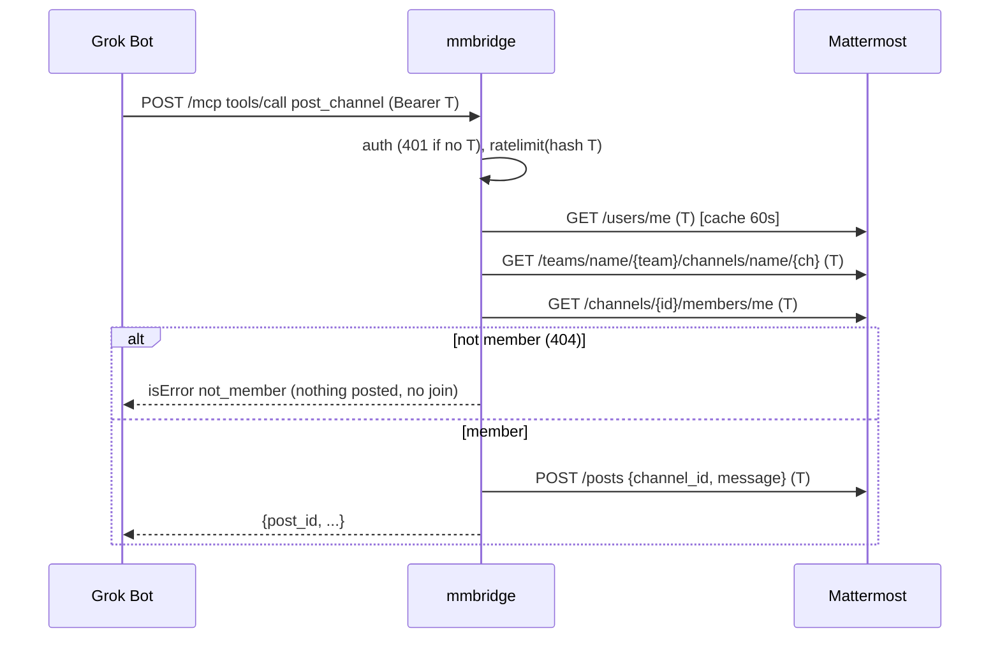

# Independent review: code-review slice-20261025-s2-post-read-channel
<!-- Written by eng-run (prompt code-review v2). Each finding row starts 'open': set disposition fixed (where) |
     accepted-risk (ONLY with Rob's approval, e.g. "Rob 2026-10-26") | rejected (reason). Plan reviews gate
     implementation (medium/large); slice reviews are advisory. -->

## Findings
| # | Severity | Location | Finding | Disposition | Reason / approval |
|---|---|---|---|---|---|
| - | - | - | No findings: Codex reported "No actionable defects were identified in the changes" (diff 644ed0e...8334f40). | n/a | nothing to address (claude-code 2026-10-26) |


## Reviewer raw output
````
OpenAI Codex v0.164.0
--------
workdir: /mnt/d/rob/projects/mmbridge
model: gpt-6.1-sol
provider: openai
approval: never
sandbox: workspace-write [workdir, /tmp, $TMPDIR]
reasoning effort: none
reasoning summaries: none
session id: 01a176ef-29fb-7660-8ac7-0a795b38d62e
--------
user
changes against '644ed0e'
exec
/bin/bash -lc 'cat PROJECT_STATE.md; cat AGENTS.md; python3 .eng/bin/eng-check .' in /mnt/d/rob/projects/mmbridge
 succeeded in 471ms:
---
id: STATE
type: project-state
phase: implement
status: active
owner_agent: Eddie
date: 2026-10-26
links: []
triage: medium            # unset | small | medium | large
active_slice: thoughts/shared/slices/2026-10-25-s2-post-read-channel.md
# Single source of truth for approvals. One item per line: "CP-X: <path> - <decision needed>".
# Later checkpoints (e.g. CP-B while in discover) may be listed early. Quote items containing commas.
pending_approvals: []
# Working agreements (see PROCESS.md section 10). Never hard-code these in design docs.
implementer: claude-code      # who writes code (default: Claude Code on the owner's PC)
planner: grok-bot             # who plans, writes docs, keeps state and process
cross_review: codex-advisory  # codex-advisory | none  (advisory, never a gate)
push_permission: ask          # ask (before each push) | standing
board: none                   # none | vikunja (optional, board only; repo stays the source of truth)
acceptance: executable-specs   # v2.5: tests/acceptance/, see PROCESS.md 13
---
# PROJECT_STATE

> Single entry point. Any agent reads THIS file first, then the latest handoff linked below.
> Update it at the end of every session. Keep it under one screen.

## Current phase
implement - entry/exit criteria in `.eng/PROCESS.md` section 3.

## Goal (one sentence)
A public HTTPS MCP bridge (Python, deployed on Coolify at chats.rmlab.cloud) that lets Grok Bots read and post in Rob's self-hosted Mattermost, each bot using its own Mattermost bot token.

## Active slice
[thoughts/shared/slices/2026-10-25-s2-post-read-channel.md](thoughts/shared/slices/2026-10-25-s2-post-read-channel.md) (slice 1 done, CP-S 2026-10-26)

## Next action
Slice 1 done (verify PASS, CP-S approved 2026-10-26). Next: start slice 2 (post/read channel) on Rob's PC via `python3 .eng/bin/eng-run implement thoughts/shared/plans/2026-10-25-mmbridge-mcp.md SLICE-20261025-s2-post-read-channel` (CP-C covers start; FYI Rob). Push of local commits needs Rob's OK (push_permission: ask).

## Blockers
- 2026-10-26: slice 2 implement run couldn't execute commands (python3 .eng/bin/*, .venv/bin/pytest refused by the permission mode). Rob to allow them, then re-run. See latest handoff.

## Pending approvals
See `pending_approvals` in the front matter (the only copy; `.eng/bin/eng-status` renders it). Do not list items here.

## Back-ups to an earlier phase
<!-- date - from phase -> to phase - why (blameless) - artifacts revised -->
none

## Latest artifacts
<!-- Relative links only; .eng/bin/eng-check verifies they resolve. -->
- Conventions: [AGENTS.md](AGENTS.md)
- Owner guide: [OWNER-GUIDE.md](OWNER-GUIDE.md)
- Definition of Done: [docs/definition-of-done.md](docs/definition-of-done.md)
- Process feedback: [thoughts/shared/process-feedback.md](thoughts/shared/process-feedback.md)
- Design (approved; scope hold approved): [docs/design/2026-10-25-mmbridge-mcp.md](docs/design/2026-10-25-mmbridge-mcp.md)
- Architecture: [docs/architecture/2026-10-25-mmbridge-mcp.md](docs/architecture/2026-10-25-mmbridge-mcp.md)
- ADRs 0001-0005: [docs/decisions/](docs/decisions/)
- Latest handoff: [thoughts/shared/handoffs/2026-10-26_09-00-00_s2-blocked-no-exec.md](thoughts/shared/handoffs/2026-10-26_09-00-00_s2-blocked-no-exec.md)
- Plan (approved): [thoughts/shared/plans/2026-10-25-mmbridge-mcp.md](thoughts/shared/plans/2026-10-25-mmbridge-mcp.md)
- Verification s1 (PASS): [thoughts/shared/verification/2026-10-26-s1-verify.md](thoughts/shared/verification/2026-10-26-s1-verify.md)
- Slices: [thoughts/shared/slices/](thoughts/shared/slices/)
- Specs: [tests/acceptance/specs/test_mmbridge.py](tests/acceptance/specs/test_mmbridge.py)
- Research: [thoughts/shared/research/2026-10-25-mmbridge-current-code.md](thoughts/shared/research/2026-10-25-mmbridge-current-code.md)
- Deferred work: [TODOS.md](TODOS.md)

## Approval log
<!-- One row per decision. Artifact cell names the file path(s). Decision: approved | accepted | partially accepted | deferred | rejected.
     Pre-kit decisions: back-fill with Checkpoint "pre-kit" and Decision "approved (back-filled, pre-kit)". .eng/bin/eng-check matches rows to statuses. -->
| Date | Checkpoint | Artifact | Decision (Rob) |
|---|---|---|---|
| 2026-10-25 | CP-A | docs/design/2026-10-25-mmbridge-mcp.md | approved (problem, REQ-1..8, acceptance examples) |
| 2026-10-25 | CP-A (scope) | docs/design/2026-10-25-mmbridge-mcp.md | approved (scope mode hold: REQ-1..8 in; @mention wakes, auto-join, multi-bot, threads/reactions/files out) |
| 2026-10-25 | CP-B | docs/architecture/2026-10-25-mmbridge-mcp.md | approved |
| 2026-10-25 | CP-B | docs/decisions/0001-credential-handoff-bearer-per-call.md, docs/decisions/0002-mattermost-http-client.md, docs/decisions/0003-mcp-surface-streamable-http.md, docs/decisions/0004-per-token-in-memory-rate-limit.md, docs/decisions/0005-structured-logs-public-health.md | accepted (ADR-0001..0005) |
| 2026-10-26 | CP-C | thoughts/shared/plans/2026-10-25-mmbridge-mcp.md | approved speclock sha256:2e4855ad12913e1f |
| 2026-10-26 | CP-S | thoughts/shared/slices/2026-10-25-s1-auth-list-channels.md | approved (manual verification approved by Rob; verify PASS; review F1/F2 accepted-risk) |
---
id: AGENTS
type: conventions
phase: any
status: active
owner_agent: Eddie
date: 2026-10-25
links: [PROJECT_STATE.md, docs/definition-of-done.md]
---
# Agent conventions

**Start here:** read `PROJECT_STATE.md`, then the latest handoff it links. Do not rely on chat history.
Process: eng-process kit; canonical copy at `.eng/PROCESS.md` (phases, checkpoints, skill for each phase in section 3, session convention in section 8). Run `.eng/bin/eng-check .` before and after each session.
**The kit is vendored in this repo:** skills are in `.claude/skills/eng-*/SKILL.md` (Claude Code loads them as project skills; other agents read them as files) and the scripts are in `.eng/bin/` (plain Python 3, run through the interpreter from the repo root: `python3 .eng/bin/eng-check .`; native Windows: `python .eng/bin/eng-check .` or `py .eng/bin/eng-check .`). Do not look for the kit elsewhere; if `.eng/bin` or `.claude/skills` is missing, ask the planner to run `<kit>/bin/eng-init <repo> --upgrade`.

## Working agreements
The values live in `PROJECT_STATE.md` front matter (`implementer`, `planner`, `cross_review`, `push_permission`, `board`); `.eng/PROCESS.md` section 10 says what each means. Summary:
- The **planner** agent plans, writes docs, keeps state and process. It does not write production code.
- The **implementer** (default: Claude Code on the owner's PC) codes one slice at a time. When a slice is ready, the planner sends the owner the "ready to implement" message (`.eng/bin/eng-status` prints it), then afterwards picks up the implementer's handoff and runs `eng-verify` and `.eng/bin/eng-check`.
- **Cross-model review** (Codex) is advisory, never a gate. See `.eng/PROCESS.md` section 10.
- **Push:** follow `push_permission` (default `ask`: ask the owner before each push).
- **Owner review notes** (`thoughts/shared/review-notes/`) belong to the owner. Agents never edit them until the owner says they are ready.

## Commands
- Install:  `python3 -m venv .venv && .venv/bin/pip install -r requirements.txt -r requirements-dev.txt`
- Build:    `docker build -t mmbridge .`
- Test:     `.venv/bin/pytest tests/unit -q && .venv/bin/pytest tests/acceptance -q`
- Lint/typecheck: none yet
- Run locally: `MATTERMOST_URL=http://localhost:8065 .venv/bin/uvicorn app.main:app --port 8080`

## Architecture map
<top-level dirs and what lives there, 5-10 lines>

## Code style / conventions
<only rules an agent cannot infer from the code>

## Rules
- Never weaken a test, timeout, or check to make it pass; never use `--no-verify`.
- Durable decisions go in `docs/decisions/` (ADR). Deferred work goes in `TODOS.md`.
- Don't touch: <paths / systems off-limits>

## Gotchas
eng-check: OK - 0 error(s), 0 warning(s), 29 artifact(s) checked

exec
/bin/bash -lc 'git diff --stat 644ed0ec80eaec8aecc030bcec842215f7d285e8; cat .eng/PROCESS.md' in /mnt/d/rob/projects/mmbridge
 succeeded in 237ms:
 .eng/runners.toml                                  |   3 +
 CHANGELOG.md                                       |   4 +
 app/mattermost.py                                  |   2 +-
 app/mcp.py                                         |  45 +++++++-
 app/ratelimit.py                                   |  10 +-
 app/service.py                                     |  43 +++++++-
 app/validate.py                                    |  42 +++++++
 tests/acceptance/drivers/fake_mattermost.py        |  87 ++++++++++++++-
 tests/acceptance/drivers/mcp.py                    |  25 ++++-
 tests/unit/test_channels.py                        | 122 +++++++++++++++++++++
 .../slices/2026-10-25-s2-post-read-channel.md      |   4 +-
 11 files changed, 373 insertions(+), 14 deletions(-)
<!-- Copy of eng-process kit v2.5.1 PROCESS.md, vendored by eng-init. Do not edit here. -->
# Engineering Process (canonical, kit v2.1)

One human approver (Rob, "the owner"), several interchangeable AI agents. **All state lives in files; the repo is the single source of truth.** Any agent must be able to pick up the project from `PROJECT_STATE.md` + the latest handoff alone. This file is the only place the phase-to-skill routing lives (section 3); `AGENTS.md` and skills reference it, and `.eng/PROCESS.md` is a pinned read-only copy written by `eng-init`.

## 1. Repo layout (created by `<kit>/bin/eng-init`)
```
PROJECT_STATE.md          single entry point: phase, triage, working agreements, active slice, next action, approvals
AGENTS.md  (CLAUDE.md -> @AGENTS.md)   commands, architecture map, conventions
OWNER-GUIDE.md            plain-language guide + glossary for the owner
CHANGELOG.md  TODOS.md    release notes; deferred work and scope cuts
docs/definition-of-done.md
docs/vision/              long-lived product vision / feature list (type vision)
docs/design/              design docs per increment (problem -> requirements -> scope [-> architecture])
docs/architecture/        optional separate architecture docs for large work (type architecture)
docs/decisions/           ADRs NNNN-slug.md, id ADR-NNNN, append-only
thoughts/shared/research/         codebase research: what the code IS (type research)
thoughts/shared/market-research/  external/market/methods research (type market-research)
thoughts/shared/briefs/           project briefs for a new implementer/reviewer (type project-brief)
thoughts/shared/{plans,slices,handoffs,retros}/
thoughts/shared/verification/     verification reports + independent review findings (*-review.md)
thoughts/shared/review-notes/     owner's scratch notes; agents don't edit; not checked
thoughts/shared/process-feedback.md  friction log for the kit (type process-feedback)
.eng/bin/                 vendored kit scripts (eng-check, eng-status, eng-new, eng-init, englib.py); plain python3
.eng/templates/  .eng/PROCESS.md  .eng/VERSION   vendored templates, this file, kit version
.claude/skills/eng-*/SKILL.md     vendored skills (Claude Code project-skill location)
.eng/templates/  .eng/PROCESS.md  .eng/VERSION    kit copy (templates used by .eng/bin/eng-new)
```
Every checked artifact starts with front matter: `id, type, phase, status, owner_agent, date, links`. `.eng/bin/eng-check` enforces it. Inline lists may quote items containing commas (`["a, b", c]`); dash lists also work.

## 2. Triage (`eng-triage`, first step for any request)
| Size | Signal | Phases |
|---|---|---|
| **Small** | about 1 file or an obvious fix, no new interface, no data change, reversible | Implement -> Verify -> Ship (one slice card, no plan) |
| **Medium** | a few files, one component, known patterns | Discover (short design doc) -> Research -> Plan -> Implement -> Verify -> Ship -> Reflect |
| **Large** | new component/interface/data model, cross-cutting, brownfield risk, security/money/data | all nine phases, all checkpoints |
When in doubt, size up. Re-triage if research reveals more than expected. Record it in `PROJECT_STATE.md` (`triage:`).

**Readiness check.** When a project claims to be at a later phase (e.g. "we're already on slice 1"), `eng-triage` verifies that every earlier phase's artifacts and approvals exist for its size (table below; `.eng/bin/eng-status` prints `readiness:` and `.eng/bin/eng-check` fails on gaps). If anything is missing, set `phase` back to the earliest incomplete phase, list exactly what is missing under Blockers, and record the back-up (section 4a).

| To be in phase | Small | Medium | Large |
|---|---|---|---|
| research | n/a | approved design (CP-A) | approved design (CP-A) |
| architecture | n/a | n/a | + approved codebase research (CP-R) |
| plan | n/a | approved design; research doc exists | + approved architecture (CP-B logged, or approved `docs/architecture/` doc) |
| implement | slice card | + approved plan (CP-C) with clean plan review | + approved plan (CP-C) with clean plan review |
| verify | slice card | same as implement | same as implement |
| ship | + verification `pass` (CP-D) | + verification `pass` | + verification `pass` |

## 3. Phases (and the skill for each: this is the routing table)
| # | Phase | Skill | Entry | Output | Exit criteria | Checkpoint |
|---|---|---|---|---|---|---|
| 0 | (any session) | eng-resume to start, eng-handoff to end; eng-triage for new requests; eng-project-init to adopt | | | | |
| 1 | Discover | eng-discover | triaged M/L | `docs/design/*` (+ optional `docs/vision/`, `thoughts/shared/market-research/`) | problem, metric, testable requirements; no `[NEEDS CLARIFICATION]` | **CP-A Product** |
| 2 | Scope | eng-scope-review | CP-A approved | design doc Scope section (baseline = approved requirements list); cuts -> TODOS.md; ADR if durable | mode chosen relative to baseline, in/out lists | (part of CP-A for L) |
| 3 | Research | eng-research | approved design | `thoughts/shared/research/*` | code *as is* with file:line; no recommendations | **CP-R Research** (L; optional M) |
| 4 | Architecture | eng-architecture-review | research approved | design doc Architecture section **or** `docs/architecture/*` linked from it; ADRs | contracts, data, sequence, failure modes, rollback, observability, security | **CP-B Architecture** (L) |
| 5 | Plan | eng-plan | prerequisites (section 2) | `thoughts/shared/plans/*` + slice cards + **mandatory Codex plan review** (M, L) | vertical slices, each with automated + manual criteria; What We're NOT Doing; no open critical/high review finding | **CP-C Plan** (M, L) |
| 6 | Implement | eng-implement-slice (run by the implementer) | plan approved, slice next, no pending approvals | code + tests, plan checkboxes, slice card; then independent review findings | slice's automated criteria pass; review findings answered | **CP-S Slice** per slice |
| 7 | Verify | eng-verify | all slices `review`/`done` | `thoughts/shared/verification/*` | every criterion re-executed; DoD pass; verdict PASS | **CP-D Done** |
| 8 | Ship | eng-ship | verification PASS | CHANGELOG entry, VERSION (if used), PR | CI green, PR opened | **CP-P PR merge/deploy** (Rob merges) |
| 9 | Reflect | eng-retro | shipped (or weekly, or each advisor consultation) | `thoughts/shared/retros/*` + edits | process-feedback pass done; each change applied to a file | none |

**One phase per session, one artifact, then stop for approval.** Discovery tends to pre-draft later artifacts (architecture, plan). That's allowed only as input. **Wording, used everywhere:** `input` = a pre-draft written in an earlier phase than its own, not yet worked on in its own phase; `draft` = being written in its own phase; `in-review` = waiting for Rob. None of these is an approval, and neither is any invented status like `approved-for-review` (`.eng/bin/eng-check` rejects those). Pre-drafts carry `status: input` and the heading note "input, not approved"; their own phase's skill turns them into `draft`. The owner may choose to group phases in one session once familiar with the process; record that in the handoff.

## 4. Approval checkpoints
- **Front matter `pending_approvals` is the single source of truth.** Item format: `CP-X: <path>[ + <path>] - <decision needed>`; paths must exist (CP-P may name a PR URL). The body section only points at it; `.eng/bin/eng-status` renders it. `.eng/bin/eng-check` fails if the body lists CP items that differ.
- Checkpoints for **later** phases may be pending early (e.g. CP-B auth/hosting questions during Discover). A pending checkpoint for an **earlier** phase than the current one blocks (`.eng/bin/eng-check` error); so does any missing prerequisite (section 2), for every phase, not just implement/verify/ship.
- **Owner review workflow.** Rob may jot notes in `thoughts/shared/review-notes/<owner>-review-notes.md`. Agents never edit or act on it until he says the notes are ready. Approvals arrive in chat. The agent then records each one in (1) the PROJECT_STATE Approval log row, (2) the artifact `status`, and (3) an ADR if the decision is durable, removes the pending item, and commits. The repo, not the chat, is the official record. `.eng/bin/eng-check` cross-checks the log and statuses both ways.
- **Notes rotation.** When a cycle finalizes (a slice reaches `done`, or a ship), if the scratch file has notes: `git mv` it to `<cycle-id>-<owner>-review-notes.md` and recreate the empty scratch file from `.eng/templates/review-notes.md`. Done in eng-handoff and eng-ship.
- Rejection: status back to `draft`, reasons in the artifact; for research, discard and redo rather than patch.
- ADR statuses: `proposed | accepted | partially-accepted | deferred | rejected | deprecated | superseded`. `partially-accepted` requires a `## Parts` section marking each part; `deferred` sets `revisit:`.

### 4a. Backing up to an earlier phase (blameless)
Discovering that an earlier artifact is wrong is normal. Any agent or the owner can call "back up to <phase>" (usually Discover): set `phase` back, set the design doc back to `draft` and any later-phase pre-drafts to `input`, revise them, move affected approvals back to `pending_approvals`, and add a line to PROJECT_STATE "Back-ups to an earlier phase": date, from -> to, why, artifacts revised. No blame, just the reason.

**Approvals live only in the Approval log table** (`| date | CP-X | path | decision |`). `eng-check` flags an approval written anywhere else in PROJECT_STATE.md (a prose line like "CP-C approved by Rob", a row-like line outside the table, a stray line inside the section), and any `approved` status without a table row.

**Design changes after CP-A.** Once the design doc is approved, editing it needs re-approval: set it back to `in-review` and request CP-A again, then log a **new** Approval log row (newer date). To make the check exact, put the content hash in the decision cell: `approved sha256:<first 12+ hex of sha256 of the file, LF line endings>`. Without a hash, `eng-check` warns when git shows a commit touching the approved design dated after the latest CP-A row. Edits during phase `discover` are never flagged. It also warns when plan or slice drafts exist while no design doc is approved (except triage small, or unset: size unknown before triage). Both checks are errors since v2.5.0.

## 5. WIP rules
- One project phase at a time; **max 1 slice `in-progress`** (enforced). Max open PRs = what Rob can review (default 1).
- Pull the next slice only when the previous is `done` or explicitly `blocked` with a reason.
- A slice is ~100-200 changed lines, end-to-end, demoable. Bigger -> split before starting.
- Deferrals and unrelated discoveries go to `TODOS.md`, not into the current slice.

## 6. Definition of Done
`docs/definition-of-done.md` (project may extend, never weaken). Core: criteria re-executed in the verifying session; tests incl. regression; no weakened gates; docs, CHANGELOG, ADRs, TODOS updated; verification PASS; state + handoff written.

## 7. Context hygiene
- **One phase per session.** Start fresh; load only PROJECT_STATE, the latest handoff, and the inputs the skill names.
- **~40% rule of thumb:** no context meter exists, so use proxies: when you've read >~15 files, done >~30 tool calls, or been corrected twice, compact: write progress into the artifact + handoff and end the session.
- **Compaction is into files**, never into memory: plan checkboxes, slice progress log, handoff.
- **Sub-tasks for search:** delegate wide searches to sub-agents returning paths + file:line; read critical artifacts directly and fully.
- Codebase research documents what *is*; opinions belong in market research, architecture or plan.
- Keep AGENTS.md short: only what an agent cannot infer from code.

## 8. Session convention (every skill's Start and Finish)
Skills say "Session: standard" instead of repeating this.
- **Start:** new session. Read only `PROJECT_STATE.md`, the latest handoff it links, and the skill's Inputs. Run `.eng/bin/eng-check .`; if it fails for a reason this skill must not fix, stop and report. If `pending_approvals` holds a checkpoint this skill needs, stop.
- **Finish:** update PROJECT_STATE (`phase`, `active_slice`, `pending_approvals`, `owner_agent`, `date`, Next action, Blockers, Latest artifacts) as part of **eng-handoff**, which is the session end. It writes `thoughts/shared/handoffs/YYYY-MM-DD_HH-MM-SS_<slug>.md` (Tasks+status, Critical References, Recent changes file:line, Learnings, Artifacts, Approvals, Next Steps naming the next skill), runs `.eng/bin/eng-check .` (must pass) and commits the docs. eng-handoff and eng-resume don't call themselves.
- **Resume:** eng-resume reads PROJECT_STATE, the linked handoff fully, then only its Critical References; verifies Recent changes exist (git); reports discrepancies; proceeds only if no needed approval is pending.
- If the next agent must ask "what was I doing?", the handoff is defective. Log it in `process-feedback.md`.
- Session handoff and **project brief** are different: the handoff passes one session to the next; a brief (`.eng/bin/eng-new brief`) orients a new implementer or reviewer and points at the plan and state.

## 9. Rules for every agent
Recommend; Rob decides. Never weaken a gate or use `--no-verify`. A report is a claim until re-executed. Stop and report on plan/code mismatch ("Issue in Phase N") instead of improvising. No fix without root cause; after 3 failed fixes, stop and hand off. Log process friction in `thoughts/shared/process-feedback.md` as you hit it.

## 10. Working agreements (standard; values in PROJECT_STATE front matter)
| Field | Default | Meaning |
|---|---|---|
| `implementer` | `claude-code` | Who writes code: Claude Code on the owner's own PC. Never name it in design docs; reference this field. |
| `planner` | `grok-bot` | Grok Bot assistants plan, write docs, keep state and process. They don't write production code. |
| `cross_review` | `codex-advisory` | Independent cross-model review; advisory, never a gate. `none` disables. |
| `push_permission` | `ask` | `ask` = ask the owner before each push; `standing` = may push the slice branch without asking (never merge). |
| `board` | `none` | Optional Kanban (e.g. self-hosted Vikunja, deferred). If used: board only, one card per slice linking to the repo plan/slice card. The repo stays the single source of truth; never record decisions on the board. |

**Implementer hand-off loop.**
1. When a slice is ready (plan approved with its mandatory plan review clean (M/L), slice is next in PROJECT_STATE `active_slice` with `status: todo`, `pending_approvals` empty, `.eng/bin/eng-check` OK), the planner **starts** implementation on the owner's PC: `python3 .eng/bin/eng-run implement <plan> <slice-id>` (or `eng run implement ...` with the global CLI), then tells Rob once, as FYI, with the standard message from `.eng/templates/ready-to-implement.md` (`.eng/bin/eng-status` prints it filled). Bots run eng-run on Rob's PC only with Rob's approval; his CP-C / slice-ready approval covers starting implement unless he said otherwise (if PROJECT_STATE has no standing note, a one-line "start implement?" is enough). **Fallback:** if eng-run or the Claude CLI is unavailable, or Rob wants to drive Claude interactively, send the paste prompt from the same message: `Run eng-resume, then eng-implement-slice for <slice> per <plan>`. Work keeps running until Rob interjects or a real decision is due: CP-S, a push when `push_permission: ask`, eng-check failures, locked-spec issues, open critical/high plan-review findings, blockers.
2. The implementer runs the slice on the owner's PC, ends with eng-handoff.
3. **Independent review (advisory):** before eng-verify, the cross-model review runs on the slice diff. Findings go to `thoughts/shared/verification/<date>-<slice>-review.md` (`.eng/bin/eng-new review <slug>`). The implementer fixes or answers each finding, then eng-verify runs.
4. The planner picks up the implementer's handoff and runs `eng-verify` and `.eng/bin/eng-check`, then requests CP-S.

**Mandatory plan review (medium and large; small exempt).** After the plan and slice cards are drafted and before CP-C, Codex reviews them non-interactively from the repo root on the owner's machine:
`codex exec "review <plan path> and the slice cards <slice glob> against <design doc> (REQ ids), <architecture doc> and <ADR range> for gaps, wrong ordering, missing tests, and security holes; output a numbered list of findings with severity" -o thoughts/shared/verification/<date>-<slug>-plan-review.md`
`.eng/bin/eng-status` prints this command with the real paths while CP-C is pending. **Codex output always goes straight to a file in the repo, never only the terminal:** `-o`/`--output-last-message <path>` writes the final review to the review file. Then turn that file into the findings artifact in place: add the review-findings front matter and Findings table (from `templates/review-findings.md`) above the raw output, which stays under "Reviewer raw output". Link it it from the plan's `plan_review:` field. Each finding gets a severity (critical/high/medium/low) and a disposition: `fixed` (where), `accepted-risk` (only with Rob's approval, recorded in the row), or `rejected` (with a reason). `.eng/bin/eng-check` fails, for medium/large triage, if a slice is in-progress or the phase is implement/verify/ship without a linked plan review, or with any critical/high finding still `open`. **Grandfathered plans** (approved before the review was mandatory): before the next slice starts, either run the review retroactively (same command, link it in `plan_review:`, fix/disposition findings), or record Rob's waiver in the Approval log: `| <date> | CP-C | <plan path> | waiver: plan review - approved by Rob |`. eng-check's error names both routes. This is the one review that is a gate; slice-diff and architecture reviews stay advisory.

**Cross-model review (Codex), advisory.** Run it on every slice diff before Rob approves the slice (always for auth, tenancy or security work), and on architecture docs for large work (plans: see the mandatory review above). Skip it for small or docs-only changes (write "skipped: <reason>" in the verification report). In Claude Code, gstack's `/codex` calls the real Codex CLI (diffs: `codex review --base <base> > thoughts/shared/verification/<date>-<slice-slug>-review.md`; documents: `codex exec "<prompt>" -o thoughts/shared/verification/<date>-<slug>-review.md`; always written into the repo). That needs `npm install -g @openai/codex` and `codex login` once on the owner's PC. Findings are recorded in the findings file and summarized in the verification report's "Cross-model review" section. They are advice: Rob decides, and no finding blocks by itself.

**Windows owner machines.**
- Line endings: set per command, not globally: `git -c core.autocrlf=false <cmd>` (or `input`). Kit files are LF.
- Encoding: write files as UTF-8 **without BOM** (PowerShell 5: `Out-File -Encoding utf8` adds a BOM; use `[IO.File]::WriteAllText` or PowerShell 7 `utf8NoBOM`). The scripts tolerate a BOM and print ASCII only.
- Archiving a repo to move it: include dotfiles and `.git` (`tar -czf repo.tgz -C <parent> <repo>`; Explorer's "Send to zip" can skip them).

**Headless agent runs (`eng-run`, v2.3).** From the repo root: `python3 .eng/bin/eng-run plan-review <plan>`, `... implement <plan> <slice-id>`, `... code-review <slice-id | --base REF>`. Prompts are `.eng/prompts/<role>.md` (kit-owned); the runner per role is `.eng/runners.toml` (project-owned, created once; defaults implement=claude, plan-review/code-review=codex), overridable by `ENG_RUNNER_<ROLE>` or `--runner` (`claude`, `codex`, or a `[runners.<name>]` `command` runner). Rules: every run writes a run log `thoughts/shared/runs/<date>-<role>-<target>.md` (command, prompt, output, exit code); every review also writes a review-findings file in `thoughts/shared/verification/` with rows `open` until dispositioned; review output never lives only in the terminal. Plan reviews set an empty `plan_review:` so eng-check's gate applies. eng-run refuses a review by the same runner that implemented the slice (run log, else PROJECT_STATE `implementer`) unless `--allow-self-review`, which must be named in the verification report. `--dry-run` prints the exact command without running. Bots (Chet, Dave) may run eng-run on Rob's PC only with Rob's approval for that run.

## 10a. The kit travels with the repo
The kit is vendored into every repo, so any agent on any machine (box, WSL, Git Bash, macOS) has it without the kit source: skills in `.claude/skills/<name>/SKILL.md`, scripts in `.eng/bin/`, prompts in `.eng/prompts/`, version in `.eng/VERSION`. Always call scripts by repo-relative path from the repo root, through the interpreter (no shebang reliance): `python3 .eng/bin/eng-check .` on Linux/macOS/WSL/Git Bash, `python .eng/bin/eng-check .` or `py .eng/bin/eng-check .` on native Windows. Every path the scripts compare or print is normalized to POSIX form (`/`), so backslash paths in front matter, links or the Approval log work too; always write `/` in docs. Commit `.eng/` and `.claude/skills/`. Never edit vendored files in a repo; change the kit and re-vendor.
- **Upgrade an existing repo** (planner, from the kit source): `<kit>/bin/eng-init <repo> --upgrade`. It overwrites only kit-owned files (`.eng/bin`, `.eng/templates`, `.eng/prompts`, `.eng/PROCESS.md`, `.eng/VERSION`, `.claude/skills/eng-*`), never project files; commit the result as "chore: vendor eng-process vX.Y.Z".
- `--upgrade` also: refreshes template comments/help text in project files (AGENTS.md, CLAUDE.md, OWNER-GUIDE.md, PROJECT_STATE.md body, DoD, ...) only where a section is still unchanged kit boilerplate, and prints every owner-edited stale section to update by hand (never overwrites owner content; front matter untouched); adds an empty `plan_review:` to plans lacking it; maintains the `# >>> eng-process defaults` block in `.gitignore` (`__pycache__/`, `*.pyc`, `.venv/`, ...) adding only lines not already present anywhere in the file (no duplicate block), and prints (never runs) `git rm -r --cached -- <files>` for tracked files the ignore rules now match. `__pycache__`/`.pyc` are never vendored. Stale sections are reported by name with a short diff. New checks start warn-only for one version (stray approvals: warn until v2.4.0; `eng-check --strict` makes them errors).
- `eng-check` fails if `.eng/bin` or `.claude/skills/eng-*` is missing, and warns when `.eng/VERSION` is older than the kit running it (or `$ENG_KIT/VERSION` if set).
- **Optional global install on a dev machine:** copy the skills to Claude Code's personal skill dir so they work in every repo: `mkdir -p ~/.claude/skills && cp -r <repo>/.claude/skills/eng-* ~/.claude/skills/` (WSL: inside the WSL home; Git Bash: `%USERPROFILE%\.claude\skills`). Project skills in the repo are still the source of truth; scripts are always taken from the repo's `.eng/bin/`.

## 11. Brownfield adoption and migration
Use `<kit>/bin/eng-init <repo> --brownfield` (eng-project-init "brownfield mode"). It lists every pre-existing markdown file with a suggested destination and type (a heuristic from its name and path; confirm each).
1. **Never delete history.** Move pre-kit docs with `git mv <old> <new>` in a dedicated commit (`chore: adopt eng-process layout`) so `git log --follow` works. Don't mix moves with content edits in one commit.
2. **Map each doc** to a kit location and type: vision/feature list -> `docs/vision/`; design/spec -> `docs/design/`; architecture -> `docs/architecture/`; codebase notes -> `thoughts/shared/research/`; external/market research -> `thoughts/shared/market-research/`; plans -> `thoughts/shared/plans/`; orientation docs for an implementer -> `thoughts/shared/briefs/`. Add front matter; unknown status -> `draft`.
3. **ADRs:** kit format is `docs/decisions/NNNN-slug.md` with id `ADR-NNNN` (4 digits). Migrate `ADR-001` style: `git mv docs/adr/001-x.md docs/decisions/0001-x.md`, set `id: ADR-0001`, then rewrite cross-references (`grep -rl 'ADR-0\?\([0-9]\{2,3\}\)'` then `sed -E 's/ADR-([0-9]{3})\b/ADR-0\1/g'`, reviewed). Keep numbers stable; never renumber to close gaps. Map old statuses: Deferred -> `deferred`; "accepted with parts open" -> `partially-accepted` + `## Parts`.
4. **Back-fill the Approval log** for decisions already accepted before the kit: one row per artifact, Checkpoint `pre-kit`, Decision `approved (back-filled, pre-kit)` / `accepted (...)`, date = original decision date if known. Set statuses to match. `.eng/bin/eng-check` then passes the log/status cross-check.
5. Delete only generated or duplicate files, and only with Rob's OK. Superseded docs get `status: superseded`.
6. Run the eng-triage **readiness check** to set the true phase.

## 12. Learning loop: predictions, evidence, lessons, adoption
- **Predictions.** Every ADR, advisor-consultation note and retro recommendation records *Expected outcome*, *Check date* and *What would prove it wrong* (templates `adr.md`, `retro.md`). eng-retro scores each past entry whose check date has passed as **right / wrong / unclear** with one line of evidence, in the retro and on the entry's `Score:` line.
- **Rejecting a finding.** A rejected Codex (or any reviewer) finding needs evidence in its Reason cell: a `file:line` (e.g. `src/auth.py:42`) or a test reference (e.g. `tests/test_auth.py::test_expired_token`). `eng-check` fails rejected rows without either (an error since v2.5.0). Retros record the **review hit-rate**: findings accepted vs rejected, and real bugs caught.
- **Research provenance.** Each research file starts with a provenance header: per source, the source (URL or repo), the commit (repos: pinned SHA) or date read (web), and `verified` (checked against the source by the author) or `unverified`. Pin cloned source repos to a commit and record it. When a consultation or decision relies on research, run a **staleness diff** first (`git -C <src> fetch && git -C <src> log --oneline <pinned>..origin/HEAD -- <paths relied on>`; web sources: re-read the page) and note the result. **Snapshot** a web page (save a copy next to the research with its fetch date) only when a decision-driving claim rests on it, and do it at re-derivation time, not by default. See `SOURCES.md`.
- **Kit lessons.** Format **"when X, do Y, because Z"** with origin, confirmation count and status (`templates/kit-lesson.md`). A lesson is a *hypothesis* until a second project confirms it. eng-retro proposes them; **Rob approves** each before it enters the kit's `LESSONS.md`.
- **Design adoption.** `process-feedback.md` has a *Design adoption* section: each kit step adopted or skipped, with reason. A skip the owner made knowingly (informed-owner skip) is recorded but not counted. **Two counted non-safety skips of the same step raise a redesign flag** for that step. **Any skip of a safety gate** (personal data handling, mandatory plan review, CP approvals) **is escalated to Rob immediately.**
- **Waste and time.** Each retro answers "which step felt like waste?" and records rough time per phase, so the kit can be trimmed with evidence.
- **Frontend legibility.** Architecture reviews always ask: *Can the owner judge this frontend's behaviour and code? If not, what reduces that gap?* Plans include a short **Demo script**. Frontend CI checks are opt-in and size-dependent: `.eng/templates/ci-checklist.md` (not enforced by eng-check).

## 13. Executable specifications (v2.5; Dave Farley's ATDD four-layer model)
**Two kinds of "spec", one direction.** *Design-side specs* (the design doc, the architecture doc, ADRs) say **what**
to build and **how** to build it; they are the authority. *Executable specs* are the **test-side** expression of the
design doc's requirements (REQ-n) and its plain-language acceptance examples: pytest tests in domain language under
`tests/acceptance/specs/`, each pointing back at its requirement with `@pytest.mark.req("REQ-n")` (the design doc's
id). They never introduce requirements; a spec without a REQ, or a REQ without a spec, is a gap to fix in the design
doc or the specs.

**Four layers** (`.eng/templates/acceptance/`, copied by `eng-spec init`):
1. **Specs** (`specs/`): what, never how; no URLs, selectors, status codes or sleeps; each creates its own data.
2. **DSL** (`dsl.py`): the shared domain vocabulary; aliases names per run (functional and temporal isolation).
3. **Protocol drivers** (`drivers/`): `api` (httpx), `ui` (Playwright), `mcp`. All system knowledge lives here.
4. **System under test**: deployed like production, started outside the tests; external systems stubbed at its boundary.

**By size.** Small: unchanged (unit/regression tests; no executable specs). Medium: specs on the API channel.
Large: API channel plus one Playwright web journey (`@pytest.mark.channels("api", "ui")`), with an ADR from
`.eng/templates/adr-acceptance-tests.md`.

**Approvals.**
- **CP-A:** Rob approves the plain-language Given/When/Then examples in the design doc's "Acceptance examples".
- **CP-C:** the planner writes the specs and the DSL interface, runs `.eng/bin/eng-spec lock .`, and the CP-C Approval
  log row records `approved speclock sha256:<hex>` (hash of `tests/acceptance/spec-lock.json`, printed by the command).
- **Locked:** spec files, and the DSL public interface (public step names, parameters, docstrings).
- **Flagged:** DSL assertion-step bodies (`assert_`/`then_`/`expect_`/`check_`/`verify_`); the Codex code review must
  name each changed step.
- **Free:** drivers, private DSL helpers (`_x`), `conftest.py`.
- An edit to a locked spec or the DSL interface during implementation is **not** a hard failure: `eng-run implement`
  prints a WARNING and writes an OWNER REVIEW entry in the run log, and `eng-check` warns until Rob re-approves
  (re-lock, new CP-C row) or the edit is reverted.

**Slices.** Each slice card lists `reqs:` and `specs:` (pytest node ids) or `specs: none - <reason>`. The implementer
runs them first and confirms they are red, then makes them green without touching locked files.

**Verify.** Re-run the acceptance suite on every planned channel; paste `eng-spec trace .` (REQ -> specs) with results
into the verification report; `eng-spec status .` must be clean or re-approved.

**eng-check (warn-only until v2.6.0; `--strict` makes them errors)**, active only when the project opted in
(`acceptance: executable-specs` in PROJECT_STATE, or a spec lock exists) and triage is not small:
`speclock-not-approved`, `spec-changed-without-approval`, `dsl-interface-changed`, `dsl-assertion-changed` (cleared
when a review-findings file names the step), `slice-without-spec`, `spec-unknown-node`, `req-without-spec` (at
verify/ship).

**Migration / grandfathering.** Existing projects are unaffected until they opt in with `eng-spec init .` (after
`eng-init --upgrade`). A project mid-increment may opt in at its next plan (CP-C); approved designs without
"Acceptance examples" are grandfathered, and their examples are written straight into specs at CP-C.


exec
/bin/bash -lc "cat thoughts/shared/handoffs/2026-10-26_09-00-00_s2-blocked-no-exec.md; find . -name 'AGENTS*' -not -path './.venv/*'; git diff 644ed0ec80eaec8aecc030bcec842215f7d285e8" in /mnt/d/rob/projects/mmbridge
 succeeded in 1128ms:
---
id: HANDO-20261026-s2-blocked-no-exec
type: handoff
phase: implement
status: complete
owner_agent: claude-code
date: 2026-10-26T09:00:00-05:00
links: [thoughts/shared/slices/2026-10-25-s2-post-read-channel.md, thoughts/shared/plans/2026-10-25-mmbridge-mcp.md]
git_commit: 22bd3b6
branch: main
next_skill: eng-implement-slice
---
# Handoff: Slice 2 not started, implementer session could not execute commands

## Task(s)
- Slice 2 (SLICE-20261025-s2-post-read-channel, plan Phase 2): **todo, not started**. No code changed.
- Slice 3 (DM): todo.

## Critical References
- thoughts/shared/slices/2026-10-25-s2-post-read-channel.md
- thoughts/shared/plans/2026-10-25-mmbridge-mcp.md (Phase 2)

## Recent changes
- Slice card s2: Progress log + Blockers entry (this session).
- PROJECT_STATE.md: Blockers, Latest handoff link.
- No production or test code touched.

## Learnings
- The headless implement run (eng-run implement) ran with a permission mode that refuses every Python execution: `python3 .eng/bin/eng-check .`, `python3 .eng/bin/eng-status .` and `.venv/bin/pytest tests/unit -q` all came back "requires approval" with nobody there to approve. `git` read commands worked.
- Without running anything, eng-implement-slice step 1 (eng-check must pass), step 2a (confirm specs are red) and step 4 (Phase 2 automated verification) can't be done. Writing the slice without running it would break test-first, so the session stopped.

## Artifacts
- thoughts/shared/handoffs/2026-10-26_09-00-00_s2-blocked-no-exec.md (this file)
- thoughts/shared/slices/2026-10-25-s2-post-read-channel.md (Progress log / Blockers)
- PROJECT_STATE.md

## Approvals
- None requested or granted. pending_approvals unchanged (empty). Nothing pushed.

## Action Items & Next Steps
1. Rob: allow the implementer to run `python3 .eng/bin/*`, `.venv/bin/pytest`, and `codex` (for the slice-2 review). Options: add them to the project's `.claude/settings.json` permissions allowlist, or start the run with a permission mode that permits them. Or run interactively: `Run eng-resume, then eng-implement-slice for SLICE-20261025-s2-post-read-channel per thoughts/shared/plans/2026-10-25-mmbridge-mcp.md`.
2. Re-run `python3 .eng/bin/eng-run implement thoughts/shared/plans/2026-10-25-mmbridge-mcp.md SLICE-20261025-s2-post-read-channel`. Then clear the blocker in the slice card and PROJECT_STATE.

## Other Notes
- `git status` showed main up to date with origin/main at 22bd3b6, so slice 1 commits look pushed already. The previous handoff's action item 1 ("ask Rob OK to push") may be stale.
./.eng/templates/AGENTS.md
./AGENTS.md
diff --git a/.eng/runners.toml b/.eng/runners.toml
index 69f536b..669f521 100644
--- a/.eng/runners.toml
+++ b/.eng/runners.toml
@@ -28,3 +28,6 @@ base = "main"            # default --base for code-review <slice-id>
 # type = "command"
 # command = "gemini -p {prompt}"
 # prompt_via = "arg"       # arg | stdin (stdin: the prompt is piped in)
+
+[runners.claude]
+implement_args = ["--permission-mode", "bypassPermissions"]
diff --git a/CHANGELOG.md b/CHANGELOG.md
index 883f2dd..9d3bc82 100644
--- a/CHANGELOG.md
+++ b/CHANGELOG.md
@@ -2,6 +2,10 @@
 All notable changes to this project. Format: Keep a Changelog style; newest first.
 
 ## [Unreleased]
+<!-- id: CHANG-20261026-s2-post-read-channel | owner_agent: unassigned | date: 2026-10-26 -->
+### Added
+- Bots can post to and read channels they belong to (post_channel, read_channel); non-member channels are refused without joining, and posts are limited to 20 per minute per bot.
+
 <!-- id: CHANG-20261026-s1-mcp-list-channels | owner_agent: unassigned | date: 2026-10-26 -->
 ### Added
 - MCP endpoint at /mcp: Grok Bots connect with their own Mattermost bot token (Authorization: Bearer) and can list their channels; the header-echo placeholder is removed and unknown paths return 404.
diff --git a/app/mattermost.py b/app/mattermost.py
index d37c997..c6dc8e6 100644
--- a/app/mattermost.py
+++ b/app/mattermost.py
@@ -41,7 +41,7 @@ class Client:
             raise MMError("mattermost_unavailable") from None
         return self._result(r)
 
-    async def post(self, path: str, json: dict) -> dict:
+    async def post(self, path: str, json: dict | list) -> dict | list:
         try:
             r = await self._send("POST", path, json=json)
         except (httpx.TransportError, httpx.TimeoutException):
diff --git a/app/mcp.py b/app/mcp.py
index 208358d..d618025 100644
--- a/app/mcp.py
+++ b/app/mcp.py
@@ -1,15 +1,21 @@
-"""MCP server (ADR-0003): FastMCP, Streamable HTTP, stateless, JSON responses. Slice 1: list_channels."""
+"""MCP server (ADR-0003): FastMCP, Streamable HTTP, stateless, JSON responses.
+
+Tool arguments are typed Any with an explicit JSON schema: app/validate.py (not pydantic coercion)
+decides what is invalid, so every bad input is `invalid_argument` with zero Mattermost calls.
+"""
 import math
 import time
 import uuid
+from typing import Annotated, Any
 
 from mcp.server.fastmcp import FastMCP
 from mcp.server.transport_security import TransportSecuritySettings
 from mcp.types import CallToolResult
+from pydantic import Field, WithJsonSchema
 
-from app import service
+from app import service, validate
 from app.auth import current_token, token_hash
-from app.errors import tool_error, tool_ok
+from app.errors import ToolError, tool_error, tool_ok
 from app.logging import call_line, log
 from app.mattermost import MATTERMOST_URL, Client, MMError
 
@@ -21,12 +27,24 @@ _MESSAGES = {
 }
 
 
+def _arg(schema: dict, description: str):
+    return Annotated[Any, WithJsonSchema(schema), Field(description=description)]
+
+
+Team = _arg({"type": "string", "pattern": "^[a-z0-9][a-z0-9._-]{0,63}$"}, "Team name (URL name, e.g. rmlab).")
+Channel = _arg({"type": "string", "pattern": "^[a-z0-9][a-z0-9._-]{0,63}$"}, "Channel name (URL name, e.g. town-square).")
+Message = _arg({"type": "string", "minLength": 1, "maxLength": validate.MAX_MESSAGE}, "Message text (Markdown).")
+Limit = _arg({"type": "integer", "minimum": 1, "maximum": validate.MAX_LIMIT},
+             "How many of the newest posts to return.")
+
+
 def build(limiter, mm_transport=None, base_url: str = MATTERMOST_URL) -> FastMCP:
     server = FastMCP("mmbridge", stateless_http=True, json_response=True, streamable_http_path="/mcp",
                      transport_security=TransportSecuritySettings(enable_dns_rebinding_protection=False))
     identities = service.IdentityCache()
 
-    async def run(tool: str, fn) -> CallToolResult:
+    async def run(tool: str, fn, check=lambda: (), write: bool = False) -> CallToolResult:
+        """check() validates the arguments (before any MM call) and returns them for fn(client, *args)."""
         token = current_token.get()
         th = token_hash(token)
         fields = {"request_id": uuid.uuid4().hex[:12], "tool": tool, "token_hash": th[:8], "bot": None,
@@ -38,11 +56,18 @@ def build(limiter, mm_transport=None, base_url: str = MATTERMOST_URL) -> FastMCP
             if ra:
                 fields["outcome"] = "rate_limited"
                 return tool_error("rate_limited", "Too many calls; slow down.", retry_after_s=math.ceil(ra))
+            args = check()
+            if write and (ra := limiter.check_write(th)):
+                fields["outcome"] = "rate_limited"
+                return tool_error("rate_limited", "Too many posts; slow down.", retry_after_s=math.ceil(ra))
             me = await identities.me(client, th)
             fields["bot"] = me["username"]
-            result = await fn(client)
+            result = await fn(client, *args)
             fields["outcome"] = "ok"
             return tool_ok(result)
+        except ToolError as e:
+            fields["outcome"] = e.code
+            return tool_error(e.code, e.message, **e.extra)
         except MMError as e:
             fields["outcome"] = e.code
             extra = {"status": e.status} if e.code == "mattermost_error" else {}
@@ -60,4 +85,14 @@ def build(limiter, mm_transport=None, base_url: str = MATTERMOST_URL) -> FastMCP
     async def list_channels() -> CallToolResult:
         return await run("list_channels", service.list_channels)
 
+    @server.tool(description="Post a message to a Mattermost channel this bot is a member of. Never joins channels.")
+    async def post_channel(team: Team, channel: Channel, message: Message) -> CallToolResult:
+        return await run("post_channel", service.post_channel, write=True, check=lambda: (
+            validate.identifier("team", team), validate.identifier("channel", channel), validate.message(message)))
+
+    @server.tool(description="Read the newest posts (newest first) of a Mattermost channel this bot is a member of.")
+    async def read_channel(team: Team, channel: Channel, limit: Limit = validate.DEFAULT_LIMIT) -> CallToolResult:
+        return await run("read_channel", service.read_channel, check=lambda: (
+            validate.identifier("team", team), validate.identifier("channel", channel), validate.limit(limit)))
+
     return server
diff --git a/app/ratelimit.py b/app/ratelimit.py
index 1e5d4d2..77bcfeb 100644
--- a/app/ratelimit.py
+++ b/app/ratelimit.py
@@ -1,4 +1,4 @@
-"""In-memory token buckets (ADR-0004). Slice 1: calls per token hash + anonymous per IP.
+"""In-memory token buckets (ADR-0004): calls and writes per token hash, anonymous per IP.
 
 Capacity equals the per-minute limit (plan: the 61st call in a minute is limited).
 """
@@ -26,11 +26,14 @@ class Bucket:
 
 
 class RateLimiter:
-    def __init__(self, calls_per_min: int | None = None, anon_per_min: int | None = None, clock=time.monotonic):
+    def __init__(self, calls_per_min: int | None = None, anon_per_min: int | None = None,
+                 writes_per_min: int | None = None, clock=time.monotonic):
         self.calls_per_min = calls_per_min or int(os.getenv("RL_CALLS_PER_MIN", "60"))
+        self.writes_per_min = writes_per_min or int(os.getenv("RL_WRITES_PER_MIN", "20"))
         self.anon_per_min = anon_per_min or int(os.getenv("RL_ANON_PER_MIN", "30"))
         self.clock = clock
         self._calls: dict[str, Bucket] = {}
+        self._writes: dict[str, Bucket] = {}
         self._anon: dict[str, Bucket] = {}
 
     def _take(self, d, key, per_min) -> float:
@@ -44,5 +47,8 @@ class RateLimiter:
     def check_call(self, token_hash: str) -> float:
         return self._take(self._calls, token_hash, self.calls_per_min)
 
+    def check_write(self, token_hash: str) -> float:
+        return self._take(self._writes, token_hash, self.writes_per_min)
+
     def check_anon(self, ip: str) -> float:
         return self._take(self._anon, ip, self.anon_per_min)
diff --git a/app/service.py b/app/service.py
index 2460cf9..7f5c7e2 100644
--- a/app/service.py
+++ b/app/service.py
@@ -1,7 +1,10 @@
 """Tool logic over the Mattermost client. Identity cache keyed by sha256(token) only."""
 import time
+from datetime import datetime, timezone
 
-from app.mattermost import Client
+from app.errors import ToolError
+from app.mattermost import Client, MMError
+from app.validate import segment
 
 IDENTITY_TTL_S = 60.0
 
@@ -30,3 +33,41 @@ async def list_channels(c: Client) -> dict:
                 out.append({"team": t["name"], "name": ch["name"], "display_name": ch.get("display_name", ""),
                             "type": ch["type"]})
     return {"channels": out}
+
+
+def iso(ms: int) -> str:
+    return datetime.fromtimestamp(ms / 1000, tz=timezone.utc).isoformat(timespec="milliseconds").replace("+00:00", "Z")
+
+
+async def _member_channel(c: Client, team: str, channel: str) -> dict:
+    """By-name lookup, then membership check (REQ-7). Never joins."""
+    try:
+        ch = await c.get("/teams/name/%s/channels/name/%s" % (segment(team), segment(channel)))
+    except MMError as e:
+        if e.status in (403, 404):
+            raise ToolError("unknown_channel", "No channel %r in team %r visible to this bot." % (channel, team))
+        raise
+    try:
+        await c.get("/channels/%s/members/me" % segment(ch["id"]))
+    except MMError as e:
+        if e.status in (403, 404):
+            raise ToolError("not_member", "This bot is not a member of %s/%s; ask an admin to add it." % (team, channel))
+        raise
+    return ch
+
+
+async def post_channel(c: Client, team: str, channel: str, message: str) -> dict:
+    ch = await _member_channel(c, team, channel)
+    p = await c.post("/posts", {"channel_id": ch["id"], "message": message})
+    return {"post_id": p["id"], "channel": channel, "team": team, "create_at": iso(p["create_at"])}
+
+
+async def read_channel(c: Client, team: str, channel: str, limit: int = 20) -> dict:
+    ch = await _member_channel(c, team, channel)
+    data = await c.get("/channels/%s/posts" % segment(ch["id"]), page=0, per_page=limit)
+    posts = sorted((data["posts"][i] for i in data.get("order", [])), key=lambda p: p["create_at"], reverse=True)[:limit]
+    ids = sorted({p["user_id"] for p in posts})
+    names = {u["id"]: u["username"] for u in (await c.post("/users/ids", ids) if ids else [])}
+    return {"team": team, "channel": channel,
+            "posts": [{"id": p["id"], "author": names.get(p["user_id"], p["user_id"]),
+                       "create_at": iso(p["create_at"]), "message": p.get("message", "")} for p in posts]}
diff --git a/app/validate.py b/app/validate.py
new file mode 100644
index 0000000..a22f704
--- /dev/null
+++ b/app/validate.py
@@ -0,0 +1,42 @@
+"""Shared input validators for the channel and DM tools. Run before any Mattermost call.
+
+Every failure raises ToolError("invalid_argument"). Identifiers are additionally URL-encoded
+(segment()) wherever they go into a request path.
+"""
+import re
+from urllib.parse import quote
+
+from app.errors import ToolError
+
+_IDENT = re.compile(r"[a-z0-9][a-z0-9._-]{0,63}")
+MAX_MESSAGE = 16383
+DEFAULT_LIMIT, MAX_LIMIT = 20, 100
+
+
+def _bad(msg: str) -> ToolError:
+    return ToolError("invalid_argument", msg)
+
+
+def identifier(kind: str, value) -> str:
+    if not isinstance(value, str) or not _IDENT.fullmatch(value) or ".." in value:
+        raise _bad("%s must be 1-64 chars of a-z, 0-9, '.', '_' or '-', starting with a letter or digit." % kind)
+    return value
+
+
+def message(value) -> str:
+    s = value.strip() if isinstance(value, str) else ""
+    if not 1 <= len(s) <= MAX_MESSAGE:
+        raise _bad("message must be 1-%d characters (not blank)." % MAX_MESSAGE)
+    return s
+
+
+def limit(value) -> int:
+    if value is None:
+        return DEFAULT_LIMIT
+    if type(value) is not int or not 1 <= value <= MAX_LIMIT:
+        raise _bad("limit must be an integer from 1 to %d." % MAX_LIMIT)
+    return value
+
+
+def segment(value: str) -> str:
+    return quote(value, safe="")
diff --git a/tests/acceptance/drivers/fake_mattermost.py b/tests/acceptance/drivers/fake_mattermost.py
index 8e47095..8203f83 100644
--- a/tests/acceptance/drivers/fake_mattermost.py
+++ b/tests/acceptance/drivers/fake_mattermost.py
@@ -1,8 +1,11 @@
 """Recording fake of the Mattermost /api/v4 endpoints the bridge uses (test harness only).
 
 Injected into the bridge via httpx.ASGITransport. Records every call as (method, path, auth_token).
-Slice 1: users/me, users/me/teams, users/me/teams/{id}/channels. Extended in slices 2-3.
+Slice 1: users/me, users/me/teams, users/me/teams/{id}/channels.
+Slice 2: channel by name, members/me, POST /posts, channel posts, POST /users/ids. Extended in slice 3.
 """
+import itertools
+
 import httpx
 from starlette.applications import Starlette
 from starlette.requests import Request
@@ -15,14 +18,22 @@ class FakeMattermost:
         self.users = {}      # id -> {"id","username","token"|None,"is_bot"}
         self.teams = {}      # id -> {"id","name","display_name"}
         self.channels = {}   # id -> {"id","team_id","name","display_name","type","members":set}
+        self.posts = {}      # id -> {"id","channel_id","user_id","message","create_at"}
         self.calls = []      # (method, path, token)
-        self.changes = []
+        self.changes = []    # world changes made through the API (seeding is not a change)
+        self._clock = itertools.count(1_700_000_000_000, 1000)
+        self._ids = itertools.count(1)
         self.down = False
         self.fail_status = None   # force every response to this HTTP status
         self.app = Starlette(routes=[
             Route("/api/v4/users/me", self._me),
             Route("/api/v4/users/me/teams", self._teams),
             Route("/api/v4/users/me/teams/{team_id}/channels", self._team_channels),
+            Route("/api/v4/teams/name/{team}/channels/name/{channel}", self._channel_by_name),
+            Route("/api/v4/channels/{channel_id}/members/me", self._member_me),
+            Route("/api/v4/channels/{channel_id}/posts", self._channel_posts),
+            Route("/api/v4/posts", self._create_post, methods=["POST"]),
+            Route("/api/v4/users/ids", self._users_by_ids, methods=["POST"]),
         ])
 
     # --- world setup -------------------------------------------------------------
@@ -47,6 +58,20 @@ class FakeMattermost:
                               "type": ctype, "members": {self.user_by_name(m)["id"] for m in members} }
         return cid
 
+    def channel_by_name(self, name, team=None):
+        return next(c for c in self.channels.values()
+                    if c["name"] == name and (team is None or self.teams[c["team_id"]]["name"] == team))
+
+    def add_post(self, channel_id, user_id, message):
+        pid = "p-%d" % next(self._ids)
+        self.posts[pid] = {"id": pid, "channel_id": channel_id, "user_id": user_id, "message": message,
+                           "create_at": next(self._clock)}
+        return self.posts[pid]
+
+    def channel_posts(self, channel_id):
+        """Posts of a channel, oldest first."""
+        return sorted((p for p in self.posts.values() if p["channel_id"] == channel_id), key=lambda p: p["create_at"])
+
     def transport(self):
         fake = self
 
@@ -94,6 +119,64 @@ class FakeMattermost:
         return JSONResponse([{k: v for k, v in c.items() if k != "members"}
                              for c in self.channels.values() if c["team_id"] == tid and u["id"] in c["members"]])
 
+    def _member_channel(self, u, cid):
+        c = self.channels.get(cid)
+        if not c:
+            return None, JSONResponse({"message": "not found"}, status_code=404)
+        if u["id"] not in c["members"]:
+            return None, JSONResponse({"message": "no permission"}, status_code=403)
+        return c, None
+
+    async def _channel_by_name(self, request):
+        u, err = self._auth(request)
+        if err:
+            return err
+        p = request.path_params
+        c = next((c for c in self.channels.values() if c["name"] == p["channel"]
+                  and self.teams[c["team_id"]]["name"] == p["team"]), None)
+        if not c:
+            return JSONResponse({"message": "not found"}, status_code=404)
+        return JSONResponse({k: v for k, v in c.items() if k != "members"})
+
+    async def _member_me(self, request):
+        u, err = self._auth(request)
+        if err:
+            return err
+        c = self.channels.get(request.path_params["channel_id"])
+        if not c or u["id"] not in c["members"]:
+            return JSONResponse({"message": "not found"}, status_code=404)
+        return JSONResponse({"channel_id": c["id"], "user_id": u["id"]})
+
+    async def _channel_posts(self, request):
+        u, err = self._auth(request)
+        if err:
+            return err
+        c, err = self._member_channel(u, request.path_params["channel_id"])
+        if err:
+            return err
+        page, per_page = int(request.query_params.get("page", 0)), int(request.query_params.get("per_page", 60))
+        newest = list(reversed(self.channel_posts(c["id"])))[page * per_page:(page + 1) * per_page]
+        return JSONResponse({"order": [p["id"] for p in newest], "posts": {p["id"]: p for p in newest} })
+
+    async def _create_post(self, request):
+        u, err = self._auth(request)
+        if err:
+            return err
+        body = await request.json()
+        c, err = self._member_channel(u, body.get("channel_id"))
+        if err:
+            return err
+        p = self.add_post(c["id"], u["id"], body["message"])
+        self.changes.append(("post", c["id"], p["id"]))
+        return JSONResponse(p, status_code=201)
+
+    async def _users_by_ids(self, request):
+        u, err = self._auth(request)
+        if err:
+            return err
+        ids = await request.json()
+        return JSONResponse([{"id": x["id"], "username": x["username"]} for i in ids if (x := self.users.get(i))])
+
 
 def _tok(headers):
     a = headers.get("authorization", "")
diff --git a/tests/acceptance/drivers/mcp.py b/tests/acceptance/drivers/mcp.py
index 76fc850..eb6411f 100644
--- a/tests/acceptance/drivers/mcp.py
+++ b/tests/acceptance/drivers/mcp.py
@@ -1,6 +1,6 @@
 """MCP protocol driver (layer 3): drives the bridge app over Streamable HTTP (/mcp) in-process,
 with Mattermost replaced by a recording fake (/api/v4). Slice 1: list_channels + auth.
-Slices 2-3 extend the fake and the world/inspection helpers."""
+Slice 2: channel posts (post/read). Slice 3 extends the fake and the world/inspection helpers for DMs."""
 import io
 import json
 import logging
@@ -31,6 +31,7 @@ class McpDriver:
         self._held = self._portal.start_task_soon(self._hold, started)
         self._portal.call(started.wait)
         self._id = 0
+        self._seeded = None   # channel id of the last given_channel_posts
 
     async def _hold(self, started):  # lifespan enter/exit in one task (anyio cancel scopes)
         async with self.app.router.lifespan_context(self.app):
@@ -49,6 +50,18 @@ class McpDriver:
     def given_channel(self, team, channel, members):
         self.mm.add_channel(team, channel, members)
 
+    def given_channel_posts(self, team, channel, count):
+        cid = self.mm.channel_by_name(channel, team)["id"]
+        author = next((u for u in self.mm.users.values() if u["username"] == "seed-author"), None) \
+            or self.mm.add_user("seed-author")
+        for i in range(count):
+            self.mm.add_post(cid, author["id"], "seeded post %d" % (i + 1))
+        self._seeded = cid
+
+    def given_no_channel(self, team, channel):
+        self.mm.add_team(team)
+        assert not any(c["name"] == channel and c["team_id"] == "t-" + team for c in self.mm.channels.values())
+
     def given_mattermost_down(self):
         self.mm.down = True
 
@@ -99,6 +112,16 @@ class McpDriver:
     def mattermost_calls(self):
         return [(m, p) for m, p, _ in self.mm.calls]
 
+    def channel_posts(self, channel):
+        cid = self.mm.channel_by_name(channel)["id"]
+        return [(self.mm.users[p["user_id"]]["username"], p["message"]) for p in self.mm.channel_posts(cid)]
+
+    def newest_posts(self, count):
+        return [(p["id"], p["message"]) for p in reversed(self.mm.channel_posts(self._seeded))][:count]
+
+    def world_changes(self):
+        return list(self.mm.changes)
+
     def current_token(self):
         return self._last_token
 
diff --git a/tests/unit/test_channels.py b/tests/unit/test_channels.py
new file mode 100644
index 0000000..4386ec8
--- /dev/null
+++ b/tests/unit/test_channels.py
@@ -0,0 +1,122 @@
+"""Slice 2: shared validators, write bucket, post_channel / read_channel paths."""
+import pytest
+
+from conftest import call, payload, tok
+from app import validate
+from app.errors import ToolError
+from app.ratelimit import RateLimiter
+
+
+def _invalid(fn, *a):
+    with pytest.raises(ToolError) as e:
+        fn(*a)
+    assert e.value.code == "invalid_argument" and e.value.message
+
+
+def test_limit_boundaries():
+    assert validate.limit(None) == 20
+    assert validate.limit(1) == 1 and validate.limit(100) == 100
+    for bad in (0, 101, -1, True, False, "5", 5.0, [5]):
+        _invalid(validate.limit, bad)
+
+
+def test_message_boundaries():
+    assert validate.message("x" * 16383) == "x" * 16383
+    assert validate.message("  hi  ") == "hi"
+    for bad in ("", "   ", "x" * 16384, None, 5):
+        _invalid(validate.message, bad)
+
+
+def test_identifier_rules():
+    for ok in ("dev", "town-square", "a", "my_team.1", "x" * 64):
+        assert validate.identifier("channel", ok) == ok
+    for bad in ("a/b", "..", "a..b", "%2F", "dev%2Fx", "my channel", "Dev", "x" * 65, "", "-dev", "dev\n", None, 3):
+        _invalid(validate.identifier, "channel", bad)
+
+
+def test_segment_url_encodes():
+    assert validate.segment("a/b c") == "a%2Fb%20c"
+
+
+def test_write_bucket_independent_of_calls():
+    rl = RateLimiter(calls_per_min=100, writes_per_min=2, anon_per_min=1, clock=lambda: 0.0)
+    assert rl.check_write("a") == 0 and rl.check_write("a") == 0 and rl.check_write("a") > 0
+    assert rl.check_write("b") == 0
+    assert rl.check_call("a") == 0
+
+
+def test_write_bucket_default_20():
+    assert RateLimiter().writes_per_min == 20
+
+
+@pytest.mark.parametrize("tool,args", [
+    ("post_channel", {"team": "rmlab", "channel": "dev", "message": ""}),
+    ("post_channel", {"team": "rmlab", "channel": "dev", "message": "x" * 16384}),
+    ("post_channel", {"team": "rmlab", "channel": "../users", "message": "hi"}),
+    ("post_channel", {"team": "RMLAB", "channel": "dev", "message": "hi"}),
+    ("post_channel", {"team": "rmlab", "channel": "dev%2F..", "message": "hi"}),
+    ("read_channel", {"team": "rmlab", "channel": "dev", "limit": 0}),
+    ("read_channel", {"team": "rmlab", "channel": "dev", "limit": 101}),
+    ("read_channel", {"team": "rmlab", "channel": "dev", "limit": True}),
+    ("read_channel", {"team": "rmlab", "channel": "dev", "limit": "5"}),
+    ("read_channel", {"team": "rmlab", "channel": "a b", "limit": 5}),
+])
+async def test_invalid_argument_zero_mm_calls(bridge, mm, tool, args):
+    is_err, d = payload(await call(bridge, tool, args, token=tok(mm, "eddie")))
+    assert is_err and d["code"] == "invalid_argument" and d["message"]
+    assert mm.calls == []
+
+
+async def test_post_channel_ok(bridge, mm):
+    is_err, d = payload(await call(bridge, "post_channel", {"team": "rmlab", "channel": "dev", "message": "hi"},
+                                   token=tok(mm, "eddie")))
+    assert not is_err
+    assert set(d) == {"post_id", "channel", "team", "create_at"}
+    assert d["channel"] == "dev" and d["team"] == "rmlab" and d["create_at"].endswith("Z")
+    assert mm.posts[d["post_id"]]["message"] == "hi"
+
+
+@pytest.mark.parametrize("tool,args", [
+    ("post_channel", {"team": "rmlab", "channel": "ops", "message": "hi"}),
+    ("read_channel", {"team": "rmlab", "channel": "ops"}),
+])
+async def test_not_member_no_post_no_posts_get(bridge, mm, tool, args):
+    is_err, d = payload(await call(bridge, tool, args, token=tok(mm, "eddie")))
+    assert is_err and d["code"] == "not_member" and d["message"]
+    assert not [c for c in mm.calls if c[0] == "POST" or c[1].endswith("/posts")]
+    assert mm.changes == []
+
+
+@pytest.mark.parametrize("tool", ["post_channel", "read_channel"])
+async def test_unknown_channel(bridge, mm, tool):
+    args = {"team": "rmlab", "channel": "ghost"} | ({"message": "hi"} if tool == "post_channel" else {})
+    is_err, d = payload(await call(bridge, tool, args, token=tok(mm, "eddie")))
+    assert is_err and d["code"] == "unknown_channel" and d["message"]
+    assert not [c for c in mm.calls if "/members" in c[1] or c[1].endswith("/posts")]
+
+
+async def test_read_channel_format_newest_first(bridge, mm):
+    cid = mm.channel_by_name("dev")["id"]
+    rob = mm.add_user("rob")
+    for i in range(3):
+        mm.add_post(cid, rob["id"], "m%d" % i)
+    is_err, d = payload(await call(bridge, "read_channel", {"team": "rmlab", "channel": "dev", "limit": 2},
+                                   token=tok(mm, "eddie")))
+    assert not is_err
+    assert [p["message"] for p in d["posts"]] == ["m2", "m1"]
+    p = d["posts"][0]
+    assert set(p) == {"id", "author", "create_at", "message"}
+    assert p["author"] == "rob" and p["create_at"] == "2023-11-14T22:13:22.000Z"
+
+
+async def test_write_rate_limit_21st_post(bridge, mm):
+    t = tok(mm, "eddie")
+    args = {"team": "rmlab", "channel": "dev", "message": "hi"}
+    for _ in range(20):
+        assert not payload(await call(bridge, "post_channel", args, token=t))[0]
+    n = len(mm.calls)
+    is_err, d = payload(await call(bridge, "post_channel", args, token=t))
+    assert is_err and d["code"] == "rate_limited" and d["retry_after_s"] > 0
+    assert len(mm.calls) == n
+    # reads are not write-limited
+    assert not payload(await call(bridge, "read_channel", {"team": "rmlab", "channel": "dev"}, token=t))[0]
diff --git a/thoughts/shared/slices/2026-10-25-s2-post-read-channel.md b/thoughts/shared/slices/2026-10-25-s2-post-read-channel.md
index 2c9056d..62c8ccd 100644
--- a/thoughts/shared/slices/2026-10-25-s2-post-read-channel.md
+++ b/thoughts/shared/slices/2026-10-25-s2-post-read-channel.md
@@ -2,8 +2,8 @@
 id: SLICE-20261025-s2-post-read-channel
 type: slice
 phase: implement
-status: todo
-owner_agent: Eddie
+status: in-progress
+owner_agent: claude-code
 date: 2026-10-25
 links: [thoughts/shared/plans/2026-10-25-mmbridge-mcp.md]
 plan: thoughts/shared/plans/2026-10-25-mmbridge-mcp.md

exec
/bin/bash -lc 'cat app/mattermost.py; cat docs/architecture/2026-10-25-mmbridge-mcp.md; cat thoughts/shared/plans/2026-10-25-mmbridge-mcp.md; cat tests/acceptance/specs/test_mmbridge.py' in /mnt/d/rob/projects/mmbridge
 succeeded in 0ms:
"""Mattermost REST client (ADR-0002): one httpx client per call, using the caller's own token.

Reached only over the private stack network (MATTERMOST_URL, default http://mattermost:8065).
Retry policy: post() never retried; get() retried exactly once on httpx.ConnectError only.
"""
import os

import httpx

MATTERMOST_URL = os.getenv("MATTERMOST_URL", "http://mattermost:8065")
TIMEOUT_S = 10.0


class MMError(Exception):
    def __init__(self, code: str, status: int | None = None):
        super().__init__(code if status is None else "%s (HTTP %s)" % (code, status))
        self.code, self.status = code, status


class Client:
    def __init__(self, token: str, base_url: str = MATTERMOST_URL, transport: httpx.AsyncBaseTransport | None = None):
        self._token = token
        self._base = base_url.rstrip("/") + "/api/v4"
        self._transport = transport
        self.last_status: int | None = None

    def __repr__(self) -> str:  # never show the token
        return "Client(%s)" % self._base

    async def _send(self, method: str, path: str, **kw) -> httpx.Response:
        async with httpx.AsyncClient(transport=self._transport, timeout=TIMEOUT_S) as c:
            return await c.request(method, self._base + path, headers={"Authorization": "Bearer " + self._token}, **kw)

    async def get(self, path: str, **params) -> dict | list:
        try:
            try:
                r = await self._send("GET", path, params=params or None)
            except httpx.ConnectError:
                r = await self._send("GET", path, params=params or None)  # exactly one retry
        except (httpx.TransportError, httpx.TimeoutException):
            raise MMError("mattermost_unavailable") from None
        return self._result(r)

    async def post(self, path: str, json: dict | list) -> dict | list:
        try:
            r = await self._send("POST", path, json=json)
        except (httpx.TransportError, httpx.TimeoutException):
            raise MMError("mattermost_unavailable") from None
        return self._result(r)

    def _result(self, r: httpx.Response):
        self.last_status = r.status_code
        s = r.status_code
        if s < 400:
            return r.json()
        if s >= 500:
            raise MMError("mattermost_unavailable", s)
        if s == 401:
            raise MMError("unauthorized", s)
        if s == 404:
            raise MMError("not_found", s)
        raise MMError("mattermost_error", s)
---
id: ARCH-20261025-mmbridge-mcp
type: architecture
phase: architecture
status: approved            # input (pre-draft from an earlier phase) | draft | in-review | approved | superseded
owner_agent: Eddie
date: 2026-10-25
links: [docs/design/2026-10-25-mmbridge-mcp.md]
design: docs/design/2026-10-25-mmbridge-mcp.md
---
# Architecture: mmbridge MCP
Implements REQ-1..8 of [the design](../design/2026-10-25-mmbridge-mcp.md). Triage: medium. Grounded in [research](../../thoughts/shared/research/2026-10-25-mmbridge-current-code.md).

## Components and boundaries
| Component | Module | Responsibility |
|---|---|---|
| HTTP app | `app/main.py` | FastAPI; `/health` (public); mounts `/mcp`; everything else 404 (echo route removed) |
| Auth middleware | `app/auth.py` | Extract `Authorization: Bearer`; 401 if missing; put token in request context; never log/echo it |
| Rate limiter | `app/ratelimit.py` | In-memory token buckets keyed by SHA-256(token) / client IP (ADR-0004) |
| MCP server | `app/mcp.py` | Official `mcp` SDK, Streamable HTTP, stateless; 5 tools (ADR-0003) |
| Service layer | `app/service.py` | REQ logic: resolve team/channel/user, membership check, map errors to codes |
| Mattermost client | `app/mattermost.py` | `httpx.AsyncClient` to `MATTERMOST_URL/api/v4`, per-request bearer (ADR-0002) |
| Logging | `app/logging.py` | JSON logs + redaction filter (ADR-0005) |

Boundary: Internet → Coolify proxy (TLS, chats.rmlab.cloud) → container :8080 → private stack network → `mattermost:8065`. The bridge owns no data and no secrets.

```
Grok Bot (per-bot MCP connector, header Authorization: Bearer <bot token>)
   │ HTTPS
Coolify proxy ── mmbridge :8080 [auth → ratelimit → MCP tool → service → MM client] ──HTTP──▶ mattermost:8065 /api/v4
```

## Contracts / interfaces
Transport: MCP Streamable HTTP, `POST https://chats.rmlab.cloud/mcp`, stateless, JSON responses. Every request needs `Authorization: Bearer <token>`; else HTTP 401 `{"error":"unauthorized"}` (no `WWW-Authenticate` realm details, no echo).

| Tool | Args | Result | REQ |
|---|---|---|---|
| `list_channels` | – | `{channels:[{team, name, display_name, type}]}` (O/P channels the bot is a member of, all its teams) | 2 |
| `post_channel` | `team:str, channel:str, message:str (1..16383)` | `{post_id, channel, team, create_at}` | 3, 7 |
| `read_channel` | `team, channel, limit:int=20 (1..100)` | `{posts:[{id, author, create_at (ISO-8601 UTC), message}]}` newest first | 4, 7 |
| `dm_send` | `username, message` | `{post_id, channel_id, create_at}` | 5, 7 |
| `dm_read` | `username, limit=20 (1..100)` | same shape as `read_channel` | 6, 7 |

Error result (tool result with `isError: true`): `{"code": <code>, "message": <human text>}`. Codes: `unauthorized` (MM 401), `not_member`, `unknown_channel`, `unknown_user`, `invalid_argument`, `rate_limited` (+`retry_after_s`), `mattermost_unavailable` (connect error/timeout/5xx), `mattermost_error` (other 4xx, with MM status only). Messages never contain the token or raw MM response bodies.

## Data ownership and schemas
Mattermost owns all data. Bridge state is in-memory only: rate-limit buckets and a 60 s `users/me` cache, both keyed by SHA-256(token). No database, no persisted secrets. Config via env: `MATTERMOST_URL` (default `http://mattermost:8065`), `RL_CALLS_PER_MIN`=60, `RL_WRITES_PER_MIN`=20, `RL_ANON_PER_MIN`=30, `LOG_LEVEL`.

## Sequence (post_channel)

DM: `GET /users/username/{u}` → `POST /channels/direct [me, u.id]` (idempotent; opens or returns existing) → `POST /posts` or `GET /channels/{id}/posts?per_page=limit`. Read: `GET /channels/{id}/posts?page=0&per_page=limit`, order by `order[]`, author names via `POST /users/ids`.

## Failure modes and error handling
| Error | Trigger | Handler | User-visible result | Test |
|---|---|---|---|---|
| No credential | missing/malformed Authorization | auth middleware | HTTP 401, no MM call | REQ-1 ex2 (stub asserts 0 MM calls) |
| Invalid credential | MM 401 on `users/me` | service | `unauthorized` | stub 401 |
| Unknown channel/team | MM 404 on by-name lookup (or not visible to bot) | service | `unknown_channel` | REQ-7 |
| Not a member | `members/me` 404/403 | service, before any write | `not_member`; no join, no post | REQ-7 ex1 (assert no POST /posts) |
| Unknown user | `users/username` 404 | service | `unknown_user` | REQ-7 ex2 |
| Bad args | limit out of range, empty/oversize message | tool schema/validator | `invalid_argument` | unit |
| Rate limited | bucket empty | ratelimit | `rate_limited` + `retry_after_s` | unit |
| MM down | connect error / timeout / 5xx | client | `mattermost_unavailable`, token absent | REQ-8 ex1 (assert token not in result/logs) |
| MM other 4xx | e.g. 403 permission | client | `mattermost_error` with status | stub 403 |
| Unexpected exception | bug | top-level handler | generic `internal_error`, redacted log with request id | unit |

## Rollback, partial deploy, feature flags
Single container on Coolify built from `main`. Rollback = redeploy previous commit/image in Coolify. No data migrations, so rollback is always safe. No feature flags; unfinished tools are simply not registered. Slice 1 ships auth + echo removal + `list_channels`, so the token-echo hole closes in the first deploy.

## Observability
JSON log line per tool call (request id, tool, bot username, token-hash prefix, outcome code, MM status, latency) — ADR-0005. No headers/tokens/bodies logged; redaction filter as backstop. `/health` public liveness only, unchanged (`{"ok": true}`), used by Docker/Coolify healthcheck.

## Security (STRIDE quick pass)
- **Spoofing:** identity = Mattermost token validated by MM itself; bridge cannot act without caller's token (ADR-0001).
- **Tampering:** TLS at Coolify; container not host-published (`expose` only).
- **Repudiation:** posts authored by bot identity in MM; bridge logs bot username + request id.
- **Information disclosure:** remove echo route (currently leaks Authorization, `app/main.py:25`); never echo/log tokens; errors don't forward raw MM bodies.
- **Denial of service:** per-token and per-IP rate limits (ADR-0004); 10 s MM timeout; MCP body size capped (message ≤16383 chars).
- **Elevation of privilege:** no shared admin token; bot can do only what its MM bot account can; explicit no-join on non-member (REQ-7).

## Owner legibility (standing question)
n/a — no UI. The bridge has no frontend; Rob judges it through Mattermost (posts appear under bot names) and the acceptance examples.

## ADRs (accepted at CP-B 2026-10-25)
- [ADR-0001](../decisions/0001-credential-handoff-bearer-per-call.md) credential handoff
- [ADR-0002](../decisions/0002-mattermost-http-client.md) Mattermost client
- [ADR-0003](../decisions/0003-mcp-surface-streamable-http.md) MCP surface
- [ADR-0004](../decisions/0004-per-token-in-memory-rate-limit.md) rate limiting
- [ADR-0005](../decisions/0005-structured-logs-public-health.md) observability
Acceptance-test ADR (large-only) and Codex cross-model gate: skipped (triage medium).
---
id: PLAN-20261025-mmbridge-mcp
type: plan
phase: plan
status: approved            # input (pre-draft from an earlier phase) | draft | in-review | approved | in-progress | done | superseded
owner_agent: Eddie
date: 2026-10-25
links: [docs/design/2026-10-25-mmbridge-mcp.md, docs/architecture/2026-10-25-mmbridge-mcp.md]
plan_review: thoughts/shared/verification/2026-10-25-mmbridge-mcp-plan-review.md
---
# Plan: mmbridge MCP

## Overview
Turn the skeleton into the MCP bridge from the [design](../../../docs/design/2026-10-25-mmbridge-mcp.md) (REQ-1..8) per the approved [architecture](../../../docs/architecture/2026-10-25-mmbridge-mcp.md) and ADR-0001..0005. Three vertical slices; slice 1 is the shortest path to Rob connecting a real Mattermost bot from Grok Bot.

## Current State Analysis
From [research](../research/2026-10-25-mmbridge-current-code.md), verified against code:
- `app/main.py:12-14` `/health` returns `{"ok": true}`.
- `app/main.py:17-26` catch-all echo returns all request headers, including `Authorization` (token leak). Must go in the first deploy.
- `app/mattermost.py` and `app/mcp.py` are placeholders; `bot_token_for` stub conflicts with ADR-0001 and is removed.
- `requirements.txt`: fastapi, uvicorn only. No tests exist.

## Desired End State
`https://chats.rmlab.cloud/mcp` serves 5 MCP tools (Streamable HTTP, stateless). Each Grok Bot's MCP connection carries `Authorization: Bearer <its Mattermost bot token>`; the token lives only in the Grok Bot MCP connection, never in Coolify env or the repo. All 16 executable specs green; unknown paths 404; tokens never logged or echoed.

### Key Discoveries
- Echo leak at `app/main.py:25` (`"headers": dict(request.headers)`).
- Mattermost reachable only on the private stack network as `http://mattermost:8065` (`app/mattermost.py:11`).

## What We're NOT Doing
- @mention wakes / websocket events, auto-join, multi-bot routing, threads, reactions, files (TODOS.md, CP-A scope hold).
- Storing any token server-side (ADR-0001); no database; no admin token.
- Shared/distributed rate limiting (single container; ADR-0004).

## Implementation Approach
Call path: `POST /mcp` → `auth.require_bearer` (ASGI middleware on `/mcp`; 401 `{"error":"unauthorized"}` before any MM call; token into a `contextvars.ContextVar`) → `ratelimit.check(sha256(token), ip)` → MCP tool (`mcp` SDK `FastMCP`, `stateless_http=True`, `json_response=True`) → `service.*` → `mattermost.Client(token)`.

Key signatures:
```python
# app/mattermost.py
class MMError(Exception): code: str; status: int | None
class Client:
    def __init__(self, token: str, base_url: str = MATTERMOST_URL, transport: httpx.AsyncBaseTransport | None = None)
    async def get(self, path: str, **params) -> dict | list   # maps connect/timeout/5xx -> mattermost_unavailable, 401 -> unauthorized, 404 -> not_found, other 4xx -> mattermost_error
    async def post(self, path: str, json: dict) -> dict       # never retried
# app/validate.py (shared by post_channel/read_channel/dm_send/dm_read)
def identifier(kind: str, value: str) -> str   # team/channel/username: ^[a-z0-9][a-z0-9._-]{0,63}$ else invalid_argument; never interpolated unvalidated; path segments additionally URL-encoded
def message(value: str) -> str                 # 1..16383 chars after strip, else invalid_argument
def limit(value: int | None) -> int            # None -> 20; int 1..100 else invalid_argument (bools rejected)
# app/service.py
async def list_channels(c: Client) -> dict
async def post_channel(c, team, channel, message) -> dict
async def read_channel(c, team, channel, limit=20) -> dict
async def dm_send(c, username, message) -> dict
async def dm_read(c, username, limit=20) -> dict
# app/errors.py
def tool_error(code: str, message: str, **extra) -> CallToolResult  # isError=True, JSON {"code","message",...}
```
File tree diff:
```
app/main.py          M  remove echo; mount /mcp; 404 default
app/auth.py          A
app/ratelimit.py     A  (slice 1: call + anon buckets; slice 2: write bucket)
app/validate.py      A  (slice 2: shared validators for channel + DM tools; slice 3 reuses)
app/mcp.py           M  FastMCP server + tools
app/service.py       A
app/mattermost.py    M  httpx client; drop bot_token_for
app/errors.py        A
app/logging.py       A  JSON + redaction filter
requirements.txt     M  + mcp, httpx; requirements-dev.txt A (pytest, respx/none, pytest-asyncio)
tests/unit/          A
tests/acceptance/drivers/mcp.py, fake_mattermost.py  M/A
```
Fake Mattermost: an in-process ASGI app implementing only the `/api/v4` endpoints used, recording calls; injected via `httpx.ASGITransport` (env `MATTERMOST_URL` stays real in prod). The driver calls `/mcp` through `httpx.ASGITransport` on `app.main:app` with the `mcp` client SDK's Streamable HTTP client or raw JSON-RPC.

## Phase 1: Auth + echo removal + list_channels (real-bot connect)
Slice card: [thoughts/shared/slices/2026-10-25-s1-auth-list-channels.md](../slices/2026-10-25-s1-auth-list-channels.md) — **security slice: cross-model review required.**

### Changes Required
#### 1. Remove echo, mount MCP
**File**: `app/main.py` — delete catch-all; keep `/health`; mount MCP app at `/mcp`; unknown paths 404.
#### 2. Auth
**File**: `app/auth.py` — Bearer extraction, 401 without MM call, ContextVar token (set per request, reset in `finally`); never log the header. A well-formed but invalid token reaches MM, which returns 401 → tool error `unauthorized` (no token in result/logs). Identity cache (`users/me`, 60 s) is keyed by sha256(token) only; never shared across tokens.
**Isolation tests (unit/integration):** alternating and concurrent (`asyncio.gather`) calls from two tokens with disjoint memberships each get only their own identity and channels; the fake records the outbound `Authorization` per call and every MM call carries the caller's own token; the ContextVar is unset after each request (incl. on error); cache entries for token A are never returned for token B.
#### 3. Mattermost client + error mapping
**Files**: `app/mattermost.py`, `app/errors.py` — httpx, 10 s timeout, error codes per architecture table.
**Retry policy (ADR-0002, explicit):** `post()` (all writes) is **never** retried automatically. `get()` retries **exactly once**, only on a connection error (`httpx.ConnectError`); no retry on timeout, HTTP 4xx or 5xx. No generic retry transport/middleware may be added. Unit tests assert upstream call counts against the fake: write + connect error → 1 call; GET + connect error → 2 calls (then `mattermost_unavailable` if both fail, success if the retry succeeds); GET + timeout → 1; GET + 500 → 1; GET + 401/404 → 1.
#### 3b. Rate limiting (moved from slice 2, finding 3)
**File**: `app/ratelimit.py` — ADR-0004 buckets in slice 1: 60 calls/min per token hash, 30/min anonymous per client IP (401s count against the anon bucket); `rate_limited` + `retry_after_s`; 429 for anon. The 20 writes/min bucket is added in slice 2 with the first write tool. Tests: 61st call in a minute → `rate_limited`, retry_after_s > 0, no MM call; 31st anon request → 429; buckets independent per token.
#### 4. list_channels tool
**Files**: `app/mcp.py`, `app/service.py` — `users/me` (60 s cache by token hash), `users/me/teams`, `users/me/teams/{id}/channels`; return O/P channels only.
#### 5. Logging
**File**: `app/logging.py` — JSON line per call (ADR-0005), redaction filter.
#### 6. Test harness
`requirements-dev.txt`, `tests/unit/`, fake Mattermost + `McpDriver` (auth + list_channels), `pytest.ini`/conftest path setup. Update AGENTS.md Commands.

### Success Criteria
#### Automated Verification
- [x] `pip install -r requirements.txt -r requirements-dev.txt` succeeds
- [x] `pytest tests/unit -q` passes (auth 401 with zero MM calls; invalid token → `unauthorized`; caller isolation/ContextVar cleanup/cache keying; error mapping; retry call counts; call + anon rate limits; redaction; echo gone: `GET /anything` → 404 and body lacks headers)
- [ ] `pytest tests/acceptance -q -k "refused or joined_channels or invalid_credential or own_identity"` passes (REQ-1 ex2, invalid credential, caller isolation, REQ-2 ex1; the isolation spec's post step goes green in slice 2)
- [ ] `docker build .` succeeds; container `/health` returns `{"ok": true}`
- [x] `python3 .eng/bin/eng-check .` passes
#### Manual Verification (Rob — proves auth with a real bot)
- [ ] Coolify redeploy from `main`; `https://chats.rmlab.cloud/health` → `{"ok":true}`; `https://chats.rmlab.cloud/foo` → 404 (no headers echoed)
- [ ] `curl -X POST https://chats.rmlab.cloud/mcp` without Authorization → 401
- [ ] In Grok Bot, add MCP connection URL `https://chats.rmlab.cloud/mcp`, header `Authorization: Bearer <bot token>` (token only here; not in Coolify, not in repo)
- [ ] Ask the bot "list my Mattermost channels" → returns the channels the bot account was added to, team names correct
- [ ] Coolify logs show the call with bot username and token-hash prefix, no token

**Stop:** after automated checks pass, pause for Rob's manual verification before Phase 2.

---

## Phase 2: Post and read channel (+ write rate limit)
Slice card: [thoughts/shared/slices/2026-10-25-s2-post-read-channel.md](../slices/2026-10-25-s2-post-read-channel.md)

### Changes Required
#### 1. `post_channel`, `read_channel`
**Files**: `app/mcp.py`, `app/service.py`, `app/validate.py` — inputs validated by the shared validators before any MM call; by-name lookup (404 → `unknown_channel`); `channels/{id}/members/me` membership check before **both** `post_channel` and `read_channel` (REQ-7; 404/403 → `not_member`; never join); `POST /posts`; read via `channels/{id}/posts` + `POST /users/ids`, ISO-8601 UTC, newest first, limit 1..100 default 20, message 1..16383.
#### 2. Rate limiting
**File**: `app/ratelimit.py` — add the 20 writes/min per token hash bucket (ADR-0004) to the slice-1 limiter; `rate_limited` + `retry_after_s`.
#### 3. Fake MM + driver extensions for channel posts.

### Success Criteria
#### Automated Verification
- [ ] `pytest tests/unit -q` passes (shared validators: boundary values 0/1/100/101, None, bool, non-int limit; empty/16383/16384-char message; identifiers with `/`, `..`, `%2F`, spaces, uppercase, 65 chars → `invalid_argument` with zero MM calls; write bucket; not_member path (post and read) issues no POST and no posts GET)
- [ ] `pytest tests/acceptance -q -k "not dm"` passes (REQ-1 ex1 + isolation, REQ-3, REQ-4 x2, REQ-7 non-member post/read + unknown channel, REQ-8)
- [ ] `python3 .eng/bin/eng-check .` passes
#### Manual Verification
- [ ] After redeploy, bot posts "build is green" to a channel it's in; Rob sees it in Mattermost authored by the bot
- [ ] Bot reads that channel with limit 5 → 5 newest posts with authors/times
- [ ] Bot posts to a channel it is not in → told not a member; Rob confirms it didn't join

**Stop:** pause for Rob's manual verification before Phase 3.

---

## Phase 3: DMs
Slice card: [thoughts/shared/slices/2026-10-25-s3-dm.md](../slices/2026-10-25-s3-dm.md)

### Changes Required
#### 1. `dm_send`, `dm_read`
**Files**: `app/mcp.py`, `app/service.py` — `username`, `message`, `limit` validated with the same `app/validate.py` validators as Phase 2 before any MM call; `users/username/{u}` (404 → `unknown_user`), `POST /channels/direct [me,u]` (idempotent), post/read as Phase 2. Unit tests: DM boundary values and malformed usernames → `invalid_argument`, zero MM calls.
#### 2. Fake MM + driver: direct channels.

### Success Criteria
#### Automated Verification
- [ ] `pytest tests -q` passes (all 16 acceptance specs + unit)
- [ ] `python3 .eng/bin/eng-spec status .` reports no drift; `python3 .eng/bin/eng-check .` passes
#### Manual Verification
- [ ] Bot DMs Rob "hello" → Rob sees it in a DM from the bot; a second DM lands in the same conversation
- [ ] Rob replies "ping"; bot reads DM with rob → "ping" returned
- [ ] DM to "nobody" → unknown user error

## Demo script
1. Open `https://chats.rmlab.cloud/health` → `{"ok":true}`.
2. In Grok Bot, MCP connection `https://chats.rmlab.cloud/mcp` with `Authorization: Bearer <bot token>`.
3. "List my Mattermost channels" → channels the bot is in.
4. "Post 'build is green' in dev" → appears in Mattermost from the bot.
5. "DM rob 'hello'" → Rob gets the DM; reply "ping", ask the bot to read it.

## Testing Strategy
- Unit: `tests/unit/` — auth, client error mapping, validation, rate limiter, log redaction (pytest, pytest-asyncio).
- Integration: bridge app in-process over httpx ASGITransport against fake Mattermost ASGI app.
- Acceptance (executable specs): `tests/acceptance/specs/test_mmbridge.py`, 16 specs tagged REQ-1..8, channel `mcp` (the bridge's only API surface is MCP). Speclock before CP-C.
- Manual steps: per phase above, with a real Mattermost bot via Grok Bot.

## Plan review dispositions
[Plan review](../verification/2026-10-25-mmbridge-mcp-plan-review.md): findings 1, 2, 3, 6, 7, 8, 9 fixed in this plan, slice cards, specs and DSL; 4, 5, 10, 11, 12 accepted-risk (Rob 2026-10-25).

## Risks, Rollback, Migration
- Rollback: redeploy previous commit in Coolify; no data, always safe. Slice 1 ships the echo removal so the leak closes on first deploy.
- Risk: Grok Bot MCP connector must send custom `Authorization` header — verified in slice 1 manual step; if it can't, back up to architecture (ADR-0001).
- Risk: `mcp` SDK Streamable HTTP mount under FastAPI — pin version in slice 1.

## References
- Design: docs/design/2026-10-25-mmbridge-mcp.md
- Research: thoughts/shared/research/2026-10-25-mmbridge-current-code.md
- Architecture: docs/architecture/2026-10-25-mmbridge-mcp.md
- ADRs: docs/decisions/0001..0005
"""Executable specs (layer 1) for mmbridge, from the design's Acceptance examples. Locked at CP-C."""
import pytest

pytestmark = pytest.mark.channels("mcp")


@pytest.mark.req("REQ-1")
def test_posts_appear_as_the_connecting_bot(app):
    app.given_bot("eddie")
    app.given_channel("rmlab", "dev", members=["eddie"])
    app.post("dev", "build is green")
    app.assert_post_visible("dev", author="eddie", message="build is green")


@pytest.mark.req("REQ-1")
def test_caller_without_credential_is_refused(app):
    app.given_bot("eddie")
    app.list_channels(credential="missing")
    app.assert_refused()


@pytest.mark.req("REQ-1")
def test_invalid_credential_is_rejected_and_not_exposed(app):
    app.given_bot("eddie")
    app.list_channels(credential="invalid")
    app.assert_error("unauthorized")
    app.assert_credential_not_exposed()


@pytest.mark.req("REQ-1")
@pytest.mark.req("REQ-2")
def test_each_caller_sees_only_its_own_identity(app):
    app.given_bot("eddie")
    app.given_bot("ada")
    app.given_channel("rmlab", "dev", members=["eddie"])
    app.given_channel("rmlab", "ops", members=["ada"])
    app.as_bot("eddie")
    app.list_channels()
    app.assert_channels(["dev"], team="rmlab")
    app.as_bot("ada")
    app.list_channels()
    app.assert_channels(["ops"], team="rmlab")
    app.post("ops", "ada here")
    app.assert_post_visible("ops", author="ada", message="ada here")
    app.as_bot("eddie")
    app.list_channels()
    app.assert_channels(["dev"], team="rmlab")


@pytest.mark.req("REQ-2")
def test_lists_only_joined_channels(app):
    app.given_bot("eddie")
    app.given_channel("rmlab", "town-square", members=["eddie"])
    app.given_channel("rmlab", "dev", members=["eddie"])
    app.given_channel("rmlab", "finance", members=[])
    app.list_channels()
    app.assert_channels(["town-square", "dev"], team="rmlab")


@pytest.mark.req("REQ-3")
def test_post_to_member_channel(app):
    app.given_bot("eddie")
    app.given_channel("rmlab", "dev", members=["eddie"])
    app.post("dev", "build is green")
    app.assert_post_visible("dev", author="eddie", message="build is green")


@pytest.mark.req("REQ-4")
def test_read_requested_count(app):
    app.given_bot("eddie")
    app.given_channel("rmlab", "dev", members=["eddie"])
    app.given_channel_posts("rmlab", "dev", 30)
    app.read_channel("dev", limit=5)
    app.assert_newest_posts(5)


@pytest.mark.req("REQ-4")
def test_read_default_count(app):
    app.given_bot("eddie")
    app.given_channel("rmlab", "dev", members=["eddie"])
    app.given_channel_posts("rmlab", "dev", 30)
    app.read_channel("dev")
    app.assert_default_post_count()


@pytest.mark.req("REQ-5")
def test_first_dm_opens_conversation(app):
    app.given_bot("eddie")
    app.given_user("rob")
    app.dm_send("rob", "hello")
    app.assert_dm_visible("rob", bot="eddie", message="hello")
    app.assert_single_dm_conversation("rob", bot="eddie")


@pytest.mark.req("REQ-5")
def test_second_dm_lands_in_same_conversation(app):
    app.given_bot("eddie")
    app.given_user("rob")
    app.dm_send("rob", "hello")
    app.dm_send("rob", "again")
    app.assert_dm_visible("rob", bot="eddie", message="again")
    app.assert_single_dm_conversation("rob", bot="eddie")


@pytest.mark.req("REQ-6")
def test_read_dm(app):
    app.given_bot("eddie")
    app.given_user("rob")
    app.given_dm_post(author="rob", bot="eddie", message="ping")
    app.dm_read("rob")
    app.assert_dm_contains(author="rob", message="ping")


@pytest.mark.req("REQ-7")
def test_non_member_channel_is_refused_without_join(app):
    app.given_bot("eddie")
    app.given_channel("rmlab", "finance", members=[])
    app.post("finance", "hi")
    app.assert_error("not_member")
    app.assert_nothing_posted_or_joined()


@pytest.mark.req("REQ-7")
def test_read_of_non_member_channel_is_refused(app):
    app.given_bot("eddie")
    app.given_channel("rmlab", "finance", members=[])
    app.given_channel_posts("rmlab", "finance", 3)
    app.read_channel("finance")
    app.assert_error("not_member")
    app.assert_nothing_changed_in_mattermost()


@pytest.mark.req("REQ-7")
def test_unknown_channel_is_refused(app):
    app.given_bot("eddie")
    app.given_no_channel("rmlab", "ghost")
    app.post("ghost", "hi")
    app.assert_error("unknown_channel")
    app.assert_nothing_changed_in_mattermost()
    app.read_channel("ghost")
    app.assert_error("unknown_channel")
    app.assert_nothing_changed_in_mattermost()


@pytest.mark.req("REQ-7")
def test_dm_to_unknown_user(app):
    app.given_bot("eddie")
    app.given_no_user("nobody")
    app.dm_send("nobody", "hi")
    app.assert_error("unknown_user")
    app.assert_nothing_posted_or_joined()
    app.assert_nothing_changed_in_mattermost()


@pytest.mark.req("REQ-8")
def test_mattermost_down_is_clear_and_leaks_nothing(app):
    app.given_bot("eddie")
    app.given_channel("rmlab", "dev", members=["eddie"])
    app.given_mattermost_down()
    app.post("dev", "build is green")
    app.assert_error("mattermost_unavailable")
    app.assert_credential_not_exposed()

exec
/bin/bash -lc '.venv/bin/pytest tests/unit -q' in /mnt/d/rob/projects/mmbridge
 succeeded in 7380ms:
.................................................                        [100%]
49 passed in 4.24s

exec
/bin/bash -lc ".venv/bin/pytest tests/acceptance -q -k 'not dm'; cat .eng/runners.toml; grep -n 'implement_args\\|runners.*claude' .eng/bin/eng-run; cat app/mcp.py; python3 .eng/bin/eng-check ." in /mnt/d/rob/projects/mmbridge
exec
/bin/bash -lc "python3 .eng/bin/eng-check .; grep -n 'implement_args' .eng/bin/eng-run; cat .eng/runners.toml" in /mnt/d/rob/projects/mmbridge
 succeeded in 514ms:
eng-check: OK - 0 error(s), 0 warning(s), 29 artifact(s) checked
258:        # Opt in to more autonomy in runners.toml, e.g. implement_args = ["--approve-for-me"].
# eng-run runner configuration (project-owned; eng-init creates it once and never overwrites it).
# Role -> runner. Env override per role: ENG_RUNNER_PLAN_REVIEW, ENG_RUNNER_IMPLEMENT, ENG_RUNNER_CODE_REVIEW.
# Built-in runners: claude, codex. Add any other tool as a [runners.<name>] table with type = "command".
[roles]
implement = "claude"
plan-review = "codex"
code-review = "codex"

[review]
base = "main"            # default --base for code-review <slice-id>

# Built-in adapters accept extra options, e.g.:
# [runners.claude]
# args = ["--model", "opus"]                       # appended to every claude call
# implement_args = ["--permission-mode", "acceptEdits"]  # default for role implement
# [runners.codex]
# args = ["--model", "gpt-5-codex"]
# implement_args = ["--sandbox", "workspace-write"]   # default: writes only inside the repo, no network
# implement_args = ["--approve-for-me"]                 # opt in: auto-approved on-request escalations
# implement_args = ["--full-auto"]                      # opt in (older codex CLIs)
# plan_review_args = ["--sandbox", "read-only"]         # default for plan-review
# review_prompt = false    # true: send the prompt template to 'codex review' instead of --base (they conflict)
#
# Generic command runner (config-only new tool). Placeholders, substituted per argument (paths with spaces are safe):
#   {prompt} {prompt_file} {output_file} {repo} {role} {target} {base} {plan} {slice}
# The tool's stdout is captured; if it writes {output_file}, that file is used as the result.
# [runners.gemini]
# type = "command"
# command = "gemini -p {prompt}"
# prompt_via = "arg"       # arg | stdin (stdin: the prompt is piped in)

[runners.claude]
implement_args = ["--permission-mode", "bypassPermissions"]

2026-10-26T06:40:39.122089Z ERROR codex_core::session: failed to record rollout items: thread 01a176ef-2bd6-77c0-b3be-2b0281f57c57 not found
codex
No actionable defects were identified in the changes. All 49 unit tests and the repository checks passed; the acceptance suite did not complete during review.
No actionable defects were identified in the changes. All 49 unit tests and the repository checks passed; the acceptance suite did not complete during review.
````
